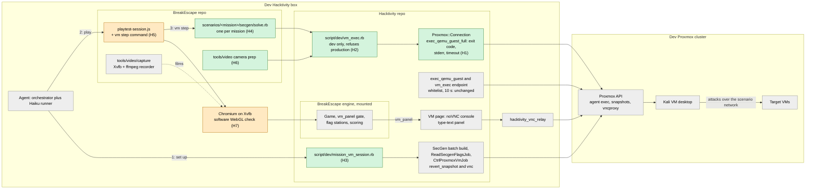
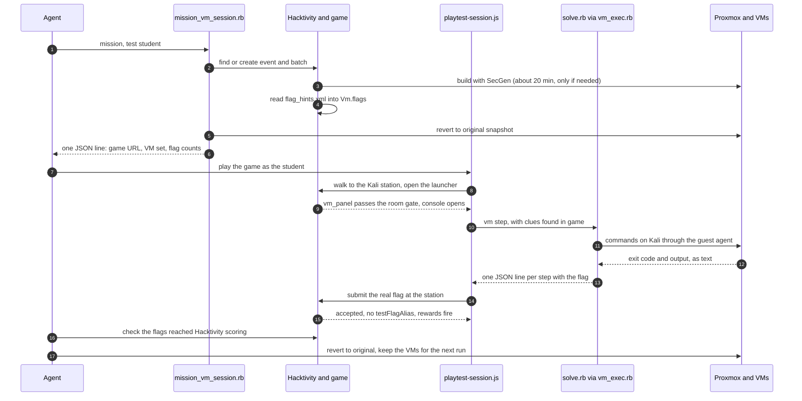

# Playtesting and filming the VM sections

Analysis, 2026-11-02. How automated (and human) playtests can complete the VM
sections of SAFETYNET missions from our Proxmox environment, and how to capture
desktop footage of real hacking for trailers. Nothing here has been built yet;
it records what exists, what is missing, and a recommended plan.

## Summary

- **Completing VM sections is mostly solved already, in three grades.** The
  `test:flag:N` alias (non-production only) clears VM steps without a VM. A real
  SecGen build plus its flag-hint XML lets a standalone game accept the real
  per-build flags. The missing piece is a **per-mission VM solve script** that
  does the hacking on the Kali VM over the QEMU guest agent, which proves the
  VM half is solvable, not just wired.
- **Desktop video is feasible without any network path into the guests.** All
  mission VMs sit on an isolated VLAN once provisioned; SSH from outside is not
  available and should not be the plan. The two routes that work are the
  **Proxmox VNC console** (already used by Hacktivity through noVNC and the VNC
  relay) and **recording inside the guest** with ffmpeg, both driven over the
  guest agent.
- **Recommended:** film through VNC on the same Xvfb + ffmpeg rig that
  `video-takes` already uses, at a forced 1920x1080 guest resolution and
  lossless VNC settings; drive the Kali desktop with keystrokes sent through
  noVNC (or `xdotool` in the guest); decide what to type by solving headless
  first. Fall back to in-guest recording only if VNC artefacts show.

## What exists today

### Game side (BreakEscape)

| Piece | Where | What it does |
|---|---|---|
| VM launcher minigame | `public/break_escape/js/minigames/vm-launcher/vm-launcher-minigame.js` | In Hacktivity mode, embeds or links `vm_panel`; standalone it just shows the VM title and IP. The SPICE download path is disabled. |
| `vm_panel` | `app/controllers/break_escape/games_controller.rb:1323` | Gated on the game being `in_progress` and the launcher's room being unlocked (admins bypass), sets `enable_console` on the VM, redirects to Hacktivity's VM page with `embedded=1`. |
| Flag station | `POST /games/:id/flags` | Server-side validation; flags never reach the client. |
| `test:flag:N` alias | `docs/test-bridge.md` "VM-backed flags in testing" | Outside production, resolves to the station's Nth real flag, then runs every normal check. Responses carry `testFlagAlias: true`. |
| Standalone real flags | `games_controller.rb:135` | `flag_hints_xml` at game creation fills `flags_by_vm`, so a standalone game can take the real flags of a real SecGen build. `vm_ips_json` does the same for IPs. |
| Video tooling | `.claude/skills/video-takes`, `tools/video/capture/` | Xvfb :97 at 1928x1088, PulseAudio sink, ffmpeg x11grab at 30 fps `ultrafast` crf 14, sync and dropped-frame checks. |

The video recipes all carry a "Real Hacking" slot marked `placeholder: true`,
filled with 1.27 s of m01 Hydra footage from the old trailer. Every recipe says
"in-game VM capture is coming"; this document is the plan for it.

### Hacktivity side

| Piece | Where | What it does |
|---|---|---|
| VNC console | `VmsController#vnc`, `#vnc_console`; `CtrlProxmoxVmJob` "vnc" | Stores a 5-minute session in Redis; the `hacktivity_vnc_relay` service calls Proxmox `vncproxy` (websocket) at connect time and bridges it to the browser. |
| noVNC page | `app/views/vms/vnc_console.html.erb` | noVNC 1.4.0 `RFB`, clipboard panel, a "type this text" feature that sends keysyms, modifier keys. |
| VM workspace | `vm_workspace.js`, `_vm_set.html.erb` | Tabs per VM, one console stage, lab sheet beside it. |
| Guest agent exec | `VmsController#vm_exec` | Whitelisted only (`get_clipboard`, `get_flags`); not a general tool. |
| SPICE | `Proxmox::Connection#spice_qemu_vm` | Present but unused by the game. |

### SecGen and the pipeline

- Mission VMs: `SecGen/scenarios/break_escape/safetynet/m01..m10`. m01 is a
  Debian 12 KDE target; m02 onwards add a **Kali Light XFCE** `attack_vm`
  (`kali_light_msf`, Proxmox template `kali-linux-msf-20260719`) beside a
  Debian KDE target. These are desktops, which suits filming.
- After provisioning the build NIC is removed and the VMs reboot onto an
  isolated VLAN. Only the Proxmox API reaches them: the guest agent
  (`PostProvisionTest`, `lib/helpers/proxmox_connection.rb`, copied into every
  project) and the console.
- Tier-3 `secgen_test`s already run exploits **from the attacker VM** over the
  guest agent (`test_msf_exploit`, `http_from_attacker`). That is the same
  mechanism a mission solve script needs.
- SecGenPipeline's lab tester pattern (`tests/labs/.../backups_lab_test.py`)
  runs a whole labsheet on the desktop VM and writes a report. That shape fits
  mission VM solves too.

## Completing the VM sections

Four grades, cheapest first. Each later grade includes what the earlier ones
check.

| Grade | How | Proves | Needs |
|---|---|---|---|
| A. Alias | `test:flag:N` at each station | Game-side flow after the VM | Nothing (already in use) |
| B. Oracle | Build the mission's SecGen scenario on Proxmox; create a standalone game with the project's flag-hint XML; read the flag files off the targets over the guest agent and submit them | Game and VM agree on flag count, order and station ownership for a real build | A pipeline host with SecGen, Proxmox API access and the BreakEscape server |
| C. Headless solve | A per-mission script runs the intended commands **on the Kali VM** over the guest agent (Hydra, ssh, sudo, sqlmap ...), parses the flags from its own output, and submits them in-game | The VM half is solvable as the lab sheet describes, on this build | Grade B, plus one solve script per mission |
| D. Visible solve | Grade C performed on the desktop at human pace while being filmed | Same as C, and gives footage | Grade C, plus the capture rig below |

Notes:

- **Grade B catches the bugs that matter most and is cheap.** `mission-secgen-review`
  checks wiring statically; grade B checks it against a built VM. Reading a
  flag "off the target" should use the files the flag modules place, not the
  hint XML, or it only proves the XML agrees with itself.
- **Grade C should mirror the lab sheet**, not the module internals. If the VM
  steps in `labsheet_vm_steps.md` change, the script changes in the same
  commit. Where to keep them: beside the mission (for example
  `scenarios/<mission>/secgen/solve.rb`), since they describe the mission's
  intended path; the Proxmox client comes from the generated project's copy,
  as `secgen_test`s do. SecGenPipeline keeps the orchestration and run reports
  (its rule: pipeline-only artefacts live there).
- **SSH from the pipeline host is not available and not needed.** The guests
  are on an isolated VLAN by design. The in-mission `ssh` (Kali to target) is
  run *inside* the Kali VM by the solve script, which is the real path.
- **Hacktivity mode** adds the `vm_panel` gate: the playtest has to reach the
  launcher's room before the console unlocks (or run as an admin, which skips
  the gate and so tests less). Use standalone for grades B and C, and
  Hacktivity dev only when the launcher → console hand-off itself is under test
  or being filmed.
- **Long-running steps.** Hydra and similar take minutes. The solve script
  should poll the guest (process gone, output file present) rather than sleep.
- **Human playtesters** need nothing new: a Hacktivity dev event with the
  mission's batch, played as students play it. Ask them to record with OBS if
  their sessions are wanted for footage (with consent noted in the log).

## Filming the desktop

### Routes compared

| Route | Picture | Effort | Verdict |
|---|---|---|---|
| **noVNC in Chromium on Xvfb, x11grab** (reuse `video-takes`) | Good to excellent, if VNC is set to lossless; the canvas is the VM framebuffer 1:1 | Low: the rig exists; only a capture page and a VNC session are new | **Recommended** for hero shots |
| **Hacktivity page capture** (game, launcher, VM workspace) | Good; includes Hacktivity chrome | Low, but needs Hacktivity dev with the relay running | Use for the hand-off shot (walk to the terminal, console opens) |
| **ffmpeg x11grab inside the guest** | Best (no transport at all) | Medium: ffmpeg must be in the guest, CPU load inside a 2-vCPU VM, and getting the file out of an isolated VM (guest agent `file-read` is size-capped, so it means chunked reads or a temporary disk or NIC on our own VM) | Fallback if VNC shows artefacts, or for very fast-scrolling output |
| Native VNC viewer (TigerVNC) on Xvfb against Proxmox `vncproxy` without websocket | Excellent in principle | Medium: Proxmox's ticket auth is awkward for stock viewers; untested here | Trial only if noVNC disappoints |
| SPICE (`spiceproxy` + `remote-viewer`) | Good, adaptive streaming | Medium; nothing else uses it now | Not worth it |
| QEMU `screendump` | Stills only | Low | Useful for stills packs and for checking screen state, not video |
| SSH session recording (`asciinema`) | Terminal only, no desktop | Low | Fine for an explainer, not what the trailer wants |

### Recommended rig

On a host that can reach the Proxmox API (and, for the hand-off shot,
Hacktivity dev):

1. **Build** the mission scenario (`SecGen/scripts/secgen-dev-run`), or use the
   VM set behind a Hacktivity dev game.
2. **Prepare the guest for camera**, over the guest agent, as the desktop user
   (the `get_clipboard` command in `VmsController#vm_exec` shows how to find
   `DISPLAY`, `XAUTHORITY` and the user):
   - `xrandr` to 1920x1080 (Proxmox's default `std` VGA supports it); check it
     stuck after login.
   - A recording profile: dark terminal at 16 to 18 pt (legible in the 9:16
     and 1:1 crops), maximised terminal, no notifications, no screensaver or
     lock, no screen blanking, a clean prompt. Hide anything that reads
     "SecGen" or "vagrant" if the edit should not show it.
   - Snapshot the VM once it is prepared, so takes can be reset in seconds.
3. **Open a capture page**: noVNC `RFB` full screen at exactly 1920x1080, `scaleViewport` off,
   `qualityLevel` 9 and `compressionLevel` 0 (or the encodings restricted to
   lossless ones), no Hacktivity overlay. Hacktivity's `vnc_console` page can
   be reused with a capture mode, or the capture page can open its own
   `vncproxy` session through the Proxmox API with a pipeline-only account.
   Credentials come from the environment or a config file, never the command
   line.
4. **Record** with the existing `record-take.mjs` and `check-take.mjs` at 30 fps,
   no audio (the VM has none; music goes on in the edit). QEMU's VNC server
   refreshes at up to about 33 Hz while the screen changes, which is enough
   for typing and scrolling output at 30 fps.
5. **Drive** at human pace. Two options:
   - Keystrokes through the page (`rfb.sendKey`, as Hacktivity's "type text"
     panel already does). Nothing to install in the guest.
   - `xdotool type --delay` inside the guest over the guest agent. More
     reliable timing; needs `xdotool` in the Kali base or a small utility
     module (a dependency, so it needs your OK).
   Either way, **decide headless, perform visibly**: run the grade C solve
   first to learn the per-build values and timings, reset to the snapshot,
   then type the known commands on camera, waiting on guest-agent checks (the
   process ended, the file exists), not on fixed sleeps or OCR.
6. **Check** each take for dropped frames as `video-takes` does, and pull a
   contact sheet for selects.

The hand-off shot (player walks to the in-game terminal, the console opens) is
recorded the same way on the Hacktivity dev page, then cut to the hero shot.

### Content rules for VM footage

- **This mission's tools only** (already a standing rule in
  `docs/video/GUIDELINES.md`): m01 is Hydra and the SSH shell, not sqlmap.
- **Answers.** Flags are generated per build, so a recording build's flags are
  not the players' flags. Fixed values in the scenario XML are different: m01's
  cracked password is a fixed answer and is pixelated in the current trailer.
  Either keep pixelating fixed answers, or film on a recording-only build whose
  fixed values are changed (which then is not quite the shipped mission).
- **Pace.** Real runs are slow (Hydra takes minutes). Film it whole and jump
  cut in the edit; don't shrink wordlists for the camera unless you agree,
  because then the footage shows a run players won't see.

## Token efficiency: never read the screen to learn a result

Added 2026-11-02 after review. Reading a screenshot after every command costs
roughly 1,000 to 1,600 tokens per image, and the model has to interpret it;
the same answer as text is a line or two. The rules:

1. **Text, not pixels.** Guest agent exec returns stdout and the exit code.
   Every check (did Hydra find a password, is the flag file there, did `sudo`
   work) is a guest-agent command whose output is grepped, not looked at.
2. **Scripts do the steps, models don't.** A mission's solve script is written
   once (one agent session), then runs with no tokens at all. It prints one
   JSON line per step and a summary line, as `run-take.sh` does. The agent
   reads the summary (a few hundred tokens) and only opens a step's log, with
   `tail -n 20`, when that step failed.
3. **The on-camera terminal still logs to text.** Start the filmed terminal
   under `script -qf --timing=/tmp/take.tim /tmp/take.log`, and set an
   invisible `PROMPT_COMMAND` that writes the last exit code to a file. The
   driver knows a command has finished from `pgrep` or that file, and reads
   its result from the log. Nothing on screen gives it away.
4. **Screens only for footage QA, and cheaply.** Dropped frames and "did the
   screen change" are ffmpeg checks (as `video-takes` already does). One small
   contact sheet per take, reviewed once by the orchestrator at selects.
5. **Cheap tiers run things.** A Haiku agent runs scripts and relays summaries;
   Sonnet fixes a broken script; Opus reviews selects and decisions.
6. **Reset by snapshot, not rebuild.** A rebuild is about 20 minutes; a
   snapshot rollback is seconds. Rebuild only when the scenario XML changes,
   and batch scenario edits so one rebuild covers them.

## Where to record what

Three environments, each good at different shots. Split the work, then join
the shots in the edit.

| Environment | Use it for | Weakness |
|---|---|---|
| Cloud dev without VMs (this container) | All game footage with lighting; all non-VM playtesting with `test:flag:N`; the game half of the hand-off shot, up to the launcher opening | No VMs |
| Dev VM on the Proxmox network | Real-flag and scripted solves; VM desktop footage; SecGen edits and rebuilds | No WebGL (but see below) |
| Live prototype on Hacktivity | The one shot that needs game and console in one frame, recorded by a person with OBS on a machine with a GPU; a final human play-through | Manual, one take at a time |

Two points change the picture:

- **VM footage doesn't need WebGL.** noVNC draws on a plain 2D canvas, so the
  dev VM's missing WebGL costs nothing for desktop shots. Only game shots need
  it, and those can come from the cloud dev environment.
- **The dev VM can probably have WebGL anyway.** This container has no GPU
  either, yet records the game with lighting: Chromium falls back to software
  WebGL (SwiftShader; see `docs/agents/LIGHTING_LOG.md` round 4). Recent Chrome
  versions block that fallback unless launched with `--enable-unsafe-swiftshader`
  (or `--use-angle=swiftshader`). It is worth five minutes to try Playwright's
  Chromium with `tools/video/capture/launch.mjs` there and check the console
  for "Lighting disabled". If it works, the frame rate is the remaining risk:
  m01 needed 4 cores for 30 fps at `ultrafast`.

### Other options

- **Record as text, replay on camera.** Capture the real solve once with
  `script --timing` (a few KB), then play it back with `scriptreplay` in a
  Kali-styled terminal on any display, at any speed, as often as the edit
  needs. Real commands and real output, no VM at filming time, and the timing
  can be stretched to fit the beat grid. It is a replay, not a live session,
  so it's your call whether that suits a trailer that sells "real hacking".
- **Render the terminal in Remotion** from the same log: sharpest result,
  any aspect ratio, but the least like a real desktop.
- **Composite the hand-off.** Instead of one live shot of game and console
  together, cut or picture-in-picture the game take (cloud dev) into the
  desktop take (Proxmox dev VM).

## Terminal recording with `script --timing`

`script` records everything the terminal receives as raw bytes, with a timing
file, and `scriptreplay` plays it back at the recorded pace. Programs run under
`script` see a real terminal, so they behave exactly as they do for a player:

- **Colour and animation survive.** msfconsole's banner and coloured prompt,
  nmap's progress lines, Hydra's output and any `\r` progress updates are
  escape sequences in the byte stream, and replay reproduces them.
- **The waits survive.** The pause while msf boots, and nmap running before its
  results appear, are in the timing file. `scriptreplay -m <seconds>` caps any
  pause (a 4-minute Hydra run can become 3 s) and `-d <n>` speeds up the whole
  replay, so the edit can keep the reality and still fit the beat.
- **Typing is captured too.** The terminal echoes keystrokes back, so typed
  commands replay at the pace they were typed. util-linux's `--log-in` /
  `--log-io` can also keep input as a separate stream.

What must match at replay, or it looks wrong:

1. **Terminal size.** Fix columns and rows at recording (`stty cols 120 rows 32`,
   or a fixed window) and replay at the same size. Programs that draw whole
   screens (msf's `less`-style pages, `top`, `vim`) depend on it.
2. **`TERM`, palette and font.** The stream says "colour 1", not "this red":
   the terminal's theme decides the actual colours. Replay in the same
   terminal emulator, with the same profile (font, size, colours), as the Kali
   desktop uses. The simplest way to make sure: **replay inside the Kali VM's
   own terminal, on its own desktop**, filmed through VNC. The font then
   matches by construction, and the walk-up shot and the full-screen terminal
   shot show the same desktop.

So the plan for VM takes is: run the real solve once under `script`, filmed live
(the msf boot and nmap waits are real); if a retake is needed, replay the
recording on the same desktop at a chosen pace instead of rerunning the attack.
asciinema works the same way and renders to video with a chosen font. It is
not needed, and would be a new dependency.

## The shots

1. **Walk up to the Kali station in game** (cloud dev, with lighting): the
   player walks up, the VM launcher opens.
2. **The launcher shows the Kali desktop.** Outside Hacktivity the launcher only
   shows VirtualBox instructions (`buildNoVmMessage` and the standalone branch
   of `vm-launcher-minigame.js`), so this needs either the dev console mode
   below, or a composite of the launcher frame and a desktop take in the edit.
   The Hacktivity live prototype already shows a real console here.
3. **Cut to the full-screen desktop and terminal** (Proxmox dev, through VNC):
   msf boots, nmap runs, results appear, flags found.
4. **Back in game**, the flag goes into the drop-site terminal.

## Building VM playtesting on the Proxmox dev environment

What exists: SecGen builds the mission on Proxmox; each project gets
`test_context.json` (no password) and `lib/proxmox_connection.rb`, which already
has `exec_qemu_guest`, `snapshot_qemu_vm` and `rollback_qemu_snapshot`. The
game already takes real flags and VM IPs at creation (`flag_hints_xml`,
`vm_ips_json`). What to build, in order:

| # | Piece | What it does | Where |
|---|---|---|---|
| 1 | **`vm-up`** | Builds the mission's scenario (`scripts/secgen-dev-run`), or finds the existing project; waits for the guest agents; takes a `clean` snapshot of each VM; writes a small `vm_session.json` (project path, system name to VM id and node, IPs, flag-hint XML path) | BreakEscape `tools/playtest/vm/` |
| 2 | **`vmctl`** | One CLI over the project's Proxmox client: `exec <system> [--user u] [--timeout s] -- <cmd>` returns one JSON line (exit code, stdout tail, path to the full log); `reset` rolls every VM back to `clean`; `ping`; `screendump` for failures only. Password from `SECGEN_PROXMOX_PASS`, never the command line | `tools/playtest/vm/` |
| 3 | **Game with real flags** | `new-game.rb` gains `--vm-session vm_session.json`, passing the project's flag-hint XML and IPs, so flags are real and the alias is not used | `tools/playtest/new-game.rb` |
| 4 | **Oracle check** | Reads each flag from where its module put it on the target (over `vmctl`) and compares it with the hint XML and the game's station list (count, order, station). Cheap; catches wiring bugs before any solve | `tools/playtest/vm/` |
| 5 | **Solve script per mission** | The lab sheet's VM steps as code. Each step names its station and flag index, takes any value the game gave the player (a username from a note, a hint from an NPC) as an argument, runs on Kali through `vmctl`, extracts the flag by regex and prints one JSON line. Runs under `script` in a fixed-size terminal so the same run doubles as footage | `scenarios/<mission>/secgen/solve.rb` |
| 6 | **Harness hook** | `playtest-session.js` gains `{"cmd":"vm","step":"<id>","args":{...}}`: calls the solve step, returns its JSON line (flag value, pass/fail, seconds), and the tester then submits the flag at the station with the usual `mg type` | `.claude/skills/playtest-scenario/` |
| 7 | **Dev console in the launcher** (for shot 2 and for human testers) | In non-production, when the game has a VM session, the launcher embeds a noVNC console for that VM through a small dev-only websocket proxy to Proxmox `vncproxy`, or opens Proxmox's own noVNC console in a window. Never in production | BreakEscape engine, dev only |
| 8 | **Camera prep** | Guest-agent script: 1920x1080, terminal profile, no notifications or blanking, fixed terminal size; then a `camera` snapshot | `tools/video/` |

Items 1 to 6 are what playtesting needs; 7 and 8 are for video and human
testers. Item 5 is the only per-mission work; the rest is written once.

### What already exists, and where

None of the game-playtest pieces above (items 1 to 8) exist in SecGenPipeline
or anywhere else. What does exist is VM-side:

| Existing | Repo | Use here |
|---|---|---|
| `scripts/secgen-dev-run`, `secgen-dev-destroy` | SecGen | Build and remove a mission's VMs outside Hacktivity |
| `scripts/agent-check`, `secgen-test-run`; `PostProvisionTest` (`run_on_system`, `attack_system`, tier-3 attacks from Kali) | SecGen | Guest-agent exec, including from the attacker VM; the pattern a solve script follows |
| `bin/scenario-driver`, `new-scenario-issues`, `scenario-collate` | SecGenPipeline | Build and run every `secgen_test` of a whole scenario. Pointed at `break_escape/safetynet/m0X.xml`, this is a ready-made VM-health preflight |
| `bin/sweep-agent-vms`, `run-record` | SecGenPipeline | Cleanup and run records |

### Recommended route: run it all through Hacktivity on dev Proxmox

Building the VMs through Hacktivity on the dev Proxmox environment, rather than
with `secgen-dev-run` and a standalone game, needs less new code and tests the
path players use. Hacktivity already has most of the list above:

| Need | Hacktivity already has |
|---|---|
| Build the VMs | SecGen batches (`StartSecgenBatchServiceJob`) |
| Real flags in the game | `ReadSecgenFlagsJob` reads the project's `flag_hints.xml` into `Vm.flags`; `Game#build_vm_context` passes them to the mission |
| Reset between runs | `revert_snapshot` to `original` (`CtrlProxmoxVmJob`, used by `RevertRelinquishedVmSetsJob`) |
| The console in game | `vm_panel` → VM page → noVNC through the relay, including the room gate and `enable_console` |
| Typing into the desktop | The console's type-text panel (`rfb.sendKey`) |
| Scoring | Hacktivity's flag records |

So items 1, 3, 7 and most of 8 come free. What is missing is general guest
exec. `VmsController#vm_exec` is whitelisted (`get_clipboard`, `get_flags`,
`get_winflags`). `Proxmox::Connection#exec_qemu_guest` also gives up after 10 s,
raises on any stderr, and drops the exit code, so it cannot run Hydra, nmap or
msf even if the whitelist were opened.

There are two ways to add it:

**A. A runner script on the dev Hacktivity box (recommended).** For example
`bin/rails runner script/dev/vm_exec.rb --vm-set ID --vm "kali" [--user kali]
[--timeout 600] -- <command>`. It uses the `Vm` model and `Proxmox::Connection`
with the app's own credentials, which it reads but never prints, and returns one
JSON line (exit code, stdout and stderr tails, path to the full log). Long jobs
run in the background in the guest (`nohup ... > /tmp/step.log; echo $!`) and
are polled. The agent and the playtest harness run on the same box, so they
just call it. It adds **no web endpoint**, so nothing new can be reached from a
browser, and it refuses to run when `Rails.env.production?`.

**B. A dev mode on the `vm_exec` endpoint.** Possible: a `dev_exec` command,
admin only, allowed only when `Rails.env.development?` **and** an explicit
`HACKTIVITY_DEV_GUEST_EXEC=1` is set, every call logged, plus a test that
production refuses it. It still means shipping an arbitrary-command endpoint
in the production codebase, behind configuration. Worth it only if something
outside the dev box (or the browser itself) has to call it. Nothing in this
plan does.

Either way, a fixed `exec_qemu_guest` variant is needed: exit code, stdout and
stderr returned rather than raised, a caller-set timeout. Add it beside the
existing method, so `vm_exec`'s behaviour doesn't change.

What's left to build on the Hacktivity route:

| # | Piece | Repo |
|---|---|---|
| H1 | `exec_qemu_guest` variant with exit code, stderr and timeout | Hacktivity |
| H2 | `script/dev/vm_exec.rb` (route A), with a background-and-poll mode | Hacktivity |
| H3 | `script/dev/mission_vm_session.rb`: for a mission and a test user, find or create the dev event and batch, wait for the build and the flags, assign a VM set, create the game, revert to `original`, print one JSON line (game URL, VM set id, VM titles, flag counts) | Hacktivity (decided 2026-11-02) |
| H4 | Per-mission solve scripts, calling H2 | BreakEscape `scenarios/<mission>/secgen/` |
| H5 | Harness `vm` step command, calling the solve step | BreakEscape `.claude/skills/playtest-scenario/` |
| H6 | Camera prep (resolution, terminal profile) through H2; a `camera` snapshot | BreakEscape `tools/video/` |
| H7 | Check software WebGL on the dev VM's Chromium (`--enable-unsafe-swiftshader`), so the walk-up shot has lighting | none, a five-minute test |

### Diagram: the changes

Green is new, amber is changed, grey exists and is untouched. Everything runs
on the dev Hacktivity box, which talks to the dev Proxmox cluster directly.
Rendered copy: `docs/images/vm_playtest_changes.png`.

### Diagram: one full run

Rendered copy: `docs/images/vm_playtest_run.png`.

## A full game playtest with VMs

On the Hacktivity route, step 1's `vm-up` and reset are H3 and
`revert_snapshot`, and VM steps call H2. The flow is otherwise the same, with
two extra checks: the tester plays as a **student account**, not an admin, so
the `vm_panel` room gate and `enable_console` are exercised, and the console
must open (which also checks the relay). At the end, the flags must show up in
Hacktivity's scoring as well as in the game.

Alias mode (`test:flag:N`) stays the default for routine runs: it is fast and
needs no VMs. Real-VM mode runs when a mission's VM, its lab sheet or the
wiring changes, and before release.

1. **Preflight** (no model needed): `vm-up` (reuse the project; rebuild only if
   the scenario XML changed), `vmctl reset` to `clean`, guest agents answer,
   the oracle check passes. Any failure stops the run with one line saying
   which check failed.
2. **Game** created with the VM session, so flags are real.
3. **Play** as now through the browser harness. When the tester reaches a VM
   launcher, the report notes "VM reached" (the realistic point to start VM
   work; some steps need clues found in game first).
4. **VM steps** run through the harness hook, passing any in-game clues in as
   arguments. That tests the clue chain both ways: game to VM (a username from
   a note works on the server) and VM to game (the flag found opens the
   archive). The tester reads one JSON line per step, never a screen.
5. **Submit** each flag at its station with its real value; the response must
   not carry `testFlagAlias`, and rewards, tasks and any flag-locked container
   must fire.
6. **On failure** the step's JSON gives the log path; read its last 20 lines,
   take a `screendump` only if the log does not explain it. Classify: VM or
   scenario bug (fix the SecGen scenario or module, rebuild, about 20 min),
   game wiring bug (fix the mission), or a solve script bug.
7. **Report** adds a VM section: per step pass or fail, seconds, real flag
   used, the project id and SecGen commit it ran against.
8. **After:** `vmctl reset`, keep the project for the next run, and destroy only
   the VMs this run built when the work is done.

A blind playtest keeps the solve script hidden from the tester and treats each
VM step as a black box that returns flags. A blind test of the VM part itself
(an agent working the Kali box from the lab sheet, through `vmctl exec` in
text) is possible but costly; worth doing once per mission at most.

## Gaps and proposed work

| # | Work | Repo | Size | Notes |
|---|---|---|---|---|
| 1 | Grade B oracle run: build, game with flag-hint XML, read flags over the guest agent, submit, report | SecGenPipeline (driver), BreakEscape (nothing new) | S | Worth doing for every VM mission before any filming |
| 2 | Per-mission solve scripts (grade C), starting with m01 then m02 (first with a Kali VM) | BreakEscape `scenarios/<m>/secgen/` | M each | Mirror the companion lab sheet; record runs under SecGenPipeline `reports/` |
| 3 | VNC capture page and session helper | BreakEscape `tools/video/capture/` | S to M | Reuses `record-take.mjs`; noVNC 1.4.0 as Hacktivity uses |
| 4 | Guest camera-prep script (resolution, terminal profile, notifications, snapshot) | BreakEscape `tools/video/` | S | Run over the guest agent |
| 5 | Optional: `xdotool` (and `ffmpeg` for the fallback) in the Kali base or a utility module | SecGen | S | New guest dependency: needs your approval |
| 6 | `video-takes` and `video-scout` skills: a "VM take" section; recipes drop the placeholder once real takes exist | BreakEscape `.claude/skills/` | S | After 3 and 4 work once |
| 7 | Optional: a capture mode on Hacktivity's `vnc_console` (no overlay, lossless settings, fixed size) | Hacktivity | S | Only if reusing the relay is easier than a direct session |

## Decisions for you

1. **Where does the rig run?** A pipeline host with Proxmox API access (the
   same one that runs `secgen-dev-run`) is the obvious place. Does it also
   reach Hacktivity dev with the VNC relay, or should hero shots skip
   Hacktivity and open their own VNC session?
2. **A Proxmox account for capture.** Opening console sessions needs the
   `VM.Console` privilege; a pipeline-only user limited to the pool its builds
   use keeps it contained.
3. **Guest tools.** Is adding `xdotool` (and possibly `ffmpeg`) to the Kali base,
   or as a utility module, acceptable? Without it, typing goes through VNC
   keystrokes, which works but is less even.
4. **Fixed answers on screen.** Keep pixelating, or film on a recording build
   with changed fixed values?
5. **Order.** Recommended: grade B for all VM missions, then m01 solve script,
   capture page and one m01 hero take as a trial, then the rest.
