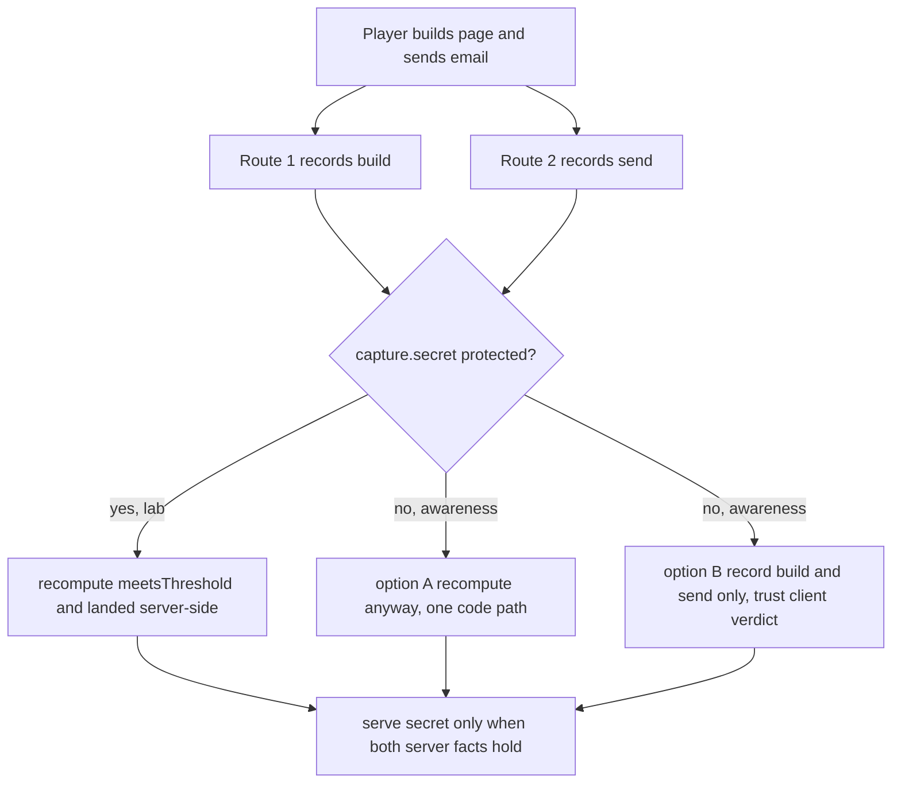

# Phish evidence recorded server-side (plan)

Scope: make the two facts that gate a phished credential's reveal, the landing page being built
and convincing, and a phishing email landing on the target, into facts the server establishes from
its own verification, not controls a tampered client grants itself. Today both reach the server only
as client-written, client-synced state, so a tampered client can forge a built page and a landed
send and be served a protected `capture.secret` (a sign-in password that is also a lock code, a PSK
or a flag) without ever running the minigames. This plan closes that forge. No code here; this is
the plan the implementation works from. Every code claim is pinned to a file and line at the current
tree.

The server owns the capture record already. `CaptureProofs#record_capture!`
(`app/models/break_escape/capture_proofs.rb:138`) stores every stored field of a capture from the
scenario and marks each entry `proven` only when `capture_evidence_holds?`
(`capture_proofs.rb:297`) is true. For a phished credential, that evidence comes through
`phish_page_evidence_holds?` (`capture_proofs.rb:441`), which is the one remaining part that reads
the client: the landing-page record from `globalVariables.se_landing_pages` and the landed send from
`mailState`. This plan replaces that one reader's trust source with two server-owned records written
by two new gated routes, and derives the victim's submission rather than trusting it.

## 1. The weakness as it stands

The phished credential's reveal is gated on two values a tampered client fully controls.

1. The landing-page build is a client minigame. `attach()`
   (`public/break_escape/js/minigames/landing-page-builder/landing-page-builder-minigame.js:1008`)
   writes `se_landing_pages[pageId]` into `globalVariables` through `writeGlobal` (`:1023`, `:1248`),
   a record carrying `built: true`, `meetsThreshold`, `credibility` and the player's `choices`
   (`landing-page-model.js` `buildRecord`, `:597`). `se_landing_pages` is an ordinary client global,
   so it round-trips: `sync_state` merges it through `merge_global_variables!`
   (`app/models/break_escape/game.rb:332`, called at `games_controller.rb:2110`). It is **not** in
   `SERVER_OWNED_GLOBAL_NAMES` (`game.rb:1798`, only `se_captures`), so a client write passes straight
   through.
2. The phish send is a client minigame. `commitSend` (`mail-bridge.js:349`) appends a `folder: 'sent'`
   record with `landed` to `mailState` (`:688-699`), and when the send first lands it writes
   `victim.submitted` back onto `se_landing_pages[pageId]` (`:412-420`). `mailState` reaches the server
   through `merge_mail_state!` (`game.rb:4828`, called at `games_controller.rb:2129`), another
   client-written, client-synced section.
3. The reader trusts both. `phish_page_evidence_holds?` (`capture_proofs.rb:441`) returns true only
   when the stored page record has `built == true`, `meetsThreshold == true` and
   `victim.submitted == true` (`:445-448`), and a `folder: 'sent'`, `landed: true` message to the
   target carrying one of the page's link kits exists (`:454-461`). Every one of those is a value the
   client wrote and synced.

So a tampered client POSTs one `sync_state` with
`globalVariables.se_landing_pages = { payroll_login: { built: true, meetsThreshold: true, victim: { submitted: true } } }`
and `mailState` carrying one `sent`/`landed` message to the phish target with the page's kit id, and
`capture_evidence_holds?` returns true, so `record_capture!` stores the `payroll_login` credential
`proven: true` and `capture_secrets` serves `Sofia2026!`. No page was built, no email was sent. In
`lab_social_engineering` that secret is the code of a `password` lock (`sofia_archive`,
`scenarios/lab_social_engineering/scenario.json.erb:217-218`, `"requires": "Sofia2026!"`), so the
forge hands the player a protected access value. This is the cheat the plan closes.

There is no server route for a page build or a phish send today: both are client minigame outcomes
that reach the server only through the `sync_state` merge. The two routes this plan adds are new.

## 2. What the server can recompute, and what stays client-asserted

The landing-page scorer and the message judge are both **pure, deterministic functions of authored
scenario data and a bounded, closed set of player choices**. That is what makes server verification
possible without the server watching the minigame.

- **The page score is recomputable.** `scorePage(pageDef, choices, target)`
  (`landing-page-model.js:461`) imports nothing, touches no DOM and reads no password; it returns
  `credibility`, `gatesPassed` and `meetsThreshold` from `pageDef` (the page's entry in
  `social.landingPages`), the player's `choices` (`{ brand, purpose, domainId, logo, wording, fields,
  padlock }`, each a menu id from the page's authored brands, domains and wordings) and the target id.
  `meetsThreshold = credibility >= linkThreshold && gatesPassed` (`:525`). The fake-check variant
  `scoreFakeCheck` (`:390`) is the same shape over four factors. Every input is authored or a
  closed-set id the server can validate against the page's own menus, so the server can recompute
  `meetsThreshold` and must never trust the client's.
- **The send outcome is recomputable.** `evaluateMessage(target, message, ctx)` (`phish-rules.js:486`)
  returns `landed = open.opened && failedRequired.length === 0` (`:549`) from the target definition
  (`social.phishTargets[...]`: its `senderAuth` policy, `interests`, `urgency`, required/advisory
  factor modes) and the composed `message` (the bounded `PENDING_MESSAGE_KEYS` the client already
  persists on a sent record, `mail-bridge.js:320`: `fromAccount`, header, slot values, `attachment`,
  `link`/`linkInfo`, `templateId`). The decisive `linkCredible` factor reads
  `message.linkInfo.meetsThreshold` (`judgeLink`, `phish-rules.js:388-392`), which is the page score
  the server now owns, so the message judge leans on the server's own page verdict for its hardest
  gate.
- **What stays client-asserted, and why it is safe.** The player's *choices* (which brand, which
  domain id, which wording, which template, which slot values) are client input, exactly as a lock
  code typed into a keypad is client input. The server does not trust the *verdict* the client draws
  from them; it recomputes the verdict from the authored rules. A choice is refused unless it names a
  value on the page's authored menu or the target's authored template set, so the client can choose
  only between authored options, never assert an arbitrary score. The avatar's position, the minigame
  animation and the UI copy stay client-driven and prove nothing; they are presentation.

| Fact | Source today | Under this plan | Why |
|---|---|---|---|
| page built | client `se_landing_pages[].built` | server route records `built` on a validated build | a build is a server event, gated on an authored page |
| `meetsThreshold` | client `se_landing_pages[].meetsThreshold` | server recomputes `scorePage` from stored `choices` | the central learning gate; the exact value a forge sets |
| `credibility` | client | server recomputes (same call) | derived with `meetsThreshold`, stored for the report |
| send to target with kit | client `mailState` sent record | server route records the send, validating target and kit | a send is a server event, gated on an authored target and kit |
| `landed` | client `mailState[].landed` | server recomputes `evaluateMessage` on the send | the second gate on the reveal |
| `victim.submitted` | client `se_landing_pages[].victim.submitted` | **derived** server-side: `page.meetsThreshold && send.landed` | not an independent fact; `describeVictimOutcome` (`landing-page-model.js:693`) already defines it this way |
| page `choices`, composed message | client | client input, validated against authored menus | free choice between authored options, like a typed code |

## 3. The server model

Two server-owned records in `player_state`, written only by two new gated routes, read by the
evidence check. The client's `se_landing_pages` and `mailState` stay for the minigame UI; the server
stops trusting them for the gate.

### 3.1 Two server-owned stores

Add to `Game::ACCESS_STATE_DEFAULTS` (`game.rb:1773`), the way `footholds` and `plantedItems` live
there:

- `player_state['seLandingPages']` = `{ pageId => entry }`, one entry per built page, each
  `{ 'pageId', 'targetId', 'choices', 'credibility', 'meetsThreshold', 'built' => true, 'at' }`.
  `choices` is the closed seven-key (or fake-check four-key) set, stored so the verdict can be shown
  and, if the scorer ever changes, recomputed. `credibility` and `meetsThreshold` are the server's own
  recomputed values, never the client's.
- `player_state['sePhishSends']` = `{ sendKey => entry }`, one entry per landed send, each
  `{ 'targetId', 'kitId', 'pageId', 'landed' => true, 'at' }`. `sendKey` is `"#{targetId}/#{kitId}"`,
  so the store is bounded by (authored phish targets x link kits) and a resend to the same
  target/kit is first-wins, never a new row.

Both are **server-written only**. They are never read from the request body on `sync_state`
(section 7), so they are never re-sent and never grow per sync (section 8). They are not served to the
client in the sync answer; the client keeps its own `se_landing_pages`/`mailState` for the UI and
reads the capture record (`captures_for_client`, `capture_proofs.rb:267`) for what it is allowed to
see.

### 3.2 Route 1: record a landing-page build

`POST games/:id/se/landing_page`, called by the build minigame at the point it attaches the page
(the `attach()` success path, `landing-page-builder-minigame.js:1008`, after the local `writeGlobal`
so the UI is unchanged). Body: `{ pageId, targetId, choices }`. The gate, a new
`CaptureProofs#record_landing_page_build!` mirroring `record_capture!`:

1. `pageId` names a page in `social.landingPages` (`CaptureModel.landing_pages`,
   `capture_model.rb:323`); else refuse `invalid`.
2. `targetId` is a phish target the page is authored for (the page's `targets` map, or a declared
   phish target, `CaptureModel.phish_target_ids`, `capture_model.rb:107`); else refuse `invalid`.
3. `choices` is validated field by field against the page's authored menus: `brand` is a brand id on
   the page, `domainId` is a domain option under that brand, `wording` is an authored wording id,
   `fields` is a subset of the known field ids, `logo`/`purpose`/`padlock` are the closed option sets.
   A choice naming a value not on the page's menu is refused `invalid` (the same discipline
   `pick_capture_candidate` applies to a capture's fields, `capture_proofs.rb:495`). The fake-check
   variant validates `choices.check` against `pageDef.check` menus.
4. The server recomputes the score with a Ruby port of `scorePage` (section 4): a new
   `BreakEscape::PhishScore.score(page_def, choices, target_cfg)` returning `{ credibility,
   gatesPassed, meetsThreshold }`. The stored `meetsThreshold`/`credibility` are the port's, never the
   body's (the body carries no score at all).
5. Store the entry `built: true` under `seLandingPages[pageId]`, first-wins but **last-score-wins on a
   rebuild**: a repeat build with different choices replaces `choices`/`credibility`/`meetsThreshold`
   (the player may rebuild a weak page into a strong one), keeping `built: true`. Re-stamp dependent
   captures (section 6).

The route refuses nothing an honest build can produce: the honest client's `choices` are exactly the
menu ids the page offers, and the port is the same function the client scored with, so a page the
client calls convincing the server also calls convincing.

### 3.3 Route 2: record a phish send

`POST games/:id/se/phish_send`, called by the send path (`commitSend`, `mail-bridge.js:349`, after the
local `mailState` append) once per send that the client would record as sent. Body: the composed
message the client already bounds to `PENDING_MESSAGE_KEYS` (`mail-bridge.js:320`) plus `{ targetId,
kitId }`. The gate, `CaptureProofs#record_phish_send!`:

1. `targetId` is an authored phish target; else refuse `invalid`.
2. `kitId` is a `kind: 'link'` payload kit whose `landingPageId` is a built page in `seLandingPages`
   (the kit set is `CaptureModel.page_evidence_kits`, `capture_model.rb:349`). A send whose kit names
   an unbuilt page is recorded with `landed: false` (the message cannot land through a page that does
   not exist), matching `judgeLink` returning `missing` for an unbuilt page.
3. The message's composed fields are validated against the target's authored template and account
   set (the `templateId` is one of the target's templates, `fromAccount` is an authored account, slot
   values are authored value ids), the same closed-menu discipline as the build route; a field naming
   an unauthored value is refused `invalid`.
4. The server recomputes `landed` with a Ruby port of `evaluateMessage` (section 5):
   `BreakEscape::PhishJudge.landed?(target_def, message, ctx)`, with `ctx` carrying the server's own
   `seLandingPages[pageId].meetsThreshold` for the `linkCredible` factor (never the client's
   `linkInfo`). The body's `landed` is ignored.
5. Store `sePhishSends["#{targetId}/#{kitId}"] = { targetId, kitId, pageId, landed, at }`, first-wins
   on `landed: true` (a later send cannot un-land an earlier success), last-wins while still
   `landed: false` (a resend that finally lands overwrites the earlier miss). Re-stamp dependent
   captures (section 6).

### 3.4 The reader change

`phish_page_evidence_holds?` (`capture_proofs.rb:441`) stops reading `se_landing_pages` and
`mailState` and reads the two server stores instead:

```
def phish_page_evidence_holds?(page_id, target_id, scenario)
  page = player_state.dig('seLandingPages', page_id)
  return false unless page.is_a?(Hash) && page['built'] == true && page['meetsThreshold'] == true

  info    = CaptureModel.page_evidence_kits(scenario)[page_id]
  kit_ids = info ? Array(info[:kits]) : []
  return false if kit_ids.empty?

  Array(player_state['sePhishSends']).any? do |_key, send|
    send.is_a?(Hash) && send['landed'] == true &&
      send['targetId'].to_s == target_id.to_s && kit_ids.include?(send['kitId'])
  end
end
```

`victim.submitted` is no longer read: it was `page.meetsThreshold && landed`
(`describeVictimOutcome`, `landing-page-model.js:701`), and both conjuncts are now the server's own
`page['meetsThreshold']` and `send['landed']`, so the derived submission is exactly these two server
facts holding together. The `extra_sent` parameter and the signature's `scenario` stay; the method no
longer needs the request's own sent messages, because a send reaches the server through the route, not
the sync (section 7), so the `extra_sent` plumbing for this path retires with the fingerprint
(section 7).

## 4. Porting the page score (`BreakEscape::PhishScore`)

A new `lib/break_escape/phish_score.rb`, a line-for-line Ruby port of `scorePage` /`scoreFakeCheck`
(`landing-page-model.js:461`, `:390`) and the per-factor scorers (`:266-341`), the gates block
(`:513-525`) and the point tables (`DEFAULT_POINTS` `:59`, `CHECK_DEFAULT_POINTS` `:72`). It is pure:
inputs are the page hash from the scenario, the validated `choices` hash and the target's per-target
config (`pageDef.targets[targetId]`, for `linkThreshold`, `minDomainTier`, `brandGate`). It returns
`{ credibility, gates_passed, meets_threshold }`; it emits no strings, reads no secret and makes no
request (the JS model's own safety note, `landing-page-model.js:9-14`). The validator can share it the
way it shares `CaptureModel`.

**Drift is contained by a shared-fixture parity test.** The real risk of a second copy of the scorer
is that the two drift. A `test/models/break_escape/phish_score_parity_test.rb` loads a committed table
of `{ pageDef, choices, target, expected }` fixtures and asserts the Ruby port returns the same
`meetsThreshold`/`credibility` as the recorded JS result for each; a matching node test
(`social-landing-page-model`, already exercising `scorePage`) asserts the JS side still produces those
recorded results, so a change to either scorer that is not mirrored fails a red test. The fixtures
cover each factor's full/partial/zero band, both gates, the brand-gate-off awareness case and the
fake-check variant.

## 5. Porting the send judge (`BreakEscape::PhishJudge`), and the decision it carries

`landed` is the second gate, and `victim.submitted = meetsThreshold && landed`. To decide the
submission from what the server has verified (the mandatory rule, section 11), the server must own
`landed`, which means a Ruby port of `evaluateMessage` (`phish-rules.js:486`): the open check
(`:496-503`), the per-factor loop over `FACTOR_ORDER` (`:512-548`) and the required-factor landing
rule `landed = open.opened && failedRequired.length === 0` (`:549`). It reads the target's authored
`senderAuth`, `interests`, `urgency` and factor modes, and the composed message's bounded fields; its
`linkCredible` factor reads the server's own page `meetsThreshold`, not the client's `linkInfo`. Like
the scorer, it is pure and parity-tested against a shared fixture table and the existing
`social-phish-rules` node tests.

This port is the larger, more drift-prone half (`phish-rules.js` is 688 lines, though the landing rule
leans on a handful of judge helpers: `judgeSender` `:246`, `deriveSenderAuth` `:278`, `judgeAddressed`
`:334`, `judgePretext` `:340`, `judgeAttachment` `:378`, `judgeLink` `:388`, and `modeFor` `:199` for
which factors are required). Whether to port it in full now, or to gate the protected secret on the
server-owned `meetsThreshold` plus a server-verified send to the authored target carrying the authored
kit (treating message credibility as a bounded client assertion), is the plan's main open question
(section 15, Q2), because it trades completeness against a sizeable, drift-prone port for a single
shipped scenario. The chunks (section 14) build the two ports as separable pieces so the decision can
land on Q2 without reshaping the rest.

## 6. Stamping the capture once the evidence holds

Today `stamp_proven_captures!` (`capture_proofs.rb:373`) runs on `sync_state` and stamps an unproven
entry `proven: true` once `capture_evidence_holds?` is true, because the evidence used to arrive on a
sync. Under this plan the evidence arrives at the two routes, so each route, after writing its record
and before `save!`, re-runs `stamp_proven_captures!(scenario:)` for the affected target, and the route
answer carries the freshly revealable capture (the same `captures`/`capturesRefused` answer shape the
sync uses, `games_controller.rb:924-931`). A `sync_state` can no longer advance this evidence, so the
phish branch of the sync's stamp walk and `phish_evidence_fingerprint` (`capture_proofs.rb:331`) and
the `phishGated`/`phish_gated_unproven_captures?` machinery (`capture_proofs.rb:412`) retire for this
path: an unproven phish-gated entry is now stamped at the send route, not chased on every later sync.
This **shrinks** what the sync must trust and what it must walk, the design's stated side benefit.

Part 3 proofs (`target_capture_proofs`, `capture_proofs.rb:315`) are unchanged: they already read
server-owned proof lists (`plantedItems`, `signedInPcs`, `gainedFootholds`), so a credential gated on
both a phish and a part-3 proof still needs both, and the part-3 half still stamps on the sync that
records that proof.

## 7. Making the stores server-owned, and retiring the client-evidence trust

The two stores must be unwritable by the client, like `footholds` and `seCaptures`.

- `seLandingPages` and `sePhishSends` are plain `player_state` keys the client never sends. The
  `sync_state` merge touches only the sections it names (`currentRoom`, `globalVariables`, `mailState`,
  inventory, and so on, `games_controller.rb:2098-2131`); it never reads `seLandingPages` or
  `sePhishSends` from the body, so a client cannot write them. No new reject list is needed, because
  they are not globals and not merged sections.
- `se_landing_pages` stays a client global for the minigame UI, but the server **stops reading it for
  the gate**. It may optionally be added to `SERVER_OWNED_GLOBAL_NAMES` (`game.rb:1798`) so the client
  write is dropped and the record is served from the server store, but that is a larger UI change
  (the builder reads `globals[PAGES_KEY]` to restore its own state, `landing-page-builder-minigame.js:182`);
  the minimal, safe change is to leave `se_landing_pages` as a client-owned UI global the gate no
  longer trusts, and let the gate read only `seLandingPages`. Recorded as Q3.
- `mailState` stays exactly as it is (the mail UI needs it); the gate stops reading it for `landed`.

A tampered client can still write `se_landing_pages`/`mailState` to any shape, and the minigame UI
will show whatever it writes, but the gate reads neither, so the forge no longer serves the secret.

## 8. Payload size (the sync size rule)

Player state synced between client and server must not grow so data is constantly re-sent.

- `seLandingPages`: bounded by the scenario's landing pages (one in the lab, a handful at most), one
  entry each, written only by Route 1. Never in the client-to-server payload.
- `sePhishSends`: bounded by (phish targets x link kits), keyed so a resend is first-wins, written only
  by Route 2. Never in the client-to-server payload.
- The two routes carry a one-shot body each (the page `choices`, or one composed message), the same
  shape and bound the client already persists on its own records; they are not re-sent state, they are
  single actions, like `POST network/plant` (`games_controller.rb:1495`).
- `sync_state` sends **less**, not more: `se_landing_pages` and `mailState` no longer have to be
  trusted, and the `phish_evidence_fingerprint` walk over the mailbox on every sync retires (section
  6). The client still syncs those sections for the UI, but the server no longer reads them for the
  gate.

Net new synced-state growth: zero per sync. Two bounded server-owned stores, each fixed by scenario
authorship, neither part of the client-to-server payload.

## 9. Stored games, format and upgrade

A save made before this change has its phish evidence in the client globals, not the server stores. On
the first request that holds `scenario_data` (section 9.1), migrate it once.

**Before (old save, client-written evidence):**

```json
{
  "globalVariables": {
    "se_landing_pages": {
      "payroll_login": {
        "pageId": "payroll_login", "targetId": "lord", "built": true,
        "credibility": 80, "meetsThreshold": true,
        "choices": { "brand": "ledgerwell", "purpose": "payslip", "domainId": "d_typo",
                     "logo": "crisp", "wording": "match", "fields": ["email","password"], "padlock": true },
        "victim": { "visited": true, "submitted": true }
      }
    }
  },
  "mailState": { "mailboxes": { "lord": { "messages": [
    { "folder": "sent", "landed": true, "targetId": "lord",
      "link": { "kitId": "kit_payroll_page" }, "pendingMessage": { "...": "..." } }
  ] } } },
  "seCaptures": { "lord": { "targetId": "lord", "kind": "credential",
                            "address": "s.lord@ledgerwell.example", "proven": true } }
}
```

**After (migrated to server stores, verdicts re-derived server-side):**

```json
{
  "seLandingPages": {
    "payroll_login": { "pageId": "payroll_login", "targetId": "lord",
      "choices": { "brand": "ledgerwell", "purpose": "payslip", "domainId": "d_typo",
                   "logo": "crisp", "wording": "match", "fields": ["email","password"], "padlock": true },
      "credibility": 80, "meetsThreshold": true, "built": true, "at": 1731600000000 }
  },
  "sePhishSends": {
    "lord/kit_payroll_page": { "targetId": "lord", "kitId": "kit_payroll_page",
      "pageId": "payroll_login", "landed": true, "at": 1731600000000 }
  },
  "seCaptures": { "lord": { "targetId": "lord", "kind": "credential",
                            "address": "s.lord@ledgerwell.example", "proven": true } }
}
```

The migration, `migrate_legacy_phish_evidence!(scenario:)`, mirroring `migrate_legacy_captures!`
(`capture_proofs.rb:229`):

- **The build verdict is re-derived, not trusted.** The old record carries `choices`; the migration
  validates them against the page menus and runs `PhishScore.score` on them, storing the **server's**
  `meetsThreshold`, not the old record's. An old save that forged `meetsThreshold: true` with junk
  choices migrates to a server verdict computed from those choices, so a forged old save is not
  laundered into a server fact. A page whose old `choices` are absent or off-menu migrates as not
  built (the player rebuilds; honest play reaches it again).
- **The send is the one legacy fact that cannot be recomputed in full.** The old `mailState` kept only
  `landed`, not always the full composed message, so the migration cannot always re-run `PhishJudge`.
  Rule (recommended, Q4): migrate a landed send to `sePhishSends` only when the re-derived build
  `meetsThreshold` holds and the old sent record carries a `pendingMessage` the judge can re-run;
  where the message is present, re-run `PhishJudge` and store its `landed`; where it is absent, store
  the send with `landed` taken from the legacy record **but gated on the server-owned build threshold**
  (an import of one historical fact, bounded, one-time), so an old save that already honestly phished
  is not soft-locked into redoing it, while a forged old `mailState` is still blocked by the
  re-derived build threshold.
- **An already-proven capture is left alone.** If `seCaptures[target].proven == true` already (the
  player was served the secret in the old save), the migration leaves it; part-2 evidence only ever
  withholds, never retracts (the proof lists are monotonic, `capture_proofs.rb:368-372`), so a player
  who finished the phish keeps the result.
- **No format bump, no `db:migrate`.** The two stores default to `{}` via `ACCESS_STATE_DEFAULTS`
  (`game.rb:5844` seeds missing keys), and the migration is a data move inside `player_state`. The old
  `se_landing_pages` global is left in place for the UI (or deleted if Q3 makes it server-owned); the
  old `mailState` is untouched (the mail UI still needs it).

### 9.1 Migration trigger

The migration reads the scenario, so pin it to a request that holds the full row: the game `show`
action (`games_controller.rb:193`) and the per-room `GET room` both load `scenario_data`, so run it
there once, guarded by a `phishEvidenceMigrated` flag so it runs a single time, before the first phish
route or sync. Do **not** wire it to `sync_state`, which loads the narrow `SYNC_STATE_COLUMNS`
(`games_controller.rb:2027`, no `scenario_data`) and is often the first request after deploy, the same
discipline the capture migration follows (`capture_proofs.rb:229` is called from the bootstrap step
that holds the scenario).

## 10. Network delays, offline play, reload

A legitimate player must never be refused, and a route that lands before or after a sync must still
credit. The two routes are self-contained server events, so the guarantees are simpler than the sync
path's.

- **The build route and the send route each carry their own fact.** Route 1 writes `seLandingPages`
  and Route 2 writes `sePhishSends` directly; neither depends on a `sync_state` landing first or in any
  order. The capture is stamped inside the route that completes the evidence (section 6), so the secret
  is revealable the instant the second route's `save!` commits, with no wait for a sync.
- **The build route must land before the send route can land a credible message**, because
  `linkCredible` reads the server's page `meetsThreshold`. On every honest path the client attaches the
  page (Route 1) before it can attach that page's link to a message and send (Route 2): the mail
  composer only offers a built page's kit (`mail-composer.js:685`, `rec.built === true`). If a race
  still lets a send route arrive before its build route, Route 2 records the send `landed: false` (the
  page is not yet in `seLandingPages`), and the client **retries** the send-record once after the next
  build confirmation. This reuses the retryable-refusal pattern proven on the gated-door work: Route 2
  answers `{ success: true, landed: false, reason: 'page_not_built_yet', retryable: true }`, and the
  client's send helper, on that reason-and-flag, awaits one `window.stateSync.sync()` (wrapped so a
  rejecting sync still proceeds) and re-posts the send once; on the re-post the build is recorded and
  the send lands. The retry fires only on that body, so every other outcome is unchanged.
- **Offline, then reconnect.** A route POST cannot be sent while offline. A build or send made offline
  is held in a **bounded in-memory re-send queue** on the SE minigame controller (not in
  `player_state`, so the sync size rule is untouched), keyed by `pageId` (builds) or `targetId/kitId`
  (sends) so it holds at most one entry per page or per target/kit and cannot grow per attempt; it is
  drained on the browser `online` event (the proven `conclude-mission.js:156` precedent) and on the
  next successful sync, each drain re-posting through the normal route once. The server records are
  idempotent (first-wins on success), so a drained duplicate is a no-op and never double-credits. A
  true forge (a build route with off-menu choices, a send route to an unauthored target) is refused on
  every drain and never credited; the queue cannot spin because each drain is one route call triggered
  only externally.
- **Reload.** `seLandingPages` and `sePhishSends` persist in `player_state`, so an earned phish
  survives a reload; the minigame rebuilds its UI from the client `se_landing_pages`/`mailState`
  globals as today. A build or send not yet posted when the tab reloads is re-driven by the minigame
  the next time the player attaches or sends, and the server record is idempotent, so a replay credits
  once.
- **Browser proof with a throttled network** (section 13): drive the lab's phish with Playwright
  `route` delaying and then aborting the build and send POSTs, and with `context.setOffline(true)`
  across a build-then-send, and confirm the honest player is credited in every case (on reconnect for
  the offline case) while the tampered client is refused.

## 11. Cheat policy: what is server-enforced and what stays best effort

Under the cheat policy the server hard-enforces anything that lets a student past a secret; a client
shortcut that only saves time is acceptable; hardening must never block a student playing as intended.

- **Server-enforced, because a protected secret is at stake (`lab_social_engineering`).** The page
  being convincing (`meetsThreshold`) and a credible email landing (`landed`) are recomputed from the
  authored rules and the player's validated choices; the submission is derived from the two. The secret
  (`Sofia2026!`, a password-lock code) is served only when both server facts hold. Forging
  `se_landing_pages`/`mailState` no longer serves it. **This is mandatory, not a preference, for a
  protected secret**, and it is the case this plan is built around.
- **Best effort is acceptable only where the served secret is not a hard-access value.** The design's
  rule is that the client-control-flow fallback (recording the authored build and landed send but
  trusting the client's `meetsThreshold`/`victim.submitted`) is allowed only when the secret is not
  protected. Across the corpus that is every awareness scenario (section 12): each is `disableAttacks`
  and its landing page carries no `capture.secret`, so there is no protected value behind the phish.
  For those, even recording only the authored build and send closes nothing a protected secret depends
  on, because none does.
- **Honest play still works.** The SE lab means the phished password to then sign in; the server serves
  the secret the moment it has recorded an authored build with a server-convincing page and an authored
  landed send, so the intended solve is unblocked. The hardening closes the forge without blocking the
  student.

## 12. Affected scenarios and honest-play risk

`grep -rl 'landingPages' scenarios/*/scenario.json.erb` plus a scan for `capture.secret` and
`revealSecret` gives the picture. The protected-secret case is one scenario.

| Scenario | Kind | Landing `capture.secret`? | Secret protected? | Treatment | Honest-play risk |
|---|---|---|---|---|---|
| `lab_social_engineering` | SE lab (attacks on) | yes: `Sofia2026!` (`scenario.json.erb:1297`), `revealSecret: true` (`:382`) | **yes**, it is the `requires` of the `sofia_archive` password lock (`:217-218`) | full server recompute (Routes 1 and 2, `PhishScore` + `PhishJudge`) | none: the port is the same function the client scores with; an honest build+send is credited and the secret served. Covered by tests 2, 3, 7 |
| `test_social_slice` | SE test fixture | no (`:675`, address and note only, no secret) | no | routes record build/send; `meetsThreshold`/`landed` recomputed, but no secret gated | none: the fixture asserts the routes and recompute without a protected payoff; good home for the forge-refused tests |
| `ca02_cv_lures`, `ca05_signin_pages`, `ca10_downloads_and_fake_checks`, `ca13_ai_assistant`, `ca14_social_media`, and other `ca*` with phish | Awareness (`disableAttacks: true`) | no (none carries a landing `capture.secret`) | no | routes record the build and send; the recompute runs but gates no protected value | none: the credential reveal is a learning payoff, not protected access, so the client fallback would also be acceptable; recomputing universally just gives one code path |
| `test_ink_email`, `test_social_*` fixtures | test | no | no | as the awareness case | none |

The headline: `lab_social_engineering` is the only shipped scenario whose phished secret is a
hard-access value, so it is the one that the mandatory rule binds. Everything else is covered for free
by the same routes, with no protected value at risk. A validator rule (section 13) warns an author who
ever puts a protected value behind an awareness phish, so a future scenario cannot quietly reopen the
forge.

## 13. Validator and schema

- **Schema** (`scripts/scenario-schema.json`): no new authored field; the routes record derived facts.
  The landing page, phish target and payload-kit shapes are unchanged.
- **Validator** (`scripts/validate_scenario.rb`): for every landing page that carries a
  `capture.secret`, resolve whether that secret is a hard-access value anywhere in the scenario
  (`CaptureModel.password_opens_lock?` and the lock-code set the access-model pass already builds), and
  **error** if it is but the page is not wired through a `payloadKit` link kit (so the server can gate
  it on a build and a send). This is the author-facing teeth for section 11: a protected phished secret
  must be reachable only through the server-recomputed evidence. Where the secret is not protected
  (every awareness page), no rule fires.
- Share `PhishScore` with the validator so an authored page can be checked for being solvable (some
  choice set meets its `linkThreshold`), reusing the pattern where `CaptureModel` and the validator
  share one source.
- Run `LANG=C.UTF-8 /usr/bin/ruby3.2 scripts/validate_scenario.rb <file> --no-graph` on
  `lab_social_engineering`, `test_social_slice` and the touched `ca*`/`test_social_*` fixtures;
  restore any unrelated `dungeon_graph.*` rewrite.

## 14. Tests and live proofs

Rails (`test/models/break_escape/`, `test/controllers/break_escape/`):

1. **Build route records a server verdict.** `POST se/landing_page` with the lab's convincing
   `choices`: `seLandingPages[payroll_login]` stored `built: true`, `meetsThreshold: true`, the
   server's `credibility`. A weak choice set: stored `built: true`, `meetsThreshold: false`.
2. **Honest build then send serves the secret.** Build (convincing), then `POST se/phish_send` to
   `lord` with `kit_payroll_page`: `sePhishSends["lord/kit_payroll_page"].landed == true`, the `lord`
   capture is stamped `proven: true`, and `GET capture_secrets` serves `Sofia2026!`.
3. **Forged client state no longer serves it.** With no build and no send route called, `sync_state`
   with `globalVariables.se_landing_pages = { payroll_login: { built: true, meetsThreshold: true,
   victim: { submitted: true } } }` and a forged `mailState` landed send: the `lord` capture stays
   unproven and `capture_secrets` withholds the secret. This is the forge the plan closes; it fails if
   the reader still reads the client globals.
4. **Off-menu build choices refused.** `POST se/landing_page` with a `domainId` not on the page's menu:
   refused `invalid`, nothing stored.
5. **Forged send verdict ignored.** `POST se/phish_send` whose body asserts `landed: true` but whose
   message fails a required factor (recomputed): stored `landed: false`, the capture stays unproven.
   Fails if the route trusts the body's `landed`.
6. **Send before build is retryable, then lands.** `POST se/phish_send` before the build route:
   recorded `landed: false`, answer `retryable`; after the build route, a re-post lands and stamps the
   capture.
7. **Convincing page, weak message, protected secret withheld.** Build convincing, but send a message
   that fails a required factor: `landed: false`, secret withheld, proving the second gate bites (this
   is the test that makes the `PhishJudge` port load-bearing; under Q2's lighter option it becomes the
   explicit boundary of what is checked).
8. **Resend idempotency.** Two send routes to the same target/kit after a landed first: one stored
   entry, the capture credited once.
9. **Migration, honest old save.** Seed an old save with a convincing `se_landing_pages` record (good
   `choices`) and a landed `mailState` send, no server stores: the `show` migration derives
   `meetsThreshold` from the choices, imports the send gated on it, and the secret is servable. A second
   seed with forged `meetsThreshold: true` over junk choices migrates to a server `meetsThreshold:
   false`, secret withheld.
10. **Hostile input.** Oversized or control-character `pageId`/`targetId`/`kitId` and over-long choice
    ids on both routes: refused, nothing stored, no exception (the `valid_capture_target_id?` length-cap
    discipline, `capture_proofs.rb:489`).

Node (`bin/test-js`):

- `PhishScore`/`PhishJudge` parity fixtures (section 4, 5): the recorded JS results that the Ruby ports
  must match, asserted on the JS side by the existing `social-landing-page-model` and `social-phish-rules`
  tests.
- The build and send client paths post to the new routes on attach and send, and keep writing their
  local `se_landing_pages`/`mailState` for the UI (the minigame behaviour is unchanged for the player).
- The send retry fires only on `page_not_built_yet` + `retryable`, awaits one sync (wrapped so a
  rejecting sync still proceeds) and re-posts once; and the bounded offline re-send queue feeds from the
  offline/transient failure, drains on `online` and on a sync, keyed so it cannot grow, and never
  double-credits.

**Live browser proof** (keyless server on the assigned port 3660 or 3661 only, headless,
`setFPS(20)`, fixed steps on). Drive `lab_social_engineering` to the phish:

- Tampered run: `sync_state` the forged `se_landing_pages` and `mailState` with no build or send route
  called; confirm `capture_secrets` withholds `Sofia2026!` and the lab's capture view shows the
  credential unproven. The proof the fix bites.
- Honest run: build the page in the minigame (attach), send the email; confirm the build and send
  routes recorded the server verdicts, the capture is served, and the `sofia_archive` lock opens with
  the served secret.
- Throttled run (section 10): with Playwright `route` delaying then aborting the build and send POSTs,
  and `context.setOffline(true)` across the build-then-send then `setOffline(false)`, confirm the
  honest player is credited (on reconnect for the offline case) and never refused. Record game ids in
  the build log.

## 15. Open questions (2026-11-14)

### Q1. Universal recompute, or only when the served secret is protected?



The routes record every scenario's build and send. The question is whether the server **recompute** of
`meetsThreshold`/`landed` runs for every scenario (one code path, Option A) or only when the served
secret is protected (Option B, a scenario-conditional branch, the client verdict trusted elsewhere).

Recommendation: **Option A, recompute universally.** It is one code path with no protected-vs-not
branch at runtime, it gives every scenario a server-owned verdict, and the recompute is cheap once the
ports exist. The awareness scenarios cost nothing extra and gain a server-truthful report.

### Q2. Port the send judge (`PhishJudge`) in full, or gate the secret on build-threshold plus a
server-verified send?

This is the real cost decision. `victim.submitted = meetsThreshold && landed`. Owning `landed` means
porting `evaluateMessage` (section 5), the larger, more drift-prone of the two ports.

- **Option A (recommended): port `PhishJudge` in full.** The server decides `landed` from the authored
  rules, so the submission is decided from what it has verified, which is what the mandatory rule says.
  Its hardest factor (`linkCredible`) already reads the server's own page threshold, and a shared
  parity fixture contains the drift.
- **Option B: gate on server `meetsThreshold` plus a server-verified send to the authored target
  carrying the authored kit, treating message credibility as a bounded client assertion.** Smaller: no
  `evaluateMessage` port. The residual is that a tampered client could land a sloppy message once it has
  a server-convincing page and sends to the right target with the right kit. Under the cheat policy this
  is a shortcut past part of the challenge (message craft), not access honest play could never reach
  (honest play reaches the secret by building a good page and sending to the right target), so it is
  arguably acceptable; but it does not literally "decide victim.submitted server-side", so it is weaker
  than the mandatory rule reads.

Before/after of the one gate value the choice turns on:

```json
// Option A: landed is the server's recompute of the whole message
{ "sePhishSends": { "lord/kit_payroll_page": { "landed": "PhishJudge.landed?(target, message, ctx)" } } }
// Option B: landed stands for "an authored send to the authored target carrying the authored kit, page meets threshold"
{ "sePhishSends": { "lord/kit_payroll_page": { "landed": "target authored AND kit authored AND seLandingPages[page].meetsThreshold" } } }
```

Recommendation: **Option A**, because the one scenario this binds (`lab_social_engineering`) phishes a
protected secret and the mandatory rule reads strictly; the port is pure and parity-tested. If the port
proves disproportionate, Option B with the validator rule (section 13) keeping protected secrets behind
the two routes is the fallback, recorded here so the decision is explicit rather than drifted into.

### Q3. Leave `se_landing_pages` a client UI global the gate ignores, or make it server-owned?

The gate reads only the new `seLandingPages` store either way. The question is whether `se_landing_pages`
also becomes `SERVER_OWNED` (dropped from client writes, served from the store), which is tidier but a
larger UI change (the builder restores its own state from the global, `landing-page-builder-minigame.js:182`).

Recommendation: **leave it a client UI global the gate no longer trusts.** It is the minimal, safe
change; a tampered client can still write it, but the gate reads neither it nor `mailState`, so nothing
is served on its say-so. Making it server-owned is a separate UI tidy-up that can follow.

### Q4. Migrating an old save's landed send where the composed message was not kept.

The old `mailState` always kept `landed` but not always the full `pendingMessage`, so `PhishJudge`
cannot always re-run at migration.

```json
// old sent record, message absent
{ "folder": "sent", "landed": true, "targetId": "lord", "link": { "kitId": "kit_payroll_page" } }
```

Recommendation: **import the legacy `landed` once, gated on the re-derived server build threshold**
(section 9). An old save that honestly phished is not soft-locked into redoing it; a forged old
`mailState` is still blocked because the build threshold is re-derived from the stored `choices`, not
trusted. Where the message is present, re-run `PhishJudge` and store its result instead. The alternative,
requiring every old save to resend, is safe but soft-locks a mid-lab save, which the cheat policy's "never
block a student playing as intended" argues against.
