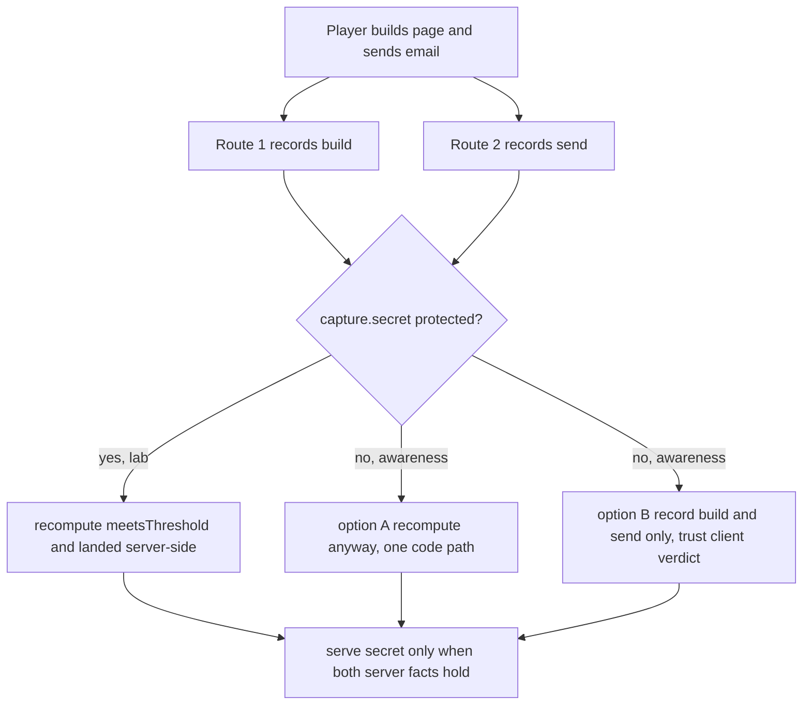
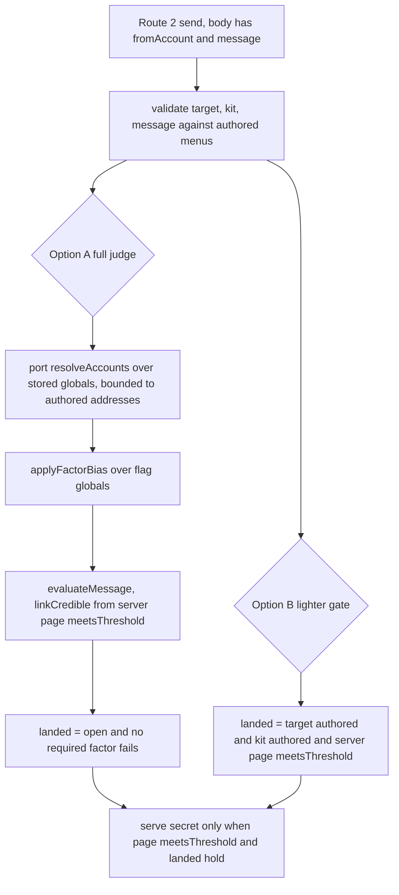

# Phish evidence recorded server-side (plan)

Scope: make the two facts that gate a phished credential's reveal, the landing page being built
and convincing, and a phishing email landing on the target, into facts the server establishes from
its own verification, not controls a tampered client grants itself. Today both reach the server only
as client-written, client-synced state, so a tampered client can forge a built page and a landed
send and be served a protected `capture.secret` (a sign-in password that is also a lock code, a PSK
or a flag) without ever running the minigames. This plan closes that forge. No code here; this is
the plan the implementation works from. Every code claim is pinned to a file and line at the merged
tree.

The server owns the capture record already. `CaptureProofs#record_capture!`
(`app/models/break_escape/capture_proofs.rb:138`) stores every stored field of a capture from the
scenario and marks each entry `proven` only when `capture_evidence_holds?`
(`capture_proofs.rb:297`) is true. For a phished credential, that evidence comes through
`phish_page_evidence_holds?` (`capture_proofs.rb:441`), which is the one remaining part that reads
the client: the landing-page record from `globalVariables.se_landing_pages` and the landed send from
`mailState`. This plan replaces that one reader's trust source with two server-owned records written
by two new gated routes, and derives the victim's submission rather than trusting it.

## 1. The weakness as it stands

The phished credential's reveal is gated on two values a tampered client fully controls.

1. The landing-page build is a client minigame. `attach()`
   (`public/break_escape/js/minigames/landing-page-builder/landing-page-builder-minigame.js:1008`)
   writes `se_landing_pages[pageId]` into `globalVariables` through `writeGlobal` (`:1023`, `:1248`),
   a record carrying `built: true`, `meetsThreshold`, `credibility` and the player's `choices`
   (`landing-page-model.js` `buildRecord`, `:597`). `se_landing_pages` is an ordinary client global,
   so it round-trips: `sync_state` merges it through `merge_global_variables!`
   (`app/models/break_escape/game.rb:332`, called at `games_controller.rb:2129`). It is **not** in
   `SERVER_OWNED_GLOBAL_NAMES` (`game.rb:1798`, only `se_captures`), so a client write passes straight
   through.
2. The phish send is a client minigame. `performSend` (`mail-bridge.js:343`) appends a `folder: 'sent'`
   record carrying `landed` to `mailState` (`commitRecord`, `:400`, `:688`), and when the send first
   lands it writes `victim.submitted` back onto `se_landing_pages[pageId]` (`:407-420`). `mailState`
   reaches the server through `merge_mail_state!` (`game.rb:4910`, called at `games_controller.rb:2148`),
   another client-written, client-synced section.
3. The reader trusts both. `phish_page_evidence_holds?` (`capture_proofs.rb:441`) returns true only
   when the stored page record has `built == true`, `meetsThreshold == true` and
   `victim.submitted == true` (`:445-448`), and a `folder: 'sent'`, `landed: true` message to the
   target carrying one of the page's link kits exists (`:454-461`). Every one of those is a value the
   client wrote and synced.

So a tampered client POSTs one `sync_state` with
`globalVariables.se_landing_pages = { payroll_login: { built: true, meetsThreshold: true, victim: { submitted: true } } }`
and `mailState` carrying one `sent`/`landed` message to the phish target with the page's kit id, and
`capture_evidence_holds?` returns true, so `record_capture!` stores the `payroll_login` credential
`proven: true` and `capture_secrets` serves `Sofia2026!`. No page was built, no email was sent. In
`lab_social_engineering` that secret is the code of a `password` lock (`sofia_archive`,
`scenarios/lab_social_engineering/scenario.json.erb:213-218`, `"requires": "Sofia2026!"`), so the
forge hands the player a protected access value. This is the cheat the plan closes.

There is no server route for a page build or a phish send today: both are client minigame outcomes
that reach the server only through the `sync_state` merge. The two routes this plan adds are new.

## 2. What the server can recompute, and what stays client-asserted

The landing-page scorer is a pure, deterministic function of authored scenario data and a bounded,
closed set of player choices. The send judge is deterministic too, but it is **not** a function of the
target definition and the message alone: it reads a context that includes the player's resolved
sending accounts, and that resolution reads gameplay globals. So the two halves differ in what the
server must hold to verify them, and the plan treats them differently.

- **The page score is recomputable from authored data and the choices.** `scorePage(pageDef, choices, target)`
  (`landing-page-model.js:461`) imports nothing, touches no DOM and reads no password; it returns
  `credibility`, `gatesPassed` and `meetsThreshold` from `pageDef` (the page's entry in
  `social.landingPages`), the player's `choices` (`{ brand, purpose, domainId, logo, wording, fields,
  padlock }`, each a menu id from the page's authored brands, domains and wordings) and the target id.
  `meetsThreshold = credibility >= linkThreshold && gatesPassed` (`:545`). The fake-check variant
  `scoreFakeCheck` (`:390`) is the same shape over four factors. Every input is authored or a
  closed-set id the server can validate against the page's own menus, so the server can recompute
  `meetsThreshold` and must never trust the client's.
- **The send outcome is recomputable, but needs the resolved sending account.** `evaluateMessage(target, message, ctx)`
  (`phish-rules.js:486`) returns `landed = open.opened && failedRequired.length === 0` (`:558`). Its
  decisive sender factor is `senderTrust = judgeSender(target, header)` where
  `header = resolveHeader(message, account)` and `account = findAccount(ctx, message.fromAccount)`
  (`:489-491`, `:156`, `:223`, `:246`). `findAccount` returns a stub with a null identity when the
  account is not in `ctx.accounts` (`:157-159`), so with no accounts the From is forced to a null
  identity, `judgeSender` fails, and for `lord` (`requiredFactors` include `senderTrust`,
  `scenario.json.erb:967`) `landed` is false and the honest solve is refused. So to decide `landed`
  the server must assemble the same `ctx` the client passes at the send point
  (`performSend`, `mail-bridge.js:381-384`): `accounts` (the player's resolved accounts),
  `people` (`social.people`), `templates` (`social.templates`), `payloadKit` (`config.payloadKit`),
  and it must apply `applyFactorBias(target, globals)` (`mail-bridge.js:135`) first. The `linkCredible`
  factor reads `message.linkInfo.meetsThreshold` (`judgeLink`, `:388-392`), which the server
  substitutes with its own page verdict, so the judge's hardest gate leans on the server's own page
  score.
- **What the server owns, and what it reads from the client.** The split that matters for trust:

  | Input to the send judge | Where it comes from | Server trust |
  |---|---|---|
  | target definition (`senderAuth`, `interests`, `urgency`, factor modes, `primedFor`) | `social.phishTargets` in the scenario row | server-owned (authored) |
  | `social.people`, `social.templates`, `config.payloadKit`, `social.mailClient.accounts` config | the scenario row | server-owned (authored) |
  | page `meetsThreshold` for `linkCredible` | the server's own `seLandingPages` store | server-owned (recomputed) |
  | the composed message (`fromAccount`, templates, slot values, `attachment`, `link`) | the route body, validated against the target's authored template and account sets | bounded client input, like a typed lock code |
  | resolved sending account identity (address, `spoofsFrom`, `person`) | `resolveAccounts(config, ids, globals)` reading `acct_<id>`, `acct_<id>_choice`, an account's `unlockedBy`, `burned_<id>` | **client-written globals** (round-trip in `player_state['globalVariables']`, none in `SERVER_OWNED_GLOBAL_NAMES`) |
  | factor-bias promotions/demotions | `applyFactorBias` reading `target.boostIfGlobal` / `strictIfGlobal` flag globals | **client-written globals** |

  The authored half and the page verdict the server owns outright. The composed message is bounded
  client input: a field is refused unless it names a value on the target's authored template or
  account set, so the client chooses only between authored options, never asserts an arbitrary verdict.
  The one input the server cannot own or independently verify is the account resolution: `resolveAccounts`
  and `applyFactorBias` read gameplay globals the client writes. The server holds those globals (they
  round-trip in `player_state`), so it can reproduce the client's verdict, but it cannot prove they were
  earned. Section 5 sets out what a forged account global can and cannot buy, and the main user question
  (section 16, Q2) turns on it.

| Fact | Source today | Under this plan | Why |
|---|---|---|---|
| page built | client `se_landing_pages[].built` | server route records `built` on a validated build | a build is a server event, gated on an authored page |
| `meetsThreshold` | client `se_landing_pages[].meetsThreshold` | server recomputes `scorePage` from stored `choices` | the central learning gate; the exact value a forge sets |
| `credibility` | client | server recomputes (same call) | derived with `meetsThreshold`, stored for the report |
| send to target with kit | client `mailState` sent record | server route records the send, validating target and kit | a send is a server event, gated on an authored target and kit |
| `landed` | client `mailState[].landed` | server recomputes the judge on the send, resolving the account from stored globals | the second gate on the reveal |
| `victim.submitted` | client `se_landing_pages[].victim.submitted` | **derived** server-side: `page.meetsThreshold && send.landed` | not an independent fact; `describeVictimOutcome` (`landing-page-model.js:701`) already defines it this way |
| page `choices`, composed message | client | bounded client input, validated against authored menus | free choice between authored options, like a typed code |
| sending account resolution | client `ctx.accounts` | server ports `resolveAccounts` over stored globals, bounded to authored addresses | the one input the server reads from client globals; see section 5 |

## 3. The server model

Two server-owned records in `player_state`, written only by two new gated routes, read by the
evidence check. The client's `se_landing_pages` and `mailState` stay for the minigame UI; the server
stops trusting them for the gate.

### 3.1 Two server-owned stores

Add to `Game::ACCESS_STATE_DEFAULTS` (`game.rb:1773`), the way `plantedItems` and `seCaptures` live
there:

- `player_state['seLandingPages']` = `{ pageId => entry }`, one entry per built page, each
  `{ 'pageId', 'targetId', 'choices', 'credibility', 'meetsThreshold', 'built' => true, 'at' }`.
  `choices` is the closed seven-key (or fake-check four-key) set, stored so the verdict can be shown
  and, if the scorer ever changes, recomputed. `credibility` and `meetsThreshold` are the server's own
  recomputed values, never the client's.
- `player_state['sePhishSends']` = `{ sendKey => entry }`, one entry per landed send, each
  `{ 'targetId', 'kitId', 'pageId', 'landed' => true, 'at' }`. `sendKey` is `"#{targetId}/#{kitId}"`,
  so the store is bounded by (authored phish targets x link kits) and a resend to the same
  target/kit is first-wins, never a new row.

Both are **server-written only**. They are never read from the request body on `sync_state`
(section 7), so they are never re-sent and never grow per sync (section 8). They are not in the
bootstrap serialisation allowlist (section 7), so they never ride back out to the client; the client
keeps its own `se_landing_pages`/`mailState` for the UI and reads the capture record
(`captures_for_client`, `capture_proofs.rb:267`) for what it is allowed to see.

### 3.2 Route 1: record a landing-page build

`POST games/:id/se/landing_page`, called by the build minigame at the point it attaches the page
(the `attach()` success path, `landing-page-builder-minigame.js:1008`, after the local `writeGlobal`
so the UI is unchanged). Body: `{ pageId, targetId, choices }`. The gate, a new
`CaptureProofs#record_landing_page_build!` mirroring `record_capture!`:

1. `pageId` names a page in `social.landingPages` (`CaptureModel.landing_pages`,
   `capture_model.rb:323`); else refuse `invalid`.
2. `targetId` is a phish target the page is authored for (the page's `targets` map, or a declared
   phish target, `CaptureModel.phish_target_ids`, `capture_model.rb:107`); else refuse `invalid`.
3. `choices` is validated field by field against the page's authored menus: `brand` is a brand id on
   the page, `domainId` is a domain option under that brand, `wording` is an authored wording id,
   `fields` is a subset of the known field ids, `logo`/`purpose`/`padlock` are the closed option sets.
   A choice naming a value not on the page's menu is refused `invalid` (the same discipline
   `pick_capture_candidate` applies to a capture's fields, `capture_proofs.rb:495`). The fake-check
   variant validates `choices.check` against `pageDef.check` menus.
4. The server recomputes the score with a Ruby port of `scorePage` (section 4): a new
   `BreakEscape::PhishScore.score(page_def, choices, target_cfg)` returning `{ credibility,
   gates_passed, meets_threshold }`. The stored `meetsThreshold`/`credibility` are the port's, never the
   body's (the body carries no score at all).
5. Store the entry `built: true` under `seLandingPages[pageId]`, first-wins but **last-score-wins on a
   rebuild**: a repeat build with different choices replaces `choices`/`credibility`/`meetsThreshold`
   (the player may rebuild a weak page into a strong one), keeping `built: true`. Re-stamp dependent
   captures (section 6).

The route refuses nothing an honest build can produce: the honest client's `choices` are exactly the
menu ids the page offers, and the port is the same function the client scored with, so a page the
client calls convincing the server also calls convincing.

### 3.3 Route 2: record a phish send

`POST games/:id/se/phish_send`, called by the send path (`performSend`, `mail-bridge.js:343`, from the
client send handler at `mail-client-minigame.js:840`, after the local record commit) once per send that
the client would record as sent. Body: the composed message the client already bounds to
`PENDING_MESSAGE_KEYS` (`mail-bridge.js:320`) plus `{ targetId, kitId }`. The gate,
`CaptureProofs#record_phish_send!`:

1. `targetId` is an authored phish target; else refuse `invalid`.
2. `kitId` is a `kind: 'link'` payload kit whose `landingPageId` is a built page in `seLandingPages`
   (the kit set is `CaptureModel.page_evidence_kits`, `capture_model.rb:349`). A send whose kit names
   an unbuilt page is recorded with `landed: false` (the message cannot land through a page that does
   not exist), matching `judgeLink` returning `missing` for an unbuilt page.
3. The message's composed fields are validated against the target's authored template and account
   set (the `templateId`/template ids are the target's templates, `fromAccount` is an authored account
   in `social.mailClient.accounts`, slot values are authored value ids), the same closed-menu
   discipline as the build route; a field naming an unauthored value is refused `invalid`.
4. The server assembles the judge context (section 5) and recomputes `landed` with a Ruby port of the
   send judge: `BreakEscape::PhishJudge.landed?(target_def, message, ctx)`. `ctx.accounts` is the
   server's port of `resolveAccounts` over `social.mailClient.accounts` and the player's stored
   `globalVariables`; the target is first passed through the `applyFactorBias` port; `ctx` carries the
   server's own `seLandingPages[pageId].meetsThreshold` for `linkCredible` (never the client's
   `linkInfo`). The body's `landed` is ignored.
5. Store `sePhishSends["#{targetId}/#{kitId}"] = { targetId, kitId, pageId, landed, at }`, first-wins
   on `landed: true` (a later send cannot un-land an earlier success), last-wins while still
   `landed: false` (a resend that finally lands overwrites the earlier miss). Re-stamp dependent
   captures (section 6).

### 3.4 The reader change

`phish_page_evidence_holds?` (`capture_proofs.rb:441`) stops reading `se_landing_pages` and
`mailState` and reads the two server stores instead. Its signature drops `extra_sent` (settled below):

```
def phish_page_evidence_holds?(page_id, target_id, scenario)
  page = player_state.dig('seLandingPages', page_id)
  return false unless page.is_a?(Hash) && page['built'] == true && page['meetsThreshold'] == true

  info    = CaptureModel.page_evidence_kits(scenario)[page_id]
  kit_ids = info ? Array(info[:kits]) : []
  return false if kit_ids.empty?

  Array(player_state['sePhishSends']).any? do |_key, send|
    send.is_a?(Hash) && send['landed'] == true &&
      send['targetId'].to_s == target_id.to_s && kit_ids.include?(send['kitId'])
  end
end
```

`victim.submitted` is no longer read: it was `page.meetsThreshold && landed`
(`describeVictimOutcome`, `landing-page-model.js:701`), and both conjuncts are now the server's own
`page['meetsThreshold']` and `send['landed']`, so the derived submission is exactly these two server
facts holding together.

**`extra_sent` is removed, not kept and ignored.** It carried the request's own sent messages so the
sync could credit a send that arrived in the same body as the capture claim. A send now reaches the
server through Route 2, never through a sync body, so there is no request-local sent message for this
path. The parameter is dropped from `phish_page_evidence_holds?`, and from `capture_evidence_holds?`
(`capture_proofs.rb:297`), `capture_revealable?` (`:361`) and `stamp_proven_captures!` (`:373`), which
only ever forwarded it to the phish reader. The caller in `apply_capture_sync_step`
(`games_controller.rb:895`) stops building `extra_sent` for this path. `each_stored_sent_message`
(`capture_proofs.rb:469`) and `phish_evidence_fingerprint` (`:331`) retire with it (section 6).

## 4. Porting the page score (`BreakEscape::PhishScore`)

A new `lib/break_escape/phish_score.rb`, a line-for-line Ruby port of `scorePage` / `scoreFakeCheck`
(`landing-page-model.js:461`, `:390`), the domain guard (`guardDomain`, `:237-242`), the per-factor
scorers (`:266-341`), the gates block (`:513-545`) and the point tables (`DEFAULT_POINTS` `:59`,
`CHECK_DEFAULT_POINTS` `:72`). It is pure: inputs are the page hash from the scenario, the validated
`choices` hash and the target's per-target config (`pageDef.targets[targetId]`, for `linkThreshold`,
`minDomainTier`, `brandGate`). It returns `{ credibility, gates_passed, meets_threshold, blocked }`;
it emits no strings, reads no secret and makes no request. The validator can share it the way it shares
`CaptureModel`.

**The port must mirror `scorePage`'s blocked branch.** `scorePage` returns `{ blocked: true }` with no
`credibility`/`meetsThreshold` when the chosen domain is off the authored menu or its host does not end
`.example` (`guardDomain`, `:237-242`, read at `:469`). The build route's field-by-field menu
validation (section 3.2 step 3) already refuses an off-menu `domainId` before the port runs, and every
authored domain option ends `.example`, so the branch cannot fire for a stored build. The port still
returns `blocked: true` for that case defensively, and the build route treats a `blocked` result as
`meets_threshold: false` (a blocked page is not convincing), so the port and the route never disagree
on a blocked page even if a future authored domain breaks the `.example` convention.

**Drift is contained by a shared-fixture parity test.** The real risk of a second copy of the scorer
is that the two drift. A `test/models/break_escape/phish_score_parity_test.rb` loads a committed table
of `{ pageDef, choices, target, expected }` fixtures and asserts the Ruby port returns the same
`meetsThreshold`/`credibility`/`blocked` as the recorded JS result for each; a matching node test
(`social-landing-page-model`, already exercising `scorePage`) asserts the JS side still produces those
recorded results, so a change to either scorer that is not mirrored fails a red test. The fixtures
cover each factor's full/partial/zero band, both gates, the brand-gate-off awareness case, the blocked
domain case and the fake-check variant.

## 5. Porting the send judge (`BreakEscape::PhishJudge`), its account resolution, and the decision it carries

`landed` is the second gate, and `victim.submitted = meetsThreshold && landed`. To decide the
submission from what the server has verified, the server must own `landed`. This is the larger, more
drift-prone half, and it is larger than the message judge alone: it is the account resolution plus the
factor bias plus the judge.

**What the port covers.** A new `lib/break_escape/phish_judge.rb` with three parts:

- **Account resolution**, a port of `resolveAccounts` (`mail-data.js:24-56`) and `domainOf` (`:5-10`).
  Input: the `social.mailClient.accounts` config (authored), the account id list the mail client offers,
  and the player's `globalVariables`. It reproduces the client's resolution: a `given` account is
  always listed; an account with `unlockedBy` only once that global is true; a `created` account only
  once `acct_<id>` is true, taking its address and display name from the `createMenu` entry named by the
  string global `acct_<id>_choice`; `burned_<id>` sets the burned flag. The resolved address is bounded
  to the account's authored `address` or an authored `createMenu` address, never free text.
- **Factor bias**, a port of `applyFactorBias` (`mail-bridge.js:135-175`): `boostIfGlobal` demotes a
  required factor to advisory, `strictIfGlobal` promotes an advisory to required, each keyed on a
  boolean flag global compared with `== true`. It returns a modified copy of the target.
- **The judge**, a port of `evaluateMessage` (`phish-rules.js:486-558`): the open check (`:496-503`),
  the per-factor loop over `FACTOR_ORDER` (`:512-556`) and the landing rule
  `landed = open.opened && failedRequired.length === 0` (`:558`). It leans on the judge helpers
  `findAccount` (`:156`), `resolveHeader` (`:223`), `judgeSender` (`:246`), `deriveSenderAuth` (`:278`,
  which also reads `ctx.people`), `judgeAddressed` (`:334`), `judgePretext` (`:340`), `judgeAttachment`
  (`:378`, with `judgeExecutable`), `judgeLink` (`:388`), `modeFor` (`:199`) and `urgencyOf` (`:300`).
  Its `linkCredible` factor reads the server's own page `meetsThreshold`, not the client's `linkInfo`:
  the server builds `message.linkInfo = { state, meetsThreshold: seLandingPages[pageId].meetsThreshold,
  domain }` from its own store before judging.

**The context the server assembles**, mirroring `performSend` (`mail-bridge.js:381-384`):
`{ accounts: resolve_accounts(...), people: social['people'], templates: social['templates'],
payloadKit: config['payloadKit'], priorFailures: 0 }`, with the target passed through the factor-bias
port first. `priorFailures` feeds only reply wording, not `landed`, so the server uses `0`.

**Which globals the server can trust, and how it gets a sender account.** The account-resolution and
factor-bias globals (`acct_<id>`, `acct_<id>_choice`, an account's `unlockedBy`, `burned_<id>`,
`boostIfGlobal`/`strictIfGlobal` flags) are **client-written**: they round-trip in
`player_state['globalVariables']` and none is in `SERVER_OWNED_GLOBAL_NAMES` (`game.rb:1798`). No server
code writes them (grep: no `acct_`/`burned_`/`boostIfGlobal`/`strictIfGlobal` writer under `app/`). The
server holds them, so it can reproduce the client's verdict exactly, which is why reading them credits
the honest solve rather than refusing it: an honest player's globals are the real ones, so
`resolveAccounts` returns the real account and `landed` computes as the client computed it. But the
server cannot prove they were earned.

So a fully server-side `landed` check is **not possible without trusting these bounded client globals**.
The plan's position: the server ports the resolution and reads the globals, bounded to authored accounts
and addresses, and treats a forged account global as a client control-flow shortcut, not a secret
bypass. A forged `acct_<id>` can at most claim the player activated an authored sending account they had
not legitimately reached (account acquisition). It cannot manufacture page credibility (the page score
is recomputed from `choices` the server owns), invent an unauthored sender identity (the address is
bounded to authored values), or land a send to an unauthored target or kit (both validated). The
protected secret stays gated on the server-recomputed page `meetsThreshold` and a landed send to the
authored target with the authored kit. This is the cheat-policy judgement in section 11, and because it
is the one input the server must read from client globals, it is the main user question (section 16, Q2).

**Honest sizing.** The port is the three parts above, roughly: `resolveAccounts` plus `domainOf`
(about 40 lines of `mail-data.js`), `applyFactorBias` (about 40 lines of `mail-bridge.js`), and the
judge with its helpers (most of `phish-rules.js`'s 688 lines, minus the string and rendering helpers
the `landed` decision does not reach). Framing it as "`evaluateMessage`, 688 lines" understates it: the
account resolution and factor bias are separate files and are the pieces most likely to drift when the
mail client changes, so the parity fixtures must drive all three.

**Drift is contained by shared-fixture parity over the whole assembly.** A
`test/models/break_escape/phish_judge_parity_test.rb` loads a committed table of
`{ accountsConfig, globals, target, message, pageMeetsThreshold, expected }` fixtures and asserts the
Ruby port returns the same resolved account set, the same biased target and the same `landed` as the
recorded JS result; the matching node tests (`social-mail-data` for `resolveAccounts`, the mail-bridge
test for `applyFactorBias`, `social-phish-rules` for `evaluateMessage`) assert the JS side still
produces those recorded results. Asserting only against `evaluateMessage` would leave `resolveAccounts`
and `applyFactorBias` unguarded, so the fixtures exercise the whole server input assembly, not the judge
in isolation. **One fixture is built from the real `lab_social_engineering` honest solve**: the lab's
authored accounts config and the globals an honest player holds at the send, the authored
convincing-page choices and the message that lands `lord`, asserting `landed: true` on both sides. That
fixture makes it a red-test failure, not a silent regression, if the port ever refuses the honest lab
solve.

## 6. Stamping the capture once the evidence holds

Today `stamp_proven_captures!` (`capture_proofs.rb:373`) runs on `sync_state` and on the bootstrap and
stamps an unproven entry `proven: true` once `capture_evidence_holds?` is true, because the evidence
used to arrive on a sync. Under this plan the phish evidence arrives at the two routes, so each route,
after writing its record and before `save!`, re-runs `stamp_proven_captures!(scenario:)`, and the route
answer carries the freshly revealable capture (the same `captures`/`capturesRefused` answer shape the
sync uses, `games_controller.rb:924-934`). A `sync_state` can no longer advance this evidence, so the
phish branch of the sync's stamp walk and `phish_evidence_fingerprint` (`capture_proofs.rb:331`) and the
`phishGated`/`phish_gated_unproven_captures?` machinery (`capture_proofs.rb:412`) retire for this path:
an unproven phish-gated entry is now stamped at the send route, not chased on every later sync. This
**shrinks** what the sync must trust and what it must walk.

Part 3 proofs (`target_capture_proofs`, `capture_proofs.rb:315`) are unchanged: they already read
server-owned proof lists (`plantedItems`, `signedInPcs`, `gainedFootholds`), so a credential gated on
both a phish and a part-3 proof still needs both, and the part-3 half still stamps on the sync that
records that proof.

## 7. Making the stores server-owned, and keeping them off the client

The two stores must be unwritable by the client, and must not ride back out to it.

- **Never written from the request.** `seLandingPages` and `sePhishSends` are plain `player_state` keys
  the client never sends. The `sync_state` merge touches only the sections it names (`currentRoom`,
  `globalVariables`, `mailState`, inventory, and so on, `games_controller.rb:2124-2185`); it never reads
  `seLandingPages` or `sePhishSends` from the body, so a client cannot write them. No new reject list is
  needed, because they are not globals and not merged sections.
- **Never serialised to the client.** The bootstrap `scenario` action builds the client copy from an
  explicit allowlist of named keys (`objectivesState`, `savedGlobalVariables`, `captures`,
  `savedCurrentRoom`, `savedMailState`, and so on, `games_controller.rb:311-420`), not a whole-state
  dump; `seCaptures` reaches the client only through `captures_for_client` (`capture_proofs.rb:267`),
  which strips `proven`/`phishGated` and never serves a secret. The two new stores are **not** in that
  allowlist and must not be added to it: the client needs neither (it keeps its own `se_landing_pages`
  and `mailState` for the UI), and the sync answer builds from `captures_for_client`, not the whole
  state, so neither store rides back out on a sync either. The implementer confirms this by grepping the
  `scenario` action and the sync answer for the two keys and finding no reference.
- **The client globals stay for the UI, untrusted.** `se_landing_pages` stays a client global for the
  minigame UI, but the server **stops reading it for the gate**. It may optionally be added to
  `SERVER_OWNED_GLOBAL_NAMES` (`game.rb:1798`) so the client write is dropped, but that is a larger UI
  change (the builder reads `globals[PAGES_KEY]` to restore its own state,
  `landing-page-builder-minigame.js:182`); the minimal, safe change is to leave `se_landing_pages` a
  client-owned UI global the gate no longer trusts (section 16, Q3). `mailState` stays exactly as it is
  (the mail UI needs it); the gate stops reading it for `landed`.

A tampered client can still write `se_landing_pages`/`mailState` to any shape, and the minigame UI will
show whatever it writes, but the gate reads neither, so the forge no longer serves the secret.

## 8. Payload size (the sync size rule)

Player state synced between client and server must not grow so data is constantly re-sent.

- `seLandingPages`: bounded by the scenario's landing pages (one in the lab, a handful at most), one
  entry each, written only by Route 1. Never in the client-to-server payload, never in the client-bound
  bootstrap or sync answer (section 7).
- `sePhishSends`: bounded by (phish targets x link kits), keyed so a resend is first-wins, written only
  by Route 2. Never in either direction.
- The two routes carry a one-shot body each (the page `choices`, or one composed message), the same
  shape and bound the client already persists on its own records; they are not re-sent state, they are
  single actions, like `POST network/plant` (`config/routes.rb:51`).
- `sync_state` sends **less**, not more: `se_landing_pages` and `mailState` no longer have to be trusted
  for the gate, and the `phish_evidence_fingerprint` walk over the mailbox on every sync retires
  (section 6). The client still syncs those sections for the UI, but the server no longer reads them for
  the gate.

Net new synced-state growth: zero per sync. Two bounded server-owned stores, each fixed by scenario
authorship, neither part of any client-facing serialisation.

## 9. Stored games, format and upgrade

A save made before this change has its phish evidence in the client globals, not the server stores. On
the first bootstrap that holds `scenario_data` (section 9.1), migrate it once.

**Before (old save, client-written evidence):**

```json
{
  "globalVariables": {
    "se_landing_pages": {
      "payroll_login": {
        "pageId": "payroll_login", "targetId": "lord", "built": true,
        "credibility": 80, "meetsThreshold": true,
        "choices": { "brand": "ledgerwell", "purpose": "payslip", "domainId": "d_typo",
                     "logo": "crisp", "wording": "match", "fields": ["email","password"], "padlock": true },
        "victim": { "visited": true, "submitted": true }
      }
    }
  },
  "mailState": { "mailboxes": { "lord": { "messages": [
    { "folder": "sent", "landed": true, "targetId": "lord",
      "link": { "kitId": "kit_payroll_page" }, "pendingMessage": { "...": "..." } }
  ] } } },
  "seCaptures": { "lord": { "targetId": "lord", "kind": "credential",
                            "address": "s.lord@ledgerwell.example", "proven": true } }
}
```

**After (migrated to server stores, verdicts re-derived server-side):**

```json
{
  "seLandingPages": {
    "payroll_login": { "pageId": "payroll_login", "targetId": "lord",
      "choices": { "brand": "ledgerwell", "purpose": "payslip", "domainId": "d_typo",
                   "logo": "crisp", "wording": "match", "fields": ["email","password"], "padlock": true },
      "credibility": 80, "meetsThreshold": true, "built": true, "at": 1731600000000 }
  },
  "sePhishSends": {
    "lord/kit_payroll_page": { "targetId": "lord", "kitId": "kit_payroll_page",
      "pageId": "payroll_login", "landed": true, "at": 1731600000000 }
  },
  "seCaptures": { "lord": { "targetId": "lord", "kind": "credential",
                            "address": "s.lord@ledgerwell.example", "proven": true } }
}
```

The migration, `migrate_legacy_phish_evidence!(scenario:)`, mirroring `migrate_legacy_captures!`
(`capture_proofs.rb:229`):

- **The build verdict is re-derived, not trusted.** The old record carries `choices`; the migration
  validates them against the page menus and runs `PhishScore.score` on them, storing the **server's**
  `meetsThreshold`, not the old record's. An old save that forged `meetsThreshold: true` with junk
  choices migrates to a server verdict computed from those choices, so a forged old save is not
  laundered into a server fact. A page whose old `choices` are absent or off-menu migrates as not built
  (the player rebuilds; honest play reaches it again).
- **The send is the one legacy fact that cannot always be recomputed in full.** The old `mailState` kept
  only `landed`, and the full composed message (`pendingMessage`) only when the send was still awaiting a
  reply, so `PhishJudge` cannot always re-run, and the account globals a re-run needs may themselves have
  moved on. Rule (recommended, Q4): migrate a landed send to `sePhishSends` only when the re-derived
  build `meetsThreshold` holds; where the old sent record carries a `pendingMessage` the judge can
  re-run (with the resolved account from the save's stored globals), re-run `PhishJudge` and store its
  `landed`; where the message is absent, store the send with `landed` taken from the legacy record **but
  gated on the server-owned build threshold** (an import of one historical fact, bounded, one-time), so
  an old save that already honestly phished is not soft-locked into redoing it, while a forged old
  `mailState` is still blocked by the re-derived build threshold.
- **An already-proven capture is left alone.** If `seCaptures[target].proven == true` already (the player
  was served the secret in the old save), the migration leaves it; part-2 evidence only ever withholds,
  never retracts (the proof lists are monotonic), so a player who finished the phish keeps the result.
- **No format bump, no `db:migrate`.** The two stores default to `{}` via `ACCESS_STATE_DEFAULTS`
  (`game.rb:5926` seeds missing keys), and the migration is a data move inside `player_state`. The old
  `se_landing_pages` global is left in place for the UI (or deleted if Q3 makes it server-owned); the old
  `mailState` is untouched (the mail UI still needs it).

### 9.1 Migration trigger and gate

The migration reads the scenario and must run before the first phish route or sync reads the new stores,
so it belongs in the locked bootstrap that already holds `scenario_data`: `prepare_bootstrap_state!`
(`game.rb:214`), called from the `scenario` bootstrap action (`games_controller.rb:288`). It must not be
wired to `sync_state`, which loads the narrow `SYNC_STATE_COLUMNS` (`games_controller.rb:2046`, no
`scenario_data`) and is often the first request after deploy, the same discipline the capture migration
follows.

It is added as a **genuinely separate guarded step**, not folded silently next to the capture migration,
because `bootstrap_state_needs_write?` (`game.rb:831`) is a cheap OR of predicates that decides whether
the lock is taken at all. A save with legacy `globalVariables.se_landing_pages` but already-migrated
captures and empty new stores trips none of the existing predicates (`legacy_captures?`,
`unrecorded_shared_logins?`, `stampable_captures?` over the now-empty new stores), so without its own
predicate the lock is never taken and the migration never runs for exactly the save that needs it. So:

- A new predicate `legacy_phish_evidence?` (player_state alone, no scenario): true when
  `globalVariables.se_landing_pages` is a non-empty Hash and `phishEvidenceMigrated` is not set. It is
  added to the OR in `bootstrap_state_needs_write?` (`game.rb:831`).
- A new writer `migrate_legacy_phish_evidence!(scenario:)` is added to `run_bootstrap_writers!`
  (`game.rb:839`), ordered **before** `stamp_proven_captures!`, so the stamp that follows in the same
  locked pass picks up the migrated evidence and stamps the capture `proven: true` at once. This closes
  the narrow `proven: false` window directly, rather than waiting for a later sync. The writer sets
  `phishEvidenceMigrated = true` when it finishes, so it runs a single time.

The common honest case needs no migration to stay unlocked anyway: an honest mid-lab old save recorded
the capture `proven: true` when it was first recorded (the sync merged `globalVariables`/`mailState`
before `apply_capture_sync_step`, so `record_capture!` computed `proven` over the already-merged
evidence), and `capture_revealable?` serves any `proven: true` entry without reading the phish stores.
The migration closes the narrow `proven: false` window, where the player built and sent but the capture
had not yet been stamped when the save was taken.

## 10. Network delays, offline play, reload

A legitimate player must never be refused, and an honest build and send must always be credited. The two
routes are self-contained server events, so the guarantees are simpler than the sync path's.

- **The build route and the send route each carry their own fact.** Route 1 writes `seLandingPages` and
  Route 2 writes `sePhishSends` directly; neither depends on a `sync_state` landing first. The capture is
  stamped inside the route that completes the evidence (section 6), so the secret is revealable the
  instant the second route's `save!` commits, with no wait for a sync.
- **The send route awaits the build route's own response, not a sync.** `linkCredible` reads the
  server's page `meetsThreshold`, so the build must be recorded on the server before the send is judged.
  The client send helper therefore **awaits the build POST's HTTP response before firing the send POST**.
  On every honest path the page is built client-side before its link can be attached to a message (the
  composer only offers a built page's kit, `mail-composer.js:685`, `rec.built === true`), so the build
  route has already been POSTed; the send helper waits for that POST's own promise to resolve, then posts
  the send. The earlier idea of awaiting one `window.stateSync.sync()` is wrong for this: `seLandingPages`
  is server-written only and never in the sync answer (sections 3.1, 7), so a sync neither carries the
  build confirmation to the client nor proves the build POST committed. If, despite the ordering, a send
  route still arrives before its build route is recorded, Route 2 records the send `landed: false` and
  answers `{ success: true, landed: false, reason: 'page_not_built_yet', retryable: true }`; the send
  helper, on that reason-and-flag, re-awaits the in-flight build POST (or re-posts the build from the
  client page record if none is pending) and re-posts the send once. The re-post lands because the build
  is now recorded. The retry fires only on that body, so every other outcome is unchanged.
- **Offline, then reconnect.** A route POST cannot be sent while offline. A build or send made offline is
  held in a **bounded in-memory re-send queue** on the SE minigame controller (not in `player_state`, so
  the sync size rule is untouched), keyed by `pageId` (builds) or `targetId/kitId` (sends) so it holds at
  most one entry per page or per target/kit and cannot grow per attempt; it is drained on the browser
  `online` event (the `conclude-mission.js:156` precedent) and on the next successful sync, each drain
  re-posting through the normal route once, builds before sends. The server records are idempotent
  (first-wins on success), so a drained duplicate is a no-op and never double-credits. A true forge (a
  build route with off-menu choices, a send route to an unauthored target) is refused on every drain and
  never credited; the queue cannot spin because each drain is one route call triggered only externally.
- **Reload.** `seLandingPages` and `sePhishSends` persist in `player_state`, so an earned phish survives a
  reload; the minigame rebuilds its UI from the client `se_landing_pages`/`mailState` globals as today. A
  build or send not yet posted when the tab reloads is re-driven by the minigame the next time the player
  attaches or sends, and the server record is idempotent, so a replay credits once.
- **Browser proof with a throttled network** (section 15): drive the lab's phish with Playwright `route`
  delaying and then aborting the build and send POSTs, and with `context.setOffline(true)` across a
  build-then-send, and confirm the honest player is credited in every case (on reconnect for the offline
  case) while the tampered client is refused.

## 11. Cheat policy: what is server-enforced and what stays best effort

Under the cheat policy the server hard-enforces anything that lets a student past a secret; a client
shortcut that only saves time is acceptable; hardening must never block a student playing as intended.

- **Server-enforced, because a protected secret is at stake (`lab_social_engineering`).** The page being
  convincing (`meetsThreshold`) is recomputed from the authored rules and the player's validated choices,
  which the server owns outright. A credible email landing (`landed`) is recomputed from the authored
  rules and the composed message, with the sending account resolved from stored globals. The submission is
  derived from the two. The secret (`Sofia2026!`, a password-lock code) is served only when both server
  facts hold. Forging `se_landing_pages`/`mailState` no longer serves it. **This is mandatory, not a
  preference, for a protected secret.**
- **The one input read from client globals is a control-flow shortcut, not a secret bypass.** The account
  resolution reads client-written globals (section 5). A forged account global can at most claim the
  player activated an authored sending account they had not earned, skipping part of the account-acquisition
  control flow. It cannot forge the page credibility, invent an unauthored sender identity, or land to an
  unauthored target or kit. Under the cheat policy a control-flow shortcut that reaches a point honest play
  can reach (honest play reaches the secret by building a good page and sending a credible message from a
  legitimate account to the right target) is acceptable; access honest play could never reach is refused,
  and nothing here opens such access. The validator rule (section 13) keeps the page's secret reachable
  only through the two routes, so a future author cannot quietly reopen the forge.
- **Best effort is acceptable where the served secret is not a hard-access value.** The fallback (recording
  the authored build and landed send without recomputing the message verdict) is allowed only when the
  secret is not protected. Across the corpus that is every awareness scenario (section 12): each landing
  page carries no `capture.secret`, so there is no protected value behind the phish, and recording only the
  authored build and send closes nothing a protected secret depends on, because none does.
- **Honest play still works.** The server serves the secret the moment it has recorded an authored build
  with a server-convincing page and an authored landed send judged from the player's own stored globals, so
  the intended solve is unblocked. The hardening closes the forge without blocking the student.

## 12. Affected scenarios and honest-play risk

`grep -rl 'landingPages' scenarios/*/scenario.json.erb` plus a scan for `capture.secret` and
`revealSecret` gives the picture. Four scenarios author `landingPages` (`lab_social_engineering`,
`ca05_signin_pages`, `ca10_downloads_and_fake_checks`, `test_social_slice`); only the lab's landing page
carries a `secret`.

| Scenario | Kind | Landing `capture.secret`? | Secret protected? | Treatment | Honest-play risk |
|---|---|---|---|---|---|
| `lab_social_engineering` | SE lab | yes: `Sofia2026!` (`scenario.json.erb:1297`), `revealSecret: true` (`:382`) | **yes**, it is the `requires` of the `sofia_archive` password lock (`:213-218`) | full server recompute (Routes 1 and 2, `PhishScore` + `PhishJudge`) | none: the ports are the same functions the client scores and judges with, run over the player's own stored globals; an honest build+send is credited and the secret served. Covered by tests 2, 3, 7 and the honest-solve parity fixture |
| `test_social_slice` | SE test fixture | no (address and note only, no secret) | no | routes record build/send; `meetsThreshold`/`landed` recomputed, but no secret gated | none: the fixture asserts the routes and recompute without a protected payoff; good home for the forge-refused tests |
| `ca05_signin_pages`, `ca10_downloads_and_fake_checks`, and other `ca*` with phish | Awareness (`disableAttacks: true`) | no | no | routes record the build and send; the recompute runs but gates no protected value | none: the credential reveal is a learning payoff, not protected access, so the client fallback would also be acceptable; recomputing universally just gives one code path |
| `test_ink_email`, `test_social_*` fixtures | test | no | no | as the awareness case | none |

The headline: `lab_social_engineering` is the only shipped scenario whose phished secret is a
hard-access value, so it is the one the mandatory rule binds. It also sets `"disableAttacks": true`
(`:8`), so `disableAttacks` is **not** what separates it from the awareness set; the discriminator is the
landing `capture.secret` scan, which holds. Everything else is covered for free by the same routes, with
no protected value at risk. A validator rule (section 13) warns an author who ever puts a protected value
behind an awareness phish, so a future scenario cannot quietly reopen the forge.

## 13. Validator and schema

- **Schema** (`scripts/scenario-schema.json`): no new authored field; the routes record derived facts.
  The landing page, phish target and payload-kit shapes are unchanged.
- **Validator** (`scripts/validate_scenario.rb`): for every landing page that carries a `capture.secret`,
  resolve whether that secret is a hard-access value anywhere in the scenario
  (`CaptureModel.password_opens_lock?` and the lock-code set the access-model pass already builds), and
  **error** if it is but the page is not wired through a `payloadKit` link kit (so the server can gate it
  on a build and a send). This is the author-facing teeth for section 11: a protected phished secret must
  be reachable only through the server-recomputed evidence. Where the secret is not protected (every
  awareness page), no rule fires.
- Share `PhishScore` with the validator so an authored page can be checked for being solvable (some
  choice set meets its `linkThreshold`), reusing the pattern where `CaptureModel` and the validator share
  one source.
- Run `LANG=C.UTF-8 /usr/bin/ruby3.2 scripts/validate_scenario.rb <file> --no-graph` on
  `lab_social_engineering`, `test_social_slice` and the touched `ca*`/`test_social_*` fixtures; restore
  any unrelated `dungeon_graph.*` rewrite.

## 14. Build order (chunks)

The work lands in chunks, each leaving the game runnable, testable and committable on its own, so a chunk
can merge without the next existing. The reader change (3.4) lands only **after** both stores and both
ports exist, or the gate would withhold the secret from honest players in the interim. Order:

1. **Stores and defaults.** Add `seLandingPages` and `sePhishSends` to `ACCESS_STATE_DEFAULTS`
   (`game.rb:1773`) and confirm the seed (`:5926`). No behaviour change yet: nothing reads or writes them.
   The game runs exactly as before. Commit.
2. **`PhishScore` port and its parity test.** Add `lib/break_escape/phish_score.rb` and
   `phish_score_parity_test.rb` with the node side asserting the recorded JS results. Pure, unused by any
   route yet. The game is unchanged. Commit.
3. **Route 1 (build) and its store write.** Add `record_landing_page_build!`, the route and the client
   POST on `attach()`. It writes `seLandingPages`; nothing reads it for the gate yet, so the old client
   evidence still drives the reader and honest play is unaffected. The build store starts filling. Commit.
4. **`PhishJudge` port (account resolution, factor bias, judge) and its parity test.** Add
   `lib/break_escape/phish_judge.rb` and `phish_judge_parity_test.rb`, including the honest-solve fixture.
   Pure, unused by any route yet. The game is unchanged. Commit.
5. **Route 2 (send) and its store write.** Add `record_phish_send!`, the route, the client POST (awaiting
   the build POST, section 10) and the retry/offline-queue wiring. It writes `sePhishSends`; the reader
   still uses the old client evidence, so honest play is unaffected and both stores are now filling.
   Commit.
6. **The reader change and stamping.** Switch `phish_page_evidence_holds?` to the two stores (3.4), drop
   `extra_sent` through the call chain, re-stamp from the two routes (section 6), and retire
   `phish_evidence_fingerprint` / `phish_gated_unproven_captures?` / `each_stored_sent_message` and the
   sync's phish stamp branch. This is the chunk that moves trust off the client; it lands only now that
   both stores and both ports exist. Update the two tests that assert on the retiring machinery (section
   15). Commit.
7. **Legacy migration and its gate.** Add `legacy_phish_evidence?`, `migrate_legacy_phish_evidence!` and
   its place in `bootstrap_state_needs_write?` / `run_bootstrap_writers!` (section 9.1). Old saves migrate
   on their next bootstrap. Commit.
8. **Validator rule and schema confirmation** (section 13). Commit.

Chunks 1 to 5 each leave the reader on the old client evidence, so the game plays exactly as today and
the forge is still open but no worse than today; chunk 6 closes it. Each chunk's "still runnable" claim
holds against this order.

## 15. Tests and live proofs

Rails (`test/models/break_escape/`, `test/controllers/break_escape/`):

1. **Build route records a server verdict.** `POST se/landing_page` with the lab's convincing `choices`:
   `seLandingPages[payroll_login]` stored `built: true`, `meetsThreshold: true`, the server's
   `credibility`. A weak choice set: stored `built: true`, `meetsThreshold: false`.
2. **Honest build then send serves the secret.** Build (convincing), then `POST se/phish_send` to `lord`
   with `kit_payroll_page` and the lab's landing message, the save's globals resolving the authored
   sending account: `sePhishSends["lord/kit_payroll_page"].landed == true`, the `lord` capture is stamped
   `proven: true`, and `GET capture_secrets` serves `Sofia2026!`.
3. **Forged client state no longer serves it.** With no build and no send route called, `sync_state` with
   `globalVariables.se_landing_pages = { payroll_login: { built: true, meetsThreshold: true, victim: {
   submitted: true } } }` and a forged `mailState` landed send: the `lord` capture stays unproven and
   `capture_secrets` withholds the secret. This is the forge the plan closes; it fails if the reader still
   reads the client globals.
4. **Off-menu build choices refused.** `POST se/landing_page` with a `domainId` not on the page's menu:
   refused `invalid`, nothing stored.
5. **Forged send verdict ignored.** `POST se/phish_send` whose body asserts `landed: true` but whose
   message fails a required factor (recomputed over the resolved account): stored `landed: false`, the
   capture stays unproven. Fails if the route trusts the body's `landed`.
6. **Send before build is retryable, then lands.** `POST se/phish_send` before the build route: recorded
   `landed: false`, answer `retryable`; after the build route, a re-post lands and stamps the capture.
7. **Convincing page, weak message, protected secret withheld.** Build convincing, but send a message that
   fails a required factor: `landed: false`, secret withheld, proving the second gate bites. This is the
   test that makes the `PhishJudge` port load-bearing; under Q2's lighter option it becomes the explicit
   boundary of what is checked.
8. **Account resolution credits the honest sender and refuses a missing one.** `POST se/phish_send` with a
   `fromAccount` the save's globals resolve to the authored sending account: `senderTrust` passes and the
   send lands. The same send with globals that do not resolve that account (as if the account was never
   obtained): `senderTrust` fails, `landed: false`. Proves the server reproduces the client's account
   resolution and the honest solve is not refused.
9. **Resend idempotency.** Two send routes to the same target/kit after a landed first: one stored entry,
   the capture credited once.
10. **Migration, honest old save.** Seed an old save with a convincing `se_landing_pages` record (good
    `choices`) and a landed `mailState` send, no server stores: the bootstrap migration derives
    `meetsThreshold` from the choices, imports the send gated on it, stamps the capture, and the secret is
    servable. A second seed with forged `meetsThreshold: true` over junk choices migrates to a server
    `meetsThreshold: false`, secret withheld.
11. **Migration gate fires on the exposed save.** A save with legacy `globalVariables.se_landing_pages`,
    already-migrated captures and empty new stores: `bootstrap_state_needs_write?` is true (via
    `legacy_phish_evidence?`), the lock is taken, the migration runs. Fails if the migration is folded in
    without its own predicate.
12. **Hostile input.** Oversized or control-character `pageId`/`targetId`/`kitId` and over-long choice ids
    on both routes: refused, nothing stored, no exception (the `valid_capture_target_id?` length-cap
    discipline, `capture_proofs.rb:489`).

**Updating the retiring tests.** Chunk 6 retires `phish_evidence_fingerprint` and
`phish_gated_unproven_captures?` and the `extra_sent` plumbing for the phish path.
`test/models/break_escape/capture_record_test.rb` and
`test/controllers/break_escape/capture_proofs_test.rb` assert on that machinery and will fail or go stale;
they are updated or removed in the same chunk as the reader change, not left behind.

Node (`bin/test-js`):

- `PhishScore` parity fixtures (section 4) and `PhishJudge` parity fixtures (section 5), the latter driving
  the whole server input assembly: `resolveAccounts`, `applyFactorBias` and `evaluateMessage`, asserted on
  the JS side by the existing `social-mail-data`, mail-bridge and `social-phish-rules` tests, including the
  honest-solve fixture.
- The build and send client paths post to the new routes on attach and send, and keep writing their local
  `se_landing_pages`/`mailState` for the UI (the minigame behaviour is unchanged for the player).
- The send helper awaits the build POST's response before posting the send (section 10); the retry fires
  only on `page_not_built_yet` + `retryable` and re-posts once; the bounded offline re-send queue feeds
  from the offline/transient failure, drains on `online` and on a sync, builds before sends, keyed so it
  cannot grow, and never double-credits.
- If a new engine JS module gains a new static import, add the file to each test harness copy list
  (`bin/test-js` runs plain `node`).

**Live browser proof** (keyless server on the assigned port 3660 or 3661 only, headless, `setFPS(20)`,
fixed steps on). Drive `lab_social_engineering` to the phish:

- Tampered run: `sync_state` the forged `se_landing_pages` and `mailState` with no build or send route
  called; confirm `capture_secrets` withholds `Sofia2026!` and the lab's capture view shows the credential
  unproven. The proof the fix bites.
- Honest run: build the page in the minigame (attach), send the email; confirm the build and send routes
  recorded the server verdicts, the capture is served, and the `sofia_archive` lock opens with the served
  secret.
- Throttled run (section 10): with Playwright `route` delaying then aborting the build and send POSTs, and
  `context.setOffline(true)` across the build-then-send then `setOffline(false)`, confirm the honest player
  is credited (on reconnect for the offline case) and never refused. Record game ids in the build log.

## 16. User questions (2026-11-14)

### Q1. Universal recompute, or only when the served secret is protected?



The routes record every scenario's build and send. The question is whether the server **recompute** of
`meetsThreshold`/`landed` runs for every scenario (one code path, Option A) or only when the served secret
is protected (Option B, a scenario-conditional branch, the client verdict trusted elsewhere).

Recommendation: **Option A, recompute universally.** It is one code path with no protected-vs-not branch
at runtime, it gives every scenario a server-owned verdict, and the recompute is cheap once the ports
exist. The awareness scenarios cost nothing extra and gain a server-truthful report.

### Q2. How far to port the send judge, given it must read client-written account globals

This is the real cost and trust decision, and it replaces the earlier "port `evaluateMessage` or not"
framing. Deciding `landed` from the authored rules means porting not just the message judge but the
account resolution and the factor bias, and those read gameplay globals the client writes: `acct_<id>`,
`acct_<id>_choice`, an account's `unlockedBy`, `burned_<id>`, and the `boostIfGlobal`/`strictIfGlobal`
flags. None is server-owned, so a fully server-side `landed` is not possible without trusting them. The
server holds them (they round-trip in `player_state`), so reading them reproduces the client's verdict and
credits the honest solve; the open point is that it cannot prove they were earned.



- **Option A (recommended): port the full judge, reading the bounded account globals.** The server decides
  `landed` from the authored rules, resolving the sending account from stored globals bounded to authored
  addresses. Message craft (sender trust, pretext, addressing) is checked. A forged account global is a
  control-flow shortcut past account acquisition, not a secret bypass (section 11); the page credibility,
  the sender identity set and the target/kit are all still server-bounded. Parity fixtures over the whole
  assembly, including the honest-solve case, contain drift and prove the honest lab solve is credited.
- **Option B: gate on the server page `meetsThreshold` plus a server-verified send to the authored target
  carrying the authored kit; treat message craft as a bounded client assertion.** Smaller: no account
  resolution, factor bias or message-judge port. Residual: a tampered client that has an honestly-built
  page and sends to the right target with the right kit lands regardless of sender/message craft, and the
  sender factors are not checked at all. Still cannot forge the page credibility or send to an unauthored
  target or kit. It does not literally decide `landed` server-side, so it is weaker than the mandatory rule
  reads for a protected secret, but it avoids reading any account global.

Before/after of the one gate value the choice turns on:

```json
// Option A: landed is the server's recompute of the whole message over the resolved account
{ "sePhishSends": { "lord/kit_payroll_page": { "landed": "PhishJudge.landed?(biasedTarget, message, ctxWithResolvedAccounts)" } } }
// Option B: landed stands for "an authored send to the authored target carrying the authored kit, page meets threshold"
{ "sePhishSends": { "lord/kit_payroll_page": { "landed": "target authored AND kit authored AND seLandingPages[page].meetsThreshold" } } }
```

Recommendation: **Option A.** The one scenario this binds (`lab_social_engineering`) phishes a protected
secret and the mandatory rule reads strictly; the account globals it reads are bounded to authored values
and a forge of them is a control-flow shortcut, not a secret bypass. The honest-solve parity fixture makes
a refusal of honest play a red test. If the full judge proves disproportionate, Option B with the
validator rule (section 13) keeping protected secrets behind the two routes is the explicit fallback. If
Option B is chosen, decide whether it drops the sender factors entirely (simplest) and accept that message
craft is then unchecked for every scenario, protected or not.

### Q3. Leave `se_landing_pages` a client UI global the gate ignores, or make it server-owned?

The gate reads only the new `seLandingPages` store either way. The question is whether `se_landing_pages`
also becomes `SERVER_OWNED` (dropped from client writes, served from the store), which is tidier but a
larger UI change (the builder restores its own state from the global,
`landing-page-builder-minigame.js:182`).

Recommendation: **leave it a client UI global the gate no longer trusts.** It is the minimal, safe change;
a tampered client can still write it, but the gate reads neither it nor `mailState`, so nothing is served
on its say-so. Making it server-owned is a separate UI tidy-up that can follow.

### Q4. Migrating an old save's landed send where the composed message was not kept.

The old `mailState` always kept `landed` but not always the full `pendingMessage`, so `PhishJudge` cannot
always re-run at migration, and the account globals it would read may have moved on since the send.

```json
// old sent record, message absent
{ "folder": "sent", "landed": true, "targetId": "lord", "link": { "kitId": "kit_payroll_page" } }
```

Recommendation: **import the legacy `landed` once, gated on the re-derived server build threshold**
(section 9). An old save that honestly phished is not soft-locked into redoing it; a forged old `mailState`
is still blocked because the build threshold is re-derived from the stored `choices`, not trusted. Where
the message is present, re-run `PhishJudge` (with the account resolved from the save's stored globals) and
store its result instead. The alternative, requiring every old save to resend, is safe but soft-locks a
mid-lab save, which the cheat policy's "never block a student playing as intended" argues against.
