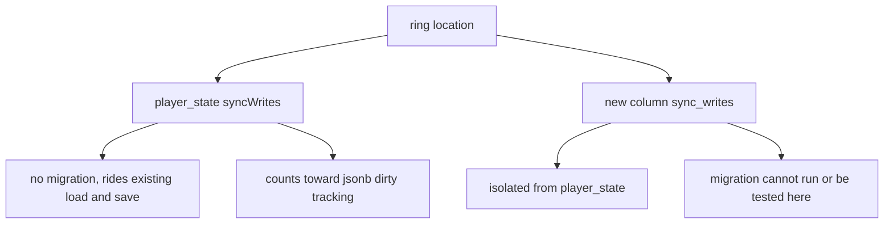
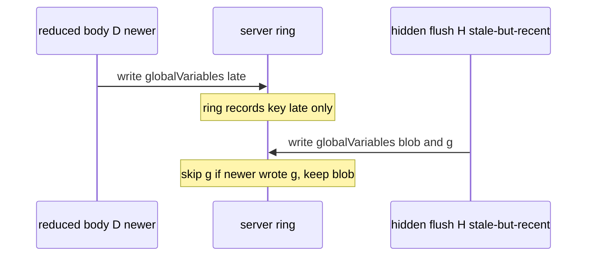
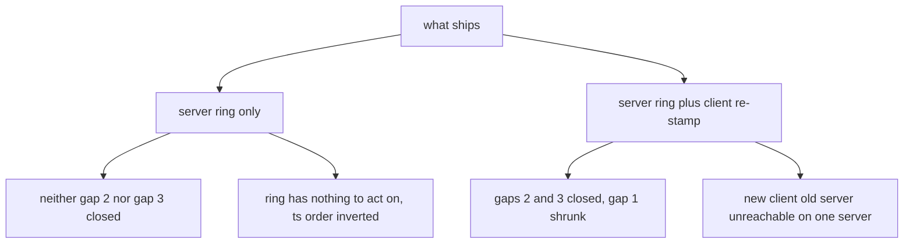
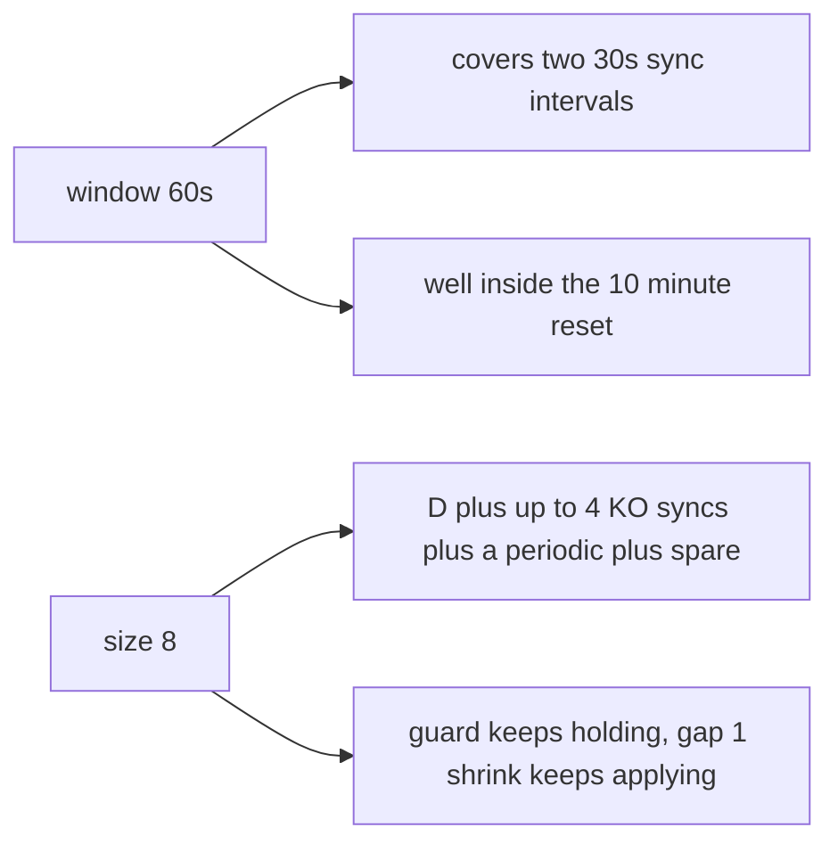
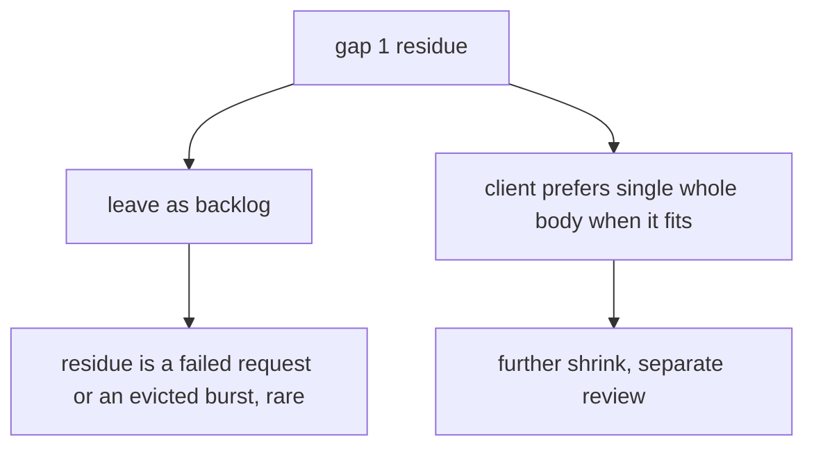

# Sync stale-but-recent ring: closing three save-loss gaps

Status: PLAN only. Nothing is built. Worktree `p-hard-sync-ring`, branch
`build/hard-sync-ring-plan`, cut from integration train 47 (`b83696932`), which
already holds the gated-door currentRoom sync, the notSaved contract and the
train 46 hidden-tab save (including the hidden-guard fix at
state-sync.js:984-989).

This is the server follow-up to the hidden-save work on the server stream. It is
re-derived from the code here, not taken on trust.

## 1. What the task is

`sync_state` orders whole request bodies by one scalar stamp,
`player_state['lastSyncClientTs']`. A request at or below that stamp (and no more
than ten minutes below it) is stale, and a stale request skips every
last-write-wins section wholesale. Three rare interleavings lose a legitimate
save because of this all-or-nothing ordering:

- Gap 2: a newer-content body is stamped below an older-content body that
  reached the server first, so the newer content is dropped as stale.
- Gap 3: a key changed twice, the newer value reaches the server first with the
  lower stamp, and the older value lands second with the higher stamp and wins.
- Gap 1: the one large body that uniquely carries some content fails after the
  page is gone, so that content never reaches the server at all.

The fix has two halves that ship together:

- A client re-stamp. The reduced flush body stops being stamped below the hidden
  flush it chases and is stamped above it, so for every section the stamp order
  matches the content order. This is what closes gaps 2 and 3.
- A server ring. A short, bounded ring of the last few accepted writes (clientTs
  plus the keys or whole sections each wrote, never any values) lets the server
  apply a stale-but-recent request key by key, skipping only the keys a newer
  recorded request already wrote, without moving `lastSyncClientTs`. This makes
  the re-stamp safe (a re-stamped body can no longer force the body it passed to
  be skipped whole) and shrinks gap 1 to the single residue no server can reach:
  a request that never arrives.

A completeness guard keeps the ring honest: the key-by-key merge applies only
when the ring is known to hold every newer write, and otherwise the request
falls back to the fully-stale whole-skip it gets today. Section 5 states the
guard and shows that it never weakens gaps 2 and 3.

## 2. Current behaviour, from the code

Server, `app/controllers/break_escape/games_controller.rb`:

- `sync_state` (:833) runs one transaction under `Game.lock` with the narrow
  `SYNC_STATE_COLUMNS` load (:2116, no scenario_data). Order inside: format
  refusal (:848, a 409 that rolls back), `stale_sync_request?` (:853),
  `merge_last_write_wins_sections` unless stale (:863), `merge_grow_only_sections`
  always (:866), the capture step always (:871), then one `save!` only if
  `@game.changed?` (:880).
- `stale_sync_request?` (:2169): reads `params[:clientTs]`. A request with no
  numeric clientTs is never stale (old clients). Stale when
  `client_ts <= stored && stored - client_ts <= SYNC_STALE_RESET_MS`
  (ten minutes, :2122). Otherwise it stores `client_ts` as the new
  `lastSyncClientTs` and returns false.
- `merge_last_write_wins_sections` (:2187): currentRoom (with
  `may_sync_current_room?` acceptance, `credit_via_pass_on_sync!` and the
  notSaved refusal contract at :2206-2217), globalVariables, npcInkVariables,
  timedMessages, phoneState (notSaved over a cap), mailState (notSaved over a
  cap, plus mailTrimmed), npcVisibility, npcHostility, playerHealth, notes. It
  returns nil today (currentRoom no longer 403s; the `refusal`/Rollback path at
  :864 is dormant but kept).
- `merge_grow_only_sections` (:2285): scenarioBriefShown, triggeredEvents,
  scenarioClock, commandBoardLog, biometricSamples. Union, max or earliest, all
  idempotent, all run on a stale request already.
- The capture step (:913) is server-owned and grow-only; it already runs on a
  stale request and takes every stored field from the scenario, so the client
  never owns the record. `se_captures` is a server-owned global that
  `merge_global_variables!` drops (game.rb:806).
- `lastSyncClientTs` lives in player_state and is never in the bootstrap
  `filtered` payload (:320-430, each key added explicitly) nor in any sync
  answer (:883-904, built from fixed fields). This is the precedent the ring
  follows.

Merge semantics, `app/models/break_escape/game.rb` (the exact distinction the
ring recorder must respect, section 5):

- `merge_global_variables!` (:801): per key. A `null` value deletes the key
  (:834). Server-owned, read-only and the revoked-cards union are dropped or
  unioned inside the merge regardless of the ring.
- `merge_npc_ink_variables!` (:5105), `merge_npc_visibility!` (:4981),
  `merge_npc_hostility!` (:5005): per NPC id, each id's entry replaced whole.
  ink and visibility can reject the whole update over a byte or size cap
  (`return` without writing), so a rejected update lands nothing.
- `merge_phone_state!` (:5198), `merge_mail_state!` (:5431): per flattened key,
  each key replaced whole, with a notSaved-over-a-cap path.
- `merge_player_health!` (:5053): one whole section, a single `{hp, maxHP}`
  value, rejected whole when out of range.
- `replace_timed_messages!` (:5136): the whole `timedMessages` section is
  replaced from the incoming `{pending, delivered}`. It does not merge by key.
- notes (:2266): per id in the controller.

Client, `public/break_escape/js/state-sync.js`:

- `nextClientTs` (:723) is `max(Date.now(), last + 1)`, so stamps only rise on a
  page.
- `buildChanges` (:564) diffs against `this.confirmed`: keyed sections
  (`KEYED_SECTIONS`, :31) per key, whole sections (`WHOLE_SECTIONS`, :42) whole,
  currentRoom, scenarioBriefShown, the clock and timed-text keys. It returns
  `{ body, ack }` or null.
- `confirm` (:684) records the ack as the new confirmed snapshot, honouring
  notSaved (currentRoom is confirmed even when refused).
- `_applyAnswer` (:1001): a stale answer confirms nothing; an answer older than
  `_confirmedTs` confirms nothing.
- `flush` (:836) is the pagehide and hidden-tab keepalive. When no flush is in
  flight it sizes the whole delta (`_sizeFlushBody`, :939). When a flush is
  already in flight it sends the whole delta if it fits beside it with a fresh
  stamp above it (:868-871), else the reduced difference `_changesSinceInFlight`
  (:968) stamped `oldest.clientTs - 1`, that is below the in-flight flush, with
  the "leave one clientTs free below every flush" rule (:853-855). This
  below-stamping is exactly what creates gaps 2 and 3.
- Cadence that drives the ring's sizing: periodic sync every 30 s
  (`SyncManager` interval, :269); a request-soon sync coalesced to at most one
  per `REQUEST_SOON_DEBOUNCE_MS` 750 ms, capped `REQUEST_SOON_MAX_MS` 1500 ms
  from the first (:16-17); keepalive budget `KEEPALIVE_BODY_LIMIT` 60000 (:6).

## 3. The three gaps, as concrete interleavings that lose a save today

All three need the whole delta to exceed the keepalive budget during a hide,
show, hide sequence, so that the second flush goes as a reduced difference body D
stamped below the hidden flush H. H is the large hidden flush (stamp `tsH`), D
the reduced difference (stamp `tsH - 1`). "prevTs" is the last stamp before H.
The stamps below are today's below-stamp regime, the bug the fix removes: after
the client re-stamp (section 8) D is stamped above H, so the losing orders here
no longer arise. The controller tests (section 10) drive the shipped
re-stamped order, not these.

### Gap 2: newer content dropped as stale

1. Last confirmed sync holds `g = 5`, `health = 100`.
2. Page hidden. A 45 KB global `blob` changed. Flush H sends `{ blob, g:5,
   health:100 }` at `tsH = 1002`, guard set, in flight.
3. Page visible, then hidden again. Meanwhile `health` dropped to 70 (a hit).
   The whole delta (`blob` plus `health`) does not fit, so D sends
   `{ playerHealth: 70 }` at `tsD = 1001`.
4. Network delivers H first. Server stores `lastSyncClientTs = 1002`, writes
   `blob`, `health = 100`.
5. D arrives at 1001. `1001 <= 1002` and within ten minutes, so stale. The whole
   of `merge_last_write_wins_sections` is skipped. `health = 70` is lost; the
   player's recorded health is the pre-hit 100.

### Gap 3: a key changed twice, older value wins

1. Last confirmed sync holds `g = 5`.
2. Page hidden. H sends `{ blob(45 KB), g:5 }` at `tsH = 1002`, in flight.
3. Page visible, then hidden. `g` is now 7. Whole delta does not fit, so D sends
   `{ globalVariables: { g: 7 } }` at `tsD = 1001`.
4. Network delivers D first. `1001` is newer than the last confirmed stamp, so
   fresh. Server writes `g = 7`, stores `lastSyncClientTs = 1001`.
5. H arrives at 1002. `1002 > 1001`, so fresh. Server writes `g = 5` (the value
   H was built with). The newer `g = 7` is overwritten by the older `g = 5`.

### Gap 1: the unique large body fails after the page is gone

1. Last confirmed sync holds `g = 5`.
2. Page hidden. H sends `{ blob(45 KB), g:5 }` at `tsH = 1002`, in flight.
3. Page visible, then hidden. `late = 1` changed. Whole delta does not fit, so D
   sends `{ globalVariables: { late: 1 } }` at `tsD = 1001`.
4. D lands, server writes `late = 1`.
5. H's request fails (a 500, a dropped connection) while the page is already
   gone, so there is no pagehide left to resend. `blob` was only ever carried by
   H. `blob` is lost. The server never received it.

Gap 1 is the one a server change cannot fully close: the server cannot apply
content that never reached it. The ring plus the client re-stamp shrink it so
that `blob` is lost only when H's own request fails to arrive, never merely
because of the order H and D land in.

## 4. The ring

### Where it lives

In `player_state`, under one new key `syncWrites`, beside `lastSyncClientTs`.
Not a new column: a column needs a migration (which cannot be run or tested in
this shared-database environment) and would widen the narrow sync load the
sync-deltas rule keeps thin. player_state already carries `lastSyncClientTs`,
already rides the `SYNC_STATE_COLUMNS` load and the one conditional `save!`, and
is already proven never to reach the client. The ring inherits all of that.

### Shape and bound

```
player_state['syncWrites'] = [
  { "ts": 1700000001002, "w": { "globalVariables": ["g"], "playerHealth": true } },
  { "ts": 1700000001001, "w": { "globalVariables": ["late"] } }
]
```

- `ts`: the request's clientTs (integer).
- `w`: a map of section name to either an array of the keys that request wrote,
  or `true` meaning the whole section was claimed.

Constants (controller):

- `SYNC_RING_MAX = 8` entries.
- `SYNC_RING_WINDOW_MS = 60_000` (60 s).
- `SYNC_RING_KEYS_PER_ENTRY = 32` recorded keys across all sections in one entry.

Size 8, not 4: the completeness guard (section 5) only lets the key-by-key merge
run when the ring still holds every write newer than the stale-but-recent
request. A size-4 ring is emptied of the hidden flush H within a burst of four
newer writes, which a KO fight easily produces, so with four entries the merge
would nearly always refuse and fall back to whole-skip. Eight entries let the
merge keep applying in realistic bursts; section 5 shows the arithmetic. The
ring stays bounded either way.

### Append and expiry (fixed-size proof)

On every accepted request that changed at least one last-write-wins value (fresh
or stale-but-recent), append `{ ts, w }` where `w` holds only the sections and
keys whose merge actually changed a stored value (after server-owned and
read-only drops, after notSaved refusals, after a refused currentRoom, after a
whole-update cap rejection). A request whose merges changed nothing appends
nothing, so a no-op resend neither grows the ring nor forces a save (the
`@game.changed?` guard at games_controller.rb:880 still holds). Then normalise:

1. If one entry's recorded keys exceed `SYNC_RING_KEYS_PER_ENTRY`, collapse its
   largest sections to `true` until it is within the cap. A first-after-load
   full snapshot therefore records as a handful of `true` section claims, not
   hundreds of keys.
2. Drop every entry whose `ts` is more than `SYNC_RING_WINDOW_MS` below the
   largest `ts` present.
3. Keep the newest `SYNC_RING_MAX` entries by `ts`.

Size ceiling: at most 8 entries, each at most 32 short strings plus a few
section names and a ts, so the ring is bounded above by roughly 8 KB of jsonb
regardless of session length or how many syncs run. It never accumulates: step
2 and step 3 run on every append, and nothing else writes it. A test asserts the
serialised ring stays under a fixed byte cap after a long run of syncs.

Collapsing a section to `true` is conservative: a later stale-but-recent request
then treats the whole section as claimed and skips it, even keys the collapsed
snapshot did not individually change. That can only forgo a gap 1 recovery (an
unclaimed key left unapplied); it can never put an older value over a newer one,
so it never breaks the invariant. The collapse only happens for a single request
that wrote more than 32 keys, which in practice is only a first-after-load
snapshot, whose keys the next ordinary sync carries again anyway.

### Never sent to the client

The ring is read and written only inside `sync_state`. It is not added to the
bootstrap `filtered` payload (:320-430) and not added to any sync answer
(:883-904), exactly as `lastSyncClientTs` is not. No route serialises the whole
of player_state to the client; the only whole-slice copy is `new_session`'s
`preserved_keys` (:268-269), which is server-side and for a fresh game and drops
`syncWrites` naturally. Two tests pin this: the bootstrap payload for a game
whose player_state carries `syncWrites` does not mention it, and a `sync_state`
answer body does not mention it. Nothing in the ring is a value a reader could
want anyway, only stamps and key names.

## 5. The stale bands, the completeness guard and the key-by-key merge

`stale_sync_request?` keeps its two existing outcomes and gains a middle band.
For a numeric clientTs with a stored `lastSyncClientTs`:

- `client_ts > stored`: fresh. Store it as today. Record a ring entry for what
  it changed.
- `stored - client_ts > SYNC_STALE_RESET_MS` (over ten minutes below): the
  existing reset. Treat as fresh, store it, as today, and clear `syncWrites` as
  well (see "Clearing the ring on a reset" below).
- `0 <= stored - client_ts <= SYNC_STALE_RESET_MS` and the completeness guard
  below holds: stale but recent, the new path. Build the skip set from the ring
  and apply last-write-wins sections key by key. Do not move `lastSyncClientTs`.
  Record a ring entry for what this request actually changed.
- `0 <= stored - client_ts <= SYNC_STALE_RESET_MS` and the completeness guard
  does not hold: fully stale, exactly today's behaviour. Skip all last-write-wins
  sections, run grow-only and capture, do not move the stamp, record nothing.

### Clearing the ring on a reset

The ten-minute reset branch stores a `client_ts` far below the entries the ring
already holds (`stale_sync_request?`, games_controller.rb:2175-2178). This branch
is reachable: `lastClientTs` starts at 0 on a fresh page and `nextClientTs`
floors at `Date.now()` (state-sync.js), so a system clock set back more than ten
minutes between a reload's old and new page lands a request far below stored.
Without a clearing step the ring would then hold only pre-reset high-`ts`
entries, which stay the largest `ts` present, so every later low-`ts` append is
dropped at once by expiry step 2 (more than 60 s below the lingering max) and the
oldest retained entry stays above every new request. The completeness guard would
then always fail and the stale-but-recent merge would go dormant for the rest of
the session. The invariant is not broken (the guard falls back to the safe
whole-skip), but the fix would silently stop working after a backward-clock
reset.

So when the reset branch fires, clear `syncWrites` (set it empty, the same write
that stores the lower `lastSyncClientTs`). The ring then rebuilds from the
post-reset writes on the new, lower timeline, and the next reduced body that
chases a post-reset flush recovers through the empty-ring branch above. Clearing
the whole ring is chosen over dropping only entries with `ts > client_ts` because
the reset establishes a fresh stamp timeline and the pre-reset entries can never
again match a legitimate stale-but-recent request's `ts >=` test. A test drives a
reset after the ring holds pre-reset entries and asserts the ring is empty
afterwards and a post-reset stale-but-recent merge engages again.

### The completeness guard (why the key-by-key merge is safe)

The key-by-key merge is correct only if the ring holds every accepted write with
`ts >= D.ts`, because a key left unskipped is applied on the assumption that no
newer request wrote it. The ring is a fixed size, so it cannot promise that for a
request older than its oldest retained entry.

Guard: the stale-but-recent path runs only when `D.ts` is at or above the oldest
retained ring entry's `ts`. Then every write newer than D is still in the ring,
by expiry step 2 and step 3 having kept them, so the skip set is complete.
Otherwise some newer write may have been evicted, and the request falls back to
fully stale and skips all last-write-wins sections.

Empty ring. When the ring holds no entries there is no oldest entry, so the
guard expression has no value to compare against and the implementer must pick a
branch. The chosen behaviour is to treat the skip set as empty and merge every
key, not to fall back. This is safe and is the better of the two safe choices.
An empty ring can only occur before the first last-write-wins write is recorded
(append normalisation never drops the just-appended entry, and eviction always
leaves at least one entry once anything is recorded), so there is no unrecorded
newer write to protect, and merging against an empty skip set cannot put an
older value over a newer one. Falling back would also be safe but would forgo
gap 1 recovery for a reduced body that chases the very first flush, so the merge
branch is specified explicitly to stop an implementer picking the fall-back by
reflex and quietly losing that first-flush recovery.

The guard never weakens gaps 2 and 3. Both of those gaps are about not letting H
overwrite a key D already wrote with a newer value. On the fall-back path H is
whole-skipped, so H writes nothing at all, including the contested key, which is
exactly what protects it. On the stale-but-recent path H's contested key is in
the skip set and is dropped. Either way H's older value does not land. The guard
only governs gap 1's shrink, that is, whether H's unique keys (the keys no newer
request wrote) get applied. When the guard falls back, H's unique keys are lost
for that body, the same loss gap 1 has today; when it holds, they are recovered.

### Does the guard leave the fix applying in realistic play? (the numbers)

For the guard to hold when the stale-but-recent H lands, the ring must still
hold every write stamped between H's own stamp and the moment H lands, within
the 60 s window. Count the writes that can land in that interval:

- The in-flight life of H is the time to upload a 45 KB keepalive body, seconds
  on a slow link. Take 3 s as a generous worst case.
- D, the reduced difference body: 1 write.
- Periodic syncs at 30 s: 0 to 1 within a 3 s interval.
- Request-soon syncs during the visible burst (a KO fight debounces to one per
  750 ms, capped 1500 ms from the first): up to 4 in 3 s.

Worst realistic total ahead of H: about 1 + 1 + 4 = 6 entries. A size-4 ring
keeps only the newest four, so H falls out and the guard fails: the merge
refuses and gaps 2 and 3 still close (fall-back whole-skip) but gap 1 is not
shrunk for that body. A size-8 ring keeps those six with two to spare, so the
guard holds and gap 1 is shrunk. The 60 s window spans two 30 s periodic
intervals and sits well inside the ten-minute reset, so expiry never trims an
entry that a still-in-flight H needs. Hence `SYNC_RING_MAX = 8`,
`SYNC_RING_WINDOW_MS = 60_000`. The byte ceiling at eight entries is about 8 KB,
still bounded and still never sent.

### The skip set

The skip set for a stale-but-recent request at `ts`: the union, over every ring
entry with `entry.ts >= ts`, of that entry's `w`. A section mapped to `true` by
any such entry is wholly claimed. Otherwise the claimed keys of that section are
the union of the arrays. The comparison is `>=`, not `>`, so a newer entry that
shares D's exact millisecond (two tabs can draw the same `Date.now()`) is still
skipped: a same-ms cross-tab order is undefined, and skipping is the
conservative choice that matches today's whole-skip of an equal stamp rather
than letting D's possibly-older value land. The request's own entry is appended
only after its merges run, so it is never in its own skip set.

The mechanism is a pre-filter, not a rewrite of the merge methods. Before each
`merge_*!` call the stale-but-recent path removes from the incoming params any
key a newer entry claimed, and skips the call entirely for a wholly-claimed
section. The existing merge methods then run unchanged on the narrowed input, so
their own guards (server-owned globals, read-only globals, the revoked-cards
union, the mail and phone caps) all still apply. A key left in is, by
construction, one no newer accepted request wrote, so this request holds the
most recent value for it and last-write-wins is correct.

### Pre-filtering the compound-key sections (mailState, phoneState)

For `globalVariables` a claimed key is a plain top-level params key, so the
recorder and the pre-filter use the same string on both sides and the filter is a
direct top-level reject. `mailState` and `phoneState` need the mapping spelled
out, because the key the server merges by is not the shape a value is nested in,
and a filter that gets the mapping wrong under-filters and lets an older key
overwrite a newer one (the one place a wrong implementation breaks the invariant
rather than merely degrading).

The canonical claim key is a single dotted string, the same spelling the client
sends and the same spelling that keys the params hash. The two sections differ
only in how the server derives that string:

- `mailState`. `params[:mailState]` is a flat map whose top-level keys are
  already the dotted compound keys the client built (`mailboxes.<box>.<msgId>`,
  `threads.<key>`, `jobs`, `drafts`, `metrics`; state-sync.js keys mailState per
  key as a `KEYED_SECTIONS` member). `mail_state_updates` (game.rb:5494) parses
  each of those into an internal array path (`['mailboxes', box, msgId]`,
  `['threads', key]`) or a scalar key (`'jobs'`). The recorder must canonicalise
  that array path back to the dotted string, not record the array as-is, or its
  claim keys never compare equal to the dotted params keys the pre-filter sees.
- `phoneState`. `params[:phoneState]` is a flat map keyed by npc id, each value a
  whole entry that `merge_phone_state!` (game.rb:5198) replaces per npc id. The
  claim key is the npc id itself, so no compound derivation is needed; it is
  listed here because, like mailState, its claim key is the params top-level key,
  not a section-level `true`.

Mapping, both directions:

```
# Recording direction: a landed update -> a canonical claim key string.
def claim_key_for(path)             # path as mail_state_updates yields it
  path.is_a?(Array) ? path.join('.') # ['mailboxes', box, msg] -> "mailboxes.box.msg"
                                      # ['threads', key]        -> "threads.key"
                    : path.to_s       # 'jobs' / 'drafts' / 'metrics' -> itself
end
# phoneState: the claim key is the npc id, recorded as-is.

# Filtering direction: drop any claimed key from the incoming params section.
def prefilter_section(section_params, claimed_keys)   # claimed_keys is a Set of strings
  return nil if claimed_keys == :whole                 # whole-section claim: skip the merge
  kept = section_params.reject { |k, _| claimed_keys.include?(k.to_s) }
  kept.empty? ? nil : kept                             # nil -> skip the merge call
end
```

The join on the recording side and the top-level params key on the filtering
side are the same string, so the map is identity on the dotted form; the only
transform is array-path to dotted when recording. A thread key or a message id
that itself contains a dot round-trips correctly: `mail_state_updates` splits
`mailboxes.<box>.<msgId>` on the first dot only (`split('.', 2)`), so joining
`['mailboxes', box, msgId]` with `.` rebuilds the exact original key.

Worked example. A newer entry recorded that it wrote `mailboxes.inbox.m2`. An
older stale-but-recent request D then arrives carrying an older read-state for
`m1` and the only copy of `m2`:

Before the pre-filter, `params[:mailState]`:

```json
{
  "mailboxes.inbox.m1": { "id": "m1", "read": false },
  "mailboxes.inbox.m2": { "id": "m2", "read": true }
}
```

Skip set for D: `{ "mailState": { "mailboxes.inbox.m2" } }`.

After the pre-filter, the hash handed to `merge_mail_state!`:

```json
{ "mailboxes.inbox.m1": { "id": "m1", "read": false } }
```

`m2` is dropped (a newer request already wrote it), `m1` is kept and applied (no
newer request wrote it, so D holds its most recent value). Health of the test: a
naive top-level filter fails here. If the recorder claims mailState as a whole
section, or the pre-filter treats `mailState` as one opaque params key, D's `m1`
is dropped along with `m2` and gap 1's unique key is lost; if instead the filter
compares the recorded array path `['mailboxes','inbox','m2']` against the dotted
params key `"mailboxes.inbox.m2"`, they never match, nothing is dropped, and D's
older `m2` overwrites the newer one, breaking the invariant. The section 10 test
asserts the correct result: after D, `m1` is applied and `m2` keeps its newer
value, which only the per-compound-key filter with the canonical mapping
produces.

### How each section is claimed (merge semantics re-audited)

The recorder classifies a section by the server's merge, not by the client's
section list. In particular the client sends `triggeredEvents` in
`KEYED_SECTIONS` (state-sync.js:31) although the server treats it grow-only, so
it must never be recorded into `w`.

| Section | Server merge | Claim recorded |
| --- | --- | --- |
| globalVariables | `merge_global_variables!`, per key, `null` deletes | per key; a deleted key is recorded by its name (see below) |
| npcInkVariables | `merge_npc_ink_variables!`, per NPC id, whole-update cap | per id; record nothing if the cap rejected the whole update |
| npcVisibility | `merge_npc_visibility!`, per id, size cap | per id; nothing if the cap rejected it |
| npcHostility | `merge_npc_hostility!`, per id (a KO is never undone by the merge) | per id |
| mailState | `merge_mail_state!`, per flattened key, notSaved over a cap | per key that landed; a notSaved key is not recorded |
| phoneState | `merge_phone_state!`, per flattened key, notSaved over a cap | per key that landed; a notSaved key is not recorded |
| notes | per id in the controller | per id |
| playerHealth | `merge_player_health!`, one whole section, range-checked | whole section, `"playerHealth": true`, only when it landed |
| timedMessages | `replace_timed_messages!`, whole section replaced | whole section, `"timedMessages": true`, only when it landed |
| currentRoom | whole string, `may_sync_current_room?` acceptance, notSaved | `"currentRoom": true`, only when accepted and written, never when refused to notSaved |
| triggeredEvents, scenarioClock, commandBoardLog, biometricSamples, scenarioBriefShown | grow-only, commutative, idempotent | not recorded, never filtered |

The two whole-section claims matter. `replace_timed_messages!` and
`merge_player_health!` replace their section from the incoming hash rather than
merging by key, so a per-key record would be a trap: a stale-but-recent request
that kept `timedMessages.delivered` but had `timedMessages.pending` dropped from
params would call `replace_timed_messages!` with a partial hash, which rebuilds
`pending => []` and wipes the key that was kept. Both sections are therefore
recorded as a single whole-section `true`, and on a stale-but-recent request
they are skipped entirely when any newer entry wrote them, never pre-filtered by
key.

Deletions are claims. A newer request that deletes global `k` (the client sends
`k: null`, the merge deletes it at game.rb:834) records `k` in `w` just as a set
does. Without that, a stale-but-recent request carrying an older `k` would not
be skipped and would resurrect the deleted key. A tombstone counts as a write
that changed a stored value, so the "record only what the merge changed" rule
already covers it, and the shape (a list of key names) already carries it.

Record only what the merge changed. The recorder keys off the values the merge
actually altered, not off the keys in params. This matters twice: a no-op resend
of an unchanged value then records nothing (so it does not force a save, keeping
the `@game.changed?` optimisation and the one-UPDATE-per-changing-sync behaviour
intact), and the skip set never claims a key a newer request merely carried but
did not change (so an older request holding the one changed value for that key
is still applied). The revoked-cards union inside globalVariables is a grow-only
union under one key: recording it as a claimed key is safe because dropping it
on a stale-but-recent request never puts an older value over a newer one, and
the client resends the union regardless.

### Server-owned, never written by a stale request

`lastSyncClientTs` (never moved on the stale-but-recent path, the load-bearing
invariant of this whole change), `se_captures` (dropped by
`merge_global_variables!`, recorded only through the capture step), the viaPass
and gated-door credit globals (`server_credit_global_names`, written only by the
server's own credit path, game.rb:808), and the ring itself. None of these is
driven by stale incoming content.

## 6. Row lock and format 409

Everything runs inside the one `Game.lock` transaction (:840), so the ring read,
the guard check, the skip-set build, every merge and the ring append are
serialised per game. Two syncs for the same game cannot interleave their ring
reads and writes; the second blocks on the row lock and reloads post-commit
(`with_lock` semantics, :2315). Reordering is only ever across the network
before the lock, which is exactly what the ring is for.

The format refusal (:848-851) still runs first and still rolls the transaction
back on a 409, so a format-refused request writes neither `lastSyncClientTs` nor
the ring. The ring change adds nothing to the format path and does not touch
`sync_format_refusal`. The dormant 403 `refusal`/Rollback path (:864) is
untouched; the stale-but-recent path returns no refusal, so it cannot 403.

## 7. Network delay, reordering and the legitimate player

The point of the change is that a legitimate player who is simply slow or whose
packets reorder never loses progress and is never refused:

- Two periodic syncs reordered: already safe today and stays safe. A later sync
  carries everything an earlier unconfirmed sync held, so either order lands
  everything.
- A reduced flush D re-stamped above its hidden flush H (the client change,
  section 8): if H lands first, D is fresh and applies (gaps 2 and 3 close). If
  D lands first, H arrives stale-but-recent and the ring merges H's unique keys
  (gap 1 shrunk) while skipping the keys D already wrote (gaps 2 and 3 close);
  if the guard does not hold, H is whole-skipped and gaps 2 and 3 still close,
  only gap 1 is not shrunk for that body.
- A periodic sync drawn before H and still in flight: if it lands after a newer
  body, it is stale-but-recent and merges key by key rather than being dropped
  whole, so its own content survives where a newer request did not supersede it.
- A clock set back mid-session: `nextClientTs` keeps stamps rising on the page;
  the ten-minute reset still absorbs a reload-time clock change. The ring window
  is 60 s, well inside that, so a reset request (over ten minutes below) is
  fresh, never a stale-but-recent merge against a stale window. The reset also
  clears `syncWrites` (section 5, "Clearing the ring on a reset"), so the ring
  does not linger on the pre-reset stamps and keep the completeness guard failing
  for the rest of the session.
- No new refusal is introduced. A stale-but-recent request returns
  `{ success: true, stale: true }` with the capture answer fields as today, plus
  it now actually applies its unclaimed keys. The client still treats a stale
  answer as "resend with the next sync" (:773), which remains correct and
  harmless: anything it resends is either unchanged or newer.

## 8. The client change and who closes which gap

The server ring alone closes neither gap 2 nor gap 3. The skip set is keyed by
ts, and under today's below-stamp regime ts order is inverted against content
order, so the ring is pointed the wrong way:

- Gap 2 without the re-stamp: H.ts 1002 carries the pre-hit health 100, D.ts
  1001 the post-hit 70, H lands first. H is fresh, stores 1002, writes 100, and
  the ring records H wrote `playerHealth`. D arrives at 1001, stale-but-recent;
  its skip set is the union of entries with ts at or above 1001, which includes
  H, so D's `playerHealth` 70 is skipped and health stays 100. Not closed.
- Gap 3 without the re-stamp: D (g 7) at 1001 lands first and is fresh; H (g 5)
  at 1002 lands second and is also fresh (1002 above 1001), so H is never on the
  stale-but-recent path and overwrites with the older 5. Not closed.

So one client change is needed, and it is what closes both gaps. The reduced
body is stamped inside `_changesSinceInFlight` (:968-981), not in the caller: the
below-stamp is `const clientTs = oldest.clientTs - 1` at state-sync.js:971, and
the very next line, `if (clientTs <= oldest.prevTs) return null` at :972,
suppresses the reduced body whenever there is no free slot below the oldest
flush. Both lines change together:

- :971 draws a fresh stamp above every in-flight flush (a plain `nextClientTs`,
  already above them) instead of `oldest.clientTs - 1`.
- :972's null return must be neutralised. It exists only to refuse a body that
  has no slot below the oldest flush; once the body is stamped above, there is
  always a valid stamp and that refusal no longer applies. Removing only the
  caller's "leave one clientTs free below every flush" reservation (:853-855) and
  re-stamping, while leaving :972 in place, still suppresses a legitimate reduced
  body whenever `oldest.clientTs - 1 <= oldest.prevTs`, even though a valid stamp
  above exists. The remaining null return from :980 (nothing changed since the
  in-flight flushes) stays: a truly empty difference is still nothing to send.

The caller's reservation (:853-855) is then no longer needed and is removed, and
the whole-delta-if-it-fits branch (:868-871) already stamps above and is
unchanged.

With D stamped above H, stamp order matches content order and both gaps close:
if H lands first, D is fresh and applies; if D lands first, H is stale-but-recent
and the ring skips the keys D wrote while merging H's unique keys. The ring is
what makes the re-stamp safe: a re-stamped D could, without the ring, make H
look fully stale and drop H's unique sections; with the ring, H arriving
stale-but-recent keeps those sections.

`nextClientTs` (:723) is `max(Date.now(), last + 1)`, and `last` was advanced
when the in-flight flush drew its stamp, so the reduced body is strictly above
every in-flight flush and above `stored` for its own page: it is never wrongly
judged stale, and it carries the newest content so "fresh" is correct.

New client against an old server. Shipping the re-stamp before the ring reaches
a server would, in the D-lands-first order, have the old server store D's higher
stamp and then skip H wholesale as stale, losing H's unique content, where
today's below-stamping would have H land second as fresh and apply. This order
is not reachable in a single-server deploy: the served client and the server
move together on the same train, so a client is never newer than its server. The
client and server changes ship together on train 47; the pairing is required for
either gap, and server-first is also safe (an old client just does not get the
improvement).

No other client change. `_applyAnswer`, `confirm`, the notSaved and mailTrimmed
handling and the hidden-guard logic (including the fix at :984-989) are
untouched.

## 9. Delta-sync rule compliance (load-bearing)

- player_state does not grow and is not re-sent: `syncWrites` is bounded to
  eight entries within a 60 s window by the append normalisation (section 4),
  and it is never serialised to the client, so the client never re-sends it.
- Every sync still sends only its own delta. The ring changes what the server
  does with a delta that arrives out of order, not what the client sends. The
  one client change makes a reduced flush body smaller-or-equal, never larger.
- No value is stored in the ring, only stamps and key names, so the ring cannot
  become a second copy of player_state.
- The ring append records only what a merge changed, so a no-op resend stays a
  no-op: it adds nothing to the ring and does not force a save.

## 10. Tests

Unit, Ruby (new `test/controllers/break_escape/sync_stale_ring_test.rb` and a
model test if the ring helpers live in Game):

- ring append records only landed, changed keys; a refused currentRoom, a
  notSaved mailState and a cap-rejected npcInkVariables update are not recorded;
  a no-op resend of an unchanged value appends nothing and issues no UPDATE.
- a deletion is recorded as a claim: a newer request deletes global `k`, a
  stale-but-recent older request carrying `k` is skipped and does not resurrect
  it.
- timedMessages and playerHealth are recorded whole (`true`), never per key: a
  stale-but-recent request with a newer entry claiming either section is skipped
  for it; a partial-params request never reaches `replace_timed_messages!` and so
  cannot wipe the kept key.
- ring normalisation: over-32-key entry collapses largest sections to `true`;
  entries older than 60 s below the max are dropped; at most eight kept; byte cap
  holds after a long synthetic run.
- reset clears the ring: with the ring holding pre-reset high-`ts` entries, a
  request over ten minutes below stored takes the reset branch; assert
  `syncWrites` is empty afterwards, and that a following post-reset
  stale-but-recent request on the new lower timeline engages the merge (rather
  than the guard failing forever on the lingering pre-reset entries).
- mailState and phoneState pre-filter maps compound keys: a newer entry claimed
  `mailboxes.inbox.m2`; a stale-but-recent request carrying older `m1` and the
  unique `m2` has `m2` dropped and `m1` applied. The test is written so that a
  whole-section skip of mailState, or a filter comparing the array path against
  the dotted params key, gives the wrong answer (m1 lost, or older m2 applied
  over the newer one); only the canonical dotted-key filter passes. A phoneState
  claim by npc id skips only that contact's entry.
- empty-ring branch: the first reduced body that chases the very first flush,
  with no ring entries yet, merges all its keys (empty skip set) rather than
  falling back.
- skip-set build: union of writes of entries with ts at or above a given ts
  (equal ts included), with `true` dominating.
- completeness guard: a burst of more than eight last-write-wins writes lands;
  then a stale-but-recent request whose ts is below the oldest retained entry
  falls back to whole-skip (applies none of its last-write-wins sections, does
  not move `lastSyncClientTs`), while a stale-but-recent request whose ts is at
  or above the oldest retained entry merges key by key. This is the proof that an
  evicted newer write can never be overwritten by an older one.
- a stale-but-recent request (guard holding) applies unclaimed keys, skips
  claimed ones, does not move `lastSyncClientTs`, and still runs grow-only and
  capture.
- a fully stale request (beyond the window, or guard failing) behaves exactly as
  today.
- the reset band (over ten minutes) is fresh, as today.

Controller interleaving (the core proof, same file): drive the three gaps as
ordered `sync_state` requests against one game, with the shipped re-stamp order
(the reduced body D stamped above the hidden flush H), and assert the final
player_state.

- Gap 2: tsD above tsH. Drive H then D, assert `playerHealth == 70` and `blob`
  present; drive D then H, assert `playerHealth == 70` (H stale-but-recent, its
  `playerHealth` skipped) and `blob` present (H's unique key merged). Both orders
  pass under the skip-set rule because D carries the higher stamp.
- Gap 3: tsD above tsH. Drive D then H, assert `g == 7` (H stale-but-recent, its
  `g` skipped); drive H then D, assert `g == 7` (D fresh, applies).
- Gap 1 recovery: D (reduced, `late`, higher stamp) then H (stale-but-recent,
  `blob`), assert both `late` and `blob` present and `lastSyncClientTs` unchanged
  by H.
- currentRoom: a newer entry wrote currentRoom, an older stale-but-recent room
  is skipped; and a refused currentRoom does not block a later legitimate room.

Unit, JS (extend `test/js/state-sync-hidden-save.test.mjs` or a new
`test/js/sync-stale-ring.test.mjs`): the reduced flush body is stamped above the
newest in-flight flush, not below; the "leave one free below" reservation is
gone; a valid reduced body that the old `oldest.clientTs - 1 <= oldest.prevTs`
rule would have suppressed at state-sync.js:972 is now sent (the null return no
longer fires for a body stamped above, while a genuinely empty difference still
returns null); the whole-delta-if-it-fits path is unchanged; no regression in the
hidden guard tests. Add the new JS file to each test harness copy list if it
imports a new module (it should not need to).

Live browser proof on the keyless server on an assigned port (3670 or 3671,
started by hand the way `tools/playtest/start-keyless-server.sh` starts :3001,
never :3000), headless, killed by PID afterwards: load a game and drive the real
flush path so the client itself re-stamps the reduced body above the hidden
flush, then let the two overlapping `sync_state` PUTs land in each order (holding
one request at the network layer, or issuing them through the window.__test
bridge with the stamps the client produced, not hand-picked stamps), reproducing
gap 2 and gap 3 on the real controller path, and assert the persisted
player_state through a fresh bootstrap. Driving the real re-stamp, not crafted
stamps, is what makes this prove the shipped client change rather than a helper.

Run, without the shared lock, every test file this change touches and every file
that imports a changed module: the new controller and JS files, and the existing
`captures_sync_test.rb`, `capture_proofs_test.rb` (its query and save counters),
`current_room_guard_refusal_test.rb`, `mail_state_sync_test.rb`,
`saved_current_room_test.rb`, `reload_persistence_test.rb` (its one-UPDATE and
no-op-no-UPDATE assertions), `format_version_test.rb` and the state-sync JS
suite. The integrator runs the full suites once per batch.

## 11. Chunked build order

1. Ring storage and helpers (append recording only changed keys, normalise,
   skip-set build) with unit tests, plus the never-sent tests and the
   no-op-no-UPDATE test. Record-only, no read path yet: fresh requests write the
   ring, nothing reads it. This chunk already adds the `syncWrites` key that
   `reload_persistence_test` carries and already touches the save path, so its
   tests land here, not later. Commit.
2. Stale-but-recent band in `stale_sync_request?` (including the empty-ring
   branch and clearing `syncWrites` when the ten-minute reset fires), the
   completeness guard, and the key-by-key pre-filter in `sync_state`, for the
   keyed sections, the compound-key sections (mailState and phoneState, with the
   canonical dotted-key mapping), the whole-section claims (playerHealth,
   timedMessages) and the deletion claim. Guard test (the burst of more than
   eight writes), the reset-clearing test, the compound-key pre-filter test and
   the per-section merge tests. The guard lands here, with the read path it
   protects, never later. Until chunk 3 lands, the stale-but-recent merge
   strips `currentRoom` from the params it sees, so currentRoom keeps today's
   whole-skip on any stale request (it is handled inline in `sync_state`, not by a
   `merge_*!` call the pre-filter covers). The band also passes `stale: true` to
   `apply_capture_sync_step`, so capture proof stamping is deferred to the next
   fresh sync, exactly as today: the stale answer makes the client resend the
   mail, and that fresh request stamps it. Tests: an older room on a
   stale-but-recent request leaves the newer stored room in place, and phish
   proof mail on a stale-but-recent request is kept and stamped on the next fresh
   sync. Commit.
3. currentRoom under the stale-but-recent path (skip when newer, else the normal
   acceptance and notSaved contract). currentRoom test. Commit.
4. Client re-stamp of the reduced flush body above the in-flight flushes, remove
   the below reservation. JS unit tests, then the controller gap 2, gap 3 and
   gap 1 tests, which exercise the shipped re-stamped order and so belong here,
   with the client change, not in chunk 2. Commit.
5. Size-bound test and the live browser reordered-request proof on the assigned
   port. Commit.
6. Comments and this document's cross-references tidied. Commit.

Each chunk commits with explicit paths after checking `git diff --cached --stat`.

## 12. Decisions

These were the plan's open questions. Each is settled here by the plan's own
recommendation, since all five are technical calls the integrator can review and
override. The context and the diagrams are kept so the reasoning behind each
decision stays on the page.

### Q1. Ring in player_state, or a new column?

Context. player_state already carries `lastSyncClientTs`, already rides the
narrow sync load and the one conditional save, and is proven never to reach the
client. A column would isolate the ring from player_state's jsonb dirty tracking
but needs a migration, which cannot be run or tested in this shared-database
environment, and widens the narrow load the sync-deltas rule keeps thin.



Before (player_state today):

```json
{ "lastSyncClientTs": 1700000001002, "globalVariables": { "g": 7 } }
```

After (chosen):

```json
{
  "lastSyncClientTs": 1700000001002,
  "globalVariables": { "g": 7 },
  "syncWrites": [ { "ts": 1700000001002, "w": { "globalVariables": ["g"] } } ]
}
```

Decision: player_state, under `syncWrites`. Reason: a new column needs a
migration that cannot be run or tested in this shared-database environment, while
player_state is bounded here and already proven never to reach the client.

### Q2. Per-key records with a cap, or section-level only?

Context. Section-level records (record only which sections a request touched)
are smaller and simpler, but a stale-but-recent request would then skip a whole
section a newer request merely touched, dropping that request's keys the newer
one never carried, which is exactly the content gap 1 needs to preserve.
Per-key records preserve those keys. The exceptions are the sections the server
replaces whole: playerHealth and timedMessages are recorded as whole-section
`true`, because a per-key record of a whole-replace section would let the
pre-filter hand the merge a partial hash and wipe the key it kept. A full
snapshot's per-key record collapses to `true` only when it exceeds the 32-key
cap.



Before (section-level record):

```json
{ "ts": 1700000001002, "w": { "globalVariables": true } }
```

After (per-key with a 32-key cap, whole-replace sections always `true`):

```json
{ "ts": 1700000001002, "w": { "globalVariables": ["late"], "playerHealth": true } }
```

Decision: per-key for the keyed sections, capped at 32 keys per entry and
collapsing the largest sections to `true` only when a single request writes more
than the cap; whole-section `true` for playerHealth, timedMessages and
currentRoom; grow-only sections never recorded; deletions recorded as key
claims; and only keys a merge actually changed are recorded. Reason: per-key is
what preserves a stale-but-recent request's unique keys (gap 1), with
whole-section `true` only where the server replaces the section whole and a
partial hash would wipe a kept key.

### Q3. Ship the client re-stamp with this, or server only?

Context. The server ring alone closes neither gap 2 nor gap 3: under today's
below-stamping the ts order is inverted against the content order (section 8), so
the ring, which is keyed by ts, cannot help. The re-stamp is what closes both
gaps, and the ring is what makes the re-stamp safe (it stops a re-stamped body
from forcing the body it passed to be skipped whole). The choice is therefore not
between "gap 2 for all clients" and "gaps 2 and 3": it is between neither gap
without the re-stamp and both with it.



Before (reduced body stamp today): `clientTs = oldest.clientTs - 1` (below H).

After: `clientTs = nextClientTs()` (above every in-flight flush).

Decision: ship the client re-stamp together with the server ring on train 47.
Reason: either gap needs both halves (the ring alone cannot act on an inverted
ts order), and a single-server deploy never reaches the only order in which a new
client against an old server would be worse than today.

### Q4. Ring window 60 s and size 8: right numbers?

Context. The window must comfortably exceed the largest realistic gap between a
flush and the difference body that chases it, bounded by how long a keepalive
stays in flight (seconds). The periodic sync interval is 30 s, so a 60 s window
spans two intervals and sits well inside the ten-minute reset. The size must hold
every write newer than a stale-but-recent H so the completeness guard keeps
holding rather than falling back; section 5 shows a KO fight can put about six
writes ahead of H in a 3 s in-flight window, so four entries would nearly always
fall back and eight leaves headroom.



Before and after are the constants, not data: `SYNC_RING_WINDOW_MS` and
`SYNC_RING_MAX`.

Decision: 60 s window, size 8, `SYNC_RING_KEYS_PER_ENTRY = 32`. Reason: a KO
fight can put about six writes ahead of a 3 s in-flight flush, so eight keeps the
completeness guard holding and gap 1 shrunk where four would nearly always fall
back; gaps 2 and 3 close at any size, so the raise costs only about 8 KB of
bounded jsonb.

This decision raises the ring size from the integrator's figure of 4 to 8.

### Q5. The gap 1 residue: leave it, or add a client preference for one body?

Context. After this change, gap 1 loses content only when the one request that
uniquely carries it fails to arrive and the page is already gone, or (more
rarely) when a burst evicts the hidden flush from the ring so the guard falls
back to whole-skip. A client could shrink this further by preferring a single
whole body over H plus D whenever the whole delta fits the budget, so the unique
content rides the body most likely to land. That is a separate client change with
its own review.



Before: H carries unique `blob`, D carries `late`, two bodies.

After (option C): one body carries `blob` and `late` when it fits the budget.

Decision: leave the gap 1 residue to the backlog. Reason: the residue is a
failed request or a rare burst eviction, neither of which a further server change
reaches, and the single-body client preference is a separate client change that
deserves its own plan and review.
