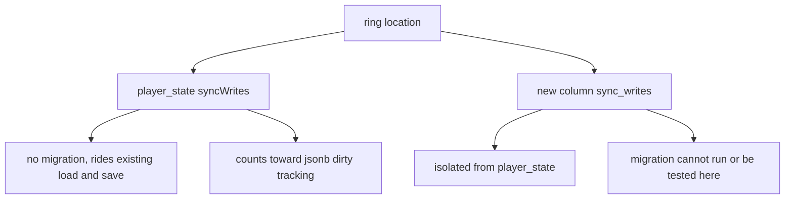
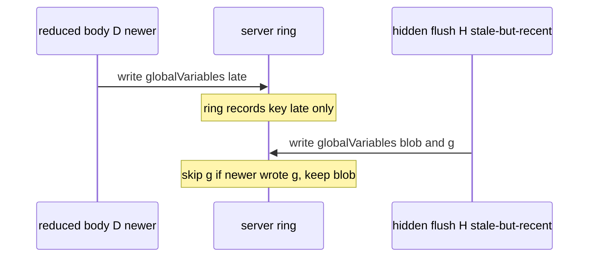
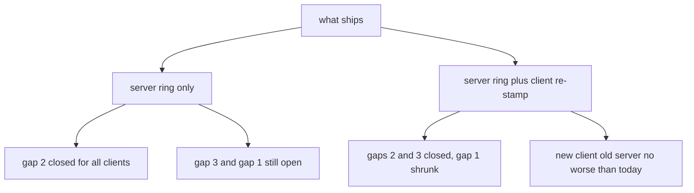
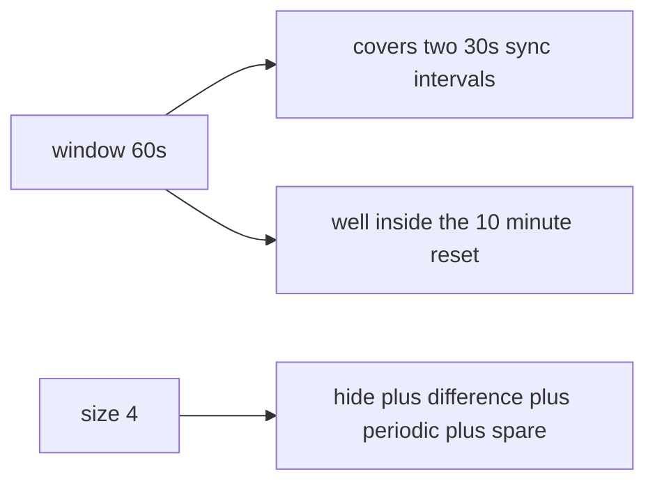
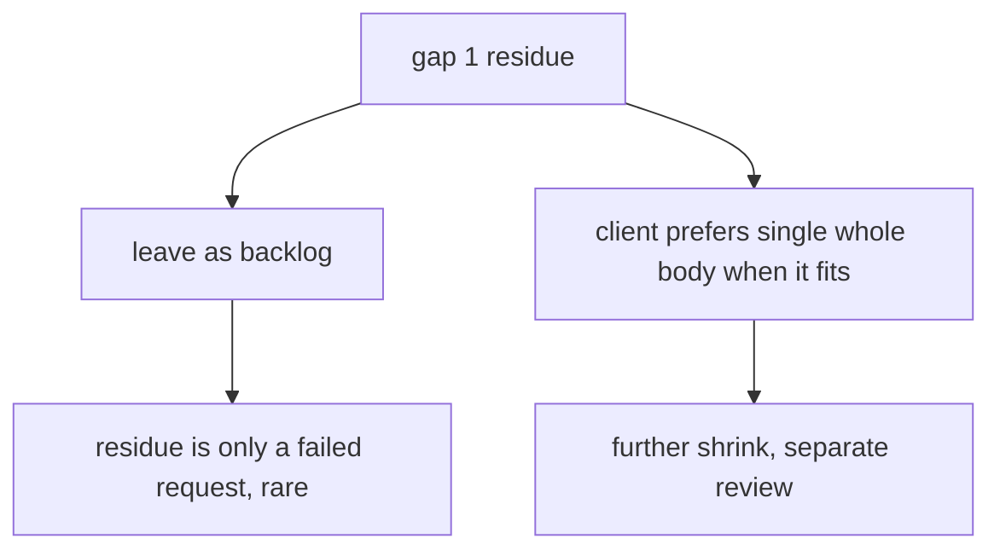

# Sync stale-but-recent ring: closing three save-loss gaps

Status: PLAN only. Nothing is built. Worktree `p-hard-sync-ring`, branch
`build/hard-sync-ring-plan`, cut from integration train 47 (`b83696932`), which
already holds the gated-door currentRoom sync, the notSaved contract and the
train 46 hidden-tab save (including the review R3 m1 guard fix at
state-sync.js:984-989).

This is the server follow-up the hidden-save review R3 left for the server
stream ("Server follow-up", section "Net against base"). It is treated here as a
starting point and re-derived from the code, not taken on trust.

## 1. What the task is

`sync_state` orders whole request bodies by one scalar stamp,
`player_state['lastSyncClientTs']`. A request at or below that stamp (and no more
than ten minutes below it) is stale, and a stale request skips every
last-write-wins section wholesale. Three rare interleavings lose a legitimate
save because of this all-or-nothing ordering:

- Gap 2: a newer-content body is stamped below an older-content body that
  reached the server first, so the newer content is dropped as stale.
- Gap 3: a key changed twice, the newer value reaches the server first with the
  lower stamp, and the older value lands second with the higher stamp and wins.
- Gap 1: the one large body that uniquely carries some content fails after the
  page is gone, so that content never reaches the server at all.

The fix keeps a short, bounded ring of the last few accepted writes (clientTs
plus the keys or whole sections each wrote, never any values) and applies a
stale-but-recent request key by key, skipping only the keys a newer recorded
request already wrote, without moving `lastSyncClientTs`. A matching client
change stamps the reduced flush body above the flush it follows instead of below
it. Together these close gaps 2 and 3 in full and shrink gap 1 to the single
residue no server can reach: a request that never arrives.

## 2. Current behaviour, from the code

Server, `app/controllers/break_escape/games_controller.rb`:

- `sync_state` (:833) runs one transaction under `Game.lock` with the narrow
  `SYNC_STATE_COLUMNS` load (:2116, no scenario_data). Order inside: format
  refusal (:848, a 409 that rolls back), `stale_sync_request?` (:853),
  `merge_last_write_wins_sections` unless stale (:863), `merge_grow_only_sections`
  always (:866), the capture step always (:871), then one `save!` only if
  something changed (:880).
- `stale_sync_request?` (:2169): reads `params[:clientTs]`. A request with no
  numeric clientTs is never stale (old clients). Stale when
  `client_ts <= stored && stored - client_ts <= SYNC_STALE_RESET_MS`
  (ten minutes, :2122). Otherwise it stores `client_ts` as the new
  `lastSyncClientTs` and returns false.
- `merge_last_write_wins_sections` (:2187): currentRoom (with
  `may_sync_current_room?` acceptance, `credit_via_pass_on_sync!` and the
  notSaved refusal contract at :2206-2217), globalVariables, npcInkVariables,
  timedMessages, phoneState (notSaved over a cap), mailState (notSaved over a
  cap, plus mailTrimmed), npcVisibility, npcHostility, playerHealth, notes. It
  returns nil today (currentRoom no longer 403s; the `refusal`/Rollback path at
  :864 is dormant but kept).
- `merge_grow_only_sections` (:2285): scenarioBriefShown, triggeredEvents,
  scenarioClock, commandBoardLog, biometricSamples. Union, max or earliest, all
  idempotent, all run on a stale request already.
- The capture step (:913) is server-owned and grow-only; it already runs on a
  stale request and takes every stored field from the scenario, so the client
  never owns the record. `se_captures` is a server-owned global that
  `merge_global_variables!` drops (game.rb:806).
- `lastSyncClientTs` lives in player_state and is never in the bootstrap
  `filtered` payload (:320-430, each key added explicitly) nor in any sync
  answer (:883-904, built from fixed fields). This is the precedent the ring
  follows.

Client, `public/break_escape/js/state-sync.js`:

- `nextClientTs` (:723) is `max(Date.now(), last + 1)`, so stamps only rise on a
  page.
- `buildChanges` (:564) diffs against `this.confirmed`: keyed sections
  (`KEYED_SECTIONS`, :31) per key, whole sections (`WHOLE_SECTIONS`, :42) whole,
  currentRoom, scenarioBriefShown, the clock and timed-text keys. It returns
  `{ body, ack }` or null.
- `confirm` (:684) records the ack as the new confirmed snapshot, honouring
  notSaved (currentRoom is confirmed even when refused).
- `_applyAnswer` (:1001): a stale answer confirms nothing; an answer older than
  `_confirmedTs` confirms nothing.
- `flush` (:836) is the pagehide and hidden-tab keepalive. When no flush is in
  flight it sizes the whole delta (`_sizeFlushBody`, :939). When a flush is
  already in flight it sends the whole delta if it fits beside it with a fresh
  stamp above it (:868-871), else the reduced difference `_changesSinceInFlight`
  (:968) stamped `oldest.clientTs - 1`, that is below the in-flight flush, with
  the "leave one clientTs free below every flush" rule (:853-855). This
  below-stamping is exactly what creates gaps 2 and 3.

## 3. The three gaps, as concrete interleavings that lose a save today

All three need the whole delta to exceed the keepalive budget
(`KEEPALIVE_BODY_LIMIT` 60000, :6) during a hide, show, hide sequence, so that
the second flush goes as a reduced difference body D stamped below the hidden
flush H. H is the large hidden flush (stamp `tsH`), D the reduced difference
(stamp `tsH - 1`). "prevTs" is the last stamp before H.

### Gap 2: newer content dropped as stale

1. Last confirmed sync holds `g = 5`, `health = 100`.
2. Page hidden. A 45 KB global `blob` changed. Flush H sends `{ blob, g:5,
   health:100 }` at `tsH = 1002`, guard set, in flight.
3. Page visible, then hidden again. Meanwhile `health` dropped to 70 (a hit).
   The whole delta (`blob` plus `health`) does not fit, so D sends
   `{ playerHealth: 70 }` at `tsD = 1001`.
4. Network delivers H first. Server stores `lastSyncClientTs = 1002`, writes
   `blob`, `health = 100`.
5. D arrives at 1001. `1001 <= 1002` and within ten minutes, so stale. The whole
   of `merge_last_write_wins_sections` is skipped. `health = 70` is lost; the
   player's recorded health is the pre-hit 100.

### Gap 3: a key changed twice, older value wins

1. Last confirmed sync holds `g = 5`.
2. Page hidden. H sends `{ blob(45 KB), g:5 }` at `tsH = 1002`, in flight.
3. Page visible, then hidden. `g` is now 7. Whole delta does not fit, so D sends
   `{ globalVariables: { g: 7 } }` at `tsD = 1001`.
4. Network delivers D first. `1001` is newer than the last confirmed stamp, so
   fresh. Server writes `g = 7`, stores `lastSyncClientTs = 1001`.
5. H arrives at 1002. `1002 > 1001`, so fresh. Server writes `g = 5` (the value
   H was built with). The newer `g = 7` is overwritten by the older `g = 5`.

### Gap 1: the unique large body fails after the page is gone

1. Last confirmed sync holds `g = 5`.
2. Page hidden. H sends `{ blob(45 KB), g:5 }` at `tsH = 1002`, in flight.
3. Page visible, then hidden. `late = 1` changed. Whole delta does not fit, so D
   sends `{ globalVariables: { late: 1 } }` at `tsD = 1001`.
4. D lands, server writes `late = 1`.
5. H's request fails (a 500, a dropped connection) while the page is already
   gone, so there is no pagehide left to resend. `blob` was only ever carried by
   H. `blob` is lost. The server never received it.

Gap 1 is the one a server change cannot fully close: the server cannot apply
content that never reached it. The ring plus the client re-stamp shrink it so
that `blob` is lost only when H's own request fails to arrive, never merely
because of the order H and D land in.

## 4. The ring

### Where it lives

In `player_state`, under one new key `syncWrites`, beside `lastSyncClientTs`.
Not a new column: a column needs a migration (which cannot be run or tested in
this shared-database environment) and would widen the narrow sync load the
sync-deltas rule keeps thin. player_state already carries `lastSyncClientTs`,
already rides the `SYNC_STATE_COLUMNS` load and the one conditional `save!`, and
is already proven never to reach the client. The ring inherits all of that.

### Shape and bound

```
player_state['syncWrites'] = [
  { "ts": 1700000001002, "w": { "globalVariables": ["g"], "playerHealth": true } },
  { "ts": 1700000001001, "w": { "globalVariables": ["late"] } }
]
```

- `ts`: the request's clientTs (integer).
- `w`: a map of section name to either an array of the keys that request wrote,
  or `true` meaning the whole section was claimed.

Constants (controller):

- `SYNC_RING_MAX = 4` entries.
- `SYNC_RING_WINDOW_MS = 60_000` (60 s).
- `SYNC_RING_KEYS_PER_ENTRY = 32` recorded keys across all sections in one entry.

### Append and expiry (fixed-size proof)

On every accepted request that wrote at least one last-write-wins key or section
(fresh or stale-but-recent), append `{ ts, w }` where `w` holds only the
sections and keys that actually landed (after server-owned and read-only drops,
after notSaved refusals, after a refused currentRoom). Then normalise:

1. If one entry's recorded keys exceed `SYNC_RING_KEYS_PER_ENTRY`, collapse its
   largest sections to `true` until it is within the cap. A first-after-load
   full snapshot therefore records as a handful of `true` section claims, not
   hundreds of keys.
2. Drop every entry whose `ts` is more than `SYNC_RING_WINDOW_MS` below the
   largest `ts` present.
3. Keep the newest `SYNC_RING_MAX` entries by `ts`.

Size ceiling: at most 4 entries, each at most 32 short strings plus a few
section names and a ts, so the ring is bounded above by roughly 4 KB of jsonb
regardless of session length or how many syncs run. It never accumulates: step
2 and step 3 run on every append, and nothing else writes it. A test asserts the
serialised ring stays under a fixed byte cap after a long run of syncs.

### Never sent to the client

The ring is read and written only inside `sync_state`. It is not added to the
bootstrap `filtered` payload (:320-430) and not added to any sync answer
(:883-904), exactly as `lastSyncClientTs` is not. Two tests pin this: the
bootstrap payload for a game whose player_state carries `syncWrites` does not
mention it, and a `sync_state` answer body does not mention it. Nothing in the
ring is a value a reader could want anyway, only stamps and key names.

## 5. The stale bands and the key-by-key merge

`stale_sync_request?` keeps its two existing outcomes and gains a middle band.
For a numeric clientTs with a stored `lastSyncClientTs`:

- `client_ts > stored`: fresh. Store it as today. Record a ring entry for what
  it writes.
- `stored - client_ts > SYNC_STALE_RESET_MS` (over ten minutes below): the
  existing reset. Treat as fresh, store it, as today.
- `SYNC_RING_WINDOW_MS < stored - client_ts <= SYNC_STALE_RESET_MS` (stale, but
  older than the ring window): fully stale, exactly today's behaviour. Skip all
  last-write-wins sections, run grow-only and capture, do not move the stamp.
- `0 <= stored - client_ts <= SYNC_RING_WINDOW_MS` (stale but recent): the new
  path. Build the skip set from the ring and apply last-write-wins sections key
  by key, as below. Do not move `lastSyncClientTs`. Record a ring entry for what
  this request actually wrote (it may be trimmed away at once if four newer
  entries already fill the window, which is harmless).

The skip set for a stale-but-recent request at `ts`: the union, over every ring
entry with `entry.ts > ts`, of that entry's `w`. A section mapped to `true` by
any such entry is wholly claimed. Otherwise the claimed keys of that section are
the union of the arrays.

The mechanism is a pre-filter, not a rewrite of the merge methods. Before each
`merge_*!` call the stale-but-recent path removes from the incoming params any
key a newer entry claimed, and skips the call entirely for a wholly-claimed
section. The existing merge methods then run unchanged on the narrowed input, so
their own guards (server-owned globals, read-only globals, the revoked-cards
union, the mail and phone caps) all still apply. A key left in is, by
construction, one no newer accepted request wrote, so this request holds the
most recent value for it and last-write-wins is correct.

Per section type:

- Keyed last-write-wins (globalVariables, npcInkVariables, npcVisibility,
  npcHostility, mailState, notes, phoneState, timedMessages): drop the keys a
  newer entry claimed; if the whole section is claimed, skip it. notes key by
  `id`, mailState and phoneState by their flattened keys exactly as the client
  and `merge_mail_state!` / `merge_phone_state!` key them. phoneState and
  mailState keep their notSaved-over-a-cap behaviour on the keys that remain.
- Whole last-write-wins (playerHealth): recorded as a whole-section write
  (`"playerHealth": true`). Apply only when no newer entry wrote playerHealth.
- Grow-only (triggeredEvents, scenarioClock, commandBoardLog, biometricSamples,
  scenarioBriefShown): never filtered. They are commutative and idempotent and
  already run on fully stale requests; they do not need and must not get skip
  logic (skipping them could drop a union member).
- currentRoom (whole last-write-wins string with a refusal contract): recorded
  as `"currentRoom": true` only when it was actually accepted and written (not
  when `may_sync_current_room?` refused it and it went to notSaved, so a later
  legitimate room is never blocked by a refused one). On a stale-but-recent
  request, skip currentRoom when a newer entry wrote it; otherwise run the normal
  `may_sync_current_room?` acceptance, `credit_via_pass_on_sync!` and notSaved
  path unchanged.
- Server-owned, never written by a stale request: `lastSyncClientTs` (never
  moved on the stale-but-recent path, the load-bearing invariant of this whole
  change), `se_captures` (dropped by `merge_global_variables!`, recorded only
  through the capture step), the viaPass and gated-door credit globals
  (`server_credit_global_names`, written only by the server's own credit path,
  game.rb:808), and the ring itself. None of these is driven by stale incoming
  content.

## 6. Row lock and format 409

Everything runs inside the one `Game.lock` transaction (:840), so the ring read,
the skip-set build, every merge and the ring append are serialised per game. Two
syncs for the same game cannot interleave their ring reads and writes; the
second blocks on the row lock and reloads post-commit (`with_lock` semantics,
:2315). Reordering is only ever across the network before the lock, which is
exactly what the ring is for.

The format refusal (:848-851) still runs first and still rolls the transaction
back on a 409, so a format-refused request writes neither `lastSyncClientTs` nor
the ring. The ring change adds nothing to the format path and does not touch
`sync_format_refusal`. The dormant 403 `refusal`/Rollback path (:864) is
untouched; the stale-but-recent path returns no refusal, so it cannot 403.

## 7. Network delay, reordering and the legitimate player

The point of the change is that a legitimate player who is simply slow or whose
packets reorder never loses progress and is never refused:

- Two periodic syncs reordered: already safe today and stays safe. A later sync
  carries everything an earlier unconfirmed sync held, so either order lands
  everything.
- A reduced flush D re-stamped above its hidden flush H (the client change,
  section 8): if D lands first, H arrives stale-but-recent and the ring merges
  H's unique keys (gap 1 shrunk) while skipping the keys D already wrote (gap 3
  closed). If H lands first, D is fresh and applies (gap 2 closed).
- A periodic sync drawn before H and still in flight: if it lands after a newer
  body, it is stale-but-recent and merges key by key rather than being dropped
  whole, so its own content survives where a newer request did not supersede it.
- A clock set back mid-session: `nextClientTs` keeps stamps rising on the page;
  the ten-minute reset still absorbs a reload-time clock change. The ring window
  is 60 s, well inside that, so a reset request (over ten minutes below) is
  fresh, never a stale-but-recent merge against a stale window.
- No new refusal is introduced. A stale-but-recent request returns
  `{ success: true, stale: true }` with the capture answer fields as today, plus
  it now actually applies its unclaimed keys. The client still treats a stale
  answer as "resend with the next sync" (:773), which remains correct and
  harmless: anything it resends is either unchanged or newer.

## 8. The client change

Server-only, the ring closes gap 2 even for an unchanged old client, because the
stale body D (stamped below H) becomes a stale-but-recent merge instead of a
whole-body skip. It does not close gap 3 for an old client, because gap 3's
losing body H is the newer-stamped one, which the ring never treats as stale. So
one client change is needed to close gap 3 and to shrink gap 1:

In `flush`, the `_changesSinceInFlight` path (:875-881) stops stamping the
reduced body at `oldest.clientTs - 1` and instead draws a fresh stamp above every
in-flight flush (a plain `nextClientTs`, which is already above them). The
"leave one clientTs free below every flush" reservation (:853-855) is then no
longer needed and is removed. The whole-delta-if-it-fits branch (:868-871)
already stamps above and is unchanged.

Why this is safe with the ring and not without it: a reduced body stamped above
H could, before the ring, make H stale and drop H's unique sections. With the
ring, H arriving stale-but-recent has its unique keys merged, so nothing H
uniquely carries is lost to the order. The client change and the server change
ship together on the same train; the server tolerates an old client (it just
does not get the gap 3 / gap 1 improvement), and a new client against an old
server is no worse than today (the reduced body is stamped above H, so if H
lands second it is fully stale and skipped, which is the same whole-body loss as
today, not a regression, and only in the rare oversized-delta hide-show-hide
case). Rollout note: server first or together is fine; new-client-old-server is
acceptable for the brief train window.

No other client change. `_applyAnswer`, `confirm`, the notSaved and mailTrimmed
handling and the hidden-guard logic (including the R3 m1 fix at :984-989) are
untouched.

## 9. Delta-sync rule compliance (load-bearing)

- player_state does not grow and is not re-sent: `syncWrites` is bounded to four
  entries within a 60 s window by the append normalisation (section 4), and it
  is never serialised to the client, so the client never re-sends it.
- Every sync still sends only its own delta. The ring changes what the server
  does with a delta that arrives out of order, not what the client sends. The
  one client change makes a reduced flush body smaller-or-equal, never larger.
- No value is stored in the ring, only stamps and key names, so the ring cannot
  become a second copy of player_state.

## 10. Tests

Unit, Ruby (new `test/controllers/break_escape/sync_stale_ring_test.rb` and a
model test if the ring helpers live in Game):

- ring append records only landed keys; a refused currentRoom and a notSaved
  mailState are not recorded.
- ring normalisation: over-32-key entry collapses largest sections to `true`;
  entries older than 60 s below the max are dropped; at most four kept; byte cap
  holds after a long synthetic run.
- skip-set build: union of writes of entries newer than a given ts, with `true`
  dominating.
- a stale-but-recent request applies unclaimed keys, skips claimed ones, does
  not move `lastSyncClientTs`, and still runs grow-only and capture.
- a fully stale request (beyond the window) behaves exactly as today.
- the reset band (over ten minutes) is fresh, as today.

Controller interleaving (the core proof, same file): drive the three gaps as
ordered `sync_state` requests against one game and assert the final
player_state.

- Gap 2: H then D, assert `playerHealth == 70` and `blob` present.
- Gap 3: D then H, assert `g == 7`.
- Gap 1 recovery: D (reduced, `late`) then H (stale-but-recent, `blob`), assert
  both `late` and `blob` present and `lastSyncClientTs` unchanged by H.
- currentRoom: a newer entry wrote currentRoom, an older stale-but-recent room
  is skipped; and a refused currentRoom does not block a later legitimate room.

Unit, JS (extend `test/js/state-sync-hidden-save.test.mjs` or a new
`test/js/sync-stale-ring.test.mjs`): the reduced flush body is stamped above the
newest in-flight flush, not below; the "leave one free below" reservation is
gone; the whole-delta-if-it-fits path is unchanged; no regression in the hidden
guard tests. Add the new JS file to each test harness copy list if it imports a
new module (it should not need to).

Live browser proof on the keyless server on an assigned port (3670 or 3671,
started by hand the way `tools/playtest/start-keyless-server.sh` starts :3001,
never :3000), headless, killed by PID afterwards: load a game, then issue two
overlapping `sync_state` PUTs with crafted clientTs in a controlled order (via
the window.__test bridge or direct fetch with the CSRF token), reproducing gap 2
and gap 3 on the real controller path, and assert the persisted player_state
through a fresh bootstrap. This is the real-path proof the fix-claims rule
requires, not only a helper test.

Run, without the shared lock, every test file this change touches and every file
that imports a changed module: the new controller and JS files, and the existing
`captures_sync_test.rb`, `current_room_guard_refusal_test.rb`,
`mail_state_sync_test.rb`, `saved_current_room_test.rb`,
`reload_persistence_test.rb`, `format_version_test.rb` and the state-sync JS
suite. The integrator runs the full suites once per batch.

## 11. Chunked build order

1. Ring storage and helpers (append, normalise, skip-set build) with unit tests.
   Record-only, no behaviour change yet: fresh requests write the ring, nothing
   reads it. Commit.
2. Stale-but-recent band in `stale_sync_request?` and the key-by-key pre-filter
   in `sync_state`, for the keyed sections and playerHealth. Controller gap 2
   test. Commit.
3. currentRoom under the stale-but-recent path (skip when newer, else the normal
   acceptance and notSaved contract). currentRoom test. Commit.
4. Client re-stamp of the reduced flush body above the in-flight flushes, remove
   the below reservation. JS unit tests, controller gap 3 and gap 1 tests.
   Commit.
5. Never-sent and size-bound tests, then the live browser reordered-request
   proof on the assigned port. Commit.
6. Comments and this document's cross-references tidied. Commit.

Each chunk commits with explicit paths after checking `git diff --cached --stat`.

## 12. Open questions

### Q1. Ring in player_state, or a new column?

Context. player_state already carries `lastSyncClientTs`, already rides the
narrow sync load and the one conditional save, and is proven never to reach the
client. A column would isolate the ring from player_state's jsonb dirty tracking
but needs a migration, which cannot be run or tested in this shared-database
environment, and widens the narrow load the sync-deltas rule keeps thin.



Before (player_state today):

```json
{ "lastSyncClientTs": 1700000001002, "globalVariables": { "g": 7 } }
```

After (chosen):

```json
{
  "lastSyncClientTs": 1700000001002,
  "globalVariables": { "g": 7 },
  "syncWrites": [ { "ts": 1700000001002, "w": { "globalVariables": ["g"] } } ]
}
```

Recommendation: player_state. The migration constraint is decisive here, the
size is bounded, and the never-sent proof is the same one `lastSyncClientTs`
already relies on.

### Q2. Per-key records with a cap, or section-level only?

Context. Section-level records (record only which sections a request touched)
are smaller and simpler, but a stale-but-recent request would then skip a whole
section a newer request merely touched, dropping that request's keys the newer
one never carried, which is exactly the content gap 1 needs to preserve.
Per-key records preserve those keys but can be large for a full-snapshot sync.



Before (section-level record):

```json
{ "ts": 1700000001002, "w": { "globalVariables": true } }
```

After (per-key with a 32-key cap, collapsing to true only when oversized):

```json
{ "ts": 1700000001002, "w": { "globalVariables": ["late"] } }
```

Recommendation: per-key, capped at 32 keys per entry, collapsing the largest
sections to `true` only when a single request writes more than the cap (a
first-after-load snapshot). This keeps gap 1 recovery for the common small
difference bodies and bounds the size.

### Q3. Ship the client re-stamp with this, or server only?

Context. The server ring alone closes gap 2 for every client. Gap 3 and the gap
1 shrink need the client to stamp the reduced flush body above its hidden flush.
A new client against an old server is no worse than today in the rare oversized
hide-show-hide case, and no worse at all otherwise.



Before (reduced body stamp today): `clientTs = oldest.clientTs - 1` (below H).

After: `clientTs = nextClientTs()` (above every in-flight flush).

Recommendation: ship both together on train 47. The server change is the larger
and riskier part and should not wait for a second train to pair with the client
change.

### Q4. Ring window 60 s and size 4: right numbers?

Context. The window must comfortably exceed the largest realistic gap between a
flush and the difference body that chases it, which is bounded by how long a
keepalive stays in flight (seconds, not minutes). The periodic sync interval is
30 s, so a 60 s window spans two intervals. Four entries cover a hide, a
difference body, a periodic sync and one spare in the same window.



Before and after are the constants, not data: `SYNC_RING_WINDOW_MS` and
`SYNC_RING_MAX`.

Recommendation: 60 s and 4, with `SYNC_RING_KEYS_PER_ENTRY = 32`. They are the
integrator's figures and fit the timing; a test asserting the byte ceiling pins
them.

### Q5. The gap 1 residue: leave it, or add a client preference for one body?

Context. After this change, gap 1 loses content only when the one request that
uniquely carries it fails to arrive and the page is already gone. A client could
shrink this further by preferring a single whole body over H plus D whenever the
whole delta fits the budget, so the unique content rides the body most likely to
land. That is a separate client change with its own review.



Before: H carries unique `blob`, D carries `late`, two bodies.

After (option C): one body carries `blob` and `late` when it fits the budget.

Recommendation: leave the residue as backlog for this plan. It is a failed
request, which no server change reaches, and the single-body client preference
deserves its own plan rather than riding this one.
