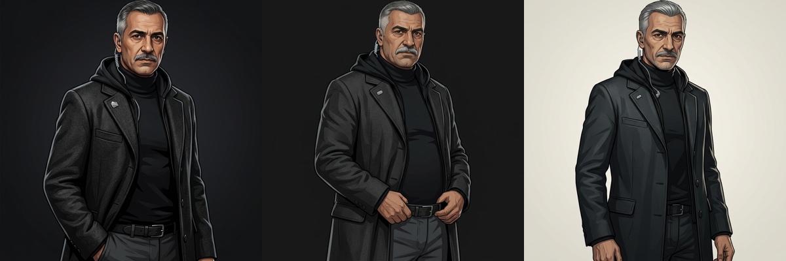
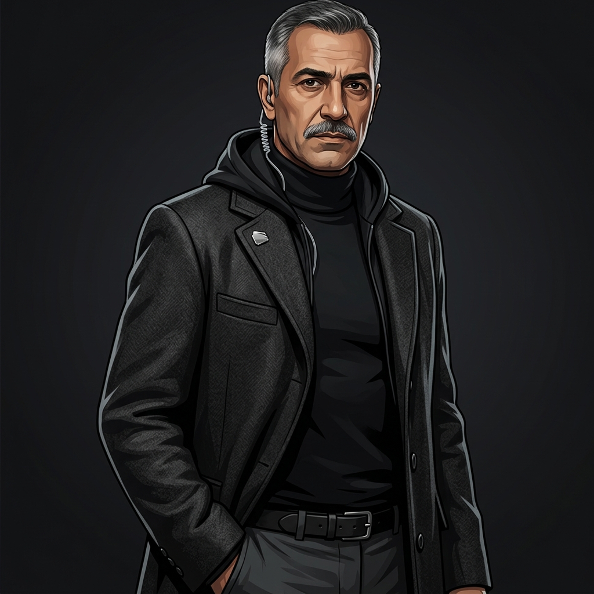
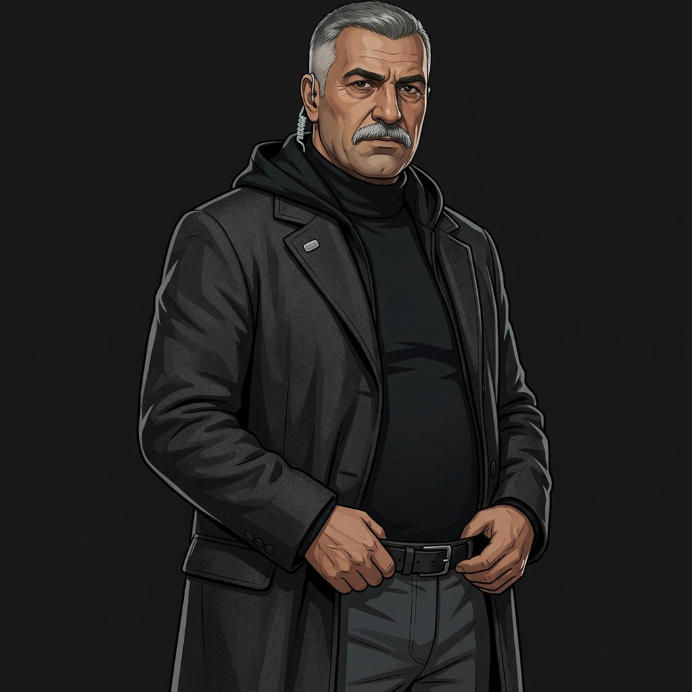
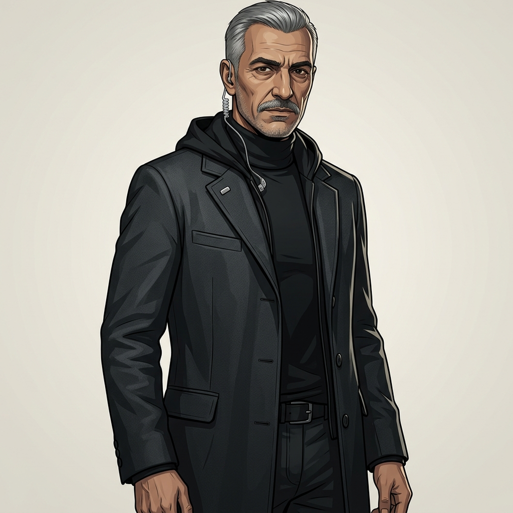

# Cast-look proposals, m05–m08 (character stage)

Written 2026-10-16 after the user approved the character-stage prep: a look for every m05–m08 NPC that has no art of its own, then concepts for each approved character, one at a time. Only Kemal Aydin (m06 C1) has concepts so far (see the m06 section).

**Scope.** Every NPC in the four `scenario.json.erb` files whose `spriteSheet` / `avatar` points at a shared stand-in (`female_scientist_v2`, `male_office_worker_v2`, a borrowed headshot, and so on). The recurring characters, which already have their own art (HaX `agent_hax`, Netherton `netherton`, Nightshade `nightshade`) and m04's cast, are left out. The player sprite isn't an NPC and is left out too.

**How to read each entry.** *Voice* is quoted from the NPC's `voice.style` in the erb, so the age and accent in the look match what the player hears. *Look* is the description that goes into the Gemini prompt (character-talk-animation Step 1). The text rarely gives ethnicity, so each mission's choices are explained in its "Cast balance" note (AGENTS.md: keep the cast diverse). Every character faces right in the finished art: the concepts get flipped in Step 1b.

**Cost once approved.** Gemini runs 3–4 metered calls per character for concepts. PixelLab is a flat subscription, at about 4 generations for the bust, 15 for visemes and a walk character with the six standard animations.

**Wiring issues found along the way (not proposals, for the orchestrator):**

- m05 and m06 still give Netherton the generic `male_spy_v2` sheet, talk and visemes (m05 erb `director_netherton`, m06 erb `director_netherton`), and use `male_spy_headshot.png` as his phone avatar (m05 :786, m06 :798). m07 and m08 use `netherton`. Point m05/m06 at `netherton` too (mission-local, sprite fields only, no spoken line changes).
- m05's `patricia_phone` should use her new headshot once it exists (it now uses `female_security_guard_headshot.png`, :1400).
- **Codename clash (settled 2026-10-16):** m04's ENTROPY operative "Cipher" (sprite `operative_cipher`) keeps the name. The user renamed m08's SAFETYNET suspect to "Agent 0x23 'Vector'"; his ids, globals, ink file and routes were renamed with him (`agent_vector`, `m08_suspect_vector.ink`), and his sprite key is `agent_vector`.
- **Dani's gender** (m06): settled by the user on 2026-10-16: Dani is a young man. The ink comment, the credits line and the voice style now say "he"/"his", matching the voice (Puck) and the stand-in sprite (`male_office_worker_v2`).

## m05 Insider Trading (6 NPCs, one with a second portrait)

**Cast balance.** Lisa is British-Korean (the voice says so). Torres was born in Madrid. Halloran's Dublin voice and Patricia's Cardiff voice suggest white Irish and white Welsh, and the proposal keeps that. To widen the range, Owen becomes mixed-race (Black British with Irish heritage, which fits the surname and Manchester) and the Recruiter becomes African-American. Ages run late twenties (Owen), early thirties (Lisa), mid-forties (Halloran), late forties (Torres) and early fifties (Patricia) to fifties (the Recruiter). That gives three women and two men on site, plus the Recruiter by phone. Today Halloran shares `female_scientist_v2` with m06's Irina and m07's Elena, and Lisa shares `female_office_worker_v2` with m06's Priya and m08's analyst and ATHENA, so these new keys also stop three missions looking alike.

### M05-1: The Recruiter (`recruiter`, phone) — logged need D8

- **Who she is:** ENTROPY's talent spotter, a former intelligence-agency recruiter, calling from somewhere comfortable. Talks about people as placements. She may come back (m06 follows the TalentStack money), so she gets art of her own.
- **Voice:** Gacrux; "former intelligence-agency talent spotter in her fifties … educated American (Washington DC, Mid-Atlantic) accent … low, warm … charming and empathetic on the surface, utterly ruthless underneath."
- **Look for the concept prompt:** an African-American woman in her mid-fifties with warm brown skin, short silver-grey natural hair cut close and neat, small pearl studs, tortoiseshell reading glasses. She wears a camel cashmere roll-neck under a tailored dark navy blazer, a slim gold watch and dark tailored trousers. Polished, at ease, the faint smile of someone who already knows your answer.
- **Stand-in now:** phone avatar `helen_carver_headshot.png` (sis01's hospital CIO, a different woman).
- **Recommended sprite key:** `the_recruiter`. Make the concept, bust, talk/visemes and headshot now, and leave the walk character until a mission puts her in a room.

**Decision:**
- [ ] Approve  - [ ] Change

**Comments:**

### M05-2: David Torres (`david_torres`) — plus the knocked-out portrait, logged need D6

- **Who he is:** a senior engineer, the insider, who is found alone at the upload terminal in the data centre. Grieving and past lying. After the knockout the narration has him down and bleeding, but today his bust stands relaxed (D6).
- **Voice:** Schedar; "late forties, born in Madrid and twenty years in England … light Castilian Spanish accent … low, soft … exhausted and grieving, past the point of lying."
- **Look for the concept prompt:** a Spanish man of about 48 with light olive skin, dark curly hair going grey and in need of a cut, two days of salt-and-pepper stubble, tired dark eyes with heavy shadows. He wears a creased pale blue Oxford shirt with the sleeves rolled and the collar open, a loosened dark tie, a lanyard with a blank staff card, navy chinos and a brown belt. A man who hasn't slept for a week.
- **Second portrait (`david_torres_ko`):** the same man, same clothes, slumped and seated on the floor with his back against a server rack. His tie is pulled askew, a cut at the hairline with blood running down to the brow, and one hand is pressed to his ribs. His eyes are open and his mouth closed (frame 0 has to be closed). He still speaks in the post-KO knot, so it needs visemes too. **Wiring needs an engine change** (the user approves engine work): no person-chat tag swaps or hides the bust today (D6, checked against `chat-helpers.js`). The options are a new `#portrait:` tag, or a mission-local second NPC (`david_torres_down`) shown after the KO that carries the alternative bust and the post-KO knot. The second option needs no engine work but does mean moving ink.
- **Stand-in now:** `male_nerd_v2` (shared with m08's Vector).
- **Recommended sprite keys:** `david_torres`, plus `david_torres_ko` (bust, visemes and headshot only, no walk character).

**Decision:**
- [ ] Approve  - [ ] Change

**Comments:**

### M05-3: Lisa Park (`lisa_park`)

- **Who she is:** the marketing coordinator and the office gossip, who points the player at people. She gossips because she cares.
- **Voice:** Laomedeia; "early thirties, British-Korean, raised in New Malden … south-west London accent … bright, mid-to-high … quick, chatty … warm and observant."
- **Look for the concept prompt:** a British-Korean woman of about 32 with light skin, shoulder-length black hair with a soft fringe and a tortoiseshell claw clip, small gold hoops. She wears a mustard-yellow cardigan over a white tee, a staff lanyard with a blank card, high-waisted dark jeans and a tan belt. Friendly and alert.
- **Stand-in now:** `female_office_worker_v2`.
- **Recommended sprite key:** `lisa_park`.

**Decision:**
- [ ] Approve  - [ ] Change

**Comments:**

### M05-4: Owen Gallagher (`owen_gallagher`)

- **Who he is:** the systems administrator, frazzled, sardonic about the network and relieved someone competent has turned up.
- **Voice:** Puck; "late twenties … Manchester accent … quick, energetic … friendly and a bit frazzled, sardonic."
- **Look for the concept prompt:** a mixed-race Black British man of about 28 with light brown skin and freckles, short curly dark hair with a fade, a short beard. He wears a faded navy band-style t-shirt (no text) under an open grey zip fleece, a lanyard with a blank card and a USB stick clipped to it, black jeans and a black belt with a multitool pouch. The look of someone who has been under a desk for an hour.
- **Stand-in now:** `male_telecom_v2`.
- **Recommended sprite key:** `owen_gallagher`.

**Decision:**
- [ ] Approve  - [ ] Change

**Comments:**

### M05-5: Dr Ruth Halloran (`dr_halloran`)

- **Who she is:** the cryptography research lead, sharp, protective of her team and impatient with sloppy reasoning. She's one of the whodunnit's suspects.
- **Voice:** Erinome; "mid-forties … educated Irish (Dublin) accent … clear, mid-range … measured, precise … sharp, protective of her team."
- **Look for the concept prompt:** a white Irish woman of about 45 with fair, lightly freckled skin, auburn hair with some grey, pinned up in a loose twist, rectangular black-framed glasses. She wears a dark green fine-knit jumper under a charcoal blazer, a lanyard with a blank card, grey wool trousers and a black belt. She looks at you as if checking your working.
- **Stand-in now:** `female_scientist_v2` (also m06 Irina and m07 Elena).
- **Recommended sprite key:** `ruth_halloran`.

**Decision:**
- [ ] Approve  - [ ] Change

**Comments:**

### M05-6: Patricia Morgan (`patricia_morgan`, plus her phone twin `patricia_phone`)

- **Who she is:** the Chief Security Officer, ex-military, the player's ally on site. Dry and steady, with warmth only in what she notices.
- **Voice:** Kore; "early fifties, ex-military … South Wales (Cardiff) accent … firm, low-to-mid … brisk, economical … direct, dry and steady under pressure."
- **Look for the concept prompt:** a white Welsh woman of about 52 with fair, weathered skin, short silver-blonde hair in a practical crop, pale grey eyes. She wears a black security-manager's jumper with shoulder patches (no text) over a white collared shirt, a radio clipped at the shoulder, a lanyard with a blank card, black trousers and a black duty belt with a torch. She stands like someone who used to wear a uniform.
- **Stand-in now:** `female_security_guard_v2`; her phone avatar is `female_security_guard_headshot.png`.
- **Recommended sprite key:** `patricia_morgan` (both the person and phone entries use it).

**Decision:**
- [ ] Approve  - [ ] Change

**Comments:**

## m06 Follow the Money (6 NPCs)

**Cast balance.** Most of it comes from the voices: Irina is Russian (mid-thirties), Dani British-Nigerian (early twenties), Priya British-Indian from Leeds (mid-thirties), Kemal Turkish-German (late fifties), Satoshi from the American West Coast (early forties). The checkpoint guard's text says only South London and forties, so the proposal makes him a South London-born son of Colombian parents (Elephant and Castle has a long-standing Latin American community). Nobody else in the mission is Latin American. British-Caribbean was the first idea, but Netherton (Black British of Caribbean heritage, late fifties, ex-military) is in m06 too, and a second stern older Black man in a uniform-like role would blur the two. Satoshi stays white American: he borrowed the Japanese pseudonym, and giving him Japanese heritage would make it read as his real name. That's two women and four men, aged early twenties to late fifties.

### M06-1 (C1): Kemal Aydin, Satoshi's minder (`satoshi_minder`) — approved; three concepts below

- **Who he is:** Turkish-German, late fifties, from Hamburg. He spent thirty years as a bank's vault security chief and now guards Satoshi for the Crypto Anarchists, because he believes in them. Courteous and immovable.
- **Voice:** Iapetus; a German (Hamburg) accent in careful, fluent English; low, gravelly and slow.
- **Look for the concept prompt:** a broad-shouldered Turkish-German man of about 58, close-cropped grey hair greying at the temples, a neat grey moustache, olive skin, dark eyes. He wears a dark charcoal overcoat over a black roll-neck, a plain earpiece wire, and a small lapel pin. The Crypto Anarchists' hooded look shows only as a black hood worn down under the coat collar, which keeps a family likeness to Satoshi's sprite without copying it. (The concepts ask for a *plain* silver pin, because the prompts say "no text, no logos"; a HashChain mark can be added at the pixel stage if wanted.)
- **Stand-in now:** `male_hacker_hood_down_v2`.
- **Recommended sprite key:** `kemal_aydin`.

**Concepts** (Gemini, 3 calls, no reference images because the only existing art is pixel sprites; flipped to face right and reframed per Step 1b). The files are in git-ignored `public/break_escape/assets/characters/wip/`, each with a `_prompt.txt`, and the unflipped originals are kept as `_raw.png`. The chosen one becomes `characters/kemal_aydin_nonpixelart.png` with its prompt, and the PixelLab stages start from it.

| 1: the brief as written | 2: heavier, hands at the belt | 3: leaner, sterner, light background |
| --- | --- | --- |
|  |  |  |
| Close to the C1 text: grey crop, moustache, wool overcoat open over the roll-neck, hood down at the collar, one hand in a pocket. | A bigger, harder man, more bouncer than bank chief. His hands are visible at the belt; they're clean, but hands are what the bust stage most often mangles. | Taller, lined face, stubble, coat buttoned. Reads most like an ex-vault chief. The light background gives the dark coat a clean edge for the bust stage's background removal; 1 and 2 are dark coat on near-black. |

My pick: **3**, then 1. 3 matches "courteous and immovable" best and is the safest to pixelate. Concept 1's dark-on-dark edge could lose the coat's outline when the background is removed.

**Pick:**
- [ ] 1  - [ ] 2  - [ ] 3  - [ ] None (re-roll; say what to change)

**Comments:**

### M06-2: Checkpoint Guard (`checkpoint_guard`)

- **Who he is:** a contract guard on the trading-floor turnstile. Goes by his list. Can be talked round, slipped past or knocked out.
- **Voice:** Alnilam; "forties on a long shift … South London accent … low, flat … slow, procedural … unimpressed; goes by his list."
- **Look for the concept prompt:** a British-Colombian man of about 45 with light brown skin, a shaved head, a short greying goatee, heavy-lidded patient eyes, a small gold cross at the open collar. He wears a black contract-security bomber jacket with a plain grey shoulder patch (no text) over a white shirt with the collar open, a radio on his chest, a clipboard under one arm, black trousers and a black belt. He's been standing for nine hours and could stand nine more.
- **Stand-in now:** `male_security_guard_v2` (also m07's Ray Hollis).
- **Recommended sprite key:** `hashchain_guard`.

**Decision:**
- [ ] Approve  - [ ] Change

**Comments:**

### M06-3: Dr Irina Volkova (`irina_volkova`)

- **Who she is:** an academic cryptographer, guarded and precise, ten years in British academia.
- **Voice:** Kore; "mid-thirties, Moscow-educated and ten years in British academia, guarded and precise … light Russian accent … low-to-mid … measured … dry and tightly controlled."
- **Look for the concept prompt:** a white Russian woman of about 35 with pale skin and high cheekbones, straight ash-blonde hair scraped back into a low, tight bun, grey-blue eyes, thin silver-rimmed glasses. She wears a fitted black blazer over a high-necked ivory blouse, a thin silver chain, slim charcoal trousers and a black belt. Arms close to her body; she gives nothing away.
- **Stand-in now:** `female_scientist_v2` (also m05 Halloran and m07 Elena).
- **Recommended sprite key:** `irina_volkova`.

**Decision:**
- [ ] Approve  - [ ] Change

**Comments:**

### M06-4: Dani Okonkwo (`trader_npc`) — a young man (user, 2026-10-16)

- **Who he is:** a young crypto trader, wired on caffeine and frightened by what he has noticed. He flagged the ENTROPY wallets before anyone else did, and is scared of what that means.
- **Voice:** Puck; "young man … in his early twenties, British-Nigerian, jittery on caffeine and increasingly frightened … south-east London (Peckham) accent … mid-to-high … fast, nervy, over-explaining."
- **Look for the concept prompt:** a British-Nigerian man of about 23 with deep brown skin, short twists on top with a skin fade, a thin moustache, wide anxious eyes. He wears a slim navy gilet over a pale grey Oxford shirt with the top button undone, a smartwatch, a lanyard with a blank card, black slim trousers and a black belt. He has an energy-drink can in one hand (no label).
- **Stand-in now:** `male_office_worker_v2` (also m07's Mercer and m08's Phantom).
- **Recommended sprite key:** `dani_okonkwo`.

**Decision:**
- [ ] Approve  - [ ] Change

**Comments:**

### M06-5: Priya Raghavan (`blockchain_analyst`)

- **Who she is:** a blockchain forensics analyst who loves the work and hasn't yet understood what her own graph proves.
- **Voice:** Leda; "mid-thirties, British-Indian … Northern English (Leeds) accent … bright, mid-to-high … quick … enthusiastic and technical."
- **Look for the concept prompt:** a British-Indian woman of about 35 with medium brown skin, long thick black hair in a side plait, round black-framed glasses, a small nose stud. She wears a teal knitted jumper with the sleeves pushed up, a smartwatch, a lanyard with a blank card, dark trousers and a brown belt, and holds a tablet. Bright and eager to show you something.
- **Stand-in now:** `female_office_worker_v2`.
- **Recommended sprite key:** `priya_raghavan` (not `priya_s`, which already exists for someone else).

**Decision:**
- [ ] Approve  - [ ] Change

**Comments:**

### M06-6: Satoshi Nakamoto II (`satoshi_nakamoto`)

- **Who he is:** the exchange's founder and ideologue, unrepentant, faintly amused. The Crypto Anarchists' figurehead, so he may come back.
- **Voice:** Umbriel; "early forties, entirely unrepentant … American West Coast (San Francisco) accent … warm, mid-low … calm, unhurried … faintly amused."
- **Look for the concept prompt:** a white American man of about 42 with a lightly tanned face, a well-kept sandy-brown beard, clear grey eyes, shoulder-length sandy hair tucked under the raised hood of an expensive charcoal merino hoodie. Under it he wears a black tee with a fine gold chain, plus dark selvedge jeans and a tan leather belt. A smile that says this is going the way he planned.
- **Stand-in now:** `male_hacker_hood_v2` (generic; also m08's off-duty agent; it has no viseme sheet).
- **Recommended sprite key:** `satoshi_nakamoto`.

**Decision:**
- [ ] Approve  - [ ] Change

**Comments:**

## m07 The Architect's Gambit (5 NPCs, one headshot-only)

**Cast balance.** The voices set Elena as Mexican-American (early thirties) and Thomas as Korean-American (forties). Hollis and Mercer are Pacific Northwest Americans with no ethnicity given. The proposal makes Hollis Black American and Mercer white, so the four people on site are Latina, Korean-American, Black and white, aged mid-thirties to late fifties. Mercer, a cold engineer who costed the deaths, is the archetype most likely to slide into "older white man villain"; the look keeps him a tired professional, not a cartoon. The swap the other way (Mercer Black, Hollis white) works just as well if the user prefers it. Thomas Park shares a surname with m05's Lisa Park; they're different missions and continents, so no change.

### M07-1: The Architect (`the_architect`, phone) — headshot only

- **Who he is:** ENTROPY's planner. In canon he's comms only: he takes over the player's handset and never appears. Recurring.
- **Voice:** Sadaltager with voice distortion; "a man in his sixties … deliberately unplaceable … low pitch that never lifts; quiet, slow … lecturer's precision. Faintly amused."
- **Look for the concept prompt:** a man in his sixties seen only as a backlit silhouette: the shape of short, neat hair and the shoulders of a tailored dark suit, his face in deep shadow apart from a thin line of light on the rim of his glasses. Behind him is a cold blue-grey glow, like a wall of screens. The face can't be made out, which keeps canon's "never appears" while still giving the phone a caller who isn't a borrowed hoodie.
- **Stand-in now:** phone avatar `male_hacker_hood_headshot.png` (a generic hacker who looks nothing like a sixty-year-old planner).
- **Recommended sprite key:** `the_architect` (concept and headshot only; no bust animation, walk character or visemes, since he's never on screen in person).

**Decision:**
- [ ] Approve  - [ ] Change

**Comments:**

### M07-2: Ray Hollis (`ray_hollis`)

- **Who he is:** a facility guard who was bought, six months into taking money he can't explain. Patrols the checkpoint floor with a vision cone.
- **Voice:** Puck; "mid-thirties … working-class American accent, Pacific Northwest … low, flat … slow, too-casual … like a man rehearsing an answer."
- **Look for the concept prompt:** a Black American man of about 35 with medium-dark brown skin, a short flat-top, a thin goatee, eyes that slide away. He wears a navy utility-company guard uniform shirt with plain shoulder patches (no text), a radio on his chest, a too-new expensive steel watch (the money), dark navy cargo trousers and a black duty belt with a torch.
- **Stand-in now:** `male_security_guard_v2` (also m06's checkpoint guard).
- **Recommended sprite key:** `ray_hollis`.

**Decision:**
- [ ] Approve  - [ ] Change

**Comments:**

### M07-3: Elena Rodriguez (`elena_rodriguez`)

- **Who she is:** a grid engineer who helped build tonight's outage believing nobody would be hurt, and has just read otherwise. The conflicted one, and a source of intel.
- **Voice:** Leda; "early thirties … Californian American accent with Mexican-American Spanish inflection … frightened and entirely competent at the same time."
- **Look for the concept prompt:** a Mexican-American woman of about 32 with warm tan skin, long dark brown wavy hair tied back in a low ponytail with loose strands, dark eyes. She wears a high-visibility orange engineering vest (no text) open over a grey work shirt with the sleeves rolled, a hard-hat clipped to her belt, a lanyard with a blank card, dark work trousers and a brown belt. Composed, but her jaw is tight.
- **Stand-in now:** `female_scientist_v2` (also m05 Halloran and m06 Irina).
- **Recommended sprite key:** `elena_rodriguez`.

**Decision:**
- [ ] Approve  - [ ] Change

**Comments:**

### M07-4: Dr James Mercer (`james_mercer`), 'Blackout'

- **Who he is:** an engineer who costed the deaths himself and signed the page. Cold, not recruitable, never defensive.
- **Voice:** Iapetus; "late fifties … General American accent, Pacific Northwest … professorial and unhurried, a lecturer's cadence."
- **Look for the concept prompt:** a white American man of about 58 with pale, slightly ruddy skin, thinning swept-back silver hair, a neatly trimmed white beard, rimless glasses, calm pale blue eyes. He wears a navy quarter-zip jumper over a pale blue collared shirt, khaki trousers and a brown leather belt, and holds a mechanical pencil. He looks like a well-liked professor.
- **Stand-in now:** `male_office_worker_v2` (also m06's Dani and m08's Phantom).
- **Recommended sprite key:** `james_mercer`.

**Decision:**
- [ ] Approve  - [ ] Change

**Comments:**

### M07-5: Thomas Park (`thomas_park`)

- **Who he is:** a plant maintenance technician sent to break the one thing that would have held the load. Practical, terse, not a believer.
- **Voice:** Rasalgethi; "forties … Korean-American accent, Pacific Northwest … mid-low; short sentences, steady pace. Practical, terse, hands-first."
- **Look for the concept prompt:** a Korean-American man of about 45 with light skin, short black hair greying at the sides, a lean, set face. He wears dark grey work coveralls unzipped to the waist with the sleeves tied round his hips, a black thermal top, work gloves tucked in a pocket, a heavy tool belt and steel-capped boots. Hands-first; impatient with talk.
- **Stand-in now:** `male_telecom_v2` (also m05's Owen).
- **Recommended sprite key:** `thomas_park`.

**Decision:**
- [ ] Approve  - [ ] Change

**Comments:**

## m08 The Mole (5 NPCs)

**Cast balance.** The voices set Phantom as British-Ghanaian (early forties) and the junior analyst as British-Indian from Leicester (mid-twenties). Vector (renamed from Cipher, 2026-10-16) is Glaswegian and the off-duty agent a Geordie, neither with an ethnicity given. The proposal makes Vector British-Chinese (Glasgow has a long-standing Chinese community) and the off-duty agent white. With the regulars present (Netherton, Black British of Caribbean heritage; Nightshade, an older white man; HaX, light tan), the mission's people cover Caribbean, West African, South Asian, East Asian and white British, aged mid-twenties to late fifties. Phantom and Netherton are both Black British men; Phantom is twenty years younger, Ghanaian-raised, in civilian clothes and loose where Netherton is upright, so they won't read alike. ATHENA is an AI, so her look is designed as a hologram, not a person. Today ATHENA and the analyst share one sheet with m05's Lisa and m06's Priya (`female_office_worker_v2`), a look-alike the design review flagged (DESIGN_REVIEW_P5_C1 "Look-alikes").

### M08-1: ATHENA (`receptionist_ai`, and `opening_briefing_cutscene`)

- **Who she is:** SAFETYNET's building AI, a reception avatar standing by the lobby counter. Smooth and unnervingly helpful. The player can knock her flat ("Her reception avatar, knocked flat. She logged it.").
- **Voice:** Kore; "SAFETYNET's building AI at reception … British Received Pronunciation … smooth, corporate-calm, unnervingly helpful."
- **Look for the concept prompt:** a holographic receptionist projected above a floor emitter, a woman of indeterminate age with smooth, idealised features, her skin and hair rendered in translucent pale cyan light with faint horizontal scan lines. Sleek hair in a chignon, a high-collared tailored jacket and pencil skirt in the same glowing cyan, the edges of the figure dissolving slightly into light. A calm, too-perfect half-smile. She should read at a glance as a projection, not a person, which also explains why she doesn't fight back.
- **Risk:** PixelLab's walk-character stage may not keep the translucency. If it comes out solid, a solid figure in cyan-and-white tones still tells her apart from every human in the cast. The bust and visemes matter most, because she's static.
- **Stand-in now:** `female_office_worker_v2`.
- **Recommended sprite key:** `athena` (her walk character only needs idle animations; she doesn't patrol).

**Decision:**
- [ ] Approve  - [ ] Change

**Comments:**

### M08-2: Agent 0x23 'Vector' (`agent_vector`; was 'Cipher' until 2026-10-16)

- **Who he is:** a red herring, a socially anxious crypto genius whose odd hours are a classified project, not treason. Over-explains, which reads as guilt.
- **Voice:** Iapetus; "early thirties … educated Scottish (Glasgow) accent … mid-to-high … fast, over-explains, corrects your terminology. Terrified of being misunderstood."
- **Look for the concept prompt:** a British-Chinese man of about 32 with light skin, untidy straight black hair falling over his forehead, thin wire-framed glasses, a nervous half-frown. He wears a slightly too-big oatmeal cable-knit jumper over a checked shirt collar, a SAFETYNET lanyard with a blank card, corduroy trousers and a brown belt, and clutches a printed sheaf of notes to his chest.
- **Stand-in now:** `male_nerd_v2` (also m05's Torres).
- **Recommended sprite key:** `agent_vector` (see the codename note at the top).

**Decision:**
- [ ] Approve  - [ ] Change

**Comments:**

### M08-3: Junior Analyst (`background_analyst`)

- **Who she is:** a junior SAFETYNET analyst who hasn't slept, watching a mole hunt happen around her desk. A background bark with no required task.
- **Voice:** Vindemiatrix; "mid-twenties who has not slept … British-Indian, from Leicester … East Midlands accent … soft, slightly high … nervy, oversharing out of stress."
- **Look for the concept prompt:** a British-Indian woman of about 25 with light brown skin, long black hair in a messy high ponytail coming loose, small gold studs, tired eyes. She wears an oversized maroon university-style sweatshirt (no text) over a white collared shirt, a SAFETYNET lanyard with a blank card, black trousers and a black belt, and holds a takeaway coffee cup in both hands.
- **Stand-in now:** `female_office_worker_v2` (shared with ATHENA in the same mission).
- **Recommended sprite key:** `junior_analyst`.

**Decision:**
- [ ] Approve  - [ ] Change

**Comments:**

### M08-4: Agent 0x88 'Phantom' (`agent_phantom`)

- **Who he is:** a red herring, a charismatic field coordinator running his own unauthorised mole hunt. Deflects with charm.
- **Voice:** Fenrir; "early forties … British-Ghanaian, raised in Accra and educated in London … light, educated Ghanaian English accent … warm, mid-low; quick, easy … deflects with charm."
- **Look for the concept prompt:** a British-Ghanaian man of about 42 with deep brown skin, a close-cropped haircut with a neat line-up, a trimmed beard, a confident easy smile kept closed. He wears a well-cut camel overcoat over a dark green knitted polo shirt, a steel watch, dark grey trousers and a black belt, and carries a leather travel holdall (his travel-desk alibi). Relaxed, the most comfortable man in a building on lockdown.
- **Stand-in now:** `male_office_worker_v2` (also m06's Dani and m07's Mercer).
- **Recommended sprite key:** `agent_phantom`.

**Decision:**
- [ ] Approve  - [ ] Change

**Comments:**

### M08-5: Off-Duty Agent (`background_agent`) — logged need: must not read like the player

- **Who he is:** an off-duty SAFETYNET agent in the break room, pretending to read while eavesdropping on everyone. Gossipy and paranoid. He can catch the player picking a lock.
- **Voice:** Puck; "forties pretending to read while eavesdropping … Geordie (Newcastle) accent … low, conspiratorial … unhurried … gossipy and paranoid."
- **Look for the concept prompt:** a white Geordie man of about 46 with fair, ruddy skin, thinning sandy hair, a few days of ginger-grey stubble, reading glasses pushed down his nose, eyes looking over them. He wears a rumpled forest-green crew-neck jumper over a pale checked shirt with the collar out, the sleeves shoved up, a SAFETYNET lanyard with a blank card, brown cords and a brown belt, and holds a rolled-up magazine (no text).
- **Why no hoodie:** the player sprite is a dark hoodie with the hood down (`male_hacker_hood_down_v2`), and his stand-in is a dark hoodie with the hood up, which reads as the player at a glance. A green jumper and a different silhouette, with no hood shape at the neck, fixes that completely. If the user wants the hoodie kept for character, the fallback is a bright mustard zip hoodie worn open over the checked shirt: a clearly different colour and an open front.
- **Stand-in now:** `male_hacker_hood_v2` (also m06's Satoshi; no viseme sheet).
- **Recommended sprite key:** `offduty_agent`.

**Decision:**
- [ ] Approve  - [ ] Change

**Comments:**
