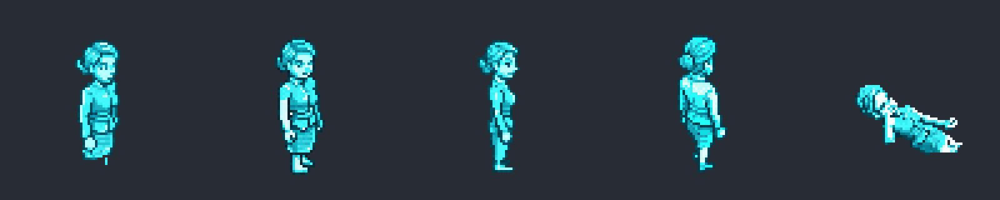

# Decisions waiting on you (17 October 2026)

Open in the Markdown preview (Ctrl+Shift+V) to see the images. Tick the boxes you want and write in the comment fields, then tell me it's filled in.

Five questions, then some optional polish at the end.

---

## 1. ATHENA: should her walking sprite look like a hologram?

### How ATHENA is used

**In the story.** ATHENA is SAFETYNET headquarters' building AI, and m08 (The Mole) takes place inside headquarters. She's the reception avatar by the lobby counter: smooth, corporate-calm and unnervingly helpful, with a cool British (RP) voice. Her theme is that she logs everything ("I log everything now"). That matters in a mission about a mole who is reading the building's logs.

**In the game.** She appears in two places, both using the same `athena` sprite:

1. **The opening cutscene** (`opening_briefing_cutscene`). She welcomes the player into the Citadel and sets up the mole hunt:
   - She notes that Nightshade's PIN device has been signed out since St. Catherine's. This is the mission's first clue, balanced by other agents' items ("Read nothing into it").
   - She delivers the carry-over line from m07 ("Portland happened. You moved the one team to Austin…").
2. **At reception** (`receptionist_ai`, standing still in the lobby). She's a hint console:
   - she nudges you towards the archive passphrase ("facilities spend most of the night near the kettle");
   - she nudges you towards the Director's safe code (his service number is on a printout in the operations-floor tray);
   - she gives a mole hint: "The calmest person in a frightened building is not always the bravest."

**Fighting her.** The player can punch her. She has a weak hostile setting (3 damage), so she can be knocked out. That has consequences:
- Before the mole is named, knocking her out **tips the mole off**. HaX texts: "ATHENA's avatar is down, and she logged every second of it. Half this building reads her logs." This sets `nightshade_tipped_off`.
- The credits record it: "ATHENA: Her reception avatar, knocked flat. She logged it."

So she does walk and fight a little: she turns, takes punches and falls. She doesn't patrol.

### What she looks like now

The concept you approved (2): a translucent cyan projection whose skirt hem breaks into digital fragments. This is the "projection, not a person" look.

Her dialogue portrait keeps that look:

Her **walking sprite** came out solid. PixelLab's walk-character stage doesn't keep translucency. In play (checked today) she draws fully opaque in flat cyan, and the dissolving hem is gone. Below, enlarged 4× for viewing: idle, three walk directions, and the end of her fall.

The cast proposal expected this risk and said a solid cyan figure still sets her apart from every human. She is the only cyan character.

### Options

- [ ] **A. Leave her solid.** The flat cyan already marks her as not human, and the portrait carries the hologram look in conversation. Cost: nothing.
- [x] **B. Make her translucent in the engine (recommended).** Add an optional NPC sprite setting, e.g. `"spriteAlpha": 0.8` with a soft glow or flicker, and set it on her two entries. No new art, so the frames stay exactly as they are, and any future hologram or ghost NPC can reuse it. Cost: a small engine change plus a browser check.
- [ ] **C. Redraw the frames with AI.** Edit her idle, walk and fall strips with PixelLab to add scan lines and a fragmenting hem. Cost: roughly 160–320 generations (4,525 are left), with a risk of jitter between frames that then needs fixing.
- [ ] **D. B and C together.**

**Comments:**

>

---

## 2. Resume screen: should Enter mean "Resume"?

When you reload a game in progress, a Resume / Restart / New Session overlay appears on top of the title screen. It doesn't block keys: pressing Enter while it's showing also moves the title screen on underneath. The overlay stays up and you still have to click Resume. It isn't harmful, but it's confusing. Found by the round-4 engine check.

- [x] **A. Enter = Resume (recommended).** While the overlay is up, Enter resumes and other keys do nothing. Clicking still works for all three buttons.
- [ ] **B. Block keys only.** The overlay swallows key presses, so only clicks work.
- [ ] **C. Leave it as it is.**

**Comments:**

>

---

## 3. m01: eight lines over the 30-word cap

The validator reports 8 lines in m01 over the 30-word cap. They were there before today (the m01 voiced-lines commit, 24759290), and they're the only validator errors left in m01–m08.

**Four are voiced debrief lines** in `m01_closing_debrief.ink`. Shortening them means new audio for those four clips:

| Line | Words | Text |
|---|---|---|
| 302 | 31 | "Post-operation check on Kevin's files confirms: no ENTROPY connections. No hidden agenda. He was exactly what he appeared to be—an IT manager who'd been raising security concerns nobody would listen to." |
| 311 | 37 | "I want to be direct with you: neither of them was ENTROPY. Kevin was an IT manager flagging concerns. Maya was our own informant—the one who brought us the lead on Operation Shatter in the first place." |
| 345 | 32 | "We may never know what Maya had to tell us. She'd been documenting everything about ENTROPY's operations at Viral Dynamics. The parts she hadn't written down yet—names, contacts, methods—that intelligence is gone." |
| 492 | 41 | "He'll be cleared. The forged email had a 'HEADER MISMATCH DETECTED' flag — the mail server's own forensic system flagged it as a forgery. The anomaly report showed his workstation running a simultaneous session…" |

**Four are HaX phone texts** in m01's scenario file (lockpick acquired, the Kali terminal, Derek's password list, the password list hint, at 31–46 words). Phone texts aren't voiced, so trimming them costs nothing.

- [x] **A. Fix all eight (recommended).** Split the debrief lines in two at a natural break (most already have one), so the words barely change. Trim the phone texts. The four debrief clips go into the TTS top-up below.
- [ ] **B. Phone texts only.** Leave the voiced lines as they are and accept the four validator errors.
- [ ] **C. Leave all eight.**

**Comments:**

>

**Resolved 2026-10-17:** a2c7d0ff. The form's count was low: the validator lists only four findings per rule, so m01 had 16 lines over the cap. Fixed 15: the four debrief lines, Kevin's two (one a Player line) and the briefing objectives line split at natural breaks; eight HaX phone texts trimmed (facts and VM paths unchanged). Left: m01_npc_maya.ink:95 (37 words, voiced), for the lead to split by hand.

---

## 4. The voice top-up (TTS)

Today's work added or changed about 80 voiced lines across m01–m08. Each needs a Gemini TTS clip before it's heard in game. Until then the server generates them live, which is slow, costs money mid-game, and is silent on a server with no key. Phone texts aren't voiced and aren't counted.

| Where | About | What |
|---|---|---|
| Carry-over lines (m02–m08) | 37 | Briefing and debrief lines that react to the earlier mission (Netherton, HaX, ATHENA) |
| m05 | 25 | Lisa's vaguer tin story, Patricia's in-person naming, Owen's new topic and narration, HaX's nudges and fight texts |
| m03/m04/m06/m07/m08 | 15 | Terry's Restart line, fight-advice lines, the m06 debrief location line, m07/m08 fixes |
| m01 (if you tick 3A) | 4 | The split debrief lines |

The tts-audio skill's process: generate per mission (`tts:batch_generate`), listen to a sample of the clips, then commit them to `tts_cache/`. It also prunes clips that no line uses any more.

- [x] **A. Run the top-up for m01–m08 now (recommended).** Metered Gemini TTS, about 80 short clips. I'll report the count and any failed clips, and check a sample against the voice bible.
- [ ] **B. Run it, but play me a few clips per voice first.**
- [ ] **C. Not yet.**

**Comments:**

>

**Resolved 2026-10-17 (m01–m03 only):** d72ca612, 504bdb69, 524f9b72: 12 + 10 + 7 clips, coverage complete. m04–m08 were never voiced on the current model (0 clips against about 2,500 expected lines), so a top-up there means voicing them for the first time. That's held for the user to approve the cost and the prep edits (m04: 5 `{player_name}` lines and the old HaX style; m05: the old HaX style; m07: 1 `{player_name}` line).

---

## 5. Push

Nothing from this work has been pushed. `main` is **168 commits** ahead of `origin` (github.com/cliffe/BreakEscape). That covers:
- the m03–m08 fixes;
- the new cast;
- the engine changes;
- carry-over;
- your own UI-theme, avatar and health-bar commits from the other sessions.

The working tree is clean.

- [ ] **A. Push `main` now.**
- [ ] **B. Push after the TTS top-up and the last browser check.**
- [x] **C. Not yet. I'll push myself.**

**Comments:**

>

---

## Optional polish (tick any you want)

- [x] **Browser check for the last round.** A short Sonnet run covering:
  - round 4: the phone hit warning, the m06 debrief page error and the 422, and m08's text-viewer icons;
  - the two carry-over debrief lines (m02, m04);
  - Restart m06 without finishing, then a New Session of m07.
- [x] **The off-duty agent (m08):** his north idle is a shade brighter than his other frames. One AI edit, about 10–20 generations.
- [x] **Park (m07):** his "round" (o/u/w) mouth is a small slot. Two or three more takes, about 3 generations.
- [x] **Phantom (m08):** his north punch coat reads slightly more mustard than the rest. One AI edit, about 10 generations.
- [x] **The Recruiter (m05):** her phone avatar is still a stand-in (Helen Carver's headshot). Four 32px attempts failed. Options: try again with a different method, or wait until she gets a walk sprite in a later mission, which makes the headshot automatically.

**Comments:**

> For the colour edits, consider hand editting them.

---

**Anything else:**

>
