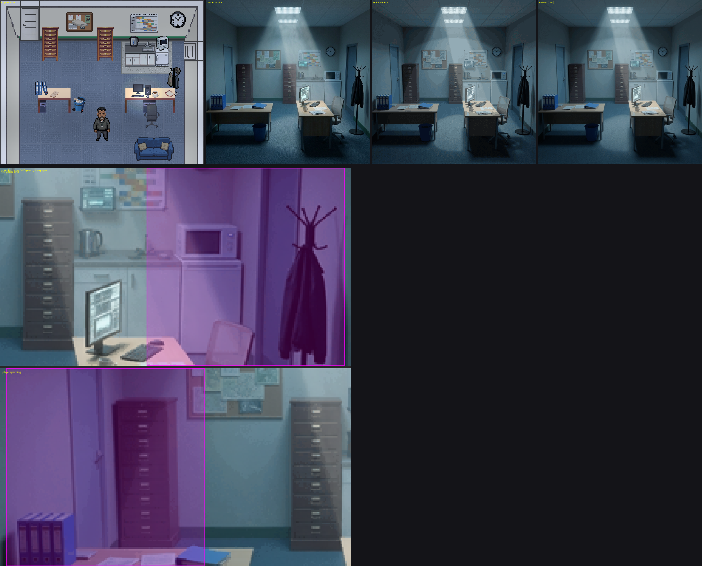
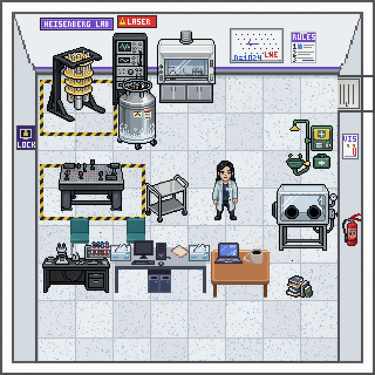
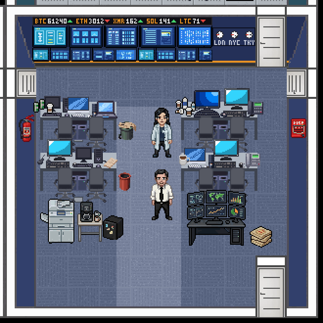
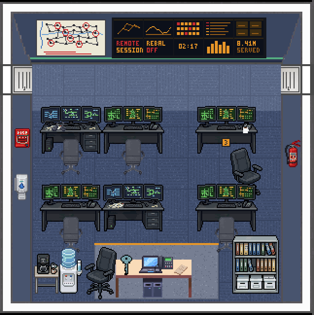
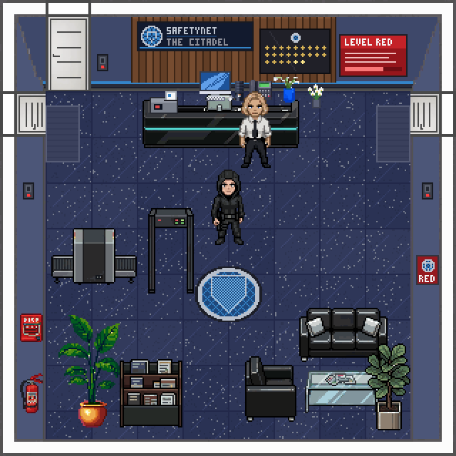

# Pending decisions: m04–m08 (pass 5)

Prepared 2026-10-14. Each mission folder's `DECISIONS_PENDING.md` has the full detail and file:line references; this form collects everything that needs your say in one place.

**How to fill it in:** tick boxes with `[x]`, and write under any **Comments** line. Leave a box empty to mean "not yet". When you've finished, tell me the form is ready and I'll act on it, item by item.

Images open in VS Code's Markdown preview (Ctrl+Shift+V).

---

## 0. What gets approved next

Tick the groups you want me to act on as soon as you hand the form back. Unticked groups wait.

- [ ] **1. Blind playtests:** you run them; I fix what they find
- [ ] **2. First-room looks:** apply your sign-offs and change requests
- [ ] **3. Conversation backgrounds:** metered Gemini, within the budget you set in section 3
- [ ] **4. Characters:** write cast-look proposals, then generate after your picks
- [ ] **5. Calls I made that you can overrule:** apply any you overrule
- [ ] **6. SecGen checks:** reword the game text to match whatever you find
- [ ] **7. Engine changes:** build the ones you tick, each in its own commit with a test
- [ ] **8. Housekeeping**

**Overall comments:**

>

---

## 1. Blind "do your best" playtests (you run these, outside auto mode)

Each prompt is self-contained and spoiler-free. The report lands in the mission folder as `PASS5_BLIND_A.md`.

| Mission | Prompt | Run it? |
|---|---|---|
| m04 Critical Failure | `docs/agents/M04_BLIND_PLAYTEST_PROMPT.md` | [ ] |
| m05 Insider Trading | `docs/agents/M05_BLIND_PLAYTEST_PROMPT.md` | [ ] |
| m06 Follow the Money | `docs/agents/M06_BLIND_PLAYTEST_PROMPT.md` | [ ] |
| m07 The Architect's Gambit | `docs/agents/M07_BLIND_PLAYTEST_PROMPT.md` | [ ] |
| m08 The Mole | `docs/agents/M08_BLIND_PLAYTEST_PROMPT.md` (has a "Deduction" section) | [ ] |

- [ ] When a report lands, I fix its findings without asking first

**Comments:**

>

---

## 2. First-room sign-offs (the look for each new setting)

The other rooms in each mission already follow the first room's style, so a change here means a redo across that mission. Changes are still cheap: each mission has one tileset script and one props script.

### 2.1 m04: POV conversation background, operations office (P1)

A realistic night-shift office: two ceiling panels on, haze falling on Vance's desk and the kitchenette, cool blue-grey shadows. The set's other rooms follow it. Faults I accepted:
- the north door sits on the left side wall;
- the right desk runs front to back;
- there's a small made-up screen above the kettle;
- the cabinets read dark brown at night.

- [ ] Approve
- [ ] Change (say what below)

**Comments:**

>

### 2.2 m05: Halloran's Heisenberg lab, Quantum Dynamics Corporation (D15)

The room has:
- clean-room white walls with a quantum-violet line;
- the cryostat in a keep-clear box;
- a LASER warning, a helium dewar and a fume hood;
- the LAB RULES notice by the door;
- the laser bench and glovebox.

The rest of the building follows: lilac-grey front of house, a sage break room, a graphite server side and a red line in the key vault.

- [ ] Approve
- [ ] Change (say what below)

**Comments:**

>

### 2.3 m06: HashChain trading floor (D8)

The room has:
- midnight-navy walls with a bitcoin-amber line;
- an LED price ticker over a wall of market monitors;
- world clocks;
- steel trading desks;
- a six-screen head-trader station.

- [ ] Approve
- [ ] Change (say what below)

**Comments:**

>

### 2.4 m07: Pacific Northwest grid control, the operations floor (U13)

The room has:
- dark slate walls with an evergreen line;
- a 147-substation wall map with red rings;
- an amber video wall;
- two rows of front-on consoles;
- the supervisor's dais with the plant key and handover sheet.

- [ ] Approve
- [ ] Change (say what below)

**Comments:**

>

### 2.5 m08: SAFETYNET HQ, the Citadel lobby (R1)

The room has:
- dark granite with the SAFETYNET seal at the spawn point;
- slate walls with walnut slats, and the signal-blue brand line;
- a black reception counter for ATHENA;
- a LEVEL RED screen;
- a memorial wall of gold stars;
- an X-ray arch;
- red-LED badge readers.

- [ ] Approve
- [ ] Change (say what below)

**Comments:**

>

---

## 3. Conversation (POV) backgrounds: metered Gemini

Each room gets one painted background, made from the dressed and lit room, for its conversations. The skill budgets 2–4 calls a room. m04 used 19 calls for its set. At the moment these conversations show plain black.

| Mission | Rooms | Estimated calls | Go ahead? | Cap (calls) |
|---|---|---|---|---|
| m05 (D17) | 10 | 20–30 | [ ] | ___ |
| m06 (D10) | 9 | 20–30 (recommended cap 30) | [ ] | ___ |
| m07 (D-POV) | 6 | 12–20 | [ ] | ___ |
| m08 (D-POV) | 9 | 20–30 | [ ] | ___ |

- [ ] Do them one mission at a time, and show you the first room of each before the rest (recommended)
- [ ] Do whole missions without stopping

**Comments:**

>

---

## 4. Characters (the PixelLab pipeline; concepts are metered Gemini)

Every pick is yours. The pipeline makes a few concepts for each character, you pick one, and then the sprite, talk and viseme sheets follow on PixelLab, which costs nothing per image.

### 4.1 m06: Kemal Aydin, Satoshi's minder (C1, proposal written)

- **Who he is:** Turkish-German, about 58, from Hamburg. He was a bank's vault security chief for thirty years and now guards Satoshi because he believes in the cause.
- **Voice:** Iapetus, a Hamburg accent, low and slow.
- **Look:**
  - close-cropped greying hair, a neat grey moustache, olive skin;
  - a charcoal overcoat over a black roll-neck, an earpiece and a HashChain lapel pin;
  - a black hood worn down under the coat collar.
- **Now:** he uses the stand-in sprite `male_hacker_hood_down_v2`.

- [ ] Approve this look
- [ ] Change (below)

**Comments:**

>

### 4.2 Casts still needing proposals (m05, m07, m08, and the rest of m06)

I haven't written the other cast-look proposals yet. Specific needs already logged:
- **m05 D6:** a knocked-out or seated portrait for Torres. His bust stands relaxed while the narration has him down.
- **m05 D8:** the Recruiter gets her own sprite and headshot: a woman in her fifties, Washington DC, polished. She may come back in later missions.
- **m08:** the off-duty agent's hoodie reads like the player's sprite at a glance.

- [ ] Write cast-look proposals for every NPC in m05–m08 (diverse, matched to each voice's accent and age), for you to review here
- [ ] Then generate concepts for the ones you approve (metered Gemini, one character at a time)

**Comments:**

>

---

## 5. Calls I made without you (overrule any)

Each is local to one mission and easy to reverse. Tick **Overrule** to have me undo it or change it.

| # | Mission | What I decided | Keep | Overrule |
|---|---|---|---|---|
| 5.1 | m05 D2 | A wrong accusation (Halloran) brings the upload forward: Torres's scene opens at 99%, and the debrief and a credit report a lost window | [ ] | [ ] |
| 5.2 | m05 D11 | Kept pass 3's fast clone at Owen and Halloran, rather than gating it on seeing the hallway reader first | [ ] | [ ] |
| 5.3 | m05 D13 | CyBOK trimmed: dropped Incident Response and Quantum Cryptography; added Privilege escalation under OSV | [ ] | [ ] |
| 5.4 | m05 | "Send Security" uses the hand-over ending with a flag, and a breaker stops the upload at 99% (a cost I invented) | [ ] | [ ] |
| 5.5 | m06 D1 | Added Kemal, Satoshi's minder, with a sight challenge and ways past him without a fight | [ ] | [ ] |
| 5.6 | m06 D7 | CyBOK: removed "CVEs and CWEs" and "Hash functions", because nothing in game teaches them | [ ] | [ ] |
| 5.7 | m07 U1 | The m07/m08 timeline fixed on m07's side, with a "contingency board since Thursday" line in the briefing | [ ] | [ ] |
| 5.8 | m07 U2 | No cross-mission carry-over yet; lines hold whatever the player did in earlier missions | [ ] | [ ] |
| 5.9 | m07 U5 | "Trace How They Got In" is no longer "(Optional)", and its two tasks are required again. This avoids an engine bug | [ ] | [ ] |
| 5.10 | m07 U8 | The fingerprint kit is carried but unused in m07 | [ ] | [ ] |
| 5.11 | m07 L1 | When the clock expires, the video wall's Seattle panel turns red and the wall's light goes red | [ ] | [ ] |
| 5.12 | m07 | Park turns hostile on a third visit; returning with the projection gives one last chance | [ ] | [ ] |
| 5.13 | m08 U2 | **Option B:** the box gives the time and terminal, never a name. The player must name the mole to Netherton through the door audit. Option A needs the VM to show a shared login | [ ] | [ ] |
| 5.14 | m08 U4 | HaX half-recognises the Architect's teacher line ("Same classroom, 0x00. Don't ask me whose yet."), without naming Tesseract | [ ] | [ ] |
| 5.15 | m08 | Sealed files on all three suspects in the Director's safe (Okafor's evaluation, a vetting query on Cipher, a standards referral on Phantom). These make Cipher and Phantom look more suspicious | [ ] | [ ] |
| 5.16 | m08 | MIFARE card for the Director (a step up from the EM4100 cards in m04–m07), with HaX explaining the difference | [ ] | [ ] |
| 5.17 | m08 | The off-duty agent catches a locker pick in his visible sight circle, which tips the mole off | [ ] | [ ] |
| 5.18 | m08 L1 | The RECORDING lamp became an object that lights up during the confrontation; the door sign reads "Interrogation Suite" | [ ] | [ ] |

**Comments:**

>

---

## 6. SecGen checks (the VM side; I can't open these files)

Agents aren't allowed to open the SecGen XML or the exploit guides, so these claims were written from the in-game text and still need checking. For each one, tick **OK** or note what's different, and I'll reword the game text to match.

### m05
- [ ] **D1, the most important:** the flag-3 manifest on the VM names Torres, so the deduction only decides who names him first. The proposed SecGen change is that the manifest shows badge #4471 only. Approve the change? `[ ] yes [ ] no`
- [ ] **D3 / D12:**
  - flag 1 is an admin login in a handover note on the research portal;
  - flag 2 is an authenticated image-upload weakness in Bludit;
  - flag 3 is Torres's staging manifest in a home directory;
  - flag 4 is root through a sudo rule, and holds the Architect's authorisation;
  - other hosts or services are listening;
  - the flags can be taken in any order.
- [ ] **D12:** the debrief summary reads "old software with a known flaw… an admin login in a handover note… one account allowed to run far more than its job needed".
- [ ] **D14:** the RFID, lockpicking, recon and Bludit field-guide sheets exist at their `labUrl`s, and their titles match the item names.

### m06
- [ ] **D3 / D4 / D6:**
  - S1, the backend's way in is an exposed build service and holds no flag;
  - S2, flag 1 is a password cracked offline from a readable shadow file;
  - S3, flag 2 is that password reused on a second account;
  - S4, flag 3 is the financial database account and flag 4 the vault account;
  - S5, the sudo field guide fits the route;
  - S6, the debrief's kill-chain line;
  - S7, the flag order.

### m07
- [ ] **U3:**
  - where each flag sits (the NFS export, the listener on a non-standard port, the operator's home directory over SSH, root through a sudo rule);
  - whether there's one target host or two;
  - the Kali IP;
  - whether flag 4 can be reached before flag 3;
  - the debrief's "three doors" line and the ATTACK HOST credit.
- [ ] **U4:** `.../labs/safetynet/nfs-and-netcat-leaks/` is live.
- [ ] **E2:** the five field-guide item names match the sheets' `title:` lines. A permission check stopped the reviewer reading them.

### m08 (the most important set)
- [ ] **U1:** which scenario is built: `break_escape/safetynet/m08_the_mole.xml` or `ctf/such_a_git.xml`? Also the flag order, and the claims about the VM:
  - the `nightshade_ops` account;
  - mail to `architect@entropy.onion`;
  - a root-only log with a Crypto Lab terminal and 47 minutes;
  - SSH as the second login;
  - the CVE ID.
- [ ] **U1 addendum 1:** does the VM's account or home directory carry Nightshade's name? If it does, the box gives the answer away, and the door-audit deduction becomes a formality. Choose:
  - `[ ]` rename the VM account to a neutral service login;
  - `[ ]` accept it, with the audit as corroboration.
- [ ] **Addendum 2:** HaX's hints describe GitList with code execution and no login, then the git history and stash, then a sudo rule.
- [ ] **Addendum 3:** the debrief says "credentials in its history… a sudo rule that handed you the rest".
- [ ] **Addendum 4:** once root is reached, can the player read an account name anywhere?

**Comments:**

>

---

## 7. Engine changes (each needs your approval; built in its own commit with a test)

Grouped by theme. The **Seen in** column shows where it came up.

### 7.1 Combat and hostility (raised most often)

| # | Change | Seen in | Build? |
|---|---|---|---|
| 7.1a | **A hostile NPC gives up the chase** past a distance or at its own door. `chaseRange` is never read today | m06 D8, m07 U10, m08 E11 | [ ] |
| 7.1b | **Pause NPC attacks while the phone, a conversation or a cutscene is open** (or don't close them on a hit) | m04 E2, m07 U12, m05 | [ ] |
| 7.1c | **A way to heal:** slow regeneration out of combat, or a `#heal:n` tag or event action | m07 E3 | [ ] |
| 7.1d | **A respawn after a knockout resets hostile NPCs** (not hostile, back at their posts) | m05 D5, m07 U11 | [ ] |
| 7.1e | Pass `maxHP`, `attackCooldown` and `attackRange` from `behavior.hostile` through to combat | m05 D4 | [ ] |
| 7.1f | Hardening: becoming hostile always takes the configured damage (the "10 per hit" was caused by the harness, not the game) | m05 D10 | [ ] |
| 7.1g | Save NPC HP with hostility, so a reload doesn't restore a hostile NPC at full health | m08 E12 | [ ] |
| 7.1h | The punch cone misses unless the player faces the attacker diagonally: widen it, or auto-face the nearest hostile | m07 | [ ] |
| 7.1i | Fists mode swallows click-to-move; a toast when interacting with a hostile NPC ("He's past talking.") | m06, m05 M5 | [ ] |
| 7.1j | Hidden or knocked-out NPCs still draw their vision cone or sight circle | m06, m08 E9 | [ ] |

### 7.2 Resume, reload and respawn

| # | Change | Seen in | Build? |
|---|---|---|---|
| 7.2a | **Resume in the room the player left**, for reload and Restart alike, and skip the Mission Brief recap on a plain resume | m05 M1, m07 E5, m08 E10 | [ ] |

### 7.3 Phone and conversation UI

| # | Change | Seen in | Build? |
|---|---|---|---|
| 7.3a | Phone number keys 1–9, not 1–5, plus a scroll cue when choices overflow | m07 | [ ] |
| 7.3b | A reopened conversation shows no stale previous line above the hub | m08 E6 | [ ] |
| 7.3c | One-line object captions wrap, or open a dialog, when the text is long (the clue was cut off) | m07 | [ ] |
| 7.3d | A `delayMs` on conversation event mappings | m08 E15 | [ ] |

### 7.4 Minigames and locks

| # | Change | Seen in | Build? |
|---|---|---|---|
| 7.4a | A flag lock with nothing required says where it unlocks, instead of a key prompt it can never accept | m07 E1 (also m02) | [ ] |
| 7.4b | The password keypad says "case-sensitive" on a near miss, or emits a failure event | m07 E4 | [ ] |
| 7.4c | The RFID reader doesn't open an empty cloner, and the flipper reports "card not accepted" | m07 U9, m06 D8 | [ ] |
| 7.4d | The PIN keypad title uses the lock's name ("Enter PIN: Director's Safe"), not "Enter PIN for item" | m08 E2 | [ ] |
| 7.4e | The dusting panel and the lock and container headers show text and observation variants; long dusting text wraps; the stale "Not a whorl" message clears | m08 E3/E5, m05 M4 | [ ] |

### 7.5 Conditions, objectives and validator

| # | Change | Seen in | Build? |
|---|---|---|---|
| 7.5a | Dotted paths in conditions (`data.result.maxAttemptsReached`) | m04 E1, m06 D5 | [ ] |
| 7.5b | The validator flags `\|\|` in conditions (it's quietly false today), plus an audit across missions | m04 L3 | [ ] |
| 7.5c | An aim made only of optional tasks completes only when every task is settled | m07 U5 | [ ] |
| 7.5d | Rewording of the required-task `*` key | m08 E1 | [ ] |
| 7.5e | The validator knows `facePlayerDistance` and `personalSpace` | m08 E8 | [ ] |
| 7.5f | `gameClock` runs at a story rate, so phone timestamps match the story | m05 M6 | [ ] |

### 7.6 Lighting

| # | Change | Seen in | Build? |
|---|---|---|---|
| 7.6a | Rack-style blinking LEDs for each mission's own racks (`qdc_`, `hce_`, `hq_`), or room emitters can set `leds` | m05 D16, m06 D9, m08 E14 | [ ] |
| 7.6b | A `fire` emitter effect | m04 L1 | [ ] |
| 7.6c | Hue-preserving blending for lit glows (reds wash to pink today) | m04 L2 | [ ] |

**Comments:**

>

---

## 8. Housekeeping

- [ ] **m03 lab sheet:** merge the VM-stages section yourself, outside the session. A safety check stops me reading the SecGen XML.
- [ ] **Shared-tree leftovers:** `db/seeds.rb` (modified) and `lib.sh` (untracked) aren't mine. Should I `[ ]` leave them or `[ ]` look at what they are?
- [ ] **Push:** nothing has been pushed. Push `main` now? `[ ] yes [ ] not yet`

**Comments:**

>
