# SE art batch 1: review

## For the user: three questions, and the picks already made (orchestrator, 2026-10-21)

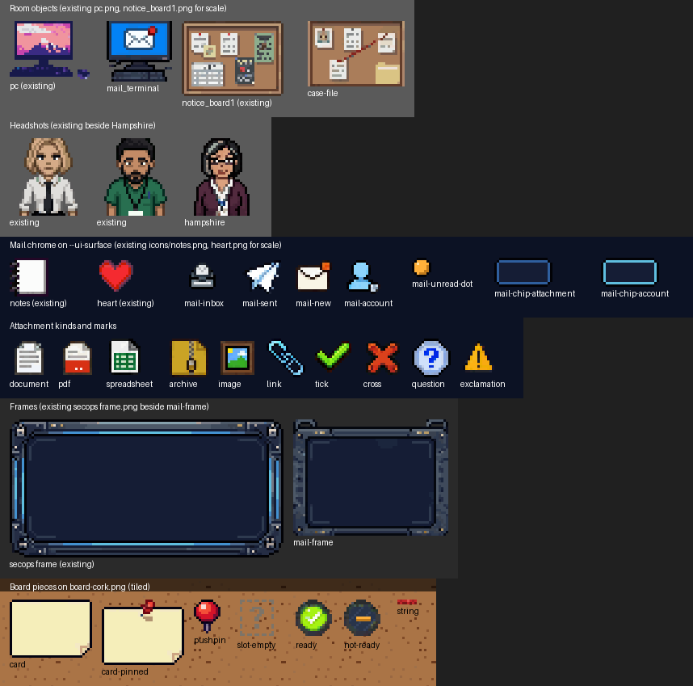

**Questions (answer any; the build runs on the current files meanwhile):**

1. **Hampshire's look.** The brief was a British Chinese woman in her mid fifties; at 32x32 the skin
   reads warm tan and could read as South Asian. Either keeps the cast varied. Options: keep as is
   (recommended), lighten the skin by hand (no generation), or rerun PixelLab (a new art round).
2. **Round badges for tick and cross.** Question and exclamation sit in round badges, tick and cross
   do not. Matching them needs a short PixelLab round (about 2 calls). Options: leave as is
   (recommended: the shapes already read clearly and are always paired with words), or run the round.
3. **`icons/document.png`** is a 16-byte text placeholder ("create me"), not an image, from the
   original repo move. Replace it with `attach-document.png`'s pixels (an overwrite of a placeholder
   nothing references), or leave it alone (recommended until something needs it).

**Picks taken without asking** (overrule any; each is cheap to change now because nothing is wired yet):

| # below | Pick | Why |
|---|---|---|
| 1 Terminal screen | Keep the envelope | A lab: the player should see at a glance which machine is the mail terminal |
| 3 Mail frame | Use the new `mail-frame.png` | It sits in the secops style and is sized for a window; the title bar is drawn in CSS |
| 4 Unread dot | Amber | Matches the new-mail badge and the theme accent; colour is never the only signal (bold row text too) |
| 6 Delayed-reply marker | Reuse `mail-new.png` | One meaning, one icon |
| 8 Board strings | SVG lines in the overlay | Strings run at any angle; a rotated tile would blur at non-right angles |
| 9 Ready-lamp glow pixels | Clean by hand at native size | A few-pixel edit, no generation |
| 10 Folders | Keep: prefixed icons in `icons/`, frames and backgrounds in `ui/social/` | Matches the repo's existing split |

The agent's full notes follow.

Made 2026-10-21 under the user's batch-1 authorisation (ASSETS.md, Slice rows). Nothing is wired in:
no code, CSS, scenario or preload line was touched, and nothing is committed.

The contact sheet is for viewing only: every piece is drawn at nearest-neighbour x3 beside an existing
asset at the same scale. The game files are at native size. Following `css/ui-themes.css`, UI art is
drawn at 1x and shown at 2x, so a 16x16 icon covers 32 CSS px.

## How it was made

- **Tool:** PixelLab Create Image (Pro) for everything that has a drawn shape. Each call returns a set
  of candidates (64 at 16x16 and 32x32, 36 at 36 to 42 px, 25 at 48x40, 16 at 64x64). Every candidate
  is kept in this folder, one sub-folder per call (`<asset>/cNN.png`, plus `job_id.txt`). The numbered
  grids are in `grids/`, and `jobs.tsv` lists each call with its job id, candidate count and size.
- **Style references:** each call was given an existing asset as its style image: `pc.png` +
  `pc10.png` + `laptop1.png` for the terminal, `notice_board1.png` + `qdc_suspects_board1.png` for the
  board, two existing 32x32 headshots for Hampshire, `ui/themes/secops/frame.png` for the frame, and
  six existing icons (heart, notes, pencil, clipboard, password, keyway) for the icons.
- **Hand-placed pixels** (secops palette from `css/ui-themes.css`, at final size): the unread dot,
  both chips, the empty-slot marker and the string tile. These are a few pixels of plain geometry,
  where a generator adds noise.
- **Edits after generation:** crops of transparent margin, a 1 px crop of the cork tile's generated
  border, centring 16x16 icons on their canvas, recolouring the "ready" lamp to make "not ready",
  painting the pin out of one card, and a half-width wrap fix on the headshot (below). Nothing was
  scaled. `build_final.py` reproduces every final file from the candidates. `final/` holds the same
  files as were placed in the game folders.
- **Counts:** PixelLab balance 4435 before, 4145 after: 290 generations over 30 Pro calls. Gemini: 0
  calls. No concept was needed for a 32x32 bust.

## OBJ1 `mail_terminal.png`

- **Path:** `public/break_escape/assets/objects/mail_terminal.png`, **27x25**. Trimmed to its content,
  as `pc.png` and the other objects are.
- **Prompt (round 2, chosen):** "Orthogonal top-down view of an office desktop computer, square to the
  wall, not isometric: a dark flat-screen monitor on a short stand, the bright blue screen filled by
  one large white mail envelope icon with a small red unread badge, a dark keyboard in front and a
  small mouse to the right." Style: pc, pc10, laptop1.
- **Chosen:** `obj1_mail_terminal_v2/c08`. **Alternatives:** the other 63 in that folder (near-identical
  framings), plus round 1 (`obj1_mail_terminal/`, 64), whose screen showed a list window that did not
  say "mail" at this size. Grids: `grids/obj1_mail_terminal_v2.png`, `grids/obj1_mail_terminal.png`.
- **Question:** the envelope makes the type obvious, and OBJ7 (OSINT workstation) will need a different
  screen. Options: (a) keep the envelope; (b) a plainer inbox-list screen (round 1, e.g. `c00` with its
  sticky note) so the terminal reads as an ordinary PC until used.

## OBJ2 `case-file.png`

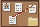

- **Path:** `public/break_escape/assets/objects/case-file.png`, **40x27**.
- **Prompt (round 2, chosen):** "...a rectangular wall corkboard used as a case file, square to the wall,
  not isometric. A thick dark-brown wooden frame with a dark outline all round, the inside completely
  filled with solid brown cork... three small white paper notes and one photo card held by red
  pushpins, a manila folder pinned at the lower right, and a single red string..." Style: notice_board1,
  qdc_suspects_board1.
- **Chosen:** `obj2_case_file_v2/c31`. **Alternatives:** `obj2_case_file_v2/` (36) and round 1
  `obj2_case_file/` (36). Background removal stripped the cork from most of them, which leaves cards
  floating; `v1/c15` (busier, string over a folder) and `v2/c26` were the runners-up.
- **Note:** the four instances can still override the texture (OBJ3 to OBJ6); this file only satisfies
  the validator's one-sprite-per-type rule and the `recon` look.

## NPC5 Chris Hampshire headshot

- **Path:** `public/break_escape/assets/characters/hampshire_headshot.png`, **32x32**, front-facing like
  every existing `*_headshot.png`.
- **Look chosen:** the contract (`00` §1) has Chris Hampshire in **Careers/HR**, not finance or payroll,
  and `00`, `03`, `04` and `10` all call her "she". I made her a British Chinese woman in her mid
  fifties: a straight black bob with grey streaks, thin dark rectangular glasses, a plum cardigan over
  a white collared blouse, and a staff lanyard. That adds an older East Asian woman to a cast that so
  far suggests Ruth Adeyemi, Tomasz, Dev and Gareth Fairbairn.
- **Prompt:** "32x32 pixel-art headshot bust, front-facing, head and shoulders filling the frame like the
  reference headshots: Chris Hampshire, a British Chinese woman in her mid fifties who runs careers and
  HR at an office, chin-length straight black bob with grey streaks, thin dark rectangular glasses,
  friendly but busy expression, plum cardigan over a white collared blouse, a staff lanyard." Style:
  `female_office_worker_v2_headshot`, `hamza_iqbal_headshot`.
- **Fix applied:** PixelLab returned all 64 busts wrapped sideways by half the width (the face split down
  the middle and swapped). A 16 px wrap-around offset puts them back. That moves whole pixels and does
  not scale. The fixed set is in `npc5_hampshire/rolled/`, grid `grids/npc5_hampshire_recentred.png`.
- **Chosen:** `rolled/c10`. **Alternatives:** `c09` (no grey), `c25`, `c29`, `c36`, `c41`, `c49`, and
  poses with a phone or mug (`c06`, `c52`, `c62`) if you want her to look busy.
- **Question:** the skin came out a warm tan, which may read South Asian rather than East Asian at this
  size. Options: (a) keep it; (b) I lighten the skin ramp by hand (a recolour, no scaling); (c) one more
  PixelLab run with a lighter skin named in the prompt.

## UI1 mail chrome

| Piece | File | Size | Source |
|---|---|---|---|
| 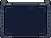 | `assets/ui/social/mail-frame.png` | 64x48, 9-slice about 8 | Pro `ui1_frame/c03`, style secops frame |
|  | `assets/icons/mail-inbox.png` | 16x16 | Pro `ui1_inbox/c60` |
|  | `assets/icons/mail-sent.png` | 16x16 | Pro `ui1_sent/c40` (paper plane) |
|  | `assets/icons/mail-unread-dot.png` | 8x8 | hand-placed, `--ui-accent` amber |
|  | `assets/ui/social/mail-chip-attachment.png` | 24x12, 9-slice 4 | hand-placed, `--ui-slot-bg` fill, `--ui-line` border |
|  | `assets/ui/social/mail-chip-account.png` | 24x12, 9-slice 4 | hand-placed, `--ui-bar-frame` border |
|  | `assets/icons/mail-account.png` | 16x16 | Pro `ui1_account/c00` (person with @ badge), for the account chip |

- Prompts: frame "dark gunmetal bezel with thin electric-blue light strips and small rivets, a slightly
  thicker top title bar strip with two tiny amber status lights..., empty flat dark navy interior...
  symmetric so it can be 9-sliced"; inbox "an open grey-blue letter tray with a white envelope inside";
  sent "a white paper plane flying up to the right"; account "a simple person silhouette... with a small
  white at-sign badge".
- The chips are frames only. The kind icon, file name and account address go inside them as DOM text in
  Source Sans 3, as `01` requires.
- **Dropped:** a paperclip icon for the attachment chip. Two runs (`ui1_paperclip/`, `ui1_paperclip_v2/`,
  128 candidates) gave capsules and hooks, not clips. The chip shows the attachment-kind icon instead.
- **Questions:**
  1. Window frame. The design asks for the overlay frame "in the game's UI theme", which `--ui-frame-*`
     already supplies. Options: (a) use the theme frame and ignore `mail-frame.png`; (b) use
     `mail-frame.png` for the mail client only (a heavier bezel with amber lights, no blue strip). No
     candidate drew a real title bar.
  2. Unread dot colour. Options: (a) amber, which matches the new-mail badge and `--ui-accent`; (b)
     light blue `--ui-button-text`, the usual "unread" colour in mail clients.

## UI2 attachment-kind icons

|  |  |  | 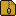 | 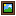 | 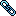 |
|---|---|---|---|---|---|
| document `c09` | pdf `ui2_pdf_v2/c12` | spreadsheet `c63` | archive `c41` | image `c09` | link `c52` |

- All at `public/break_escape/assets/icons/attach-<kind>.png`, 16x16.
- Prompts named the shape only: "white paper page with a folded top-right corner and... grey text
  lines"; "...lower half covered by a solid red band... no readable letters" (pdf); "green grid of
  cells"; "vertical zipper stripe"; "small framed picture showing a blue sky, a green hill and a yellow
  sun"; "two interlocking chain links".
- The first PDF run came out half-height (`ui2_pdf/`), so I reran it with the chosen document icon as
  the style image, which gives the two the same page shape.
- `icons/document.png` already exists but holds the text "create me", not an image, so it could not be
  reused. I left it as it is. **Question:** should it be deleted or pointed at `attach-document.png`?
  Options: (a) leave it; (b) delete it in a cleanup packet; (c) copy `attach-document.png` over it (an
  overwrite, so only with your say-so).

## UI3 new-mail notification and list marker

 `assets/icons/mail-new.png`, 16x16, Pro `ui3_newmail/c09`: "a white closed
envelope with a small round amber badge dot at its top-right corner".

- **List marker:** I did not make a separate image. The row for the delayed reply can use `mail-new.png`,
  with the unread dot for ordinary unread rows. **Question:** options: (a) reuse `mail-new.png` as the
  marker; (b) a smaller 8x8 "reply arrived" arrow, made by hand to match the dot.

## UI4 marks (16x16)

|  |  |  |  |
|---|---|---|---|
| tick `c56` | cross `c59` | question `c47` | exclamation `c18` |

- Paths `public/break_escape/assets/icons/mark-{tick,cross,question,exclamation}.png`.
- Prompts: "a bold green tick", "a bold red cross (X mark)", "a bold blue question mark inside a small
  round badge", "a bold amber warning exclamation mark inside a small triangle", each with a dark
  outline and the icon style reference.
- I picked a brighter red for the cross so it reads on the navy panel. Every mark is paired with words
  in the UI (`01`, `03`, `04`). Shape and colour both differ, so no meaning rests on colour alone.
- **Question:** the tick and cross are bare marks, while the question and exclamation sit in a badge and
  a triangle. Options: (a) keep them as they are; (b) put the tick and cross in matching round badges.

## UI5 composer blank slot and filled chip: CSS, no image

The composer's blanks are inline in the text, vary in width with their label, and need four states:
empty, focused, filled, and "no held option" (`04`). That suits CSS on the theme tokens, for example
a dashed `--ui-line` border with `--ui-slot-bg` for an empty blank, a solid `--ui-bar-frame` border
for a filled chip, and `--ui-accent` for focus. CSS stretches to any text, follows the theme, keeps
the label in Source Sans 3 and needs no 9-slice. If a pixel edge is wanted later,
`mail-chip-attachment.png` is a ready 9-slice in the same palette. No image was made.

## UI6 corkboard, pinned card, string

| Piece | File | Size | Source |
|---|---|---|---|
| 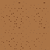 | `assets/ui/social/board-cork.png` | 62x62 tile | Pro `ui6_cork/c01`, 1 px generated border cropped; tiles cleanly (see the contact sheet) |
| 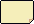 | `assets/ui/social/board-card.png` | 34x24, 9-slice about 6 | Pro `ui6_card/c13` with its pin painted out |
| 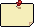 | `assets/ui/social/board-card-pinned.png` | 34x27 | Pro `ui6_card/c13` as drawn |
| 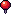 | `assets/icons/board-pushpin.png` | 11x14 | Pro `ui6_pushpin/c00`, style ref the card |
|  | `assets/ui/social/board-string.png` | 8x2 tile | hand-placed red yarn |

- Prompts: cork "seamless tileable... warm brown cork with small darker and lighter speckles... low
  contrast so text cards placed on top stay readable, no frame"; card "blank cream index card pinned to a
  corkboard by one red pushpin at the top centre... plain enough to be 9-sliced"; pin "a single red
  pushpin seen from the front and slightly above".
- Most card candidates came with a wooden frame drawn round them. `c13` and `c18` were the only
  frameless ones.
- A pin in the middle of the top edge would be stretched by a 9-slice. So `board-card.png` is the
  stretchable card, and the pin is a separate sprite placed on top. `board-card-pinned.png` is there for
  fixed-size uses.
- **Question:** string. Cards go wherever the layout puts them, so strings run at any angle. Options:
  (a) draw strings as SVG or canvas lines in the two yarn colours (`#c0282a` over `#7c1518`), with the
  tile as the colour reference; (b) repeat the 8x2 tile along a CSS-rotated strip, which turns jaggy
  at most angles; (c) no strings. Option (a) is my pick: `03` makes the corkboard decoration and the
  string static.

## UI7 empty slot and readiness markers (16x16)

| 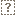 |  |  |
|---|---|---|
| empty slot, hand-placed | ready, Pro `ui7_ready/c56` | not ready, recoloured from ready |

- Paths `public/break_escape/assets/icons/board-{slot-empty,ready,not-ready}.png`.
- **Empty slot:** the Pro run (`ui7_empty_slot/`) drew dashed boxes around an arrow-like glyph instead
  of a question mark, so I drew it by hand: a dashed square and a "?" in a warm grey that reads on the
  cream card and on navy. The words ("Expects: ???", "Not ready") stay in the DOM.
- **Not ready:** the Pro "lamp switched off" run (`ui7_not_ready/`) came out at about half the size of
  the ready lamp. I took the ready lamp, set its glass to dark slate, removed the tick and added an
  amber dash, so the two are the same size and outline.
- **Question:** the ready lamp keeps a few stray glow pixels round its ring (they show on the cork in the
  contact sheet). Options: (a) keep them; (b) I clear them by hand; (c) pick `c48` or `c57` instead.

## Placed files

New files only, none overwritten (each path was checked before copying):

- `public/break_escape/assets/objects/mail_terminal.png`, `objects/case-file.png`
- `public/break_escape/assets/characters/hampshire_headshot.png`
- `public/break_escape/assets/icons/`: `mail-inbox`, `mail-sent`, `mail-new`, `mail-account`,
  `mail-unread-dot`, `attach-{document,pdf,spreadsheet,archive,image,link}`,
  `mark-{tick,cross,question,exclamation}`, `board-{slot-empty,ready,not-ready,pushpin}` (all `.png`)
- `public/break_escape/assets/ui/social/` (new folder): `mail-frame`, `mail-chip-attachment`,
  `mail-chip-account`, `board-cork`, `board-card`, `board-card-pinned`, `board-string` (all `.png`)

**Question on folders:** `icons/` is flat today, so the small pieces carry a `mail-`, `attach-`,
`mark-` or `board-` prefix there, and the 9-slices and backgrounds went into a new `ui/social/`.
Options: (a) keep this; (b) move everything into `ui/social/` (one folder for the build); (c) put icons
in `icons/social/`. Nothing references the paths yet, so moving costs nothing now.

Still for the code packets, not art: the `this.load.image('mail_terminal', ...)` and `'case-file'`
preload lines and the `minigame-data-schemas.json` entries (`01` §7, `03` Assets).
