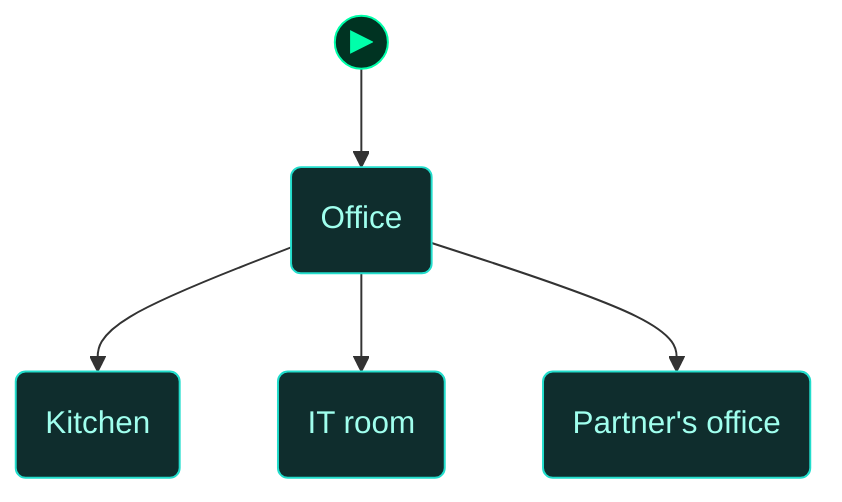

<!-- Auto-generated by scripts/generate_dungeon_graph.rb — do not edit by hand -->

# demo_ops_passwords — Scenario Graph Reference

Ops demo: passwords. A box of old password records has turned up in the confidential-waste bin at Merrin & Sallow. Ama Owusu of Fenlow Managed IT hosts. Staff habits give you what you need: Delphine posts about her life on the office feed and keeps a photo on her desk, Graham reuses one password everywhere, Julian picks long random ones. Crack what will crack, sign in with it, and see what an administrator can reach on the partner's PC that an ordinary user cannot. Authorised practice in a fictional office; nothing to break for real.

## Scenario Statistics

| Metric | Value |
|---|---|
| Story aims | 3 |
| Total tasks | 11 (0 optional) |
| VM flag challenges | 0 |
| Physical locks | 5 |
| AND-gate convergences | 0 |
| Rooms | 5 |
| Puzzle graph nodes / edges | 39 / 49 |
| Story graph nodes / edges | 3 / 0 |

## Critical Path

0 hops through story aims — minimum mandatory sequence to reach mission completion:

****

## How to Read These Diagrams

| Shape | Colour | Meaning |
|---|---|---|
| Rounded rectangle | Teal | Room / physical area |
| Rectangle | Red | Lock, barrier, or interactive terminal |
| Diamond | Orange | Inventory item or credential |
| Diamond | Red/Pink | NPC or physical key |
| Diamond | Purple | VM flag (challenge completion token) |
| Rectangle | Blue | VM challenge |
| Ribbon | Amber | NPC conversation / action gate |
| Hexagon | Green | Story aim (objective) |
| Hexagon | Amber | Critical path node |
| Circle | Grey | AND gate (all inputs required) |
| Subroutine rect `[[…]]` | Green | Container (holds items) |
| Rounded rectangle | Amber | NPC in room (Rooms & Contents only) |

Edges: `-->` solid = hard dependency; `-.->` dashed = soft / narrative dependency or optional path.
  Network edges: `-.-` log: a log source (a note) and a reader that shows it; it gates nothing.
  Network edges: `held` / `dropped` / `session at PC`: what an implant needs.

The `▶` node marks the player's starting room.

## Puzzle Graph

Physical lock–key dependency chain. Shows which items, codes, and NPC interactions are required to open each lock, and which locks gate access to each room or object. Use this to trace solvability, spot circular dependencies, and check that every key is reachable before the lock that needs it.

```mermaid
flowchart TD

  classDef room      fill:#0f2d2d,stroke:#22ddcc,color:#a0ffee
  classDef lock      fill:#2d0f0f,stroke:#e66060,color:#ffa0a0
  classDef key       fill:#2d0812,stroke:#e66060,color:#ffa0a0
  classDef item      fill:#2d1200,stroke:#e89030,color:#ffcc80
  classDef gate      fill:#111,stroke:#666,color:#eee
  classDef vm        fill:#0c1f40,stroke:#4a90d9,color:#a0c8ff
  classDef flag      fill:#1a0c2d,stroke:#9060d0,color:#cc99ff
  classDef action    fill:#1a1200,stroke:#cc9922,color:#ffee88
  classDef aim       fill:#0d2a0d,stroke:#44cc44,color:#88ff88
  classDef aim_gate  fill:#111111,stroke:#44cc44,color:#44cc44
  classDef container fill:#1a2d1a,stroke:#60b060,color:#a0e0a0
  classDef npc       fill:#2d1f0d,stroke:#d0a050,color:#ffe0a0
  classDef note      fill:#161a2d,stroke:#7788bb,color:#c0c8ee
  classDef critical  fill:#2a1500,stroke:#ffaa00,color:#ffdd88
  classDef start     fill:#003322,stroke:#00ffaa,color:#00ffaa

  node_start(("▶"))
  node_start --> office

  lock_delphine_pc["Delphine's PC<br/>Sign-in"]
  lock_jun_pc["Jun's PC<br/>Sign-in"]
  lock_graham_pc["Graham's PC<br/>Sign-in"]
  lock_partner_pc["Julian's PC<br/>Sign-in"]
  signin_delphine_arvanitis{"Delphine Arvanitis sign-in<br/>(darvanitis)"}
  office("Office")
  signin_jun_watanabe{"Jun Watanabe sign-in<br/>(jwatanabe)"}
  signin_graham_whitfield{"Graham Whitfield sign-in<br/>(gwhitfield)"}
  it_room("IT room")
  signin_julian_sallow{"Julian Sallow sign-in<br/>(jsallow)"}
  partner_office("Partner's office")
  clue_social_intelfacts_delphine_dog_name{"social/intelFacts/delphine dog name"}
  clue_rooms_office_npcs_1_feed_posts_0{"rooms/office/npcs[1]/feed/posts[0]"}
  clue_social_intelfacts_delphine_dog_year{"social/intelFacts/delphine dog year"}
  clue_it_poster{"IT poster"}
  signin_printer_svc{"Printer service sign-in<br/>(svc_printer)"}
  net_office_lan("Merrin & Sallow office network<br/>Network")
  implant_partner_pc["Implant: partner_pc<br/>(implant)"]
  device_kit_badusb{"Keystroke device<br/>(implant device)"}
  kitchen("Kitchen")
  log_signin_log[("Sign-in log<br/>signin_ok, signin_fail, signin_lockout, session_end, session_lock, admin_profile_read, usb_install_overridden")]
  reader_signin_log_pc{"Sign-in log terminal<br/>(log reader)"}
  cred_delphine_hash{"Delphine Arvanitis hash<br/>(darvanitis)"}
  cred_src_delphine_record_file{"delphine_record.dat"}
  cred_graham_hash{"Graham Whitfield hash<br/>(gwhitfield)"}
  cred_src_graham_record_file{"graham_record.dat"}
  cred_julian_hash{"Julian Sallow hash<br/>(jsallow)"}
  cred_src_julian_record_file{"julian_record.dat"}
  cred_printer_admin{"Printer service password<br/>(svc_printer)"}
  cred_src_printer_admin_note{"Printer admin.txt"}
  crackpw_delphine_arvanitis{"Delphine Arvanitis password"}
  cred_src_delphine_photo{"Photo on Delphine's desk"}
  crack_feed_delphine_arvanitis_delphine_post_1{"Delphine Arvanitis feed post delphine_post_1"}
  crackpw_graham_whitfield{"Graham Whitfield password"}
  crackpw_julian_sallow{"Julian Sallow password"}
  admin_at_delphine_pc{"Delphine's PC<br/>Administrator session"}
  admin_at_jun_pc{"Jun's PC<br/>Administrator session"}
  admin_at_graham_pc{"Graham's PC<br/>Administrator session"}
  admin_at_partner_pc{"Julian's PC<br/>Administrator session"}

  office --> lock_delphine_pc
  office --> lock_jun_pc
  it_room --> lock_graham_pc
  partner_office --> lock_partner_pc
  office --> signin_delphine_arvanitis
  signin_delphine_arvanitis --> lock_delphine_pc
  office --> signin_jun_watanabe
  signin_jun_watanabe --> lock_jun_pc
  it_room --> signin_graham_whitfield
  signin_graham_whitfield --> lock_delphine_pc
  signin_graham_whitfield --> lock_jun_pc
  signin_graham_whitfield --> lock_graham_pc
  signin_graham_whitfield --> lock_partner_pc
  partner_office --> signin_julian_sallow
  signin_julian_sallow --> lock_partner_pc
  clue_social_intelfacts_delphine_dog_name -->|clue| signin_delphine_arvanitis
  clue_rooms_office_npcs_1_feed_posts_0 -->|clue| signin_delphine_arvanitis
  clue_social_intelfacts_delphine_dog_year -->|clue| signin_delphine_arvanitis
  office --> clue_it_poster
  clue_it_poster -->|clue| signin_delphine_arvanitis
  it_room --> signin_printer_svc
  signin_printer_svc -->|shared with printer_svc| signin_graham_whitfield
  net_office_lan -->|exposes| lock_delphine_pc
  net_office_lan -->|exposes| lock_graham_pc
  net_office_lan -->|exposes| lock_jun_pc
  net_office_lan -->|exposes| lock_partner_pc
  partner_office -->|at USB socket by the partner's PC| implant_partner_pc
  office --> device_kit_badusb
  device_kit_badusb -->|held| implant_partner_pc
  lock_partner_pc -->|session at PC| implant_partner_pc
  implant_partner_pc --> net_office_lan
  office --> kitchen
  office --> it_room
  office --> partner_office
  it_room --> reader_signin_log_pc
  log_signin_log -.- reader_signin_log_pc
  cred_src_delphine_record_file --> cred_delphine_hash
  cred_src_graham_record_file --> cred_graham_hash
  cred_src_julian_record_file --> cred_julian_hash
  cred_src_printer_admin_note --> cred_printer_admin
  cred_delphine_hash -->|crack (medium)| crackpw_delphine_arvanitis
  cred_src_delphine_photo -->|crack (medium)| crackpw_delphine_arvanitis
  crack_feed_delphine_arvanitis_delphine_post_1 -->|crack (medium)| crackpw_delphine_arvanitis
  cred_graham_hash -->|crack| crackpw_graham_whitfield
  cred_julian_hash -->|crack| crackpw_julian_sallow
  signin_graham_whitfield -->|administrator| admin_at_delphine_pc
  signin_graham_whitfield -->|administrator| admin_at_jun_pc
  signin_graham_whitfield -->|administrator| admin_at_graham_pc
  signin_graham_whitfield -->|administrator| admin_at_partner_pc

  class lock_delphine_pc,lock_jun_pc,lock_graham_pc,lock_partner_pc,implant_partner_pc lock
  class signin_delphine_arvanitis,signin_jun_watanabe,signin_graham_whitfield,signin_julian_sallow,signin_printer_svc,device_kit_badusb,cred_delphine_hash,cred_graham_hash,cred_julian_hash,cred_printer_admin,crackpw_delphine_arvanitis,crack_feed_delphine_arvanitis_delphine_post_1,crackpw_graham_whitfield,crackpw_julian_sallow,admin_at_delphine_pc,admin_at_jun_pc,admin_at_graham_pc,admin_at_partner_pc key
  class office,it_room,partner_office,net_office_lan,kitchen room
  class clue_social_intelfacts_delphine_dog_name,clue_rooms_office_npcs_1_feed_posts_0,clue_social_intelfacts_delphine_dog_year,clue_it_poster,reader_signin_log_pc,cred_src_delphine_record_file,cred_src_graham_record_file,cred_src_julian_record_file,cred_src_printer_admin_note,cred_src_delphine_photo item
  class log_signin_log note
  class node_start start
```

## Story Aims

Narrative objective flow. Shows story aims and their unlock conditions. Critical path aims are highlighted in amber. Use this to check aim sequencing, identify gaps between objectives, and verify that the player always has a clear next goal.


## Story + Puzzle (Integrated)

Puzzle graph and story aims combined, with bridge edges connecting physical puzzle progress to story aim completion. Use this to verify that physical actions drive narrative progress and that no aim is left floating without a puzzle prerequisite.

```mermaid
flowchart TD

  classDef room      fill:#0f2d2d,stroke:#22ddcc,color:#a0ffee
  classDef lock      fill:#2d0f0f,stroke:#e66060,color:#ffa0a0
  classDef key       fill:#2d0812,stroke:#e66060,color:#ffa0a0
  classDef item      fill:#2d1200,stroke:#e89030,color:#ffcc80
  classDef gate      fill:#111,stroke:#666,color:#eee
  classDef vm        fill:#0c1f40,stroke:#4a90d9,color:#a0c8ff
  classDef flag      fill:#1a0c2d,stroke:#9060d0,color:#cc99ff
  classDef action    fill:#1a1200,stroke:#cc9922,color:#ffee88
  classDef aim       fill:#0d2a0d,stroke:#44cc44,color:#88ff88
  classDef aim_gate  fill:#111111,stroke:#44cc44,color:#44cc44
  classDef container fill:#1a2d1a,stroke:#60b060,color:#a0e0a0
  classDef npc       fill:#2d1f0d,stroke:#d0a050,color:#ffe0a0
  classDef note      fill:#161a2d,stroke:#7788bb,color:#c0c8ee
  classDef critical  fill:#2a1500,stroke:#ffaa00,color:#ffdd88
  classDef start     fill:#003322,stroke:#00ffaa,color:#00ffaa

  node_start(("▶"))
  node_start --> office

  lock_delphine_pc["Delphine's PC<br/>Sign-in"]
  lock_jun_pc["Jun's PC<br/>Sign-in"]
  lock_graham_pc["Graham's PC<br/>Sign-in"]
  lock_partner_pc["Julian's PC<br/>Sign-in"]
  signin_delphine_arvanitis{"Delphine Arvanitis sign-in<br/>(darvanitis)"}
  office("Office")
  signin_jun_watanabe{"Jun Watanabe sign-in<br/>(jwatanabe)"}
  signin_graham_whitfield{"Graham Whitfield sign-in<br/>(gwhitfield)"}
  it_room("IT room")
  signin_julian_sallow{"Julian Sallow sign-in<br/>(jsallow)"}
  partner_office("Partner's office")
  clue_social_intelfacts_delphine_dog_name{"social/intelFacts/delphine dog name"}
  clue_rooms_office_npcs_1_feed_posts_0{"rooms/office/npcs[1]/feed/posts[0]"}
  clue_social_intelfacts_delphine_dog_year{"social/intelFacts/delphine dog year"}
  clue_it_poster{"IT poster"}
  signin_printer_svc{"Printer service sign-in<br/>(svc_printer)"}
  net_office_lan("Merrin & Sallow office network<br/>Network")
  implant_partner_pc["Implant: partner_pc<br/>(implant)"]
  device_kit_badusb{"Keystroke device<br/>(implant device)"}
  kitchen("Kitchen")
  log_signin_log[("Sign-in log<br/>signin_ok, signin_fail, signin_lockout, session_end, session_lock, admin_profile_read, usb_install_overridden")]
  reader_signin_log_pc{"Sign-in log terminal<br/>(log reader)"}
  cred_delphine_hash{"Delphine Arvanitis hash<br/>(darvanitis)"}
  cred_src_delphine_record_file{"delphine_record.dat"}
  cred_graham_hash{"Graham Whitfield hash<br/>(gwhitfield)"}
  cred_src_graham_record_file{"graham_record.dat"}
  cred_julian_hash{"Julian Sallow hash<br/>(jsallow)"}
  cred_src_julian_record_file{"julian_record.dat"}
  cred_printer_admin{"Printer service password<br/>(svc_printer)"}
  cred_src_printer_admin_note{"Printer admin.txt"}
  crackpw_delphine_arvanitis{"Delphine Arvanitis password"}
  cred_src_delphine_photo{"Photo on Delphine's desk"}
  crack_feed_delphine_arvanitis_delphine_post_1{"Delphine Arvanitis feed post delphine_post_1"}
  crackpw_graham_whitfield{"Graham Whitfield password"}
  crackpw_julian_sallow{"Julian Sallow password"}
  admin_at_delphine_pc{"Delphine's PC<br/>Administrator session"}
  admin_at_jun_pc{"Jun's PC<br/>Administrator session"}
  admin_at_graham_pc{"Graham's PC<br/>Administrator session"}
  admin_at_partner_pc{"Julian's PC<br/>Administrator session"}
  aim_morning{{"Morning: the facts"}}
  aim_midday{{"Midday: crack and sign in"}}
  aim_evening{{"Evening: the trail"}}

  office --> lock_delphine_pc
  office --> lock_jun_pc
  it_room --> lock_graham_pc
  partner_office --> lock_partner_pc
  office --> signin_delphine_arvanitis
  signin_delphine_arvanitis --> lock_delphine_pc
  office --> signin_jun_watanabe
  signin_jun_watanabe --> lock_jun_pc
  it_room --> signin_graham_whitfield
  signin_graham_whitfield --> lock_delphine_pc
  signin_graham_whitfield --> lock_jun_pc
  signin_graham_whitfield --> lock_graham_pc
  signin_graham_whitfield --> lock_partner_pc
  partner_office --> signin_julian_sallow
  signin_julian_sallow --> lock_partner_pc
  clue_social_intelfacts_delphine_dog_name -->|clue| signin_delphine_arvanitis
  clue_rooms_office_npcs_1_feed_posts_0 -->|clue| signin_delphine_arvanitis
  clue_social_intelfacts_delphine_dog_year -->|clue| signin_delphine_arvanitis
  office --> clue_it_poster
  clue_it_poster -->|clue| signin_delphine_arvanitis
  it_room --> signin_printer_svc
  signin_printer_svc -->|shared with printer_svc| signin_graham_whitfield
  net_office_lan -->|exposes| lock_delphine_pc
  net_office_lan -->|exposes| lock_graham_pc
  net_office_lan -->|exposes| lock_jun_pc
  net_office_lan -->|exposes| lock_partner_pc
  partner_office -->|at USB socket by the partner's PC| implant_partner_pc
  office --> device_kit_badusb
  device_kit_badusb -->|held| implant_partner_pc
  lock_partner_pc -->|session at PC| implant_partner_pc
  implant_partner_pc --> net_office_lan
  office --> kitchen
  office --> it_room
  office --> partner_office
  it_room --> reader_signin_log_pc
  log_signin_log -.- reader_signin_log_pc
  cred_src_delphine_record_file --> cred_delphine_hash
  cred_src_graham_record_file --> cred_graham_hash
  cred_src_julian_record_file --> cred_julian_hash
  cred_src_printer_admin_note --> cred_printer_admin
  cred_delphine_hash -->|crack (medium)| crackpw_delphine_arvanitis
  cred_src_delphine_photo -->|crack (medium)| crackpw_delphine_arvanitis
  crack_feed_delphine_arvanitis_delphine_post_1 -->|crack (medium)| crackpw_delphine_arvanitis
  cred_graham_hash -->|crack| crackpw_graham_whitfield
  cred_julian_hash -->|crack| crackpw_julian_sallow
  signin_graham_whitfield -->|administrator| admin_at_delphine_pc
  signin_graham_whitfield -->|administrator| admin_at_jun_pc
  signin_graham_whitfield -->|administrator| admin_at_graham_pc
  signin_graham_whitfield -->|administrator| admin_at_partner_pc

  class lock_delphine_pc,lock_jun_pc,lock_graham_pc,lock_partner_pc,implant_partner_pc lock
  class signin_delphine_arvanitis,signin_jun_watanabe,signin_graham_whitfield,signin_julian_sallow,signin_printer_svc,device_kit_badusb,cred_delphine_hash,cred_graham_hash,cred_julian_hash,cred_printer_admin,crackpw_delphine_arvanitis,crack_feed_delphine_arvanitis_delphine_post_1,crackpw_graham_whitfield,crackpw_julian_sallow,admin_at_delphine_pc,admin_at_jun_pc,admin_at_graham_pc,admin_at_partner_pc key
  class office,it_room,partner_office,net_office_lan,kitchen room
  class clue_social_intelfacts_delphine_dog_name,clue_rooms_office_npcs_1_feed_posts_0,clue_social_intelfacts_delphine_dog_year,clue_it_poster,reader_signin_log_pc,cred_src_delphine_record_file,cred_src_graham_record_file,cred_src_julian_record_file,cred_src_printer_admin_note,cred_src_delphine_photo item
  class log_signin_log note
  class aim_morning,aim_midday,aim_evening aim
  class node_start start
```

## Rooms

Physical room layout with all connections. Locked rooms are shown in red. Use this to check room reachability, identify dead-end rooms with no content, and understand the spatial structure of the scenario.



## Rooms & Contents

Physical room layout with all objects, containers, NPCs, and held items. Use this to check clue distribution across rooms, verify that hints are placed before the locks they solve, and spot rooms that are under- or over-loaded with content.

```mermaid
flowchart TD

  classDef room      fill:#0f2d2d,stroke:#22ddcc,color:#a0ffee
  classDef lock      fill:#2d0f0f,stroke:#e66060,color:#ffa0a0
  classDef key       fill:#2d0812,stroke:#e66060,color:#ffa0a0
  classDef item      fill:#2d1200,stroke:#e89030,color:#ffcc80
  classDef gate      fill:#111,stroke:#666,color:#eee
  classDef vm        fill:#0c1f40,stroke:#4a90d9,color:#a0c8ff
  classDef flag      fill:#1a0c2d,stroke:#9060d0,color:#cc99ff
  classDef action    fill:#1a1200,stroke:#cc9922,color:#ffee88
  classDef aim       fill:#0d2a0d,stroke:#44cc44,color:#88ff88
  classDef aim_gate  fill:#111111,stroke:#44cc44,color:#44cc44
  classDef container fill:#1a2d1a,stroke:#60b060,color:#a0e0a0
  classDef npc       fill:#2d1f0d,stroke:#d0a050,color:#ffe0a0
  classDef critical  fill:#2a1500,stroke:#ffaa00,color:#ffdd88
  classDef start     fill:#003322,stroke:#00ffaa,color:#00ffaa

  node_start(("▶"))
  node_start --> office

  office("Office")
  kitchen("Kitchen")
  it_room("IT room")
  partner_office("Partner's office")
  rc_delphine_pc_1{"Delphine's PC"}
  rc_jun_pc_2{"Jun's PC"}
  rc_niamh_laptop_3{"Niamh's Laptop"}
  rc_delphine_photo_4{"Photo on Delphine's desk"}
  rc_desk_usb_port_5{"USB port on Delphine's desk"}
  rc_printer_cupboard_6[["Printer cupboard"]]
  rc_printer_admin_note_7{"Printer admin.txt"}
  rc_it_poster_8{"IT poster"}
  rc_office_coffee_9{"Office Coffee Station"}
  rc_office_coffee_socket_10{"Wall socket"}
  rc_tour_notice_11{"Things to try"}
  rc_npc_ama_owusu_12("Ama Owusu")
  rc_npc_delphine_arvanitis_13("Delphine Arvanitis")
  rc_delphine_arvanitis_phone_14{"Delphine's phone"}
  rc_npc_jun_watanabe_15("Jun Watanabe")
  rc_npc_niamh_doherty_16("Niamh Doherty")
  rc_niamh_doherty_phone_17{"Niamh's phone"}
  rc_feed_kiosk_18{"Office feed tablet"}
  rc_fridge_19{"Fridge"}
  rc_microwave_20{"Microwave"}
  rc_kitchen_coffee_21{"Kitchen Coffee Station"}
  rc_water_cooler_22{"Water Cooler"}
  rc_washing_up_tray_23{"Washing-up Tray"}
  rc_graham_pc_24{"Graham's PC"}
  rc_secure_bin_25[["Confidential-waste bin"]]
  rc_delphine_record_file_26{"delphine_record.dat"}
  rc_graham_record_file_27{"graham_record.dat"}
  rc_julian_record_file_28{"julian_record.dat"}
  rc_signin_log_pc_29{"Sign-in log terminal"}
  rc_npc_graham_whitfield_30("Graham Whitfield")
  rc_npc_printer_service_31("Printer service")
  rc_partner_pc_32{"Julian's PC"}
  rc_partner_pc_socket_33{"USB socket by the partner's PC"}
  rc_npc_julian_sallow_34("Julian Sallow")

  office --> kitchen
  office --> it_room
  office --> partner_office
  office --> rc_delphine_pc_1
  office --> rc_jun_pc_2
  office --> rc_niamh_laptop_3
  office --> rc_delphine_photo_4
  office --> rc_desk_usb_port_5
  office --> rc_printer_cupboard_6
  rc_printer_cupboard_6 --> rc_printer_admin_note_7
  office --> rc_it_poster_8
  office --> rc_office_coffee_9
  office --> rc_office_coffee_socket_10
  office --> rc_tour_notice_11
  office --> rc_npc_ama_owusu_12
  office --> rc_npc_delphine_arvanitis_13
  rc_npc_delphine_arvanitis_13 --> rc_delphine_arvanitis_phone_14
  office --> rc_npc_jun_watanabe_15
  office --> rc_npc_niamh_doherty_16
  rc_npc_niamh_doherty_16 --> rc_niamh_doherty_phone_17
  kitchen --> rc_feed_kiosk_18
  kitchen --> rc_fridge_19
  kitchen --> rc_microwave_20
  kitchen --> rc_kitchen_coffee_21
  kitchen --> rc_water_cooler_22
  kitchen --> rc_washing_up_tray_23
  it_room --> rc_graham_pc_24
  it_room --> rc_secure_bin_25
  rc_secure_bin_25 --> rc_delphine_record_file_26
  rc_secure_bin_25 --> rc_graham_record_file_27
  rc_secure_bin_25 --> rc_julian_record_file_28
  it_room --> rc_signin_log_pc_29
  it_room --> rc_npc_graham_whitfield_30
  it_room --> rc_npc_printer_service_31
  partner_office --> rc_partner_pc_32
  partner_office --> rc_partner_pc_socket_33
  partner_office --> rc_npc_julian_sallow_34

  class office,kitchen,it_room,partner_office room
  class rc_delphine_pc_1,rc_jun_pc_2,rc_niamh_laptop_3,rc_delphine_photo_4,rc_desk_usb_port_5,rc_printer_admin_note_7,rc_it_poster_8,rc_office_coffee_9,rc_office_coffee_socket_10,rc_tour_notice_11,rc_delphine_arvanitis_phone_14,rc_niamh_doherty_phone_17,rc_feed_kiosk_18,rc_fridge_19,rc_microwave_20,rc_kitchen_coffee_21,rc_water_cooler_22,rc_washing_up_tray_23,rc_graham_pc_24,rc_delphine_record_file_26,rc_graham_record_file_27,rc_julian_record_file_28,rc_signin_log_pc_29,rc_partner_pc_32,rc_partner_pc_socket_33 item
  class rc_printer_cupboard_6,rc_secure_bin_25 container
  class rc_npc_ama_owusu_12,rc_npc_delphine_arvanitis_13,rc_npc_jun_watanabe_15,rc_npc_niamh_doherty_16,rc_npc_graham_whitfield_30,rc_npc_printer_service_31,rc_npc_julian_sallow_34 npc
  class node_start start
```


