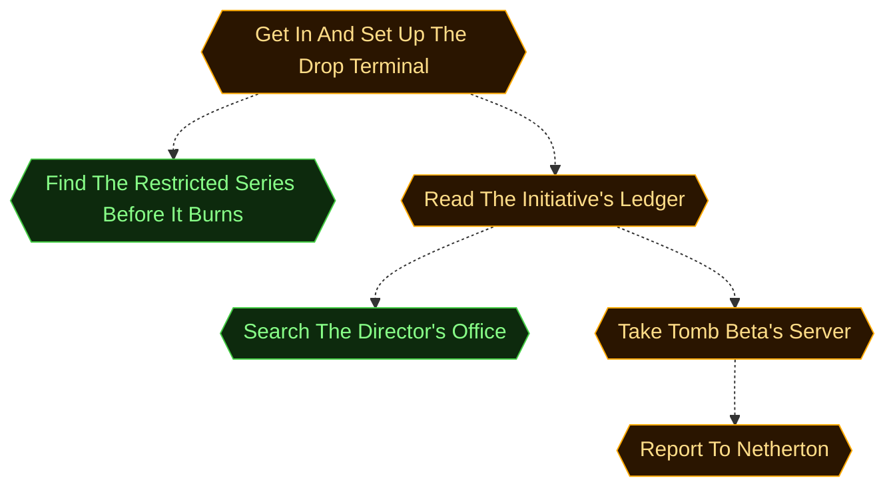
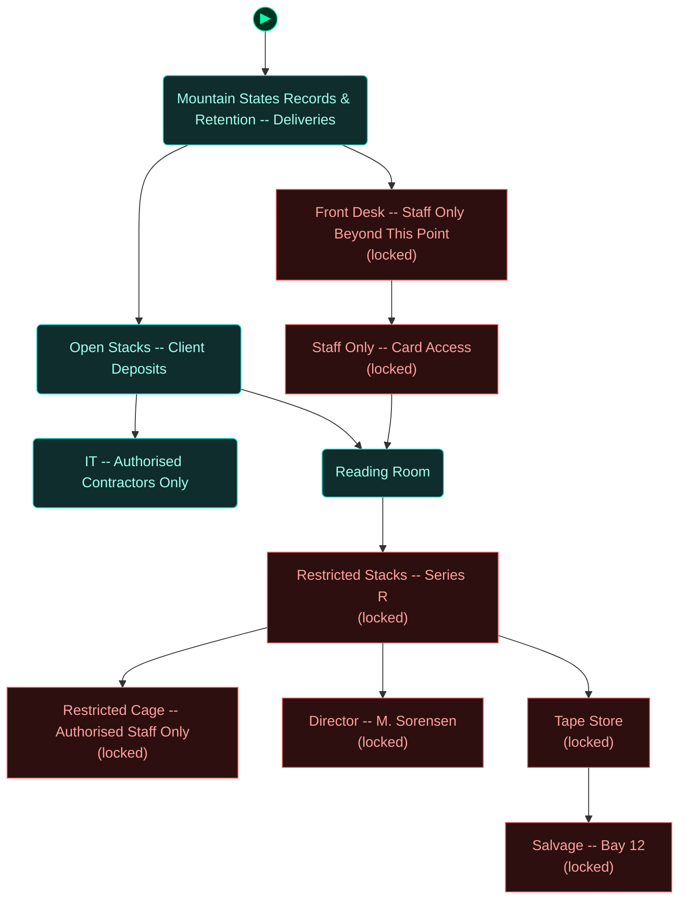

<!-- Auto-generated by scripts/generate_dungeon_graph.rb — do not edit by hand -->

# m09_digital_archaeology — Scenario Graph Reference

Helena, Montana, after hours. Last night a courier carried the Architect's order to Mountain States Records & Retention: burn Helena before the Publication. SAFETYNET read it and let it go on. Tonight the archive's director is feeding a shredder box by box, and somewhere in her stacks is the paper ENTROPY can't afford to keep. Get in, open the archive's catalogue server and take what the shredder hasn't reached. Task Force Null follows you to Montana tonight, and Director Netherton wants a name he can say in court.

## Scenario Statistics

| Metric | Value |
|---|---|
| Story aims | 6 |
| Total tasks | 27 (5 optional) |
| VM flag challenges | 4 |
| Physical locks | 11 |
| AND-gate convergences | 0 |
| Rooms | 11 |
| Puzzle graph nodes / edges | 57 / 63 |
| Story graph nodes / edges | 6 / 5 |

## Critical Path

3 hops through story aims — minimum mandatory sequence to reach mission completion:

**Get In And Set Up The Drop Terminal → Read The Initiative's Ledger → Take Tomb Beta's Server → Report To Netherton**

## How to Read These Diagrams

| Shape | Colour | Meaning |
|---|---|---|
| Rounded rectangle | Teal | Room / physical area |
| Rectangle | Red | Lock, barrier, or interactive terminal |
| Diamond | Orange | Inventory item or credential |
| Diamond | Red/Pink | NPC or physical key |
| Diamond | Purple | VM flag (challenge completion token) |
| Rectangle | Blue | VM challenge |
| Ribbon | Amber | NPC conversation / action gate |
| Hexagon | Green | Story aim (objective) |
| Hexagon | Amber | Critical path node |
| Circle | Grey | AND gate (all inputs required) |
| Subroutine rect `[[…]]` | Green | Container (holds items) |
| Rounded rectangle | Amber | NPC in room (Rooms & Contents only) |

Edges: `-->` solid = hard dependency; `-.->` dashed = soft / narrative dependency or optional path.

The `▶` node marks the player's starting room.

## Puzzle Graph

Physical lock–key dependency chain. Shows which items, codes, and NPC interactions are required to open each lock, and which locks gate access to each room or object. Use this to trace solvability, spot circular dependencies, and check that every key is reachable before the lock that needs it.

```mermaid
flowchart TD

  classDef room      fill:#0f2d2d,stroke:#22ddcc,color:#a0ffee
  classDef lock      fill:#2d0f0f,stroke:#e66060,color:#ffa0a0
  classDef key       fill:#2d0812,stroke:#e66060,color:#ffa0a0
  classDef item      fill:#2d1200,stroke:#e89030,color:#ffcc80
  classDef gate      fill:#111,stroke:#666,color:#eee
  classDef vm        fill:#0c1f40,stroke:#4a90d9,color:#a0c8ff
  classDef flag      fill:#1a0c2d,stroke:#9060d0,color:#cc99ff
  classDef action    fill:#1a1200,stroke:#cc9922,color:#ffee88
  classDef aim       fill:#0d2a0d,stroke:#44cc44,color:#88ff88
  classDef aim_gate  fill:#111111,stroke:#44cc44,color:#44cc44
  classDef container fill:#1a2d1a,stroke:#60b060,color:#a0e0a0
  classDef npc       fill:#2d1f0d,stroke:#d0a050,color:#ffe0a0
  classDef critical  fill:#2a1500,stroke:#ffaa00,color:#ffdd88
  classDef start     fill:#003322,stroke:#00ffaa,color:#00ffaa

  node_start(("▶"))
  node_start --> loading_dock

  door_front_desk["Front Desk -- Staff Only Beyond This Point<br/>Key lock"]
  front_desk("Front Desk -- Staff Only Beyond This Point")
  door_staff_passage["Staff Only -- Card Access<br/>RFID lock"]
  staff_passage("Staff Only -- Card Access")
  door_restricted_stacks["Restricted Stacks -- Series R<br/>RFID lock"]
  restricted_stacks("Restricted Stacks -- Series R")
  door_restricted_cage["Restricted Cage -- Authorised Staff Only<br/>RFID lock"]
  restricted_cage("Restricted Cage -- Authorised Staff Only")
  door_sorensen_office["Director -- M. Sorensen<br/>Password lock"]
  sorensen_office("Director -- M. Sorensen")
  door_tape_room["Tape Store<br/>RFID lock"]
  tape_room("Tape Store")
  door_salvage_cage["Salvage -- Bay 12<br/>Password lock"]
  salvage_cage("Salvage -- Bay 12")
  loading_dock("Mountain States Records & Retention -- Deliveries")
  lock_pick_kit{"Lock Pick Kit"}
  lock_enrolment_crate["Enrolment Crate"]
  rfid_cloner{"RFID Cloner"}
  fingerprint_kit{"Fingerprint Kit"}
  cyberchef_workstation{"CyberChef Workstation"}
  pin_cracker_kowalczyk_s{"PIN Cracker (Kowalczyk's)"}
  lock_director_safe["Director Safe"]
  npc_agent_hax{"Agent HaX"}
  catalogue_salvage_cage{"Catalogue: salvage cage"}
  npc_noor_haddad{"Noor Haddad"}
  staff_card_n_haddad{"Staff Card, N. Haddad"}
  open_stacks("Open Stacks -- Client Deposits")
  lock_hl_box["Harwick & Lowe, Dead Files<br/>Password lock"]
  placement_record_hl2015_0477{"Placement Record, HL2015-0477"}
  harwick_lowe_dead_files{"Harwick & Lowe, Dead Files"}
  npc_cody_old_coyote{"Cody Old Coyote"}
  key_ring_dock_office{"Key Ring, Dock Office"}
  reading_room("Reading Room")
  field_laptop["Field Laptop"]
  safetynet_drop_terminal{"SAFETYNET Drop Terminal"}
  training_notebook_scan{"Training Notebook (scan)"}
  rubber_stamp{"Rubber Stamp"}
  lock_plan_cabinet["Plan Cabinet"]
  candidate_assessment_intake_2011{"Candidate Assessment, Intake 2011"}
  plan_cabinet{"Plan Cabinet"}
  the_reading_1_viral_dynamics{"The Reading, 1: Viral Dynamics"}
  key_card_tape_store{"Key Card, Tape Store"}
  floor_safe{"Floor Safe"}
  rent_ledger{"Rent Ledger"}
  lease_abstract_and_construction_file{"Lease Abstract and Construction File"}
  shelf_marks{"Shelf Marks"}
  field_kit_link["Field Kit Link"]
  crate_stencilled_beta{"Crate, Stencilled BETA"}
  vmch_submit_catalogue_flag["Get into the catalogue server and submit the flag"]
  vmfl_submit_catalogue_flag{"Catalogue Flag"}
  vmch_submit_ledger_flag["Pull the Initiative's ledger off the catalogue server and submit it"]
  vmfl_submit_ledger_flag{"Ledger Flag"}
  vmch_submit_owner_flag["Find out who owns Tomb Beta's server and submit it"]
  vmfl_submit_owner_flag{"Owner Flag"}
  vmch_submit_control_flag["Take full control of Tomb Beta's server and submit it"]
  vmfl_submit_control_flag{"Control Flag"}
  server_closet("IT -- Authorised Contractors Only")

  door_front_desk --> front_desk
  door_staff_passage --> staff_passage
  door_restricted_stacks --> restricted_stacks
  door_restricted_cage --> restricted_cage
  door_sorensen_office --> sorensen_office
  door_tape_room --> tape_room
  door_salvage_cage --> salvage_cage
  loading_dock --> lock_pick_kit
  lock_pick_kit --> door_front_desk
  lock_pick_kit --> lock_enrolment_crate
  loading_dock --> rfid_cloner
  rfid_cloner --> door_restricted_cage
  loading_dock --> fingerprint_kit
  loading_dock --> cyberchef_workstation
  loading_dock --> pin_cracker_kowalczyk_s
  pin_cracker_kowalczyk_s --> lock_director_safe
  loading_dock --> npc_agent_hax
  npc_agent_hax --> catalogue_salvage_cage
  catalogue_salvage_cage --> door_salvage_cage
  front_desk --> npc_noor_haddad
  npc_noor_haddad --> staff_card_n_haddad
  staff_card_n_haddad --> door_staff_passage
  open_stacks --> lock_hl_box
  lock_hl_box -.-> placement_record_hl2015_0477
  open_stacks -.-> harwick_lowe_dead_files
  open_stacks --> npc_cody_old_coyote
  npc_cody_old_coyote -.-> key_ring_dock_office
  key_ring_dock_office -.-> door_front_desk
  reading_room --> field_laptop
  reading_room --> safetynet_drop_terminal
  safetynet_drop_terminal --> door_restricted_stacks
  reading_room --> safetynet_drop_terminal
  reading_room --> training_notebook_scan
  restricted_stacks --> rubber_stamp
  rubber_stamp --> lock_plan_cabinet
  restricted_cage --> lock_plan_cabinet
  lock_plan_cabinet --> candidate_assessment_intake_2011
  restricted_cage --> plan_cabinet
  sorensen_office --> lock_director_safe
  lock_director_safe --> the_reading_1_viral_dynamics
  lock_director_safe --> key_card_tape_store
  key_card_tape_store --> door_tape_room
  sorensen_office --> floor_safe
  floor_safe --> door_tape_room
  sorensen_office -.-> rent_ledger
  rent_ledger -.-> lock_director_safe
  sorensen_office --> lease_abstract_and_construction_file
  tape_room --> shelf_marks
  salvage_cage --> field_kit_link
  salvage_cage --> lock_enrolment_crate
  salvage_cage -.-> crate_stencilled_beta
  vmch_submit_catalogue_flag --> vmfl_submit_catalogue_flag
  vmfl_submit_catalogue_flag --> door_restricted_stacks
  vmch_submit_ledger_flag --> vmfl_submit_ledger_flag
  vmfl_submit_catalogue_flag -.-> vmch_submit_ledger_flag
  vmch_submit_owner_flag --> vmfl_submit_owner_flag
  vmfl_submit_ledger_flag -.-> vmch_submit_owner_flag
  vmch_submit_control_flag --> vmfl_submit_control_flag
  vmfl_submit_owner_flag -.-> vmch_submit_control_flag
  field_laptop --> vmch_submit_catalogue_flag
  loading_dock --> open_stacks
  open_stacks --> reading_room
  open_stacks --> server_closet

  class door_front_desk,door_staff_passage,door_restricted_stacks,door_restricted_cage,door_sorensen_office,door_tape_room,door_salvage_cage,lock_enrolment_crate,lock_director_safe,lock_hl_box,lock_plan_cabinet lock
  class front_desk,staff_passage,restricted_stacks,restricted_cage,sorensen_office,tape_room,salvage_cage,loading_dock,open_stacks,reading_room,server_closet room
  class lock_pick_kit,rfid_cloner,fingerprint_kit,cyberchef_workstation,pin_cracker_kowalczyk_s,catalogue_salvage_cage,placement_record_hl2015_0477,harwick_lowe_dead_files,safetynet_drop_terminal,training_notebook_scan,rubber_stamp,candidate_assessment_intake_2011,plan_cabinet,the_reading_1_viral_dynamics,floor_safe,rent_ledger,lease_abstract_and_construction_file,shelf_marks,crate_stencilled_beta item
  class npc_agent_hax,npc_noor_haddad,staff_card_n_haddad,npc_cody_old_coyote,key_ring_dock_office,key_card_tape_store key
  class field_laptop,field_kit_link,vmch_submit_catalogue_flag,vmch_submit_ledger_flag,vmch_submit_owner_flag,vmch_submit_control_flag vm
  class vmfl_submit_catalogue_flag,vmfl_submit_ledger_flag,vmfl_submit_owner_flag,vmfl_submit_control_flag flag

  classDef optional stroke-dasharray:5 2
  class placement_record_hl2015_0477,harwick_lowe_dead_files,key_ring_dock_office,rent_ledger,crate_stencilled_beta optional
  class node_start start
```

## Story Aims

Narrative objective flow. Shows story aims and their unlock conditions. Critical path aims are highlighted in amber. Use this to check aim sequencing, identify gaps between objectives, and verify that the player always has a clear next goal.

## Story + Puzzle (Integrated)

Puzzle graph and story aims combined, with bridge edges connecting physical puzzle progress to story aim completion. Use this to verify that physical actions drive narrative progress and that no aim is left floating without a puzzle prerequisite.

```mermaid
flowchart TD

  classDef room      fill:#0f2d2d,stroke:#22ddcc,color:#a0ffee
  classDef lock      fill:#2d0f0f,stroke:#e66060,color:#ffa0a0
  classDef key       fill:#2d0812,stroke:#e66060,color:#ffa0a0
  classDef item      fill:#2d1200,stroke:#e89030,color:#ffcc80
  classDef gate      fill:#111,stroke:#666,color:#eee
  classDef vm        fill:#0c1f40,stroke:#4a90d9,color:#a0c8ff
  classDef flag      fill:#1a0c2d,stroke:#9060d0,color:#cc99ff
  classDef action    fill:#1a1200,stroke:#cc9922,color:#ffee88
  classDef aim       fill:#0d2a0d,stroke:#44cc44,color:#88ff88
  classDef aim_gate  fill:#111111,stroke:#44cc44,color:#44cc44
  classDef container fill:#1a2d1a,stroke:#60b060,color:#a0e0a0
  classDef npc       fill:#2d1f0d,stroke:#d0a050,color:#ffe0a0
  classDef critical  fill:#2a1500,stroke:#ffaa00,color:#ffdd88
  classDef start     fill:#003322,stroke:#00ffaa,color:#00ffaa

  node_start(("▶"))
  node_start --> loading_dock

  door_front_desk["Front Desk -- Staff Only Beyond This Point<br/>Key lock"]
  front_desk("Front Desk -- Staff Only Beyond This Point")
  door_staff_passage["Staff Only -- Card Access<br/>RFID lock"]
  staff_passage("Staff Only -- Card Access")
  door_restricted_stacks["Restricted Stacks -- Series R<br/>RFID lock"]
  restricted_stacks("Restricted Stacks -- Series R")
  door_restricted_cage["Restricted Cage -- Authorised Staff Only<br/>RFID lock"]
  restricted_cage("Restricted Cage -- Authorised Staff Only")
  door_sorensen_office["Director -- M. Sorensen<br/>Password lock"]
  sorensen_office("Director -- M. Sorensen")
  door_tape_room["Tape Store<br/>RFID lock"]
  tape_room("Tape Store")
  door_salvage_cage["Salvage -- Bay 12<br/>Password lock"]
  salvage_cage("Salvage -- Bay 12")
  loading_dock("Mountain States Records & Retention -- Deliveries")
  lock_pick_kit{"Lock Pick Kit"}
  lock_enrolment_crate["Enrolment Crate"]
  rfid_cloner{"RFID Cloner"}
  fingerprint_kit{"Fingerprint Kit"}
  cyberchef_workstation{"CyberChef Workstation"}
  pin_cracker_kowalczyk_s{"PIN Cracker (Kowalczyk's)"}
  lock_director_safe["Director Safe"]
  npc_agent_hax{"Agent HaX"}
  catalogue_salvage_cage{"Catalogue: salvage cage"}
  npc_noor_haddad{"Noor Haddad"}
  staff_card_n_haddad{"Staff Card, N. Haddad"}
  open_stacks("Open Stacks -- Client Deposits")
  lock_hl_box["Harwick & Lowe, Dead Files<br/>Password lock"]
  placement_record_hl2015_0477{"Placement Record, HL2015-0477"}
  harwick_lowe_dead_files{"Harwick & Lowe, Dead Files"}
  npc_cody_old_coyote{"Cody Old Coyote"}
  key_ring_dock_office{"Key Ring, Dock Office"}
  reading_room("Reading Room")
  field_laptop["Field Laptop"]
  safetynet_drop_terminal{"SAFETYNET Drop Terminal"}
  training_notebook_scan{"Training Notebook (scan)"}
  rubber_stamp{"Rubber Stamp"}
  lock_plan_cabinet["Plan Cabinet"]
  candidate_assessment_intake_2011{"Candidate Assessment, Intake 2011"}
  plan_cabinet{"Plan Cabinet"}
  the_reading_1_viral_dynamics{"The Reading, 1: Viral Dynamics"}
  key_card_tape_store{"Key Card, Tape Store"}
  floor_safe{"Floor Safe"}
  rent_ledger{"Rent Ledger"}
  lease_abstract_and_construction_file{"Lease Abstract and Construction File"}
  shelf_marks{"Shelf Marks"}
  field_kit_link["Field Kit Link"]
  crate_stencilled_beta{"Crate, Stencilled BETA"}
  vmch_submit_catalogue_flag["Get into the catalogue server and submit the flag"]
  vmfl_submit_catalogue_flag{"Catalogue Flag"}
  vmch_submit_ledger_flag["Pull the Initiative's ledger off the catalogue server and submit it"]
  vmfl_submit_ledger_flag{"Ledger Flag"}
  vmch_submit_owner_flag["Find out who owns Tomb Beta's server and submit it"]
  vmfl_submit_owner_flag{"Owner Flag"}
  vmch_submit_control_flag["Take full control of Tomb Beta's server and submit it"]
  vmfl_submit_control_flag{"Control Flag"}
  server_closet("IT -- Authorised Contractors Only")
  aim_get_in{{"Get In And Set Up The Drop Terminal"}}
  aim_restricted_series{{"Find The Restricted Series Before It Burns"}}
  aim_read_the_ledger{{"Read The Initiative's Ledger"}}
  aim_search_the_office{{"Search The Director's Office"}}
  aim_take_tomb_beta{{"Take Tomb Beta's Server"}}
  aim_report_in{{"Report To Netherton"}}

  door_front_desk --> front_desk
  door_staff_passage --> staff_passage
  door_restricted_stacks --> restricted_stacks
  door_restricted_cage --> restricted_cage
  door_sorensen_office --> sorensen_office
  door_tape_room --> tape_room
  door_salvage_cage --> salvage_cage
  loading_dock --> lock_pick_kit
  lock_pick_kit --> door_front_desk
  lock_pick_kit --> lock_enrolment_crate
  loading_dock --> rfid_cloner
  rfid_cloner --> door_restricted_cage
  loading_dock --> fingerprint_kit
  loading_dock --> cyberchef_workstation
  loading_dock --> pin_cracker_kowalczyk_s
  pin_cracker_kowalczyk_s --> lock_director_safe
  loading_dock --> npc_agent_hax
  npc_agent_hax --> catalogue_salvage_cage
  catalogue_salvage_cage --> door_salvage_cage
  front_desk --> npc_noor_haddad
  npc_noor_haddad --> staff_card_n_haddad
  staff_card_n_haddad --> door_staff_passage
  open_stacks --> lock_hl_box
  lock_hl_box -.-> placement_record_hl2015_0477
  open_stacks -.-> harwick_lowe_dead_files
  open_stacks --> npc_cody_old_coyote
  npc_cody_old_coyote -.-> key_ring_dock_office
  key_ring_dock_office -.-> door_front_desk
  reading_room --> field_laptop
  reading_room --> safetynet_drop_terminal
  safetynet_drop_terminal --> door_restricted_stacks
  reading_room --> safetynet_drop_terminal
  reading_room --> training_notebook_scan
  restricted_stacks --> rubber_stamp
  rubber_stamp --> lock_plan_cabinet
  restricted_cage --> lock_plan_cabinet
  lock_plan_cabinet --> candidate_assessment_intake_2011
  restricted_cage --> plan_cabinet
  sorensen_office --> lock_director_safe
  lock_director_safe --> the_reading_1_viral_dynamics
  lock_director_safe --> key_card_tape_store
  key_card_tape_store --> door_tape_room
  sorensen_office --> floor_safe
  floor_safe --> door_tape_room
  sorensen_office -.-> rent_ledger
  rent_ledger -.-> lock_director_safe
  sorensen_office --> lease_abstract_and_construction_file
  tape_room --> shelf_marks
  salvage_cage --> field_kit_link
  salvage_cage --> lock_enrolment_crate
  salvage_cage -.-> crate_stencilled_beta
  vmch_submit_catalogue_flag --> vmfl_submit_catalogue_flag
  vmfl_submit_catalogue_flag --> door_restricted_stacks
  vmch_submit_ledger_flag --> vmfl_submit_ledger_flag
  vmfl_submit_catalogue_flag -.-> vmch_submit_ledger_flag
  vmch_submit_owner_flag --> vmfl_submit_owner_flag
  vmfl_submit_ledger_flag -.-> vmch_submit_owner_flag
  vmch_submit_control_flag --> vmfl_submit_control_flag
  vmfl_submit_owner_flag -.-> vmch_submit_control_flag
  field_laptop --> vmch_submit_catalogue_flag
  loading_dock --> open_stacks
  open_stacks --> reading_room
  open_stacks --> server_closet
  aim_get_in -.-> aim_restricted_series
  aim_get_in -.-> aim_read_the_ledger
  aim_read_the_ledger -.-> aim_search_the_office
  aim_read_the_ledger -.-> aim_take_tomb_beta
  aim_take_tomb_beta -.-> aim_report_in
  vmfl_submit_catalogue_flag -.-> aim_get_in
  door_restricted_stacks -.-> aim_restricted_series
  lock_plan_cabinet -.-> aim_restricted_series
  vmfl_submit_ledger_flag -.-> aim_read_the_ledger
  door_sorensen_office -.-> aim_search_the_office
  lock_director_safe -.-> aim_search_the_office
  door_tape_room -.-> aim_take_tomb_beta
  door_salvage_cage -.-> aim_take_tomb_beta
  vmfl_submit_owner_flag -.-> aim_take_tomb_beta
  vmfl_submit_control_flag -.-> aim_take_tomb_beta

  class door_front_desk,door_staff_passage,door_restricted_stacks,door_restricted_cage,door_sorensen_office,door_tape_room,door_salvage_cage,lock_enrolment_crate,lock_director_safe,lock_hl_box,lock_plan_cabinet lock
  class front_desk,staff_passage,restricted_stacks,restricted_cage,sorensen_office,tape_room,salvage_cage,loading_dock,open_stacks,reading_room,server_closet room
  class lock_pick_kit,rfid_cloner,fingerprint_kit,cyberchef_workstation,pin_cracker_kowalczyk_s,catalogue_salvage_cage,placement_record_hl2015_0477,harwick_lowe_dead_files,safetynet_drop_terminal,training_notebook_scan,rubber_stamp,candidate_assessment_intake_2011,plan_cabinet,the_reading_1_viral_dynamics,floor_safe,rent_ledger,lease_abstract_and_construction_file,shelf_marks,crate_stencilled_beta item
  class npc_agent_hax,npc_noor_haddad,staff_card_n_haddad,npc_cody_old_coyote,key_ring_dock_office,key_card_tape_store key
  class field_laptop,field_kit_link,vmch_submit_catalogue_flag,vmch_submit_ledger_flag,vmch_submit_owner_flag,vmch_submit_control_flag vm
  class vmfl_submit_catalogue_flag,vmfl_submit_ledger_flag,vmfl_submit_owner_flag,vmfl_submit_control_flag flag
  class aim_get_in,aim_read_the_ledger,aim_take_tomb_beta,aim_report_in critical
  class aim_restricted_series,aim_search_the_office aim

  classDef optional stroke-dasharray:5 2
  class placement_record_hl2015_0477,harwick_lowe_dead_files,key_ring_dock_office,rent_ledger,crate_stencilled_beta optional
  class node_start start
```

## Rooms

Physical room layout with all connections. Locked rooms are shown in red. Use this to check room reachability, identify dead-end rooms with no content, and understand the spatial structure of the scenario.

## Rooms & Contents

Physical room layout with all objects, containers, NPCs, and held items. Use this to check clue distribution across rooms, verify that hints are placed before the locks they solve, and spot rooms that are under- or over-loaded with content.

```mermaid
flowchart TD

  classDef room      fill:#0f2d2d,stroke:#22ddcc,color:#a0ffee
  classDef lock      fill:#2d0f0f,stroke:#e66060,color:#ffa0a0
  classDef key       fill:#2d0812,stroke:#e66060,color:#ffa0a0
  classDef item      fill:#2d1200,stroke:#e89030,color:#ffcc80
  classDef gate      fill:#111,stroke:#666,color:#eee
  classDef vm        fill:#0c1f40,stroke:#4a90d9,color:#a0c8ff
  classDef flag      fill:#1a0c2d,stroke:#9060d0,color:#cc99ff
  classDef action    fill:#1a1200,stroke:#cc9922,color:#ffee88
  classDef aim       fill:#0d2a0d,stroke:#44cc44,color:#88ff88
  classDef aim_gate  fill:#111111,stroke:#44cc44,color:#44cc44
  classDef container fill:#1a2d1a,stroke:#60b060,color:#a0e0a0
  classDef npc       fill:#2d1f0d,stroke:#d0a050,color:#ffe0a0
  classDef critical  fill:#2a1500,stroke:#ffaa00,color:#ffdd88
  classDef start     fill:#003322,stroke:#00ffaa,color:#00ffaa

  node_start(("▶"))
  node_start --> loading_dock

  loading_dock("Mountain States Records & Retention -- Deliveries")
  front_desk["Front Desk -- Staff Only Beyond This Point<br/>(locked)"]
  open_stacks("Open Stacks -- Client Deposits")
  server_closet("IT -- Authorised Contractors Only")
  staff_passage["Staff Only -- Card Access<br/>(locked)"]
  reading_room("Reading Room")
  restricted_stacks["Restricted Stacks -- Series R<br/>(locked)"]
  restricted_cage["Restricted Cage -- Authorised Staff Only<br/>(locked)"]
  sorensen_office["Director -- M. Sorensen<br/>(locked)"]
  tape_room["Tape Store<br/>(locked)"]
  salvage_cage["Salvage -- Bay 12<br/>(locked)"]
  rc_incident_book_1{"Incident Log"}
  rc_npc_agent_hax_2("Agent HaX")
  rc_m09_catalogue_field_guide_3{"SAFETYNET Field Guide: The Catalogue Server"}
  rc_m09_ledger_field_guide_4{"SAFETYNET Field Guide: The Ledger"}
  rc_m09_tomb_beta_field_guide_5{"SAFETYNET Field Guide: Tomb Beta's Server"}
  rc_m09_archive_code_guide_6{"SAFETYNET Field Guide: Archive Codes"}
  rc_catalogue_salvage_line_7{"Catalogue: salvage cage"}
  rc_npc_the_recruiter_8("The Recruiter")
  rc_npc_agent_0x47_nightshade_9("Agent 0x47 'Nightshade'")
  rc_npc_david_torres_10("David Torres")
  rc_npc_gary_whitlock_11("Gary Whitlock")
  rc_npc_director_magnus_netherton_12("Director Magnus Netherton")
  rc_npc_agent_hax_13("Agent HaX")
  rc_npc_agent_0x2d_anchor_14("Agent 0x2D 'Anchor'")
  rc_npc_agent_0x5e_lantern_15("Agent 0x5E 'Lantern'")
  rc_npc_officer_dev_malhotra_16("Officer Dev Malhotra")
  rc_npc_officer_kenji_arakawa_17("Officer Kenji Arakawa")
  rc_npc_director_magnus_netherton_18("Director Magnus Netherton")
  rc_npc_director_magnus_netherton_19("Director Magnus Netherton")
  rc_trolley_list_20{"Destruction Run, Series R"}
  rc_noor_desk_box_21{"Box Under the Desk"}
  rc_npc_noor_haddad_22("Noor Haddad")
  rc_noor_staff_card_23{"Staff Card, N. Haddad"}
  rc_hl_bay_label_24{"Bay Label"}
  rc_hl_box_25[["Harwick & Lowe, Dead Files"]]
  rc_hl_placing_sheet_26{"Placement Record, HL2015-0477"}
  rc_npc_cody_old_coyote_27("Cody Old Coyote")
  rc_dock_office_key_28{"Key Ring, Dock Office"}
  rc_npc_lyle_dillard_29("Lyle Dillard")
  rc_tape_side_console_30{"Wipe Console"}
  rc_npc_jesse_tran_31("Jesse Tran")
  rc_field_laptop_32{"Field Laptop"}
  rc_drop_terminal_33{"SAFETYNET Drop Terminal"}
  rc_drop_terminal_screen_34{"SAFETYNET Drop Terminal"}
  rc_case_file_35{"Case File, Helena"}
  rc_notebook_scan_36{"Training Notebook (scan)"}
  rc_sorensen_stamp_37{"Rubber Stamp"}
  rc_npc_margaret_sorensen_38("Margaret Sorensen")
  rc_derek_file_39{"Asset File: D. Lawson"}
  rc_letters_40{"Initiative to Social Fabric, Handoff 14"}
  rc_nightshade_copy_41{"Cleared from Locker 47"}
  rc_cage_shredder_42{"Cross-Cut Shredder"}
  rc_feed_table_box_43{"The Last Box"}
  rc_plan_cabinet_44[["Plan Cabinet"]]
  rc_nightshade_file_45{"Candidate Assessment, Intake 2011"}
  rc_printed_ledger_46{"Initiative Ledger, Print Copy"}
  rc_npc_margaret_sorensen_47("Margaret Sorensen")
  rc_sorensen_stacks_card_48{"Stacks Card, M. Sorensen"}
  rc_npc_margaret_sorensen_49("Margaret Sorensen")
  rc_derek_file_50{"Asset File: D. Lawson"}
  rc_letters_51{"Initiative to Social Fabric, Handoff 14"}
  rc_nightshade_copy_52{"Cleared from Locker 47"}
  rc_director_safe_53[["Floor Safe"]]
  rc_the_reading_54{"The Reading, 1: Viral Dynamics"}
  rc_the_reading_2_55{"The Reading, 2: The Innocents"}
  rc_the_reading_3_56{"The Reading, 3: Albion"}
  rc_the_reading_4_57{"The Reading, 4: Portland"}
  rc_the_reading_last_page_58{"The Reading, Last Page"}
  rc_master_schedule_59{"Destruction Schedule (master)"}
  rc_tape_room_keycard_60{"Key Card, Tape Store"}
  rc_rent_book_61{"Rent Ledger"}
  rc_lease_file_62{"Lease Abstract and Construction File"}
  rc_danny_sheet_63{"Broker's Note: D. Foster"}
  rc_refit_ledger_64{"Build-Out Ledger"}
  rc_deck_controller_65{"Tape Deck Controller"}
  rc_clerk_certificate_66{"Framed Certificate"}
  rc_shelf_code_legend_67{"Shelf Marks"}
  rc_alpha_tape_deck_68{"Reel Deck"}
  rc_alpha_annotations_69{"Annotation Sheets, Series ALPHA"}
  rc_npc_dr_adrian_tesseract_recording_70("Dr Adrian Tesseract (recording)")
  rc_tomb_beta_rack_71{"Rack Server"}
  rc_beta_asset_tag_72{"Property Label"}
  rc_field_kit_link_73{"Field Kit Link"}
  rc_tomb_beta_station_74{"Tomb Beta Drop Link"}
  rc_albion_folder_75{"Printed Folder: VH-2017-0312"}
  rc_mirror_job_printout_76{"Mirror Job Printout"}
  rc_enrolment_crate_77[["Crate, Stencilled BETA"]]
  rc_enrolment_binders_78{"Enrolment Binder, Tomb Beta"}

  loading_dock --> open_stacks
  loading_dock --> front_desk
  front_desk --> staff_passage
  open_stacks --> reading_room
  open_stacks --> server_closet
  staff_passage --> reading_room
  reading_room --> restricted_stacks
  restricted_stacks --> restricted_cage
  restricted_stacks --> sorensen_office
  restricted_stacks --> tape_room
  tape_room --> salvage_cage
  loading_dock --> rc_incident_book_1
  loading_dock --> rc_npc_agent_hax_2
  rc_npc_agent_hax_2 --> rc_m09_catalogue_field_guide_3
  rc_npc_agent_hax_2 --> rc_m09_ledger_field_guide_4
  rc_npc_agent_hax_2 --> rc_m09_tomb_beta_field_guide_5
  rc_npc_agent_hax_2 --> rc_m09_archive_code_guide_6
  rc_npc_agent_hax_2 --> rc_catalogue_salvage_line_7
  loading_dock --> rc_npc_the_recruiter_8
  loading_dock --> rc_npc_agent_0x47_nightshade_9
  loading_dock --> rc_npc_david_torres_10
  loading_dock --> rc_npc_gary_whitlock_11
  loading_dock --> rc_npc_director_magnus_netherton_12
  loading_dock --> rc_npc_agent_hax_13
  loading_dock --> rc_npc_agent_0x2d_anchor_14
  loading_dock --> rc_npc_agent_0x5e_lantern_15
  loading_dock --> rc_npc_officer_dev_malhotra_16
  loading_dock --> rc_npc_officer_kenji_arakawa_17
  loading_dock --> rc_npc_director_magnus_netherton_18
  loading_dock --> rc_npc_director_magnus_netherton_19
  front_desk --> rc_trolley_list_20
  front_desk --> rc_noor_desk_box_21
  front_desk --> rc_npc_noor_haddad_22
  rc_npc_noor_haddad_22 --> rc_noor_staff_card_23
  open_stacks --> rc_hl_bay_label_24
  open_stacks --> rc_hl_box_25
  rc_hl_box_25 --> rc_hl_placing_sheet_26
  open_stacks --> rc_npc_cody_old_coyote_27
  rc_npc_cody_old_coyote_27 --> rc_dock_office_key_28
  open_stacks --> rc_npc_lyle_dillard_29
  server_closet --> rc_tape_side_console_30
  server_closet --> rc_npc_jesse_tran_31
  reading_room --> rc_field_laptop_32
  reading_room --> rc_drop_terminal_33
  reading_room --> rc_drop_terminal_screen_34
  reading_room --> rc_case_file_35
  reading_room --> rc_notebook_scan_36
  restricted_stacks --> rc_sorensen_stamp_37
  restricted_stacks --> rc_npc_margaret_sorensen_38
  rc_npc_margaret_sorensen_38 --> rc_derek_file_39
  rc_npc_margaret_sorensen_38 --> rc_letters_40
  rc_npc_margaret_sorensen_38 --> rc_nightshade_copy_41
  restricted_cage --> rc_cage_shredder_42
  restricted_cage --> rc_feed_table_box_43
  restricted_cage --> rc_plan_cabinet_44
  rc_plan_cabinet_44 --> rc_nightshade_file_45
  restricted_cage --> rc_printed_ledger_46
  restricted_cage --> rc_npc_margaret_sorensen_47
  rc_npc_margaret_sorensen_47 --> rc_sorensen_stacks_card_48
  restricted_cage --> rc_npc_margaret_sorensen_49
  rc_npc_margaret_sorensen_49 --> rc_derek_file_50
  rc_npc_margaret_sorensen_49 --> rc_letters_51
  rc_npc_margaret_sorensen_49 --> rc_nightshade_copy_52
  sorensen_office --> rc_director_safe_53
  rc_director_safe_53 --> rc_the_reading_54
  rc_director_safe_53 --> rc_the_reading_2_55
  rc_director_safe_53 --> rc_the_reading_3_56
  rc_director_safe_53 --> rc_the_reading_4_57
  rc_director_safe_53 --> rc_the_reading_last_page_58
  rc_director_safe_53 --> rc_master_schedule_59
  rc_director_safe_53 --> rc_tape_room_keycard_60
  sorensen_office --> rc_rent_book_61
  sorensen_office --> rc_lease_file_62
  sorensen_office --> rc_danny_sheet_63
  sorensen_office --> rc_refit_ledger_64
  sorensen_office --> rc_deck_controller_65
  sorensen_office --> rc_clerk_certificate_66
  tape_room --> rc_shelf_code_legend_67
  tape_room --> rc_alpha_tape_deck_68
  tape_room --> rc_alpha_annotations_69
  tape_room --> rc_npc_dr_adrian_tesseract_recording_70
  salvage_cage --> rc_tomb_beta_rack_71
  salvage_cage --> rc_beta_asset_tag_72
  salvage_cage --> rc_field_kit_link_73
  salvage_cage --> rc_tomb_beta_station_74
  salvage_cage --> rc_albion_folder_75
  salvage_cage --> rc_mirror_job_printout_76
  salvage_cage --> rc_enrolment_crate_77
  rc_enrolment_crate_77 --> rc_enrolment_binders_78

  class loading_dock,open_stacks,server_closet,reading_room room
  class front_desk,staff_passage,restricted_stacks,restricted_cage,sorensen_office,tape_room,salvage_cage lock
  class rc_incident_book_1,rc_m09_catalogue_field_guide_3,rc_m09_ledger_field_guide_4,rc_m09_tomb_beta_field_guide_5,rc_m09_archive_code_guide_6,rc_catalogue_salvage_line_7,rc_trolley_list_20,rc_noor_desk_box_21,rc_noor_staff_card_23,rc_hl_bay_label_24,rc_hl_placing_sheet_26,rc_dock_office_key_28,rc_tape_side_console_30,rc_field_laptop_32,rc_drop_terminal_33,rc_drop_terminal_screen_34,rc_case_file_35,rc_notebook_scan_36,rc_sorensen_stamp_37,rc_derek_file_39,rc_letters_40,rc_nightshade_copy_41,rc_cage_shredder_42,rc_feed_table_box_43,rc_nightshade_file_45,rc_printed_ledger_46,rc_sorensen_stacks_card_48,rc_derek_file_50,rc_letters_51,rc_nightshade_copy_52,rc_the_reading_54,rc_the_reading_2_55,rc_the_reading_3_56,rc_the_reading_4_57,rc_the_reading_last_page_58,rc_master_schedule_59,rc_tape_room_keycard_60,rc_rent_book_61,rc_lease_file_62,rc_danny_sheet_63,rc_refit_ledger_64,rc_deck_controller_65,rc_clerk_certificate_66,rc_shelf_code_legend_67,rc_alpha_tape_deck_68,rc_alpha_annotations_69,rc_tomb_beta_rack_71,rc_beta_asset_tag_72,rc_field_kit_link_73,rc_tomb_beta_station_74,rc_albion_folder_75,rc_mirror_job_printout_76,rc_enrolment_binders_78 item
  class rc_npc_agent_hax_2,rc_npc_the_recruiter_8,rc_npc_agent_0x47_nightshade_9,rc_npc_david_torres_10,rc_npc_gary_whitlock_11,rc_npc_director_magnus_netherton_12,rc_npc_agent_hax_13,rc_npc_agent_0x2d_anchor_14,rc_npc_agent_0x5e_lantern_15,rc_npc_officer_dev_malhotra_16,rc_npc_officer_kenji_arakawa_17,rc_npc_director_magnus_netherton_18,rc_npc_director_magnus_netherton_19,rc_npc_noor_haddad_22,rc_npc_cody_old_coyote_27,rc_npc_lyle_dillard_29,rc_npc_jesse_tran_31,rc_npc_margaret_sorensen_38,rc_npc_margaret_sorensen_47,rc_npc_margaret_sorensen_49,rc_npc_dr_adrian_tesseract_recording_70 npc
  class rc_hl_box_25,rc_plan_cabinet_44,rc_director_safe_53,rc_enrolment_crate_77 container
  class node_start start
```

