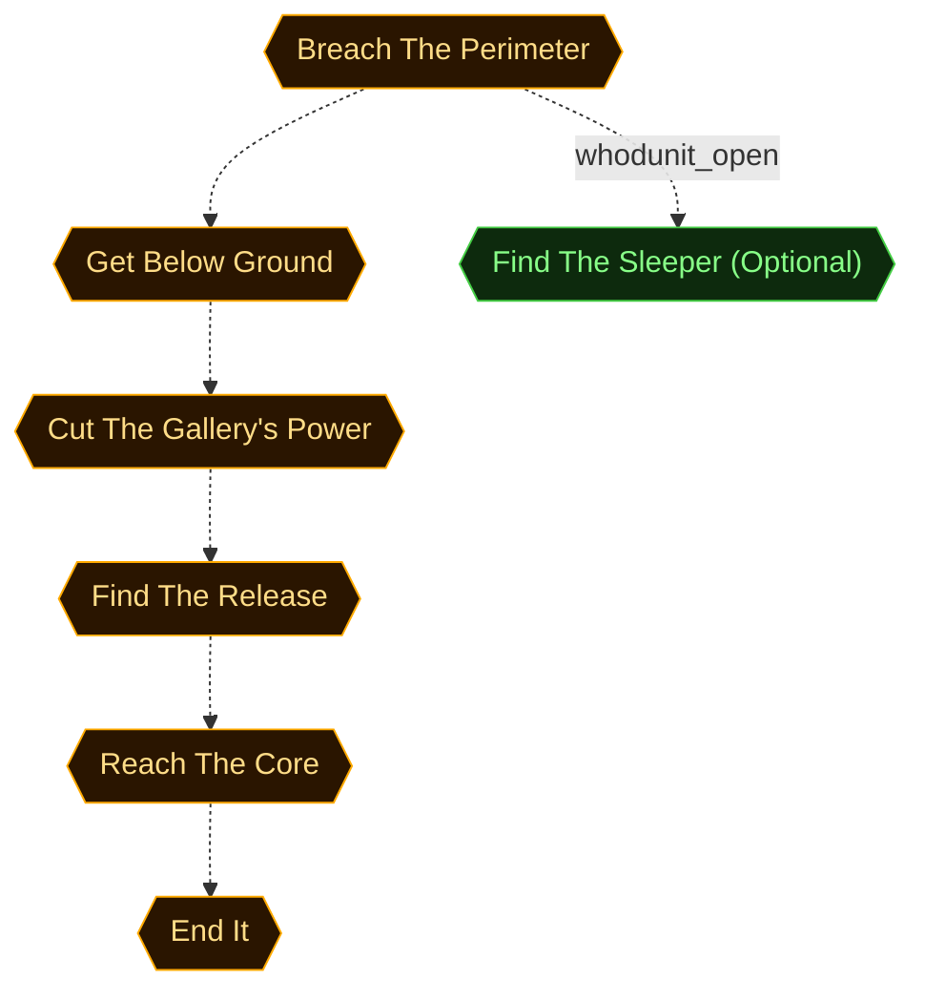
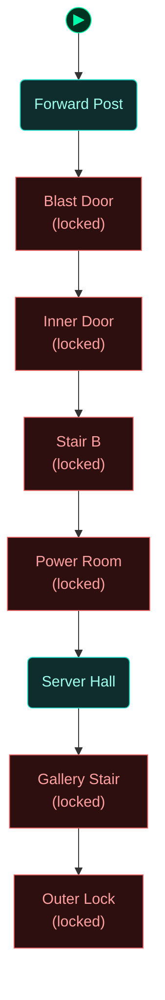

<!-- Auto-generated by scripts/generate_dungeon_graph.rb — do not edit by hand -->

# m10_full_disclosure — Scenario Graph Reference

Tomb Gamma is a Cold War bunker under the Montana hills, and the man behind ENTROPY's plan is waiting at its core. At six o'clock UTC his release sends every weakness SAFETYNET ever catalogued to every city at once. At four, two cells get it early. Director Netherton is running the raid from a folding table at the gate with Task Force Null. Get a foothold on the bunker's systems, get below ground, and reach the core before the clock does. Helena gave us the shape of a sleeper on tonight's team.

## Scenario Statistics

| Metric | Value |
|---|---|
| Story aims | 7 |
| Total tasks | 28 (8 optional) |
| VM flag challenges | 4 |
| Physical locks | 12 |
| AND-gate convergences | 1 |
| Rooms | 8 |
| Puzzle graph nodes / edges | 82 / 114 |
| Story graph nodes / edges | 7 / 6 |

## Critical Path

5 hops through story aims — minimum mandatory sequence to reach mission completion:

**Breach The Perimeter → Get Below Ground → Cut The Gallery's Power → Find The Release → Reach The Core → End It**

## How to Read These Diagrams

| Shape | Colour | Meaning |
|---|---|---|
| Rounded rectangle | Teal | Room / physical area |
| Rectangle | Red | Lock, barrier, or interactive terminal |
| Diamond | Orange | Inventory item or credential |
| Diamond | Red/Pink | NPC or physical key |
| Diamond | Purple | VM flag (challenge completion token) |
| Rectangle | Blue | VM challenge |
| Ribbon | Amber | NPC conversation / action gate |
| Hexagon | Green | Story aim (objective) |
| Hexagon | Amber | Critical path node |
| Circle | Grey | AND gate (all inputs required) |
| Subroutine rect `[[…]]` | Green | Container (holds items) |
| Rounded rectangle | Amber | NPC in room (Rooms & Contents only) |

Edges: `-->` solid = hard dependency; `-.->` dashed = soft / narrative dependency or optional path.

The `▶` node marks the player's starting room.

## Puzzle Graph

Physical lock–key dependency chain. Shows which items, codes, and NPC interactions are required to open each lock, and which locks gate access to each room or object. Use this to trace solvability, spot circular dependencies, and check that every key is reachable before the lock that needs it.

```mermaid
flowchart TD

  classDef room      fill:#0f2d2d,stroke:#22ddcc,color:#a0ffee
  classDef lock      fill:#2d0f0f,stroke:#e66060,color:#ffa0a0
  classDef key       fill:#2d0812,stroke:#e66060,color:#ffa0a0
  classDef item      fill:#2d1200,stroke:#e89030,color:#ffcc80
  classDef gate      fill:#111,stroke:#666,color:#eee
  classDef vm        fill:#0c1f40,stroke:#4a90d9,color:#a0c8ff
  classDef flag      fill:#1a0c2d,stroke:#9060d0,color:#cc99ff
  classDef action    fill:#1a1200,stroke:#cc9922,color:#ffee88
  classDef aim       fill:#0d2a0d,stroke:#44cc44,color:#88ff88
  classDef aim_gate  fill:#111111,stroke:#44cc44,color:#44cc44
  classDef container fill:#1a2d1a,stroke:#60b060,color:#a0e0a0
  classDef npc       fill:#2d1f0d,stroke:#d0a050,color:#ffe0a0
  classDef critical  fill:#2a1500,stroke:#ffaa00,color:#ffdd88
  classDef start     fill:#003322,stroke:#00ffaa,color:#00ffaa

  node_start(("▶"))
  node_start --> forward_post

  door_blast_tunnel["Blast Door<br/>RFID lock"]
  blast_tunnel("Blast Door")
  door_security_office["Inner Door<br/>RFID lock"]
  security_office("Inner Door")
  door_workshop_floor["Stair B<br/>RFID lock"]
  workshop_floor("Stair B")
  door_power_room["Power Room<br/>RFID lock"]
  power_room("Power Room")
  door_gallery["Gallery Stair<br/>RFID lock"]
  gallery("Gallery Stair")
  door_core["Outer Lock<br/>PIN lock"]
  core("Outer Lock")
  forward_post("Forward Post")
  lock_pick_kit{"Lock Pick Kit"}
  lock_fitter_locker["Fitter Locker"]
  rfid_cloner{"RFID Cloner"}
  fingerprint_kit{"Fingerprint Kit"}
  pin_cracker_kowalczyk_s{"PIN Cracker (Kowalczyk's)"}
  lock_lock_records_cupboard["Lock Records Cupboard"]
  breaching_case_sign_out_sheet{"Breaching Case: Sign-Out Sheet"}
  citadel_incident_file_v_47{"Citadel Incident File V-47"}
  helena_s_plans_tomb_gamma_as_built{"Helena's Plans: Tomb Gamma, As Built"}
  field_console_gate["Field Console (Gate)"]
  gate_terminal{"Gate Terminal"}
  maintenance_tag{"Maintenance Tag"}
  npc_director_magnus_netherton{"Director Magnus Netherton"}
  action_tether_question>"The tether, on the silent branch (door_scene_done)"]
  action_split_line>"The split line"]
  npc_agent_0x47_nightshade{"Agent 0x47 'Nightshade'"}
  action_settle_the_table>"The door scene at the table (door_scene_done)"]
  npc_officer_kenji_arakawa{"Officer Kenji Arakawa"}
  action_arakawa_call>"Arakawa's call, then the pair back"]
  npc_agent_0x23_vector{"Agent 0x23 'Vector'"}
  records_cupboard_vector_s_code{"Records cupboard: Vector's code"}
  npc_ghost{"Ghost"}
  records_cupboard_ghost_s_code{"Records cupboard: Ghost's code"}
  outer_lock_maintenance_code{"Outer lock: maintenance code"}
  guard_post_ladder{"Guard Post Ladder"}
  monitoring_desk_door_log{"Monitoring Desk: Door Log"}
  duty_handset{"Duty Handset"}
  lock_records_cupboard["Records Cupboard<br/>PIN lock"]
  gallery_shift_rota{"Gallery Shift Rota"}
  alarm_log_refit_to_date{"Alarm Log, Refit to Date"}
  records_cupboard{"Records Cupboard"}
  spare_power_room_card{"Spare Power-Room Card"}
  fitter_s_locker{"Fitter's Locker"}
  casualty_sheet{"Casualty Sheet"}
  margin_strip{"Margin Strip"}
  lock_model_terminal["Bench Terminal: Casualty Model<br/>Password lock"]
  asante_s_corrected_model{"Asante's Corrected Model"}
  bench_log_outgoing{"Bench Log: Outgoing"}
  npc_imran_siddiqui{"Imran Siddiqui"}
  action_opens_power_room>"Talked round, or a card cloned"]
  npc_gary_whitlock{"Gary Whitlock"}
  npc_wendell_briggs{"Wendell Briggs"}
  action_cut_the_shutter>"The shutter cut: slot-holder or the phone voice"]
  npc_voltage_critical_mass{"Voltage (Critical Mass)"}
  server_hall("Server Hall")
  field_console_server_hall["Field Console (Server Hall)"]
  release_console{"Release Console"}
  sealed_section_hatch{"Sealed Section Hatch"}
  operator_s_duty_sheet{"Operator's Duty Sheet"}
  lock_sealed_hatch["Sealed Hatch"]
  keypad_face_plate{"Keypad Face Plate"}
  npc_victoria_sterling{"Victoria Sterling"}
  action_opened_from_inside>"Opened from inside (Victoria or Vos)"]
  npc_pieter_vos{"Pieter Vos"}
  visitor_s_code_card{"Visitor's Code Card"}
  npc_sione_fonoti{"Sione Fonoti"}
  gallery_shift_code_card{"Gallery Shift Code Card"}
  field_console_core["Field Console (Core)"]
  core_access_code{"Core Access Code"}
  lock_core_host_terminal["Core Host Terminal"]
  andgate1((" + "))
  vmch_submit_flag_1["Get a foothold on the security monitoring host and submit the flag at the gate terminal"]
  vmfl_submit_flag_1{"Flag 1 Flag"}
  vmch_submit_flag_2["Take the staging schedule and submit the flag at the release console"]
  vmfl_submit_flag_2{"Flag 2 Flag"}
  vmch_submit_flag_3["Get out of the release service onto its host and submit the flag at the sealed section's hatch"]
  vmfl_submit_flag_3{"Flag 3 Flag"}
  vmch_submit_flag_4["Get onto the core host and submit the flag at its terminal"]
  vmfl_submit_flag_4{"Flag 4 Flag"}

  door_blast_tunnel --> blast_tunnel
  door_security_office --> security_office
  door_workshop_floor --> workshop_floor
  door_power_room --> power_room
  door_gallery --> gallery
  door_core --> core
  forward_post -.-> lock_pick_kit
  lock_pick_kit -.-> lock_fitter_locker
  forward_post --> rfid_cloner
  forward_post --> fingerprint_kit
  forward_post -.-> pin_cracker_kowalczyk_s
  pin_cracker_kowalczyk_s -.-> door_core
  pin_cracker_kowalczyk_s -.-> lock_lock_records_cupboard
  forward_post --> breaching_case_sign_out_sheet
  forward_post --> citadel_incident_file_v_47
  forward_post --> helena_s_plans_tomb_gamma_as_built
  forward_post --> field_console_gate
  forward_post --> gate_terminal
  gate_terminal --> door_blast_tunnel
  forward_post --> maintenance_tag
  maintenance_tag --> gate_terminal
  forward_post --> npc_director_magnus_netherton
  npc_director_magnus_netherton --> action_tether_question
  npc_director_magnus_netherton --> action_split_line
  forward_post --> npc_agent_0x47_nightshade
  npc_agent_0x47_nightshade --> action_settle_the_table
  forward_post --> npc_officer_kenji_arakawa
  npc_officer_kenji_arakawa --> action_arakawa_call
  forward_post --> npc_agent_0x23_vector
  npc_agent_0x23_vector -.-> records_cupboard_vector_s_code
  records_cupboard_vector_s_code -.-> lock_lock_records_cupboard
  forward_post --> npc_ghost
  npc_ghost -.-> records_cupboard_ghost_s_code
  records_cupboard_ghost_s_code -.-> lock_lock_records_cupboard
  npc_ghost -.-> outer_lock_maintenance_code
  outer_lock_maintenance_code -.-> door_core
  blast_tunnel -.-> guard_post_ladder
  guard_post_ladder -.-> door_security_office
  security_office --> monitoring_desk_door_log
  security_office --> duty_handset
  duty_handset --> door_workshop_floor
  security_office --> lock_records_cupboard
  lock_records_cupboard -.-> gallery_shift_rota
  gallery_shift_rota -.-> door_core
  lock_records_cupboard -.-> alarm_log_refit_to_date
  alarm_log_refit_to_date -.-> lock_lock_records_cupboard
  security_office -.-> records_cupboard
  records_cupboard -.-> door_core
  security_office --> lock_fitter_locker
  lock_fitter_locker --> spare_power_room_card
  spare_power_room_card --> door_power_room
  security_office -.-> fitter_s_locker
  fitter_s_locker -.-> door_power_room
  security_office --> npc_agent_0x23_vector
  npc_agent_0x23_vector -.-> records_cupboard_vector_s_code
  records_cupboard_vector_s_code -.-> lock_lock_records_cupboard
  workshop_floor --> casualty_sheet
  workshop_floor --> margin_strip
  workshop_floor --> lock_model_terminal
  lock_model_terminal --> asante_s_corrected_model
  workshop_floor --> bench_log_outgoing
  workshop_floor --> npc_imran_siddiqui
  npc_imran_siddiqui --> action_opens_power_room
  workshop_floor --> npc_imran_siddiqui
  npc_imran_siddiqui --> action_opens_power_room
  workshop_floor --> npc_gary_whitlock
  npc_gary_whitlock --> action_opens_power_room
  power_room --> npc_wendell_briggs
  npc_wendell_briggs --> action_cut_the_shutter
  power_room --> npc_voltage_critical_mass
  npc_voltage_critical_mass --> action_cut_the_shutter
  power_room --> npc_voltage_critical_mass
  npc_voltage_critical_mass --> action_cut_the_shutter
  server_hall --> field_console_server_hall
  server_hall --> release_console
  server_hall --> sealed_section_hatch
  sealed_section_hatch --> door_gallery
  server_hall --> operator_s_duty_sheet
  operator_s_duty_sheet --> lock_sealed_hatch
  gallery -.-> keypad_face_plate
  keypad_face_plate -.-> door_core
  gallery --> npc_victoria_sterling
  npc_victoria_sterling --> action_opened_from_inside
  gallery --> npc_pieter_vos
  npc_pieter_vos -.-> visitor_s_code_card
  visitor_s_code_card -.-> door_core
  npc_pieter_vos --> action_opened_from_inside
  gallery --> npc_sione_fonoti
  npc_sione_fonoti -.-> gallery_shift_code_card
  gallery_shift_code_card -.-> door_core
  core --> field_console_core
  core --> core_access_code
  core_access_code --> lock_core_host_terminal
  sealed_section_hatch -.-> andgate1
  andgate1 --> door_gallery
  release_console --> andgate1
  vmch_submit_flag_1 --> vmfl_submit_flag_1
  vmfl_submit_flag_1 --> door_blast_tunnel
  vmch_submit_flag_2 --> vmfl_submit_flag_2
  vmfl_submit_flag_1 -.-> vmch_submit_flag_2
  vmfl_submit_flag_2 --> door_gallery
  vmch_submit_flag_3 --> vmfl_submit_flag_3
  vmfl_submit_flag_2 -.-> vmch_submit_flag_3
  vmfl_submit_flag_3 --> door_gallery
  vmch_submit_flag_4 --> vmfl_submit_flag_4
  vmfl_submit_flag_3 -.-> vmch_submit_flag_4
  field_console_gate --> vmch_submit_flag_1
  action_settle_the_table --> door_blast_tunnel
  action_tether_question -.-> door_blast_tunnel
  action_split_line --> action_arakawa_call
  action_arakawa_call --> door_blast_tunnel
  action_opens_power_room -.-> door_power_room
  action_cut_the_shutter --> door_gallery
  action_opened_from_inside -.-> door_core

  class door_blast_tunnel,door_security_office,door_workshop_floor,door_power_room,door_gallery,door_core,lock_fitter_locker,lock_lock_records_cupboard,lock_records_cupboard,lock_model_terminal,lock_sealed_hatch,lock_core_host_terminal lock
  class blast_tunnel,security_office,workshop_floor,power_room,gallery,core,forward_post,server_hall room
  class lock_pick_kit,rfid_cloner,fingerprint_kit,pin_cracker_kowalczyk_s,breaching_case_sign_out_sheet,citadel_incident_file_v_47,helena_s_plans_tomb_gamma_as_built,gate_terminal,records_cupboard_vector_s_code,records_cupboard_ghost_s_code,outer_lock_maintenance_code,monitoring_desk_door_log,gallery_shift_rota,alarm_log_refit_to_date,records_cupboard,fitter_s_locker,casualty_sheet,margin_strip,asante_s_corrected_model,bench_log_outgoing,release_console,sealed_section_hatch,keypad_face_plate,visitor_s_code_card,gallery_shift_code_card item
  class field_console_gate,field_console_server_hall,field_console_core,vmch_submit_flag_1,vmch_submit_flag_2,vmch_submit_flag_3,vmch_submit_flag_4 vm
  class maintenance_tag,npc_director_magnus_netherton,npc_agent_0x47_nightshade,npc_officer_kenji_arakawa,npc_agent_0x23_vector,npc_ghost,guard_post_ladder,duty_handset,spare_power_room_card,npc_imran_siddiqui,npc_gary_whitlock,npc_wendell_briggs,npc_voltage_critical_mass,operator_s_duty_sheet,npc_victoria_sterling,npc_pieter_vos,npc_sione_fonoti,core_access_code key
  class action_tether_question,action_split_line,action_settle_the_table,action_arakawa_call,action_opens_power_room,action_cut_the_shutter,action_opened_from_inside action
  class andgate1 gate
  class vmfl_submit_flag_1,vmfl_submit_flag_2,vmfl_submit_flag_3,vmfl_submit_flag_4 flag

  classDef optional stroke-dasharray:5 2
  class lock_pick_kit,pin_cracker_kowalczyk_s,records_cupboard_vector_s_code,records_cupboard_ghost_s_code,outer_lock_maintenance_code,guard_post_ladder,gallery_shift_rota,alarm_log_refit_to_date,records_cupboard,fitter_s_locker,keypad_face_plate,visitor_s_code_card,gallery_shift_code_card optional
  class node_start start
```



## Story Aims

Narrative objective flow. Shows story aims and their unlock conditions. Critical path aims are highlighted in amber. Use this to check aim sequencing, identify gaps between objectives, and verify that the player always has a clear next goal.



## Story + Puzzle (Integrated)

Puzzle graph and story aims combined, with bridge edges connecting physical puzzle progress to story aim completion. Use this to verify that physical actions drive narrative progress and that no aim is left floating without a puzzle prerequisite.

```mermaid
flowchart TD

  classDef room      fill:#0f2d2d,stroke:#22ddcc,color:#a0ffee
  classDef lock      fill:#2d0f0f,stroke:#e66060,color:#ffa0a0
  classDef key       fill:#2d0812,stroke:#e66060,color:#ffa0a0
  classDef item      fill:#2d1200,stroke:#e89030,color:#ffcc80
  classDef gate      fill:#111,stroke:#666,color:#eee
  classDef vm        fill:#0c1f40,stroke:#4a90d9,color:#a0c8ff
  classDef flag      fill:#1a0c2d,stroke:#9060d0,color:#cc99ff
  classDef action    fill:#1a1200,stroke:#cc9922,color:#ffee88
  classDef aim       fill:#0d2a0d,stroke:#44cc44,color:#88ff88
  classDef aim_gate  fill:#111111,stroke:#44cc44,color:#44cc44
  classDef container fill:#1a2d1a,stroke:#60b060,color:#a0e0a0
  classDef npc       fill:#2d1f0d,stroke:#d0a050,color:#ffe0a0
  classDef critical  fill:#2a1500,stroke:#ffaa00,color:#ffdd88
  classDef start     fill:#003322,stroke:#00ffaa,color:#00ffaa

  node_start(("▶"))
  node_start --> forward_post

  door_blast_tunnel["Blast Door<br/>RFID lock"]
  blast_tunnel("Blast Door")
  door_security_office["Inner Door<br/>RFID lock"]
  security_office("Inner Door")
  door_workshop_floor["Stair B<br/>RFID lock"]
  workshop_floor("Stair B")
  door_power_room["Power Room<br/>RFID lock"]
  power_room("Power Room")
  door_gallery["Gallery Stair<br/>RFID lock"]
  gallery("Gallery Stair")
  door_core["Outer Lock<br/>PIN lock"]
  core("Outer Lock")
  forward_post("Forward Post")
  lock_pick_kit{"Lock Pick Kit"}
  lock_fitter_locker["Fitter Locker"]
  rfid_cloner{"RFID Cloner"}
  fingerprint_kit{"Fingerprint Kit"}
  pin_cracker_kowalczyk_s{"PIN Cracker (Kowalczyk's)"}
  lock_lock_records_cupboard["Lock Records Cupboard"]
  breaching_case_sign_out_sheet{"Breaching Case: Sign-Out Sheet"}
  citadel_incident_file_v_47{"Citadel Incident File V-47"}
  helena_s_plans_tomb_gamma_as_built{"Helena's Plans: Tomb Gamma, As Built"}
  field_console_gate["Field Console (Gate)"]
  gate_terminal{"Gate Terminal"}
  maintenance_tag{"Maintenance Tag"}
  npc_director_magnus_netherton{"Director Magnus Netherton"}
  action_tether_question>"The tether, on the silent branch (door_scene_done)"]
  action_split_line>"The split line"]
  npc_agent_0x47_nightshade{"Agent 0x47 'Nightshade'"}
  action_settle_the_table>"The door scene at the table (door_scene_done)"]
  npc_officer_kenji_arakawa{"Officer Kenji Arakawa"}
  action_arakawa_call>"Arakawa's call, then the pair back"]
  npc_agent_0x23_vector{"Agent 0x23 'Vector'"}
  records_cupboard_vector_s_code{"Records cupboard: Vector's code"}
  npc_ghost{"Ghost"}
  records_cupboard_ghost_s_code{"Records cupboard: Ghost's code"}
  outer_lock_maintenance_code{"Outer lock: maintenance code"}
  guard_post_ladder{"Guard Post Ladder"}
  monitoring_desk_door_log{"Monitoring Desk: Door Log"}
  duty_handset{"Duty Handset"}
  lock_records_cupboard["Records Cupboard<br/>PIN lock"]
  gallery_shift_rota{"Gallery Shift Rota"}
  alarm_log_refit_to_date{"Alarm Log, Refit to Date"}
  records_cupboard{"Records Cupboard"}
  spare_power_room_card{"Spare Power-Room Card"}
  fitter_s_locker{"Fitter's Locker"}
  casualty_sheet{"Casualty Sheet"}
  margin_strip{"Margin Strip"}
  lock_model_terminal["Bench Terminal: Casualty Model<br/>Password lock"]
  asante_s_corrected_model{"Asante's Corrected Model"}
  bench_log_outgoing{"Bench Log: Outgoing"}
  npc_imran_siddiqui{"Imran Siddiqui"}
  action_opens_power_room>"Talked round, or a card cloned"]
  npc_gary_whitlock{"Gary Whitlock"}
  npc_wendell_briggs{"Wendell Briggs"}
  action_cut_the_shutter>"The shutter cut: slot-holder or the phone voice"]
  npc_voltage_critical_mass{"Voltage (Critical Mass)"}
  server_hall("Server Hall")
  field_console_server_hall["Field Console (Server Hall)"]
  release_console{"Release Console"}
  sealed_section_hatch{"Sealed Section Hatch"}
  operator_s_duty_sheet{"Operator's Duty Sheet"}
  lock_sealed_hatch["Sealed Hatch"]
  keypad_face_plate{"Keypad Face Plate"}
  npc_victoria_sterling{"Victoria Sterling"}
  action_opened_from_inside>"Opened from inside (Victoria or Vos)"]
  npc_pieter_vos{"Pieter Vos"}
  visitor_s_code_card{"Visitor's Code Card"}
  npc_sione_fonoti{"Sione Fonoti"}
  gallery_shift_code_card{"Gallery Shift Code Card"}
  field_console_core["Field Console (Core)"]
  core_access_code{"Core Access Code"}
  lock_core_host_terminal["Core Host Terminal"]
  andgate1((" + "))
  vmch_submit_flag_1["Get a foothold on the security monitoring host and submit the flag at the gate terminal"]
  vmfl_submit_flag_1{"Flag 1 Flag"}
  vmch_submit_flag_2["Take the staging schedule and submit the flag at the release console"]
  vmfl_submit_flag_2{"Flag 2 Flag"}
  vmch_submit_flag_3["Get out of the release service onto its host and submit the flag at the sealed section's hatch"]
  vmfl_submit_flag_3{"Flag 3 Flag"}
  vmch_submit_flag_4["Get onto the core host and submit the flag at its terminal"]
  vmfl_submit_flag_4{"Flag 4 Flag"}
  aim_breach_the_perimeter{{"Breach The Perimeter"}}
  aim_get_below_ground{{"Get Below Ground"}}
  aim_cut_the_gallery_power{{"Cut The Gallery's Power"}}
  aim_find_the_release{{"Find The Release"}}
  aim_reach_the_core{{"Reach The Core"}}
  aim_end_it{{"End It"}}
  aim_find_the_sleeper{{"Find The Sleeper (Optional)"}}

  door_blast_tunnel --> blast_tunnel
  door_security_office --> security_office
  door_workshop_floor --> workshop_floor
  door_power_room --> power_room
  door_gallery --> gallery
  door_core --> core
  forward_post -.-> lock_pick_kit
  lock_pick_kit -.-> lock_fitter_locker
  forward_post --> rfid_cloner
  forward_post --> fingerprint_kit
  forward_post -.-> pin_cracker_kowalczyk_s
  pin_cracker_kowalczyk_s -.-> door_core
  pin_cracker_kowalczyk_s -.-> lock_lock_records_cupboard
  forward_post --> breaching_case_sign_out_sheet
  forward_post --> citadel_incident_file_v_47
  forward_post --> helena_s_plans_tomb_gamma_as_built
  forward_post --> field_console_gate
  forward_post --> gate_terminal
  gate_terminal --> door_blast_tunnel
  forward_post --> maintenance_tag
  maintenance_tag --> gate_terminal
  forward_post --> npc_director_magnus_netherton
  npc_director_magnus_netherton --> action_tether_question
  npc_director_magnus_netherton --> action_split_line
  forward_post --> npc_agent_0x47_nightshade
  npc_agent_0x47_nightshade --> action_settle_the_table
  forward_post --> npc_officer_kenji_arakawa
  npc_officer_kenji_arakawa --> action_arakawa_call
  forward_post --> npc_agent_0x23_vector
  npc_agent_0x23_vector -.-> records_cupboard_vector_s_code
  records_cupboard_vector_s_code -.-> lock_lock_records_cupboard
  forward_post --> npc_ghost
  npc_ghost -.-> records_cupboard_ghost_s_code
  records_cupboard_ghost_s_code -.-> lock_lock_records_cupboard
  npc_ghost -.-> outer_lock_maintenance_code
  outer_lock_maintenance_code -.-> door_core
  blast_tunnel -.-> guard_post_ladder
  guard_post_ladder -.-> door_security_office
  security_office --> monitoring_desk_door_log
  security_office --> duty_handset
  duty_handset --> door_workshop_floor
  security_office --> lock_records_cupboard
  lock_records_cupboard -.-> gallery_shift_rota
  gallery_shift_rota -.-> door_core
  lock_records_cupboard -.-> alarm_log_refit_to_date
  alarm_log_refit_to_date -.-> lock_lock_records_cupboard
  security_office -.-> records_cupboard
  records_cupboard -.-> door_core
  security_office --> lock_fitter_locker
  lock_fitter_locker --> spare_power_room_card
  spare_power_room_card --> door_power_room
  security_office -.-> fitter_s_locker
  fitter_s_locker -.-> door_power_room
  security_office --> npc_agent_0x23_vector
  npc_agent_0x23_vector -.-> records_cupboard_vector_s_code
  records_cupboard_vector_s_code -.-> lock_lock_records_cupboard
  workshop_floor --> casualty_sheet
  workshop_floor --> margin_strip
  workshop_floor --> lock_model_terminal
  lock_model_terminal --> asante_s_corrected_model
  workshop_floor --> bench_log_outgoing
  workshop_floor --> npc_imran_siddiqui
  npc_imran_siddiqui --> action_opens_power_room
  workshop_floor --> npc_imran_siddiqui
  npc_imran_siddiqui --> action_opens_power_room
  workshop_floor --> npc_gary_whitlock
  npc_gary_whitlock --> action_opens_power_room
  power_room --> npc_wendell_briggs
  npc_wendell_briggs --> action_cut_the_shutter
  power_room --> npc_voltage_critical_mass
  npc_voltage_critical_mass --> action_cut_the_shutter
  power_room --> npc_voltage_critical_mass
  npc_voltage_critical_mass --> action_cut_the_shutter
  server_hall --> field_console_server_hall
  server_hall --> release_console
  server_hall --> sealed_section_hatch
  sealed_section_hatch --> door_gallery
  server_hall --> operator_s_duty_sheet
  operator_s_duty_sheet --> lock_sealed_hatch
  gallery -.-> keypad_face_plate
  keypad_face_plate -.-> door_core
  gallery --> npc_victoria_sterling
  npc_victoria_sterling --> action_opened_from_inside
  gallery --> npc_pieter_vos
  npc_pieter_vos -.-> visitor_s_code_card
  visitor_s_code_card -.-> door_core
  npc_pieter_vos --> action_opened_from_inside
  gallery --> npc_sione_fonoti
  npc_sione_fonoti -.-> gallery_shift_code_card
  gallery_shift_code_card -.-> door_core
  core --> field_console_core
  core --> core_access_code
  core_access_code --> lock_core_host_terminal
  sealed_section_hatch -.-> andgate1
  andgate1 --> door_gallery
  release_console --> andgate1
  vmch_submit_flag_1 --> vmfl_submit_flag_1
  vmfl_submit_flag_1 --> door_blast_tunnel
  vmch_submit_flag_2 --> vmfl_submit_flag_2
  vmfl_submit_flag_1 -.-> vmch_submit_flag_2
  vmfl_submit_flag_2 --> door_gallery
  vmch_submit_flag_3 --> vmfl_submit_flag_3
  vmfl_submit_flag_2 -.-> vmch_submit_flag_3
  vmfl_submit_flag_3 --> door_gallery
  vmch_submit_flag_4 --> vmfl_submit_flag_4
  vmfl_submit_flag_3 -.-> vmch_submit_flag_4
  field_console_gate --> vmch_submit_flag_1
  action_settle_the_table --> door_blast_tunnel
  action_tether_question -.-> door_blast_tunnel
  action_split_line --> action_arakawa_call
  action_arakawa_call --> door_blast_tunnel
  action_opens_power_room -.-> door_power_room
  action_cut_the_shutter --> door_gallery
  action_opened_from_inside -.-> door_core
  aim_breach_the_perimeter -.-> aim_get_below_ground
  aim_get_below_ground -.-> aim_cut_the_gallery_power
  aim_cut_the_gallery_power -.-> aim_find_the_release
  aim_find_the_release -.-> aim_reach_the_core
  aim_reach_the_core -.-> aim_end_it
  aim_breach_the_perimeter -.->|whodunit_open| aim_find_the_sleeper
  vmfl_submit_flag_1 -.-> aim_breach_the_perimeter
  door_blast_tunnel -.-> aim_breach_the_perimeter
  door_security_office -.-> aim_get_below_ground
  door_workshop_floor -.-> aim_get_below_ground
  door_power_room -.-> aim_cut_the_gallery_power
  server_hall -.-> aim_find_the_release
  vmfl_submit_flag_2 -.-> aim_find_the_release
  vmfl_submit_flag_3 -.-> aim_find_the_release
  door_gallery -.-> aim_reach_the_core
  vmfl_submit_flag_4 -.-> aim_reach_the_core

  class door_blast_tunnel,door_security_office,door_workshop_floor,door_power_room,door_gallery,door_core,lock_fitter_locker,lock_lock_records_cupboard,lock_records_cupboard,lock_model_terminal,lock_sealed_hatch,lock_core_host_terminal lock
  class blast_tunnel,security_office,workshop_floor,power_room,gallery,core,forward_post,server_hall room
  class lock_pick_kit,rfid_cloner,fingerprint_kit,pin_cracker_kowalczyk_s,breaching_case_sign_out_sheet,citadel_incident_file_v_47,helena_s_plans_tomb_gamma_as_built,gate_terminal,records_cupboard_vector_s_code,records_cupboard_ghost_s_code,outer_lock_maintenance_code,monitoring_desk_door_log,gallery_shift_rota,alarm_log_refit_to_date,records_cupboard,fitter_s_locker,casualty_sheet,margin_strip,asante_s_corrected_model,bench_log_outgoing,release_console,sealed_section_hatch,keypad_face_plate,visitor_s_code_card,gallery_shift_code_card item
  class field_console_gate,field_console_server_hall,field_console_core,vmch_submit_flag_1,vmch_submit_flag_2,vmch_submit_flag_3,vmch_submit_flag_4 vm
  class maintenance_tag,npc_director_magnus_netherton,npc_agent_0x47_nightshade,npc_officer_kenji_arakawa,npc_agent_0x23_vector,npc_ghost,guard_post_ladder,duty_handset,spare_power_room_card,npc_imran_siddiqui,npc_gary_whitlock,npc_wendell_briggs,npc_voltage_critical_mass,operator_s_duty_sheet,npc_victoria_sterling,npc_pieter_vos,npc_sione_fonoti,core_access_code key
  class action_tether_question,action_split_line,action_settle_the_table,action_arakawa_call,action_opens_power_room,action_cut_the_shutter,action_opened_from_inside action
  class andgate1 gate
  class vmfl_submit_flag_1,vmfl_submit_flag_2,vmfl_submit_flag_3,vmfl_submit_flag_4 flag
  class aim_breach_the_perimeter,aim_get_below_ground,aim_cut_the_gallery_power,aim_find_the_release,aim_reach_the_core,aim_end_it critical
  class aim_find_the_sleeper aim

  classDef optional stroke-dasharray:5 2
  class lock_pick_kit,pin_cracker_kowalczyk_s,records_cupboard_vector_s_code,records_cupboard_ghost_s_code,outer_lock_maintenance_code,guard_post_ladder,gallery_shift_rota,alarm_log_refit_to_date,records_cupboard,fitter_s_locker,keypad_face_plate,visitor_s_code_card,gallery_shift_code_card optional
  class node_start start
```



## Rooms

Physical room layout with all connections. Locked rooms are shown in red. Use this to check room reachability, identify dead-end rooms with no content, and understand the spatial structure of the scenario.



## Rooms & Contents

Physical room layout with all objects, containers, NPCs, and held items. Use this to check clue distribution across rooms, verify that hints are placed before the locks they solve, and spot rooms that are under- or over-loaded with content.

```mermaid
flowchart TD

  classDef room      fill:#0f2d2d,stroke:#22ddcc,color:#a0ffee
  classDef lock      fill:#2d0f0f,stroke:#e66060,color:#ffa0a0
  classDef key       fill:#2d0812,stroke:#e66060,color:#ffa0a0
  classDef item      fill:#2d1200,stroke:#e89030,color:#ffcc80
  classDef gate      fill:#111,stroke:#666,color:#eee
  classDef vm        fill:#0c1f40,stroke:#4a90d9,color:#a0c8ff
  classDef flag      fill:#1a0c2d,stroke:#9060d0,color:#cc99ff
  classDef action    fill:#1a1200,stroke:#cc9922,color:#ffee88
  classDef aim       fill:#0d2a0d,stroke:#44cc44,color:#88ff88
  classDef aim_gate  fill:#111111,stroke:#44cc44,color:#44cc44
  classDef container fill:#1a2d1a,stroke:#60b060,color:#a0e0a0
  classDef npc       fill:#2d1f0d,stroke:#d0a050,color:#ffe0a0
  classDef critical  fill:#2a1500,stroke:#ffaa00,color:#ffdd88
  classDef start     fill:#003322,stroke:#00ffaa,color:#00ffaa

  node_start(("▶"))
  node_start --> forward_post

  forward_post("Forward Post")
  blast_tunnel["Blast Door<br/>(locked)"]
  security_office["Inner Door<br/>(locked)"]
  workshop_floor["Stair B<br/>(locked)"]
  power_room["Power Room<br/>(locked)"]
  server_hall("Server Hall")
  gallery["Gallery Stair<br/>(locked)"]
  core["Outer Lock<br/>(locked)"]
  rc_clock_forward_post_1{"Table Screen"}
  rc_kit_table_2{"Folding Table"}
  rc_case_signout_sheet_3{"Breaching Case: Sign-Out Sheet"}
  rc_incident_file_4{"Citadel Incident File V-47"}
  rc_helena_plans_5{"Helena's Plans: Tomb Gamma, As Built"}
  rc_projection_desk_6{"Projection Desk"}
  rc_gate_console_7{"Field Console (Gate)"}
  rc_gate_terminal_8{"Gate Terminal"}
  rc_gate_hut_9{"Gate Hut"}
  rc_van_one_10{"The Van"}
  rc_van_two_11{"The Second Van"}
  rc_monitor_maintenance_tag_12{"Maintenance Tag"}
  rc_npc_director_magnus_netherton_13("Director Magnus Netherton")
  rc_npc_agent_hax_14("Agent HaX")
  rc_npc_agent_hax_15("Agent HaX")
  rc_m10_guide_flag1_16{"SAFETYNET Field Guide: The Monitoring Host"}
  rc_m10_guide_flag2_17{"SAFETYNET Field Guide: The Staging Copy"}
  rc_m10_guide_flag3_18{"SAFETYNET Field Guide: Out of the Container"}
  rc_m10_guide_flag4_19{"SAFETYNET Field Guide: The Core Host"}
  rc_npc_agent_0x47_nightshade_20("Agent 0x47 'Nightshade'")
  rc_nightshade_payment_21{"Nightshade's Payment: The Defences"}
  rc_alarm_override_22{"Nightshade's Override Key"}
  rc_npc_agent_0x47_nightshade_23("Agent 0x47 'Nightshade'")
  rc_nightshade_payment_24{"Nightshade's Payment: The Defences"}
  rc_alarm_override_25{"Nightshade's Override Key"}
  rc_npc_agent_0x47_nightshade_26("Agent 0x47 'Nightshade'")
  rc_nightshade_payment_27{"Nightshade's Payment: The Defences"}
  rc_alarm_override_28{"Nightshade's Override Key"}
  rc_npc_agent_0x5e_lantern_29("Agent 0x5E 'Lantern'")
  rc_npc_agent_0x5e_lantern_30("Agent 0x5E 'Lantern'")
  rc_npc_agent_0x2d_anchor_31("Agent 0x2D 'Anchor'")
  rc_npc_officer_kenji_arakawa_32("Officer Kenji Arakawa")
  rc_npc_officer_kenji_arakawa_33("Officer Kenji Arakawa")
  rc_npc_officer_kenji_arakawa_34("Officer Kenji Arakawa")
  rc_npc_minder_35("Minder")
  rc_npc_officer_dev_malhotra_36("Officer Dev Malhotra")
  rc_npc_agent_0x23_vector_37("Agent 0x23 'Vector'")
  rc_vector_cupboard_code_38{"Records cupboard: Vector's code"}
  rc_npc_agent_0x88_phantom_39("Agent 0x88 'Phantom'")
  rc_npc_minder_40("Minder")
  rc_npc_voltage_critical_mass_41("Voltage (Critical Mass)")
  rc_npc_ghost_42("Ghost")
  rc_ghost_cupboard_code_43{"Records cupboard: Ghost's code"}
  rc_ghost_lock_code_44{"Outer lock: maintenance code"}
  rc_npc_victoria_sterling_45("Victoria Sterling")
  rc_npc_robert_vance_46("Robert Vance")
  rc_npc_elena_rodriguez_47("Elena Rodriguez")
  rc_npc_director_magnus_netherton_48("Director Magnus Netherton")
  rc_npc_agent_hax_49("Agent HaX")
  rc_npc_director_magnus_netherton_50("Director Magnus Netherton")
  rc_npc_imran_siddiqui_51("Imran Siddiqui")
  rc_npc_gary_whitlock_52("Gary Whitlock")
  rc_npc_wendell_briggs_53("Wendell Briggs")
  rc_npc_dr_adrian_tesseract_54("Dr Adrian Tesseract")
  rc_clock_blast_door_55{"Blast Door Panel"}
  rc_tunnel_rota_56{"Tunnel Post Rota"}
  rc_post_ladder_57{"Guard Post Ladder"}
  rc_npc_guard_58("Guard")
  rc_npc_guard_59("Guard")
  rc_alarm_panel_60{"Alarm Board"}
  rc_wanted_photo_61{"Shift Notes: Photo"}
  rc_duty_board_62{"Duty Board"}
  rc_door_log_63{"Monitoring Desk: Door Log"}
  rc_duty_handset_64{"Duty Handset"}
  rc_records_cupboard_65[["Records Cupboard"]]
  rc_gallery_rota_66{"Gallery Shift Rota"}
  rc_alarm_log_67{"Alarm Log, Refit to Date"}
  rc_fitter_locker_68[["Fitter's Locker"]]
  rc_fitter_spare_card_69{"Spare Power-Room Card"}
  rc_clock_security_70{"Duty Screen"}
  rc_npc_guard_71("Guard")
  rc_npc_guard_72("Guard")
  rc_npc_agent_0x23_vector_73("Agent 0x23 'Vector'")
  rc_vector_cupboard_code_74{"Records cupboard: Vector's code"}
  rc_npc_agent_0x5e_lantern_75("Agent 0x5E 'Lantern'")
  rc_npc_officer_kenji_arakawa_76("Officer Kenji Arakawa")
  rc_npc_agent_0x2d_anchor_77("Agent 0x2D 'Anchor'")
  rc_casualty_sheet_78{"Casualty Sheet"}
  rc_casualty_margin_note_79{"Margin Strip"}
  rc_model_terminal_80[["Bench Terminal: Casualty Model"]]
  rc_asante_model_81{"Asante's Corrected Model"}
  rc_bench_log_82{"Bench Log: Outgoing"}
  rc_clock_workshop_83{"Shift Clock"}
  rc_cracker_rack_84{"Cracker Rack"}
  rc_npc_imran_siddiqui_85("Imran Siddiqui")
  rc_npc_imran_siddiqui_86("Imran Siddiqui")
  rc_npc_gary_whitlock_87("Gary Whitlock")
  rc_npc_gary_whitlock_88("Gary Whitlock")
  rc_npc_guard_89("Guard")
  rc_npc_agent_0x5e_lantern_90("Agent 0x5E 'Lantern'")
  rc_npc_officer_kenji_arakawa_91("Officer Kenji Arakawa")
  rc_npc_agent_0x2d_anchor_92("Agent 0x2D 'Anchor'")
  rc_shutter_isolator_93{"Shutter Isolator"}
  rc_clock_power_94{"Load Board"}
  rc_bypass_panel_95{"Bypass Panel"}
  rc_static_kit_96{"Tool Roll"}
  rc_npc_wendell_briggs_97("Wendell Briggs")
  rc_npc_wendell_briggs_98("Wendell Briggs")
  rc_npc_voltage_critical_mass_99("Voltage (Critical Mass)")
  rc_npc_voltage_critical_mass_100("Voltage (Critical Mass)")
  rc_npc_entropy_operative_static_101("ENTROPY Operative 'Static'")
  rc_npc_agent_0x5e_lantern_102("Agent 0x5E 'Lantern'")
  rc_npc_officer_kenji_arakawa_103("Officer Kenji Arakawa")
  rc_npc_agent_0x2d_anchor_104("Agent 0x2D 'Anchor'")
  rc_plotting_board_105{"Plotting Board"}
  rc_clock_server_hall_106{"Release Console Screen"}
  rc_hall_console_107{"Field Console (Server Hall)"}
  rc_release_console_108{"Release Console"}
  rc_release_console_controls_109{"Release Console Controls"}
  rc_schedule_terminal_110{"Release Schedule: Staging Copy"}
  rc_sealed_hatch_111{"Sealed Section Hatch"}
  rc_release_operator_card_112{"Operator's Duty Sheet"}
  rc_uplink_printer_113{"Uplink Printer"}
  rc_npc_dr_abena_asante_114("Dr Abena Asante")
  rc_npc_dr_james_mercer_115("Dr. James Mercer")
  rc_npc_guard_116("Guard")
  rc_npc_guard_117("Guard")
  rc_npc_agent_0x5e_lantern_118("Agent 0x5E 'Lantern'")
  rc_npc_officer_kenji_arakawa_119("Officer Kenji Arakawa")
  rc_npc_agent_0x2d_anchor_120("Agent 0x2D 'Anchor'")
  rc_clock_gallery_121{"Lock Panel"}
  rc_lock_keypad_plate_122{"Keypad Face Plate"}
  rc_farah_chair_123{"Floor Post Chair"}
  rc_slit_window_124{"Slit Windows"}
  rc_npc_victoria_sterling_125("Victoria Sterling")
  rc_npc_victoria_sterling_126("Victoria Sterling")
  rc_npc_pieter_vos_127("Pieter Vos")
  rc_vos_code_card_128{"Visitor's Code Card"}
  rc_npc_sione_fonoti_129("Sione Fonoti")
  rc_gallery_code_card_130{"Gallery Shift Code Card"}
  rc_npc_guard_131("Guard")
  rc_npc_guard_132("Guard")
  rc_npc_guard_133("Guard")
  rc_npc_guard_134("Guard")
  rc_npc_agent_0x2d_anchor_135("Agent 0x2D 'Anchor'")
  rc_npc_minder_136("Minder")
  rc_npc_agent_0x47_nightshade_137("Agent 0x47 'Nightshade'")
  rc_nightshade_payment_138{"Nightshade's Payment: The Defences"}
  rc_alarm_override_139{"Nightshade's Override Key"}
  rc_key_console_140{"His Console"}
  rc_clock_core_141{"Key Console Readout"}
  rc_core_host_terminal_142{"Core Host Terminal"}
  rc_core_console_vm_143{"Field Console (Core)"}
  rc_core_files_144{"Core Host: File Index"}
  rc_service_door_145{"Service Door"}
  rc_core_access_key_146{"Core Access Code"}
  rc_npc_dr_adrian_tesseract_147("Dr Adrian Tesseract")
  rc_npc_agent_0x5e_lantern_148("Agent 0x5E 'Lantern'")
  rc_npc_agent_0x5e_lantern_149("Agent 0x5E 'Lantern'")
  rc_npc_agent_0x2d_anchor_150("Agent 0x2D 'Anchor'")

  forward_post --> blast_tunnel
  blast_tunnel --> security_office
  security_office --> workshop_floor
  workshop_floor --> power_room
  power_room --> server_hall
  server_hall --> gallery
  gallery --> core
  forward_post --> rc_clock_forward_post_1
  forward_post --> rc_kit_table_2
  forward_post --> rc_case_signout_sheet_3
  forward_post --> rc_incident_file_4
  forward_post --> rc_helena_plans_5
  forward_post --> rc_projection_desk_6
  forward_post --> rc_gate_console_7
  forward_post --> rc_gate_terminal_8
  forward_post --> rc_gate_hut_9
  forward_post --> rc_van_one_10
  forward_post --> rc_van_two_11
  forward_post --> rc_monitor_maintenance_tag_12
  forward_post --> rc_npc_director_magnus_netherton_13
  forward_post --> rc_npc_agent_hax_14
  forward_post --> rc_npc_agent_hax_15
  rc_npc_agent_hax_15 --> rc_m10_guide_flag1_16
  rc_npc_agent_hax_15 --> rc_m10_guide_flag2_17
  rc_npc_agent_hax_15 --> rc_m10_guide_flag3_18
  rc_npc_agent_hax_15 --> rc_m10_guide_flag4_19
  forward_post --> rc_npc_agent_0x47_nightshade_20
  rc_npc_agent_0x47_nightshade_20 --> rc_nightshade_payment_21
  rc_npc_agent_0x47_nightshade_20 --> rc_alarm_override_22
  forward_post --> rc_npc_agent_0x47_nightshade_23
  rc_npc_agent_0x47_nightshade_23 --> rc_nightshade_payment_24
  rc_npc_agent_0x47_nightshade_23 --> rc_alarm_override_25
  forward_post --> rc_npc_agent_0x47_nightshade_26
  rc_npc_agent_0x47_nightshade_26 --> rc_nightshade_payment_27
  rc_npc_agent_0x47_nightshade_26 --> rc_alarm_override_28
  forward_post --> rc_npc_agent_0x5e_lantern_29
  forward_post --> rc_npc_agent_0x5e_lantern_30
  forward_post --> rc_npc_agent_0x2d_anchor_31
  forward_post --> rc_npc_officer_kenji_arakawa_32
  forward_post --> rc_npc_officer_kenji_arakawa_33
  forward_post --> rc_npc_officer_kenji_arakawa_34
  forward_post --> rc_npc_minder_35
  forward_post --> rc_npc_officer_dev_malhotra_36
  forward_post --> rc_npc_agent_0x23_vector_37
  rc_npc_agent_0x23_vector_37 --> rc_vector_cupboard_code_38
  forward_post --> rc_npc_agent_0x88_phantom_39
  forward_post --> rc_npc_minder_40
  forward_post --> rc_npc_voltage_critical_mass_41
  forward_post --> rc_npc_ghost_42
  rc_npc_ghost_42 --> rc_ghost_cupboard_code_43
  rc_npc_ghost_42 --> rc_ghost_lock_code_44
  forward_post --> rc_npc_victoria_sterling_45
  forward_post --> rc_npc_robert_vance_46
  forward_post --> rc_npc_elena_rodriguez_47
  forward_post --> rc_npc_director_magnus_netherton_48
  forward_post --> rc_npc_agent_hax_49
  forward_post --> rc_npc_director_magnus_netherton_50
  forward_post --> rc_npc_imran_siddiqui_51
  forward_post --> rc_npc_gary_whitlock_52
  forward_post --> rc_npc_wendell_briggs_53
  forward_post --> rc_npc_dr_adrian_tesseract_54
  blast_tunnel --> rc_clock_blast_door_55
  blast_tunnel --> rc_tunnel_rota_56
  blast_tunnel --> rc_post_ladder_57
  blast_tunnel --> rc_npc_guard_58
  blast_tunnel --> rc_npc_guard_59
  security_office --> rc_alarm_panel_60
  security_office --> rc_wanted_photo_61
  security_office --> rc_duty_board_62
  security_office --> rc_door_log_63
  security_office --> rc_duty_handset_64
  security_office --> rc_records_cupboard_65
  rc_records_cupboard_65 --> rc_gallery_rota_66
  rc_records_cupboard_65 --> rc_alarm_log_67
  security_office --> rc_fitter_locker_68
  rc_fitter_locker_68 --> rc_fitter_spare_card_69
  security_office --> rc_clock_security_70
  security_office --> rc_npc_guard_71
  security_office --> rc_npc_guard_72
  security_office --> rc_npc_agent_0x23_vector_73
  rc_npc_agent_0x23_vector_73 --> rc_vector_cupboard_code_74
  security_office --> rc_npc_agent_0x5e_lantern_75
  security_office --> rc_npc_officer_kenji_arakawa_76
  security_office --> rc_npc_agent_0x2d_anchor_77
  workshop_floor --> rc_casualty_sheet_78
  workshop_floor --> rc_casualty_margin_note_79
  workshop_floor --> rc_model_terminal_80
  rc_model_terminal_80 --> rc_asante_model_81
  workshop_floor --> rc_bench_log_82
  workshop_floor --> rc_clock_workshop_83
  workshop_floor --> rc_cracker_rack_84
  workshop_floor --> rc_npc_imran_siddiqui_85
  workshop_floor --> rc_npc_imran_siddiqui_86
  workshop_floor --> rc_npc_gary_whitlock_87
  workshop_floor --> rc_npc_gary_whitlock_88
  workshop_floor --> rc_npc_guard_89
  workshop_floor --> rc_npc_agent_0x5e_lantern_90
  workshop_floor --> rc_npc_officer_kenji_arakawa_91
  workshop_floor --> rc_npc_agent_0x2d_anchor_92
  power_room --> rc_shutter_isolator_93
  power_room --> rc_clock_power_94
  power_room --> rc_bypass_panel_95
  power_room --> rc_static_kit_96
  power_room --> rc_npc_wendell_briggs_97
  power_room --> rc_npc_wendell_briggs_98
  power_room --> rc_npc_voltage_critical_mass_99
  power_room --> rc_npc_voltage_critical_mass_100
  power_room --> rc_npc_entropy_operative_static_101
  power_room --> rc_npc_agent_0x5e_lantern_102
  power_room --> rc_npc_officer_kenji_arakawa_103
  power_room --> rc_npc_agent_0x2d_anchor_104
  server_hall --> rc_plotting_board_105
  server_hall --> rc_clock_server_hall_106
  server_hall --> rc_hall_console_107
  server_hall --> rc_release_console_108
  server_hall --> rc_release_console_controls_109
  server_hall --> rc_schedule_terminal_110
  server_hall --> rc_sealed_hatch_111
  server_hall --> rc_release_operator_card_112
  server_hall --> rc_uplink_printer_113
  server_hall --> rc_npc_dr_abena_asante_114
  server_hall --> rc_npc_dr_james_mercer_115
  server_hall --> rc_npc_guard_116
  server_hall --> rc_npc_guard_117
  server_hall --> rc_npc_agent_0x5e_lantern_118
  server_hall --> rc_npc_officer_kenji_arakawa_119
  server_hall --> rc_npc_agent_0x2d_anchor_120
  gallery --> rc_clock_gallery_121
  gallery --> rc_lock_keypad_plate_122
  gallery --> rc_farah_chair_123
  gallery --> rc_slit_window_124
  gallery --> rc_npc_victoria_sterling_125
  gallery --> rc_npc_victoria_sterling_126
  gallery --> rc_npc_pieter_vos_127
  rc_npc_pieter_vos_127 --> rc_vos_code_card_128
  gallery --> rc_npc_sione_fonoti_129
  rc_npc_sione_fonoti_129 --> rc_gallery_code_card_130
  gallery --> rc_npc_guard_131
  gallery --> rc_npc_guard_132
  gallery --> rc_npc_guard_133
  gallery --> rc_npc_guard_134
  gallery --> rc_npc_agent_0x2d_anchor_135
  gallery --> rc_npc_minder_136
  gallery --> rc_npc_agent_0x47_nightshade_137
  rc_npc_agent_0x47_nightshade_137 --> rc_nightshade_payment_138
  rc_npc_agent_0x47_nightshade_137 --> rc_alarm_override_139
  core --> rc_key_console_140
  core --> rc_clock_core_141
  core --> rc_core_host_terminal_142
  core --> rc_core_console_vm_143
  core --> rc_core_files_144
  core --> rc_service_door_145
  core --> rc_core_access_key_146
  core --> rc_npc_dr_adrian_tesseract_147
  core --> rc_npc_agent_0x5e_lantern_148
  core --> rc_npc_agent_0x5e_lantern_149
  core --> rc_npc_agent_0x2d_anchor_150

  class forward_post,server_hall room
  class blast_tunnel,security_office,workshop_floor,power_room,gallery,core lock
  class rc_clock_forward_post_1,rc_kit_table_2,rc_case_signout_sheet_3,rc_incident_file_4,rc_helena_plans_5,rc_projection_desk_6,rc_gate_console_7,rc_gate_terminal_8,rc_gate_hut_9,rc_van_one_10,rc_van_two_11,rc_monitor_maintenance_tag_12,rc_m10_guide_flag1_16,rc_m10_guide_flag2_17,rc_m10_guide_flag3_18,rc_m10_guide_flag4_19,rc_nightshade_payment_21,rc_alarm_override_22,rc_nightshade_payment_24,rc_alarm_override_25,rc_nightshade_payment_27,rc_alarm_override_28,rc_vector_cupboard_code_38,rc_ghost_cupboard_code_43,rc_ghost_lock_code_44,rc_clock_blast_door_55,rc_tunnel_rota_56,rc_post_ladder_57,rc_alarm_panel_60,rc_wanted_photo_61,rc_duty_board_62,rc_door_log_63,rc_duty_handset_64,rc_gallery_rota_66,rc_alarm_log_67,rc_fitter_spare_card_69,rc_clock_security_70,rc_vector_cupboard_code_74,rc_casualty_sheet_78,rc_casualty_margin_note_79,rc_asante_model_81,rc_bench_log_82,rc_clock_workshop_83,rc_cracker_rack_84,rc_shutter_isolator_93,rc_clock_power_94,rc_bypass_panel_95,rc_static_kit_96,rc_plotting_board_105,rc_clock_server_hall_106,rc_hall_console_107,rc_release_console_108,rc_release_console_controls_109,rc_schedule_terminal_110,rc_sealed_hatch_111,rc_release_operator_card_112,rc_uplink_printer_113,rc_clock_gallery_121,rc_lock_keypad_plate_122,rc_farah_chair_123,rc_slit_window_124,rc_vos_code_card_128,rc_gallery_code_card_130,rc_nightshade_payment_138,rc_alarm_override_139,rc_key_console_140,rc_clock_core_141,rc_core_host_terminal_142,rc_core_console_vm_143,rc_core_files_144,rc_service_door_145,rc_core_access_key_146 item
  class rc_npc_director_magnus_netherton_13,rc_npc_agent_hax_14,rc_npc_agent_hax_15,rc_npc_agent_0x47_nightshade_20,rc_npc_agent_0x47_nightshade_23,rc_npc_agent_0x47_nightshade_26,rc_npc_agent_0x5e_lantern_29,rc_npc_agent_0x5e_lantern_30,rc_npc_agent_0x2d_anchor_31,rc_npc_officer_kenji_arakawa_32,rc_npc_officer_kenji_arakawa_33,rc_npc_officer_kenji_arakawa_34,rc_npc_minder_35,rc_npc_officer_dev_malhotra_36,rc_npc_agent_0x23_vector_37,rc_npc_agent_0x88_phantom_39,rc_npc_minder_40,rc_npc_voltage_critical_mass_41,rc_npc_ghost_42,rc_npc_victoria_sterling_45,rc_npc_robert_vance_46,rc_npc_elena_rodriguez_47,rc_npc_director_magnus_netherton_48,rc_npc_agent_hax_49,rc_npc_director_magnus_netherton_50,rc_npc_imran_siddiqui_51,rc_npc_gary_whitlock_52,rc_npc_wendell_briggs_53,rc_npc_dr_adrian_tesseract_54,rc_npc_guard_58,rc_npc_guard_59,rc_npc_guard_71,rc_npc_guard_72,rc_npc_agent_0x23_vector_73,rc_npc_agent_0x5e_lantern_75,rc_npc_officer_kenji_arakawa_76,rc_npc_agent_0x2d_anchor_77,rc_npc_imran_siddiqui_85,rc_npc_imran_siddiqui_86,rc_npc_gary_whitlock_87,rc_npc_gary_whitlock_88,rc_npc_guard_89,rc_npc_agent_0x5e_lantern_90,rc_npc_officer_kenji_arakawa_91,rc_npc_agent_0x2d_anchor_92,rc_npc_wendell_briggs_97,rc_npc_wendell_briggs_98,rc_npc_voltage_critical_mass_99,rc_npc_voltage_critical_mass_100,rc_npc_entropy_operative_static_101,rc_npc_agent_0x5e_lantern_102,rc_npc_officer_kenji_arakawa_103,rc_npc_agent_0x2d_anchor_104,rc_npc_dr_abena_asante_114,rc_npc_dr_james_mercer_115,rc_npc_guard_116,rc_npc_guard_117,rc_npc_agent_0x5e_lantern_118,rc_npc_officer_kenji_arakawa_119,rc_npc_agent_0x2d_anchor_120,rc_npc_victoria_sterling_125,rc_npc_victoria_sterling_126,rc_npc_pieter_vos_127,rc_npc_sione_fonoti_129,rc_npc_guard_131,rc_npc_guard_132,rc_npc_guard_133,rc_npc_guard_134,rc_npc_agent_0x2d_anchor_135,rc_npc_minder_136,rc_npc_agent_0x47_nightshade_137,rc_npc_dr_adrian_tesseract_147,rc_npc_agent_0x5e_lantern_148,rc_npc_agent_0x5e_lantern_149,rc_npc_agent_0x2d_anchor_150 npc
  class rc_records_cupboard_65,rc_fitter_locker_68,rc_model_terminal_80 container
  class node_start start
```
