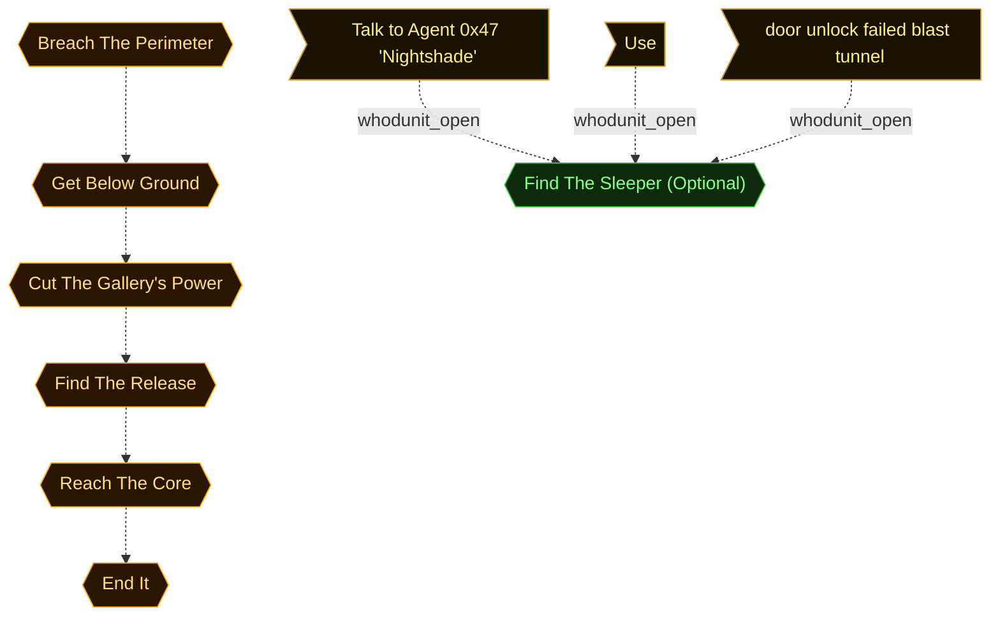
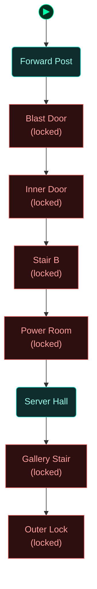

<!-- Auto-generated by scripts/generate_dungeon_graph.rb — do not edit by hand -->

# m10_full_disclosure — Scenario Graph Reference

Tomb Gamma is a Cold War bunker under the Montana hills, and the man behind ENTROPY's plan is waiting at its core. At six o'clock UTC his release sends every weakness SAFETYNET ever catalogued to every city at once. At four, two cells get it early. Director Netherton is running the raid from a folding table at the gate with Task Force Null. Get a foothold on the bunker's systems, get below ground, and reach the core before the clock does. One of tonight's team was placed eleven years ago. Netherton knows. WREN doesn't know he knows.

## Scenario Statistics

| Metric | Value |
|---|---|
| Story aims | 7 |
| Total tasks | 28 (8 optional) |
| VM flag challenges | 4 |
| Physical locks | 10 |
| AND-gate convergences | 1 |
| Rooms | 8 |
| Puzzle graph nodes / edges | 60 / 79 |
| Story graph nodes / edges | 10 / 8 |

## Critical Path

5 hops through story aims — minimum mandatory sequence to reach mission completion:

**Breach The Perimeter → Get Below Ground → Cut The Gallery's Power → Find The Release → Reach The Core → End It**

## How to Read These Diagrams

| Shape | Colour | Meaning |
|---|---|---|
| Rounded rectangle | Teal | Room / physical area |
| Rectangle | Red | Lock, barrier, or interactive terminal |
| Diamond | Orange | Inventory item or credential |
| Diamond | Red/Pink | NPC or physical key |
| Diamond | Purple | VM flag (challenge completion token) |
| Rectangle | Blue | VM challenge |
| Ribbon | Amber | NPC conversation / action gate |
| Hexagon | Green | Story aim (objective) |
| Hexagon | Amber | Critical path node |
| Circle | Grey | AND gate (all inputs required) |
| Subroutine rect `[[…]]` | Green | Container (holds items) |
| Rounded rectangle | Amber | NPC in room (Rooms & Contents only) |

Edges: `-->` solid = hard dependency; `-.->` dashed = soft / narrative dependency or optional path.

The `▶` node marks the player's starting room.

## Puzzle Graph

Physical lock–key dependency chain. Shows which items, codes, and NPC interactions are required to open each lock, and which locks gate access to each room or object. Use this to trace solvability, spot circular dependencies, and check that every key is reachable before the lock that needs it.

```mermaid
flowchart TD

  classDef room      fill:#0f2d2d,stroke:#22ddcc,color:#a0ffee
  classDef lock      fill:#2d0f0f,stroke:#e66060,color:#ffa0a0
  classDef key       fill:#2d0812,stroke:#e66060,color:#ffa0a0
  classDef item      fill:#2d1200,stroke:#e89030,color:#ffcc80
  classDef gate      fill:#111,stroke:#666,color:#eee
  classDef vm        fill:#0c1f40,stroke:#4a90d9,color:#a0c8ff
  classDef flag      fill:#1a0c2d,stroke:#9060d0,color:#cc99ff
  classDef action    fill:#1a1200,stroke:#cc9922,color:#ffee88
  classDef aim       fill:#0d2a0d,stroke:#44cc44,color:#88ff88
  classDef aim_gate  fill:#111111,stroke:#44cc44,color:#44cc44
  classDef container fill:#1a2d1a,stroke:#60b060,color:#a0e0a0
  classDef npc       fill:#2d1f0d,stroke:#d0a050,color:#ffe0a0
  classDef critical  fill:#2a1500,stroke:#ffaa00,color:#ffdd88
  classDef start     fill:#003322,stroke:#00ffaa,color:#00ffaa

  node_start(("▶"))
  node_start --> forward_post

  door_blast_tunnel["Blast Door<br/>RFID lock"]
  blast_tunnel("Blast Door")
  door_security_office["Inner Door<br/>RFID lock"]
  security_office("Inner Door")
  door_workshop_floor["Stair B<br/>RFID lock"]
  workshop_floor("Stair B")
  door_power_room["Power Room<br/>RFID lock"]
  power_room("Power Room")
  door_gallery["Gallery Stair<br/>RFID lock"]
  gallery("Gallery Stair")
  door_core["Outer Lock<br/>PIN lock"]
  core("Outer Lock")
  forward_post("Forward Post")
  lock_pick_kit{"Lock Pick Kit"}
  lock_fitter_locker["Fitter Locker"]
  rfid_cloner{"RFID Cloner"}
  fingerprint_kit{"Fingerprint Kit"}
  pin_cracker_kowalczyk_s{"PIN Cracker (Kowalczyk's)"}
  lock_lock_records_cupboard["Lock Records Cupboard"]
  breaching_case_sign_out_sheet{"Breaching Case: Sign-Out Sheet"}
  citadel_incident_file_v_47{"Citadel Incident File V-47"}
  helena_s_plans_tomb_gamma_as_built{"Helena's Plans: Tomb Gamma, As Built"}
  field_console["Field Console"]
  gate_terminal{"Gate Terminal"}
  npc_agent_0x23_vector{"Agent 0x23 'Vector'"}
  records_cupboard_vector_s_code{"Records cupboard: Vector's code"}
  npc_ghost{"Ghost"}
  records_cupboard_ghost_s_code{"Records cupboard: Ghost's code"}
  outer_lock_maintenance_code{"Outer lock: maintenance code"}
  guard_post_ladder{"Guard Post Ladder"}
  monitoring_desk_door_log{"Monitoring Desk: Door Log"}
  duty_handset{"Duty Handset"}
  lock_records_cupboard["Records Cupboard<br/>PIN lock"]
  gallery_shift_rota{"Gallery Shift Rota"}
  alarm_log_refit_to_date{"Alarm Log, Refit to Date"}
  records_cupboard{"Records Cupboard"}
  spare_power_room_card{"Spare Power-Room Card"}
  fitter_s_locker{"Fitter's Locker"}
  casualty_sheet{"Casualty Sheet"}
  margin_strip{"Margin Strip"}
  lock_model_terminal["Bench Terminal: Casualty Model<br/>Password lock"]
  asante_s_corrected_model{"Asante's Corrected Model"}
  bench_log_outgoing{"Bench Log: Outgoing"}
  server_hall("Server Hall")
  release_console{"Release Console"}
  sealed_section_hatch{"Sealed Section Hatch"}
  keypad_face_plate{"Keypad Face Plate"}
  npc_pieter_vos{"Pieter Vos"}
  visitor_s_code_card{"Visitor's Code Card"}
  npc_sione_fonoti{"Sione Fonoti"}
  gallery_shift_code_card{"Gallery Shift Code Card"}
  andgate1((" + "))
  vmch_submit_flag_1["Get a foothold on the security monitoring host and submit the flag at the gate terminal"]
  vmfl_submit_flag_1{"Flag 1 Flag"}
  vmch_submit_flag_2["Take the staging schedule and submit the flag at the release console"]
  vmfl_submit_flag_2{"Flag 2 Flag"}
  vmch_submit_flag_3["Get out of the release service onto its host and submit the flag at the sealed section's hatch"]
  vmfl_submit_flag_3{"Flag 3 Flag"}
  vmch_submit_flag_4["Take the core host and submit it at its terminal"]
  vmfl_submit_flag_4{"Flag 4 Flag"}

  door_blast_tunnel --> blast_tunnel
  door_security_office --> security_office
  door_workshop_floor --> workshop_floor
  door_power_room --> power_room
  door_gallery --> gallery
  door_core --> core
  forward_post -.-> lock_pick_kit
  lock_pick_kit -.-> lock_fitter_locker
  forward_post --> rfid_cloner
  forward_post --> fingerprint_kit
  forward_post -.-> pin_cracker_kowalczyk_s
  pin_cracker_kowalczyk_s -.-> door_core
  pin_cracker_kowalczyk_s -.-> lock_lock_records_cupboard
  forward_post --> breaching_case_sign_out_sheet
  forward_post --> citadel_incident_file_v_47
  forward_post --> helena_s_plans_tomb_gamma_as_built
  forward_post --> field_console
  forward_post --> gate_terminal
  gate_terminal --> door_blast_tunnel
  forward_post --> npc_agent_0x23_vector
  npc_agent_0x23_vector -.-> records_cupboard_vector_s_code
  records_cupboard_vector_s_code -.-> lock_lock_records_cupboard
  forward_post --> npc_ghost
  npc_ghost -.-> records_cupboard_ghost_s_code
  records_cupboard_ghost_s_code -.-> lock_lock_records_cupboard
  npc_ghost -.-> outer_lock_maintenance_code
  outer_lock_maintenance_code -.-> door_core
  blast_tunnel -.-> guard_post_ladder
  guard_post_ladder -.-> door_security_office
  security_office --> monitoring_desk_door_log
  security_office --> duty_handset
  duty_handset --> door_workshop_floor
  security_office --> lock_records_cupboard
  lock_records_cupboard -.-> gallery_shift_rota
  gallery_shift_rota -.-> door_core
  lock_records_cupboard -.-> alarm_log_refit_to_date
  alarm_log_refit_to_date -.-> lock_lock_records_cupboard
  security_office -.-> records_cupboard
  records_cupboard -.-> door_core
  security_office --> lock_fitter_locker
  lock_fitter_locker --> spare_power_room_card
  spare_power_room_card --> door_power_room
  security_office -.-> fitter_s_locker
  fitter_s_locker -.-> door_power_room
  security_office --> npc_agent_0x23_vector
  npc_agent_0x23_vector -.-> records_cupboard_vector_s_code
  records_cupboard_vector_s_code -.-> lock_lock_records_cupboard
  workshop_floor --> casualty_sheet
  workshop_floor --> margin_strip
  workshop_floor --> lock_model_terminal
  lock_model_terminal --> asante_s_corrected_model
  workshop_floor --> bench_log_outgoing
  server_hall --> field_console
  server_hall --> release_console
  server_hall --> sealed_section_hatch
  sealed_section_hatch --> door_gallery
  gallery -.-> keypad_face_plate
  keypad_face_plate -.-> door_core
  gallery --> npc_pieter_vos
  npc_pieter_vos -.-> visitor_s_code_card
  visitor_s_code_card -.-> door_core
  gallery --> npc_sione_fonoti
  npc_sione_fonoti -.-> gallery_shift_code_card
  gallery_shift_code_card -.-> door_core
  core --> field_console
  sealed_section_hatch -.-> andgate1
  andgate1 --> door_gallery
  release_console --> andgate1
  vmch_submit_flag_1 --> vmfl_submit_flag_1
  vmfl_submit_flag_1 --> door_blast_tunnel
  vmch_submit_flag_2 --> vmfl_submit_flag_2
  vmfl_submit_flag_1 -.-> vmch_submit_flag_2
  vmfl_submit_flag_2 --> door_gallery
  vmch_submit_flag_3 --> vmfl_submit_flag_3
  vmfl_submit_flag_2 -.-> vmch_submit_flag_3
  vmfl_submit_flag_3 --> door_gallery
  vmch_submit_flag_4 --> vmfl_submit_flag_4
  vmfl_submit_flag_3 -.-> vmch_submit_flag_4
  field_console --> vmch_submit_flag_1

  class door_blast_tunnel,door_security_office,door_workshop_floor,door_power_room,door_gallery,door_core,lock_fitter_locker,lock_lock_records_cupboard,lock_records_cupboard,lock_model_terminal lock
  class blast_tunnel,security_office,workshop_floor,power_room,gallery,core,forward_post,server_hall room
  class lock_pick_kit,rfid_cloner,fingerprint_kit,pin_cracker_kowalczyk_s,breaching_case_sign_out_sheet,citadel_incident_file_v_47,helena_s_plans_tomb_gamma_as_built,gate_terminal,records_cupboard_vector_s_code,records_cupboard_ghost_s_code,outer_lock_maintenance_code,monitoring_desk_door_log,gallery_shift_rota,alarm_log_refit_to_date,records_cupboard,fitter_s_locker,casualty_sheet,margin_strip,asante_s_corrected_model,bench_log_outgoing,release_console,sealed_section_hatch,keypad_face_plate,visitor_s_code_card,gallery_shift_code_card item
  class field_console,vmch_submit_flag_1,vmch_submit_flag_2,vmch_submit_flag_3,vmch_submit_flag_4 vm
  class npc_agent_0x23_vector,npc_ghost,guard_post_ladder,duty_handset,spare_power_room_card,npc_pieter_vos,npc_sione_fonoti key
  class andgate1 gate
  class vmfl_submit_flag_1,vmfl_submit_flag_2,vmfl_submit_flag_3,vmfl_submit_flag_4 flag

  classDef optional stroke-dasharray:5 2
  class lock_pick_kit,pin_cracker_kowalczyk_s,records_cupboard_vector_s_code,records_cupboard_ghost_s_code,outer_lock_maintenance_code,guard_post_ladder,gallery_shift_rota,alarm_log_refit_to_date,records_cupboard,fitter_s_locker,keypad_face_plate,visitor_s_code_card,gallery_shift_code_card optional
  class node_start start
```



## Story Aims

Narrative objective flow. Shows story aims and their unlock conditions. Critical path aims are highlighted in amber. Use this to check aim sequencing, identify gaps between objectives, and verify that the player always has a clear next goal.



## Story + Puzzle (Integrated)

Puzzle graph and story aims combined, with bridge edges connecting physical puzzle progress to story aim completion. Use this to verify that physical actions drive narrative progress and that no aim is left floating without a puzzle prerequisite.

```mermaid
flowchart TD

  classDef room      fill:#0f2d2d,stroke:#22ddcc,color:#a0ffee
  classDef lock      fill:#2d0f0f,stroke:#e66060,color:#ffa0a0
  classDef key       fill:#2d0812,stroke:#e66060,color:#ffa0a0
  classDef item      fill:#2d1200,stroke:#e89030,color:#ffcc80
  classDef gate      fill:#111,stroke:#666,color:#eee
  classDef vm        fill:#0c1f40,stroke:#4a90d9,color:#a0c8ff
  classDef flag      fill:#1a0c2d,stroke:#9060d0,color:#cc99ff
  classDef action    fill:#1a1200,stroke:#cc9922,color:#ffee88
  classDef aim       fill:#0d2a0d,stroke:#44cc44,color:#88ff88
  classDef aim_gate  fill:#111111,stroke:#44cc44,color:#44cc44
  classDef container fill:#1a2d1a,stroke:#60b060,color:#a0e0a0
  classDef npc       fill:#2d1f0d,stroke:#d0a050,color:#ffe0a0
  classDef critical  fill:#2a1500,stroke:#ffaa00,color:#ffdd88
  classDef start     fill:#003322,stroke:#00ffaa,color:#00ffaa

  node_start(("▶"))
  node_start --> forward_post

  door_blast_tunnel["Blast Door<br/>RFID lock"]
  blast_tunnel("Blast Door")
  door_security_office["Inner Door<br/>RFID lock"]
  security_office("Inner Door")
  door_workshop_floor["Stair B<br/>RFID lock"]
  workshop_floor("Stair B")
  door_power_room["Power Room<br/>RFID lock"]
  power_room("Power Room")
  door_gallery["Gallery Stair<br/>RFID lock"]
  gallery("Gallery Stair")
  door_core["Outer Lock<br/>PIN lock"]
  core("Outer Lock")
  forward_post("Forward Post")
  lock_pick_kit{"Lock Pick Kit"}
  lock_fitter_locker["Fitter Locker"]
  rfid_cloner{"RFID Cloner"}
  fingerprint_kit{"Fingerprint Kit"}
  pin_cracker_kowalczyk_s{"PIN Cracker (Kowalczyk's)"}
  lock_lock_records_cupboard["Lock Records Cupboard"]
  breaching_case_sign_out_sheet{"Breaching Case: Sign-Out Sheet"}
  citadel_incident_file_v_47{"Citadel Incident File V-47"}
  helena_s_plans_tomb_gamma_as_built{"Helena's Plans: Tomb Gamma, As Built"}
  field_console["Field Console"]
  gate_terminal{"Gate Terminal"}
  npc_agent_0x23_vector{"Agent 0x23 'Vector'"}
  records_cupboard_vector_s_code{"Records cupboard: Vector's code"}
  npc_ghost{"Ghost"}
  records_cupboard_ghost_s_code{"Records cupboard: Ghost's code"}
  outer_lock_maintenance_code{"Outer lock: maintenance code"}
  guard_post_ladder{"Guard Post Ladder"}
  monitoring_desk_door_log{"Monitoring Desk: Door Log"}
  duty_handset{"Duty Handset"}
  lock_records_cupboard["Records Cupboard<br/>PIN lock"]
  gallery_shift_rota{"Gallery Shift Rota"}
  alarm_log_refit_to_date{"Alarm Log, Refit to Date"}
  records_cupboard{"Records Cupboard"}
  spare_power_room_card{"Spare Power-Room Card"}
  fitter_s_locker{"Fitter's Locker"}
  casualty_sheet{"Casualty Sheet"}
  margin_strip{"Margin Strip"}
  lock_model_terminal["Bench Terminal: Casualty Model<br/>Password lock"]
  asante_s_corrected_model{"Asante's Corrected Model"}
  bench_log_outgoing{"Bench Log: Outgoing"}
  server_hall("Server Hall")
  release_console{"Release Console"}
  sealed_section_hatch{"Sealed Section Hatch"}
  keypad_face_plate{"Keypad Face Plate"}
  npc_pieter_vos{"Pieter Vos"}
  visitor_s_code_card{"Visitor's Code Card"}
  npc_sione_fonoti{"Sione Fonoti"}
  gallery_shift_code_card{"Gallery Shift Code Card"}
  andgate1((" + "))
  vmch_submit_flag_1["Get a foothold on the security monitoring host and submit the flag at the gate terminal"]
  vmfl_submit_flag_1{"Flag 1 Flag"}
  vmch_submit_flag_2["Take the staging schedule and submit the flag at the release console"]
  vmfl_submit_flag_2{"Flag 2 Flag"}
  vmch_submit_flag_3["Get out of the release service onto its host and submit the flag at the sealed section's hatch"]
  vmfl_submit_flag_3{"Flag 3 Flag"}
  vmch_submit_flag_4["Take the core host and submit it at its terminal"]
  vmfl_submit_flag_4{"Flag 4 Flag"}
  aim_breach_the_perimeter{{"Breach The Perimeter"}}
  aim_get_below_ground{{"Get Below Ground"}}
  aim_cut_the_gallery_power{{"Cut The Gallery's Power"}}
  aim_find_the_release{{"Find The Release"}}
  aim_reach_the_core{{"Reach The Core"}}
  aim_end_it{{"End It"}}
  aim_find_the_sleeper{{"Find The Sleeper (Optional)"}}
  story_talk_to_agent_0x47_nightshade>"Talk to Agent 0x47 'Nightshade'"]
  story_use>"Use"]
  story_door_unlock_failed_blast_tunnel>"door unlock failed blast tunnel"]

  door_blast_tunnel --> blast_tunnel
  door_security_office --> security_office
  door_workshop_floor --> workshop_floor
  door_power_room --> power_room
  door_gallery --> gallery
  door_core --> core
  forward_post -.-> lock_pick_kit
  lock_pick_kit -.-> lock_fitter_locker
  forward_post --> rfid_cloner
  forward_post --> fingerprint_kit
  forward_post -.-> pin_cracker_kowalczyk_s
  pin_cracker_kowalczyk_s -.-> door_core
  pin_cracker_kowalczyk_s -.-> lock_lock_records_cupboard
  forward_post --> breaching_case_sign_out_sheet
  forward_post --> citadel_incident_file_v_47
  forward_post --> helena_s_plans_tomb_gamma_as_built
  forward_post --> field_console
  forward_post --> gate_terminal
  gate_terminal --> door_blast_tunnel
  forward_post --> npc_agent_0x23_vector
  npc_agent_0x23_vector -.-> records_cupboard_vector_s_code
  records_cupboard_vector_s_code -.-> lock_lock_records_cupboard
  forward_post --> npc_ghost
  npc_ghost -.-> records_cupboard_ghost_s_code
  records_cupboard_ghost_s_code -.-> lock_lock_records_cupboard
  npc_ghost -.-> outer_lock_maintenance_code
  outer_lock_maintenance_code -.-> door_core
  blast_tunnel -.-> guard_post_ladder
  guard_post_ladder -.-> door_security_office
  security_office --> monitoring_desk_door_log
  security_office --> duty_handset
  duty_handset --> door_workshop_floor
  security_office --> lock_records_cupboard
  lock_records_cupboard -.-> gallery_shift_rota
  gallery_shift_rota -.-> door_core
  lock_records_cupboard -.-> alarm_log_refit_to_date
  alarm_log_refit_to_date -.-> lock_lock_records_cupboard
  security_office -.-> records_cupboard
  records_cupboard -.-> door_core
  security_office --> lock_fitter_locker
  lock_fitter_locker --> spare_power_room_card
  spare_power_room_card --> door_power_room
  security_office -.-> fitter_s_locker
  fitter_s_locker -.-> door_power_room
  security_office --> npc_agent_0x23_vector
  npc_agent_0x23_vector -.-> records_cupboard_vector_s_code
  records_cupboard_vector_s_code -.-> lock_lock_records_cupboard
  workshop_floor --> casualty_sheet
  workshop_floor --> margin_strip
  workshop_floor --> lock_model_terminal
  lock_model_terminal --> asante_s_corrected_model
  workshop_floor --> bench_log_outgoing
  server_hall --> field_console
  server_hall --> release_console
  server_hall --> sealed_section_hatch
  sealed_section_hatch --> door_gallery
  gallery -.-> keypad_face_plate
  keypad_face_plate -.-> door_core
  gallery --> npc_pieter_vos
  npc_pieter_vos -.-> visitor_s_code_card
  visitor_s_code_card -.-> door_core
  gallery --> npc_sione_fonoti
  npc_sione_fonoti -.-> gallery_shift_code_card
  gallery_shift_code_card -.-> door_core
  core --> field_console
  sealed_section_hatch -.-> andgate1
  andgate1 --> door_gallery
  release_console --> andgate1
  vmch_submit_flag_1 --> vmfl_submit_flag_1
  vmfl_submit_flag_1 --> door_blast_tunnel
  vmch_submit_flag_2 --> vmfl_submit_flag_2
  vmfl_submit_flag_1 -.-> vmch_submit_flag_2
  vmfl_submit_flag_2 --> door_gallery
  vmch_submit_flag_3 --> vmfl_submit_flag_3
  vmfl_submit_flag_2 -.-> vmch_submit_flag_3
  vmfl_submit_flag_3 --> door_gallery
  vmch_submit_flag_4 --> vmfl_submit_flag_4
  vmfl_submit_flag_3 -.-> vmch_submit_flag_4
  field_console --> vmch_submit_flag_1
  aim_breach_the_perimeter -.-> aim_get_below_ground
  aim_get_below_ground -.-> aim_cut_the_gallery_power
  aim_cut_the_gallery_power -.-> aim_find_the_release
  aim_find_the_release -.-> aim_reach_the_core
  aim_reach_the_core -.-> aim_end_it
  story_talk_to_agent_0x47_nightshade -.->|whodunit_open| aim_find_the_sleeper
  story_use -.->|whodunit_open| aim_find_the_sleeper
  story_door_unlock_failed_blast_tunnel -.->|whodunit_open| aim_find_the_sleeper
  vmfl_submit_flag_1 -.-> aim_breach_the_perimeter
  door_blast_tunnel -.-> aim_breach_the_perimeter
  door_security_office -.-> aim_get_below_ground
  door_workshop_floor -.-> aim_get_below_ground
  door_power_room -.-> aim_cut_the_gallery_power
  server_hall -.-> aim_find_the_release
  vmfl_submit_flag_2 -.-> aim_find_the_release
  vmfl_submit_flag_3 -.-> aim_find_the_release
  door_gallery -.-> aim_reach_the_core
  vmfl_submit_flag_4 -.-> aim_reach_the_core

  class door_blast_tunnel,door_security_office,door_workshop_floor,door_power_room,door_gallery,door_core,lock_fitter_locker,lock_lock_records_cupboard,lock_records_cupboard,lock_model_terminal lock
  class blast_tunnel,security_office,workshop_floor,power_room,gallery,core,forward_post,server_hall room
  class lock_pick_kit,rfid_cloner,fingerprint_kit,pin_cracker_kowalczyk_s,breaching_case_sign_out_sheet,citadel_incident_file_v_47,helena_s_plans_tomb_gamma_as_built,gate_terminal,records_cupboard_vector_s_code,records_cupboard_ghost_s_code,outer_lock_maintenance_code,monitoring_desk_door_log,gallery_shift_rota,alarm_log_refit_to_date,records_cupboard,fitter_s_locker,casualty_sheet,margin_strip,asante_s_corrected_model,bench_log_outgoing,release_console,sealed_section_hatch,keypad_face_plate,visitor_s_code_card,gallery_shift_code_card item
  class field_console,vmch_submit_flag_1,vmch_submit_flag_2,vmch_submit_flag_3,vmch_submit_flag_4 vm
  class npc_agent_0x23_vector,npc_ghost,guard_post_ladder,duty_handset,spare_power_room_card,npc_pieter_vos,npc_sione_fonoti key
  class andgate1 gate
  class vmfl_submit_flag_1,vmfl_submit_flag_2,vmfl_submit_flag_3,vmfl_submit_flag_4 flag
  class aim_breach_the_perimeter,aim_get_below_ground,aim_cut_the_gallery_power,aim_find_the_release,aim_reach_the_core,aim_end_it critical
  class aim_find_the_sleeper aim
  class story_talk_to_agent_0x47_nightshade,story_use,story_door_unlock_failed_blast_tunnel action

  classDef optional stroke-dasharray:5 2
  class lock_pick_kit,pin_cracker_kowalczyk_s,records_cupboard_vector_s_code,records_cupboard_ghost_s_code,outer_lock_maintenance_code,guard_post_ladder,gallery_shift_rota,alarm_log_refit_to_date,records_cupboard,fitter_s_locker,keypad_face_plate,visitor_s_code_card,gallery_shift_code_card optional
  class node_start start
```



## Rooms

Physical room layout with all connections. Locked rooms are shown in red. Use this to check room reachability, identify dead-end rooms with no content, and understand the spatial structure of the scenario.



## Rooms & Contents

Physical room layout with all objects, containers, NPCs, and held items. Use this to check clue distribution across rooms, verify that hints are placed before the locks they solve, and spot rooms that are under- or over-loaded with content.

```mermaid
flowchart TD

  classDef room      fill:#0f2d2d,stroke:#22ddcc,color:#a0ffee
  classDef lock      fill:#2d0f0f,stroke:#e66060,color:#ffa0a0
  classDef key       fill:#2d0812,stroke:#e66060,color:#ffa0a0
  classDef item      fill:#2d1200,stroke:#e89030,color:#ffcc80
  classDef gate      fill:#111,stroke:#666,color:#eee
  classDef vm        fill:#0c1f40,stroke:#4a90d9,color:#a0c8ff
  classDef flag      fill:#1a0c2d,stroke:#9060d0,color:#cc99ff
  classDef action    fill:#1a1200,stroke:#cc9922,color:#ffee88
  classDef aim       fill:#0d2a0d,stroke:#44cc44,color:#88ff88
  classDef aim_gate  fill:#111111,stroke:#44cc44,color:#44cc44
  classDef container fill:#1a2d1a,stroke:#60b060,color:#a0e0a0
  classDef npc       fill:#2d1f0d,stroke:#d0a050,color:#ffe0a0
  classDef critical  fill:#2a1500,stroke:#ffaa00,color:#ffdd88
  classDef start     fill:#003322,stroke:#00ffaa,color:#00ffaa

  node_start(("▶"))
  node_start --> forward_post

  forward_post("Forward Post")
  blast_tunnel["Blast Door<br/>(locked)"]
  security_office["Inner Door<br/>(locked)"]
  workshop_floor["Stair B<br/>(locked)"]
  power_room["Power Room<br/>(locked)"]
  server_hall("Server Hall")
  gallery["Gallery Stair<br/>(locked)"]
  core["Outer Lock<br/>(locked)"]
  rc_clock_forward_post_1{"Table Screen"}
  rc_kit_table_2{"Folding Table"}
  rc_case_signout_sheet_3{"Breaching Case: Sign-Out Sheet"}
  rc_incident_file_4{"Citadel Incident File V-47"}
  rc_helena_plans_5{"Helena's Plans: Tomb Gamma, As Built"}
  rc_projection_desk_6{"Projection Desk"}
  rc_gate_console_7{"Field Console"}
  rc_gate_terminal_8{"Gate Terminal"}
  rc_gate_hut_9{"Gate Hut"}
  rc_van_one_10{"The Van"}
  rc_van_two_11{"The Second Van"}
  rc_npc_director_magnus_netherton_12("Director Magnus Netherton")
  rc_npc_agent_hax_13("Agent HaX")
  rc_npc_agent_hax_14("Agent HaX")
  rc_m10_guide_flag1_15{"SAFETYNET Field Guide: The Monitoring Host"}
  rc_m10_guide_flag2_16{"SAFETYNET Field Guide: The Staging Copy"}
  rc_m10_guide_flag3_17{"SAFETYNET Field Guide: Out of the Container"}
  rc_m10_guide_flag4_18{"SAFETYNET Field Guide: The Core Host"}
  rc_npc_agent_0x47_nightshade_19("Agent 0x47 'Nightshade'")
  rc_nightshade_payment_20{"Nightshade's Payment: The Defences"}
  rc_alarm_override_21{"Nightshade's Override Key"}
  rc_npc_agent_0x47_nightshade_22("Agent 0x47 'Nightshade'")
  rc_nightshade_payment_23{"Nightshade's Payment: The Defences"}
  rc_alarm_override_24{"Nightshade's Override Key"}
  rc_npc_agent_0x47_nightshade_25("Agent 0x47 'Nightshade'")
  rc_nightshade_payment_26{"Nightshade's Payment: The Defences"}
  rc_alarm_override_27{"Nightshade's Override Key"}
  rc_npc_agent_0x5e_lantern_28("Agent 0x5E 'Lantern'")
  rc_npc_agent_0x5e_lantern_29("Agent 0x5E 'Lantern'")
  rc_npc_agent_0x2d_anchor_30("Agent 0x2D 'Anchor'")
  rc_npc_officer_kenji_arakawa_31("Officer Kenji Arakawa")
  rc_npc_officer_kenji_arakawa_32("Officer Kenji Arakawa")
  rc_npc_officer_kenji_arakawa_33("Officer Kenji Arakawa")
  rc_npc_minder_34("Minder")
  rc_npc_officer_dev_malhotra_35("Officer Dev Malhotra")
  rc_npc_agent_0x23_vector_36("Agent 0x23 'Vector'")
  rc_vector_cupboard_code_37{"Records cupboard: Vector's code"}
  rc_npc_agent_0x88_phantom_38("Agent 0x88 'Phantom'")
  rc_npc_minder_39("Minder")
  rc_npc_voltage_critical_mass_40("Voltage (Critical Mass)")
  rc_npc_ghost_41("Ghost")
  rc_ghost_cupboard_code_42{"Records cupboard: Ghost's code"}
  rc_ghost_lock_code_43{"Outer lock: maintenance code"}
  rc_npc_victoria_sterling_44("Victoria Sterling")
  rc_npc_robert_vance_45("Robert Vance")
  rc_npc_elena_rodriguez_46("Elena Rodriguez")
  rc_npc_the_recruiter_47("The Recruiter")
  rc_npc_director_magnus_netherton_48("Director Magnus Netherton")
  rc_npc_director_magnus_netherton_49("Director Magnus Netherton")
  rc_npc_director_magnus_netherton_50("Director Magnus Netherton")
  rc_clock_blast_door_51{"Blast Door Panel"}
  rc_tunnel_rota_52{"Tunnel Post Rota"}
  rc_post_ladder_53{"Guard Post Ladder"}
  rc_npc_guard_54("Guard")
  rc_npc_guard_55("Guard")
  rc_alarm_panel_56{"Alarm Board"}
  rc_wanted_photo_57{"Shift Notes: Photo"}
  rc_duty_board_58{"Duty Board"}
  rc_door_log_59{"Monitoring Desk: Door Log"}
  rc_duty_handset_60{"Duty Handset"}
  rc_records_cupboard_61[["Records Cupboard"]]
  rc_gallery_rota_62{"Gallery Shift Rota"}
  rc_alarm_log_63{"Alarm Log, Refit to Date"}
  rc_fitter_locker_64[["Fitter's Locker"]]
  rc_fitter_spare_card_65{"Spare Power-Room Card"}
  rc_clock_security_66{"Duty Screen"}
  rc_npc_guard_67("Guard")
  rc_npc_guard_68("Guard")
  rc_npc_agent_0x23_vector_69("Agent 0x23 'Vector'")
  rc_vector_cupboard_code_70{"Records cupboard: Vector's code"}
  rc_npc_agent_0x5e_lantern_71("Agent 0x5E 'Lantern'")
  rc_npc_officer_kenji_arakawa_72("Officer Kenji Arakawa")
  rc_npc_agent_0x2d_anchor_73("Agent 0x2D 'Anchor'")
  rc_casualty_sheet_74{"Casualty Sheet"}
  rc_casualty_margin_note_75{"Margin Strip"}
  rc_model_terminal_76[["Bench Terminal: Casualty Model"]]
  rc_asante_model_77{"Asante's Corrected Model"}
  rc_bench_log_78{"Bench Log: Outgoing"}
  rc_clock_workshop_79{"Shift Clock"}
  rc_cracker_rack_80{"Cracker Rack"}
  rc_npc_imran_siddiqui_81("Imran Siddiqui")
  rc_npc_imran_siddiqui_82("Imran Siddiqui")
  rc_npc_gary_whitlock_83("Gary Whitlock")
  rc_npc_gary_whitlock_84("Gary Whitlock")
  rc_npc_guard_85("Guard")
  rc_npc_agent_0x5e_lantern_86("Agent 0x5E 'Lantern'")
  rc_npc_officer_kenji_arakawa_87("Officer Kenji Arakawa")
  rc_npc_agent_0x2d_anchor_88("Agent 0x2D 'Anchor'")
  rc_shutter_isolator_89{"Shutter Isolator"}
  rc_clock_power_90{"Load Board"}
  rc_bypass_panel_91{"Bypass Panel"}
  rc_static_kit_92{"Tool Roll"}
  rc_npc_wendell_briggs_93("Wendell Briggs")
  rc_npc_wendell_briggs_94("Wendell Briggs")
  rc_npc_voltage_critical_mass_95("Voltage (Critical Mass)")
  rc_npc_voltage_critical_mass_96("Voltage (Critical Mass)")
  rc_npc_entropy_operative_static_97("ENTROPY Operative 'Static'")
  rc_npc_agent_0x5e_lantern_98("Agent 0x5E 'Lantern'")
  rc_npc_officer_kenji_arakawa_99("Officer Kenji Arakawa")
  rc_npc_agent_0x2d_anchor_100("Agent 0x2D 'Anchor'")
  rc_plotting_board_101{"Plotting Board"}
  rc_clock_server_hall_102{"Release Console Screen"}
  rc_hall_console_103{"Field Console"}
  rc_release_console_104{"Release Console"}
  rc_release_console_controls_105{"Release Console Controls"}
  rc_schedule_terminal_106{"Release Schedule: Staging Copy"}
  rc_sealed_hatch_107{"Sealed Section Hatch"}
  rc_uplink_printer_108{"Uplink Printer"}
  rc_npc_dr_abena_asante_109("Dr Abena Asante")
  rc_npc_dr_james_mercer_110("Dr. James Mercer")
  rc_npc_guard_111("Guard")
  rc_npc_guard_112("Guard")
  rc_npc_agent_0x5e_lantern_113("Agent 0x5E 'Lantern'")
  rc_npc_officer_kenji_arakawa_114("Officer Kenji Arakawa")
  rc_npc_agent_0x2d_anchor_115("Agent 0x2D 'Anchor'")
  rc_clock_gallery_116{"Lock Panel"}
  rc_lock_keypad_plate_117{"Keypad Face Plate"}
  rc_farah_chair_118{"Floor Post Chair"}
  rc_slit_window_119{"Slit Windows"}
  rc_npc_victoria_sterling_120("Victoria Sterling")
  rc_npc_victoria_sterling_121("Victoria Sterling")
  rc_npc_pieter_vos_122("Pieter Vos")
  rc_vos_code_card_123{"Visitor's Code Card"}
  rc_npc_sione_fonoti_124("Sione Fonoti")
  rc_gallery_code_card_125{"Gallery Shift Code Card"}
  rc_npc_guard_126("Guard")
  rc_npc_guard_127("Guard")
  rc_npc_guard_128("Guard")
  rc_npc_guard_129("Guard")
  rc_npc_agent_0x2d_anchor_130("Agent 0x2D 'Anchor'")
  rc_npc_minder_131("Minder")
  rc_npc_agent_0x47_nightshade_132("Agent 0x47 'Nightshade'")
  rc_nightshade_payment_133{"Nightshade's Payment: The Defences"}
  rc_alarm_override_134{"Nightshade's Override Key"}
  rc_key_console_135{"His Console"}
  rc_clock_core_136{"Key Console Readout"}
  rc_core_host_terminal_137{"Core Host Terminal"}
  rc_core_console_vm_138{"Field Console"}
  rc_core_files_139{"Core Host: File Index"}
  rc_service_door_140{"Service Door"}
  rc_npc_dr_adrian_tesseract_141("Dr Adrian Tesseract")
  rc_npc_agent_0x5e_lantern_142("Agent 0x5E 'Lantern'")
  rc_npc_agent_0x5e_lantern_143("Agent 0x5E 'Lantern'")
  rc_npc_agent_0x2d_anchor_144("Agent 0x2D 'Anchor'")

  forward_post --> blast_tunnel
  blast_tunnel --> security_office
  security_office --> workshop_floor
  workshop_floor --> power_room
  power_room --> server_hall
  server_hall --> gallery
  gallery --> core
  forward_post --> rc_clock_forward_post_1
  forward_post --> rc_kit_table_2
  forward_post --> rc_case_signout_sheet_3
  forward_post --> rc_incident_file_4
  forward_post --> rc_helena_plans_5
  forward_post --> rc_projection_desk_6
  forward_post --> rc_gate_console_7
  forward_post --> rc_gate_terminal_8
  forward_post --> rc_gate_hut_9
  forward_post --> rc_van_one_10
  forward_post --> rc_van_two_11
  forward_post --> rc_npc_director_magnus_netherton_12
  forward_post --> rc_npc_agent_hax_13
  forward_post --> rc_npc_agent_hax_14
  rc_npc_agent_hax_14 --> rc_m10_guide_flag1_15
  rc_npc_agent_hax_14 --> rc_m10_guide_flag2_16
  rc_npc_agent_hax_14 --> rc_m10_guide_flag3_17
  rc_npc_agent_hax_14 --> rc_m10_guide_flag4_18
  forward_post --> rc_npc_agent_0x47_nightshade_19
  rc_npc_agent_0x47_nightshade_19 --> rc_nightshade_payment_20
  rc_npc_agent_0x47_nightshade_19 --> rc_alarm_override_21
  forward_post --> rc_npc_agent_0x47_nightshade_22
  rc_npc_agent_0x47_nightshade_22 --> rc_nightshade_payment_23
  rc_npc_agent_0x47_nightshade_22 --> rc_alarm_override_24
  forward_post --> rc_npc_agent_0x47_nightshade_25
  rc_npc_agent_0x47_nightshade_25 --> rc_nightshade_payment_26
  rc_npc_agent_0x47_nightshade_25 --> rc_alarm_override_27
  forward_post --> rc_npc_agent_0x5e_lantern_28
  forward_post --> rc_npc_agent_0x5e_lantern_29
  forward_post --> rc_npc_agent_0x2d_anchor_30
  forward_post --> rc_npc_officer_kenji_arakawa_31
  forward_post --> rc_npc_officer_kenji_arakawa_32
  forward_post --> rc_npc_officer_kenji_arakawa_33
  forward_post --> rc_npc_minder_34
  forward_post --> rc_npc_officer_dev_malhotra_35
  forward_post --> rc_npc_agent_0x23_vector_36
  rc_npc_agent_0x23_vector_36 --> rc_vector_cupboard_code_37
  forward_post --> rc_npc_agent_0x88_phantom_38
  forward_post --> rc_npc_minder_39
  forward_post --> rc_npc_voltage_critical_mass_40
  forward_post --> rc_npc_ghost_41
  rc_npc_ghost_41 --> rc_ghost_cupboard_code_42
  rc_npc_ghost_41 --> rc_ghost_lock_code_43
  forward_post --> rc_npc_victoria_sterling_44
  forward_post --> rc_npc_robert_vance_45
  forward_post --> rc_npc_elena_rodriguez_46
  forward_post --> rc_npc_the_recruiter_47
  forward_post --> rc_npc_director_magnus_netherton_48
  forward_post --> rc_npc_director_magnus_netherton_49
  forward_post --> rc_npc_director_magnus_netherton_50
  blast_tunnel --> rc_clock_blast_door_51
  blast_tunnel --> rc_tunnel_rota_52
  blast_tunnel --> rc_post_ladder_53
  blast_tunnel --> rc_npc_guard_54
  blast_tunnel --> rc_npc_guard_55
  security_office --> rc_alarm_panel_56
  security_office --> rc_wanted_photo_57
  security_office --> rc_duty_board_58
  security_office --> rc_door_log_59
  security_office --> rc_duty_handset_60
  security_office --> rc_records_cupboard_61
  rc_records_cupboard_61 --> rc_gallery_rota_62
  rc_records_cupboard_61 --> rc_alarm_log_63
  security_office --> rc_fitter_locker_64
  rc_fitter_locker_64 --> rc_fitter_spare_card_65
  security_office --> rc_clock_security_66
  security_office --> rc_npc_guard_67
  security_office --> rc_npc_guard_68
  security_office --> rc_npc_agent_0x23_vector_69
  rc_npc_agent_0x23_vector_69 --> rc_vector_cupboard_code_70
  security_office --> rc_npc_agent_0x5e_lantern_71
  security_office --> rc_npc_officer_kenji_arakawa_72
  security_office --> rc_npc_agent_0x2d_anchor_73
  workshop_floor --> rc_casualty_sheet_74
  workshop_floor --> rc_casualty_margin_note_75
  workshop_floor --> rc_model_terminal_76
  rc_model_terminal_76 --> rc_asante_model_77
  workshop_floor --> rc_bench_log_78
  workshop_floor --> rc_clock_workshop_79
  workshop_floor --> rc_cracker_rack_80
  workshop_floor --> rc_npc_imran_siddiqui_81
  workshop_floor --> rc_npc_imran_siddiqui_82
  workshop_floor --> rc_npc_gary_whitlock_83
  workshop_floor --> rc_npc_gary_whitlock_84
  workshop_floor --> rc_npc_guard_85
  workshop_floor --> rc_npc_agent_0x5e_lantern_86
  workshop_floor --> rc_npc_officer_kenji_arakawa_87
  workshop_floor --> rc_npc_agent_0x2d_anchor_88
  power_room --> rc_shutter_isolator_89
  power_room --> rc_clock_power_90
  power_room --> rc_bypass_panel_91
  power_room --> rc_static_kit_92
  power_room --> rc_npc_wendell_briggs_93
  power_room --> rc_npc_wendell_briggs_94
  power_room --> rc_npc_voltage_critical_mass_95
  power_room --> rc_npc_voltage_critical_mass_96
  power_room --> rc_npc_entropy_operative_static_97
  power_room --> rc_npc_agent_0x5e_lantern_98
  power_room --> rc_npc_officer_kenji_arakawa_99
  power_room --> rc_npc_agent_0x2d_anchor_100
  server_hall --> rc_plotting_board_101
  server_hall --> rc_clock_server_hall_102
  server_hall --> rc_hall_console_103
  server_hall --> rc_release_console_104
  server_hall --> rc_release_console_controls_105
  server_hall --> rc_schedule_terminal_106
  server_hall --> rc_sealed_hatch_107
  server_hall --> rc_uplink_printer_108
  server_hall --> rc_npc_dr_abena_asante_109
  server_hall --> rc_npc_dr_james_mercer_110
  server_hall --> rc_npc_guard_111
  server_hall --> rc_npc_guard_112
  server_hall --> rc_npc_agent_0x5e_lantern_113
  server_hall --> rc_npc_officer_kenji_arakawa_114
  server_hall --> rc_npc_agent_0x2d_anchor_115
  gallery --> rc_clock_gallery_116
  gallery --> rc_lock_keypad_plate_117
  gallery --> rc_farah_chair_118
  gallery --> rc_slit_window_119
  gallery --> rc_npc_victoria_sterling_120
  gallery --> rc_npc_victoria_sterling_121
  gallery --> rc_npc_pieter_vos_122
  rc_npc_pieter_vos_122 --> rc_vos_code_card_123
  gallery --> rc_npc_sione_fonoti_124
  rc_npc_sione_fonoti_124 --> rc_gallery_code_card_125
  gallery --> rc_npc_guard_126
  gallery --> rc_npc_guard_127
  gallery --> rc_npc_guard_128
  gallery --> rc_npc_guard_129
  gallery --> rc_npc_agent_0x2d_anchor_130
  gallery --> rc_npc_minder_131
  gallery --> rc_npc_agent_0x47_nightshade_132
  rc_npc_agent_0x47_nightshade_132 --> rc_nightshade_payment_133
  rc_npc_agent_0x47_nightshade_132 --> rc_alarm_override_134
  core --> rc_key_console_135
  core --> rc_clock_core_136
  core --> rc_core_host_terminal_137
  core --> rc_core_console_vm_138
  core --> rc_core_files_139
  core --> rc_service_door_140
  core --> rc_npc_dr_adrian_tesseract_141
  core --> rc_npc_agent_0x5e_lantern_142
  core --> rc_npc_agent_0x5e_lantern_143
  core --> rc_npc_agent_0x2d_anchor_144

  class forward_post,server_hall room
  class blast_tunnel,security_office,workshop_floor,power_room,gallery,core lock
  class rc_clock_forward_post_1,rc_kit_table_2,rc_case_signout_sheet_3,rc_incident_file_4,rc_helena_plans_5,rc_projection_desk_6,rc_gate_console_7,rc_gate_terminal_8,rc_gate_hut_9,rc_van_one_10,rc_van_two_11,rc_m10_guide_flag1_15,rc_m10_guide_flag2_16,rc_m10_guide_flag3_17,rc_m10_guide_flag4_18,rc_nightshade_payment_20,rc_alarm_override_21,rc_nightshade_payment_23,rc_alarm_override_24,rc_nightshade_payment_26,rc_alarm_override_27,rc_vector_cupboard_code_37,rc_ghost_cupboard_code_42,rc_ghost_lock_code_43,rc_clock_blast_door_51,rc_tunnel_rota_52,rc_post_ladder_53,rc_alarm_panel_56,rc_wanted_photo_57,rc_duty_board_58,rc_door_log_59,rc_duty_handset_60,rc_gallery_rota_62,rc_alarm_log_63,rc_fitter_spare_card_65,rc_clock_security_66,rc_vector_cupboard_code_70,rc_casualty_sheet_74,rc_casualty_margin_note_75,rc_asante_model_77,rc_bench_log_78,rc_clock_workshop_79,rc_cracker_rack_80,rc_shutter_isolator_89,rc_clock_power_90,rc_bypass_panel_91,rc_static_kit_92,rc_plotting_board_101,rc_clock_server_hall_102,rc_hall_console_103,rc_release_console_104,rc_release_console_controls_105,rc_schedule_terminal_106,rc_sealed_hatch_107,rc_uplink_printer_108,rc_clock_gallery_116,rc_lock_keypad_plate_117,rc_farah_chair_118,rc_slit_window_119,rc_vos_code_card_123,rc_gallery_code_card_125,rc_nightshade_payment_133,rc_alarm_override_134,rc_key_console_135,rc_clock_core_136,rc_core_host_terminal_137,rc_core_console_vm_138,rc_core_files_139,rc_service_door_140 item
  class rc_npc_director_magnus_netherton_12,rc_npc_agent_hax_13,rc_npc_agent_hax_14,rc_npc_agent_0x47_nightshade_19,rc_npc_agent_0x47_nightshade_22,rc_npc_agent_0x47_nightshade_25,rc_npc_agent_0x5e_lantern_28,rc_npc_agent_0x5e_lantern_29,rc_npc_agent_0x2d_anchor_30,rc_npc_officer_kenji_arakawa_31,rc_npc_officer_kenji_arakawa_32,rc_npc_officer_kenji_arakawa_33,rc_npc_minder_34,rc_npc_officer_dev_malhotra_35,rc_npc_agent_0x23_vector_36,rc_npc_agent_0x88_phantom_38,rc_npc_minder_39,rc_npc_voltage_critical_mass_40,rc_npc_ghost_41,rc_npc_victoria_sterling_44,rc_npc_robert_vance_45,rc_npc_elena_rodriguez_46,rc_npc_the_recruiter_47,rc_npc_director_magnus_netherton_48,rc_npc_director_magnus_netherton_49,rc_npc_director_magnus_netherton_50,rc_npc_guard_54,rc_npc_guard_55,rc_npc_guard_67,rc_npc_guard_68,rc_npc_agent_0x23_vector_69,rc_npc_agent_0x5e_lantern_71,rc_npc_officer_kenji_arakawa_72,rc_npc_agent_0x2d_anchor_73,rc_npc_imran_siddiqui_81,rc_npc_imran_siddiqui_82,rc_npc_gary_whitlock_83,rc_npc_gary_whitlock_84,rc_npc_guard_85,rc_npc_agent_0x5e_lantern_86,rc_npc_officer_kenji_arakawa_87,rc_npc_agent_0x2d_anchor_88,rc_npc_wendell_briggs_93,rc_npc_wendell_briggs_94,rc_npc_voltage_critical_mass_95,rc_npc_voltage_critical_mass_96,rc_npc_entropy_operative_static_97,rc_npc_agent_0x5e_lantern_98,rc_npc_officer_kenji_arakawa_99,rc_npc_agent_0x2d_anchor_100,rc_npc_dr_abena_asante_109,rc_npc_dr_james_mercer_110,rc_npc_guard_111,rc_npc_guard_112,rc_npc_agent_0x5e_lantern_113,rc_npc_officer_kenji_arakawa_114,rc_npc_agent_0x2d_anchor_115,rc_npc_victoria_sterling_120,rc_npc_victoria_sterling_121,rc_npc_pieter_vos_122,rc_npc_sione_fonoti_124,rc_npc_guard_126,rc_npc_guard_127,rc_npc_guard_128,rc_npc_guard_129,rc_npc_agent_0x2d_anchor_130,rc_npc_minder_131,rc_npc_agent_0x47_nightshade_132,rc_npc_dr_adrian_tesseract_141,rc_npc_agent_0x5e_lantern_142,rc_npc_agent_0x5e_lantern_143,rc_npc_agent_0x2d_anchor_144 npc
  class rc_records_cupboard_61,rc_fitter_locker_64,rc_model_terminal_76 container
  class node_start start
```
