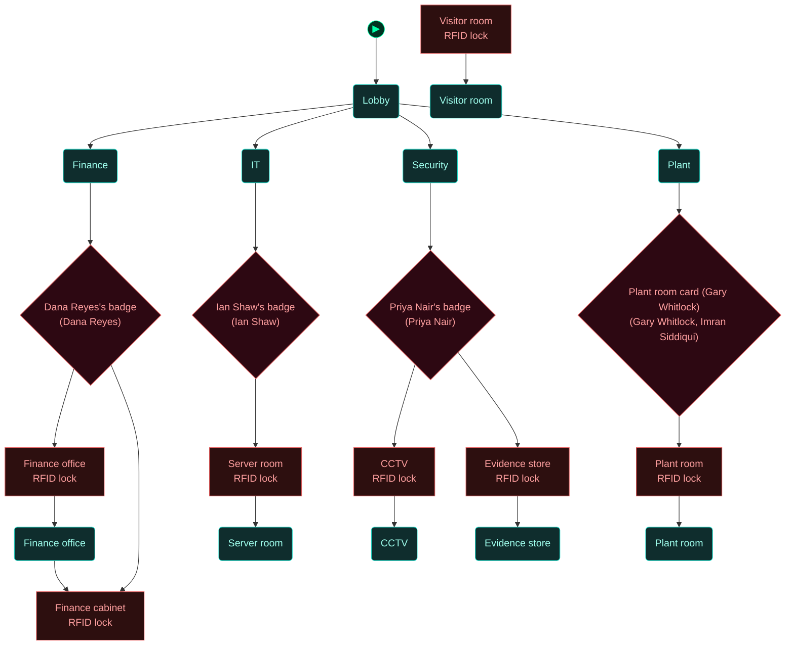
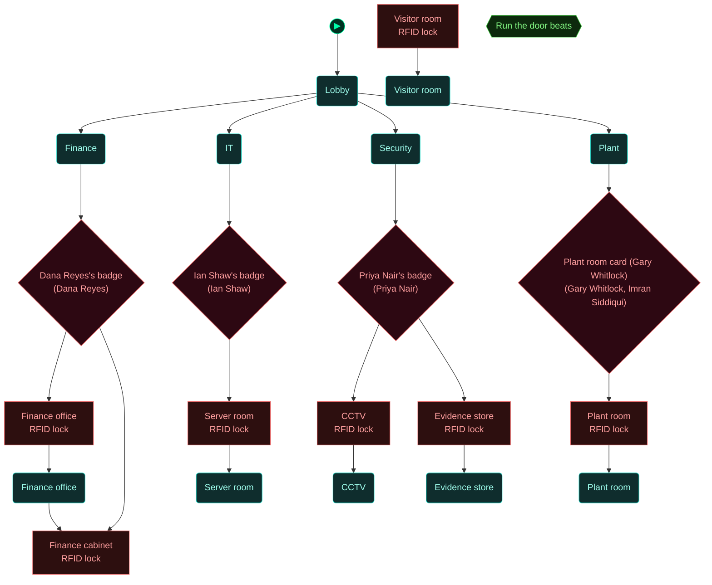
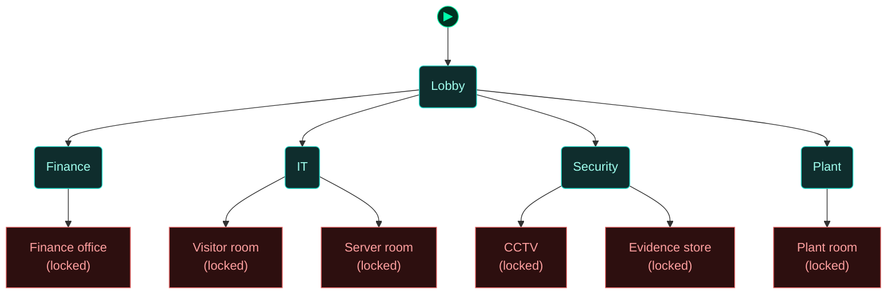

<!-- Auto-generated by scripts/generate_dungeon_graph.rb — do not edit by hand -->

# test_access_doors — Scenario Graph Reference

TEST: Access model doors

A test floor for card doors with access lists (ACCESS_MODEL_PLAN.md, step 7). Five beats, each with a sign. D1: the visitor room (off the IT lobby) wants the visitor card on the front desk. D2: copy Dana's badge in conversation; the finance office and its cabinet open for finance staff. D3: borrow Ian's spare badge, copy it from your inventory; the server room opens for IT staff. D4: copy Priya's DESFire badge; the CCTV room takes a UID-only copy, the evidence store does not. D5: copy Gary's plant room card, which Imran carries too; the plant room opens for Imran only. Take the card copier from the lobby table first (after D1).

## Scenario Statistics

| Metric | Value |
|---|---|
| Story aims | 1 |
| Total tasks | 5 (0 optional) |
| VM flag challenges | 0 |
| Physical locks | 7 |
| AND-gate convergences | 0 |
| Rooms | 11 |
| Puzzle graph nodes / edges | 22 / 21 |
| Story graph nodes / edges | 1 / 0 |

## Critical Path

0 hops through story aims — minimum mandatory sequence to reach mission completion:

****

## How to Read These Diagrams

| Shape | Colour | Meaning |
|---|---|---|
| Rounded rectangle | Teal | Room / physical area |
| Rectangle | Red | Lock, barrier, or interactive terminal |
| Diamond | Orange | Inventory item or credential |
| Diamond | Red/Pink | NPC or physical key |
| Diamond | Purple | VM flag (challenge completion token) |
| Rectangle | Blue | VM challenge |
| Ribbon | Amber | NPC conversation / action gate |
| Hexagon | Green | Story aim (objective) |
| Hexagon | Amber | Critical path node |
| Circle | Grey | AND gate (all inputs required) |
| Subroutine rect `[[…]]` | Green | Container (holds items) |
| Rounded rectangle | Amber | NPC in room (Rooms & Contents only) |

Edges: `-->` solid = hard dependency; `-.->` dashed = soft / narrative dependency or optional path.

The `▶` node marks the player's starting room.

## Puzzle Graph

Physical lock–key dependency chain. Shows which items, codes, and NPC interactions are required to open each lock, and which locks gate access to each room or object. Use this to trace solvability, spot circular dependencies, and check that every key is reachable before the lock that needs it.

## Story Aims

Narrative objective flow. Shows story aims and their unlock conditions. Critical path aims are highlighted in amber. Use this to check aim sequencing, identify gaps between objectives, and verify that the player always has a clear next goal.

## Story + Puzzle (Integrated)

Puzzle graph and story aims combined, with bridge edges connecting physical puzzle progress to story aim completion. Use this to verify that physical actions drive narrative progress and that no aim is left floating without a puzzle prerequisite.

## Rooms

Physical room layout with all connections. Locked rooms are shown in red. Use this to check room reachability, identify dead-end rooms with no content, and understand the spatial structure of the scenario.

## Rooms & Contents

Physical room layout with all objects, containers, NPCs, and held items. Use this to check clue distribution across rooms, verify that hints are placed before the locks they solve, and spot rooms that are under- or over-loaded with content.

```mermaid
flowchart TD

  classDef room      fill:#0f2d2d,stroke:#22ddcc,color:#a0ffee
  classDef lock      fill:#2d0f0f,stroke:#e66060,color:#ffa0a0
  classDef key       fill:#2d0812,stroke:#e66060,color:#ffa0a0
  classDef item      fill:#2d1200,stroke:#e89030,color:#ffcc80
  classDef gate      fill:#111,stroke:#666,color:#eee
  classDef vm        fill:#0c1f40,stroke:#4a90d9,color:#a0c8ff
  classDef flag      fill:#1a0c2d,stroke:#9060d0,color:#cc99ff
  classDef action    fill:#1a1200,stroke:#cc9922,color:#ffee88
  classDef aim       fill:#0d2a0d,stroke:#44cc44,color:#88ff88
  classDef aim_gate  fill:#111111,stroke:#44cc44,color:#44cc44
  classDef container fill:#1a2d1a,stroke:#60b060,color:#a0e0a0
  classDef npc       fill:#2d1f0d,stroke:#d0a050,color:#ffe0a0
  classDef critical  fill:#2a1500,stroke:#ffaa00,color:#ffdd88
  classDef start     fill:#003322,stroke:#00ffaa,color:#00ffaa

  node_start(("▶"))
  node_start --> lobby

  lobby("Lobby")
  finance_lobby("Finance")
  finance_office["Finance office<br/>(locked)"]
  it_lobby("IT")
  visitor_room["Visitor room<br/>(locked)"]
  server_room["Server room<br/>(locked)"]
  security_lobby("Security")
  cctv_room["CCTV<br/>(locked)"]
  evidence_store["Evidence store<br/>(locked)"]
  plant_lobby("Plant")
  plant_room["Plant room<br/>(locked)"]
  rc_card_copier_1{"Card copier"}
  rc_visitor_card_2{"Visitor card 07"}
  rc_sign_lobby_3{"Sign: Start here"}
  rc_npc_sam_okafor_4("Sam Okafor")
  rc_sign_d2_5{"Sign: D2 Copy in conversation"}
  rc_npc_dana_reyes_6("Dana Reyes")
  rc_finance_cabinet_7[["Finance cabinet"]]
  rc_finance_ledger_note_8{"Ledger summary"}
  rc_sign_d1_9{"Sign: D1 Fallback"}
  rc_sign_d3_10{"Sign: D3 Copy from a held keycard"}
  rc_npc_ian_shaw_11("Ian Shaw")
  rc_ian_spare_badge_12{"Ian's spare badge"}
  rc_sign_d4_13{"Sign: D4 UID-only copy"}
  rc_npc_priya_nair_14("Priya Nair")
  rc_sign_d5_15{"Sign: D5 Shared card"}
  rc_npc_gary_whitlock_16("Gary Whitlock")
  rc_npc_imran_siddiqui_17("Imran Siddiqui")

  lobby --> finance_lobby
  lobby --> it_lobby
  lobby --> security_lobby
  lobby --> plant_lobby
  finance_lobby --> finance_office
  it_lobby --> visitor_room
  it_lobby --> server_room
  security_lobby --> cctv_room
  security_lobby --> evidence_store
  plant_lobby --> plant_room
  lobby --> rc_card_copier_1
  lobby --> rc_visitor_card_2
  lobby --> rc_sign_lobby_3
  lobby --> rc_npc_sam_okafor_4
  finance_lobby --> rc_sign_d2_5
  finance_lobby --> rc_npc_dana_reyes_6
  finance_office --> rc_finance_cabinet_7
  rc_finance_cabinet_7 --> rc_finance_ledger_note_8
  it_lobby --> rc_sign_d1_9
  it_lobby --> rc_sign_d3_10
  it_lobby --> rc_npc_ian_shaw_11
  rc_npc_ian_shaw_11 --> rc_ian_spare_badge_12
  security_lobby --> rc_sign_d4_13
  security_lobby --> rc_npc_priya_nair_14
  plant_lobby --> rc_sign_d5_15
  plant_lobby --> rc_npc_gary_whitlock_16
  plant_lobby --> rc_npc_imran_siddiqui_17

  class lobby,finance_lobby,it_lobby,security_lobby,plant_lobby room
  class finance_office,visitor_room,server_room,cctv_room,evidence_store,plant_room lock
  class rc_card_copier_1,rc_visitor_card_2,rc_sign_lobby_3,rc_sign_d2_5,rc_finance_ledger_note_8,rc_sign_d1_9,rc_sign_d3_10,rc_ian_spare_badge_12,rc_sign_d4_13,rc_sign_d5_15 item
  class rc_npc_sam_okafor_4,rc_npc_dana_reyes_6,rc_npc_ian_shaw_11,rc_npc_priya_nair_14,rc_npc_gary_whitlock_16,rc_npc_imran_siddiqui_17 npc
  class rc_finance_cabinet_7 container
  class node_start start
```

