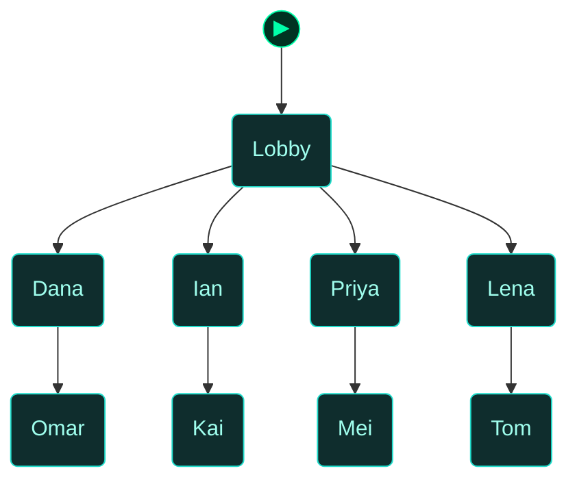

<!-- Auto-generated by scripts/generate_dungeon_graph.rb — do not edit by hand -->

# test_access_habits — Scenario Graph Reference

TEST: Access model awareness and habits

A test floor for NPC awareness and habits (ACCESS_MODEL_SLICE_9_1_PLAN.md, section 11). Eight beats, each with a sign. Dana (north, H1) never locks; Ian (east, H2) always locks; Omar (beyond Dana, H3) locks but keeps his password on a note; Priya (south, H4) and Kai (beyond Ian, H5) would never lock but the PC or its policy does; Mei (beyond Priya, H6) has a password you can work out; Tom (beyond Lena, H7) reuses his locker code; Lena (west, H8) sometimes locks.

## Scenario Statistics

| Metric | Value |
|---|---|
| Story aims | 1 |
| Total tasks | 8 (0 optional) |
| VM flag challenges | 0 |
| Physical locks | 9 |
| AND-gate convergences | 0 |
| Rooms | 9 |
| Puzzle graph nodes / edges | 29 / 99 |
| Story graph nodes / edges | 1 / 0 |

## Critical Path

0 hops through story aims — minimum mandatory sequence to reach mission completion:

****

## How to Read These Diagrams

| Shape | Colour | Meaning |
|---|---|---|
| Rounded rectangle | Teal | Room / physical area |
| Rectangle | Red | Lock, barrier, or interactive terminal |
| Diamond | Orange | Inventory item or credential |
| Diamond | Red/Pink | NPC or physical key |
| Diamond | Purple | VM flag (challenge completion token) |
| Rectangle | Blue | VM challenge |
| Ribbon | Amber | NPC conversation / action gate |
| Hexagon | Green | Story aim (objective) |
| Hexagon | Amber | Critical path node |
| Circle | Grey | AND gate (all inputs required) |
| Subroutine rect `[[…]]` | Green | Container (holds items) |
| Rounded rectangle | Amber | NPC in room (Rooms & Contents only) |

Edges: `-->` solid = hard dependency; `-.->` dashed = soft / narrative dependency or optional path.

The `▶` node marks the player's starting room.

## Puzzle Graph

Physical lock–key dependency chain. Shows which items, codes, and NPC interactions are required to open each lock, and which locks gate access to each room or object. Use this to trace solvability, spot circular dependencies, and check that every key is reachable before the lock that needs it.

```mermaid
flowchart TD

  classDef room      fill:#0f2d2d,stroke:#22ddcc,color:#a0ffee
  classDef lock      fill:#2d0f0f,stroke:#e66060,color:#ffa0a0
  classDef key       fill:#2d0812,stroke:#e66060,color:#ffa0a0
  classDef item      fill:#2d1200,stroke:#e89030,color:#ffcc80
  classDef gate      fill:#111,stroke:#666,color:#eee
  classDef vm        fill:#0c1f40,stroke:#4a90d9,color:#a0c8ff
  classDef flag      fill:#1a0c2d,stroke:#9060d0,color:#cc99ff
  classDef action    fill:#1a1200,stroke:#cc9922,color:#ffee88
  classDef aim       fill:#0d2a0d,stroke:#44cc44,color:#88ff88
  classDef aim_gate  fill:#111111,stroke:#44cc44,color:#44cc44
  classDef container fill:#1a2d1a,stroke:#60b060,color:#a0e0a0
  classDef npc       fill:#2d1f0d,stroke:#d0a050,color:#ffe0a0
  classDef critical  fill:#2a1500,stroke:#ffaa00,color:#ffdd88
  classDef start     fill:#003322,stroke:#00ffaa,color:#00ffaa

  node_start(("▶"))
  node_start --> lobby

  lock_dana_pc["Dana's PC<br/>Sign-in"]
  lock_ian_pc["Ian's PC<br/>Sign-in"]
  lock_omar_pc["Omar's PC<br/>Sign-in"]
  lock_priya_pc["Priya's PC<br/>Sign-in"]
  lock_kai_pc["Kai's PC<br/>Sign-in"]
  lock_mei_pc["Mei's PC<br/>Sign-in"]
  lock_lena_pc["Lena's PC<br/>Sign-in"]
  lock_tom_pc["Tom's PC<br/>Sign-in"]
  lock_tom_locker["Gym locker<br/>Password lock"]
  signin_dana{"Dana Reyes sign-in<br/>(dreyes)"}
  dana_room("Dana")
  signin_ian{"Ian Shaw sign-in<br/>(ishaw)"}
  ian_room("Ian")
  signin_omar{"Omar Haddad sign-in<br/>(ohaddad)"}
  omar_room("Omar")
  signin_priya{"Priya Nair sign-in<br/>(pnair)"}
  priya_room("Priya")
  signin_kai{"Kai Brennan sign-in<br/>(kbrennan)"}
  kai_room("Kai")
  signin_mei{"Mei Lin sign-in<br/>(mlin)"}
  mei_room("Mei")
  signin_lena{"Lena Fox sign-in<br/>(lfox)"}
  lena_room("Lena")
  signin_tom{"Tom Fletcher sign-in<br/>(tfletcher)"}
  tom_room("Tom")
  clue_mei_photo{"Framed photo"}
  clue_mei_calendar{"Wall calendar"}
  clue_password_memo{"IT notice"}
  lobby("Lobby")

  dana_room --> lock_dana_pc
  ian_room --> lock_ian_pc
  omar_room --> lock_omar_pc
  priya_room --> lock_priya_pc
  kai_room --> lock_kai_pc
  mei_room --> lock_mei_pc
  lena_room --> lock_lena_pc
  tom_room --> lock_tom_pc
  tom_room --> lock_tom_locker
  dana_room --> signin_dana
  signin_dana --> lock_dana_pc
  signin_dana --> lock_ian_pc
  signin_dana --> lock_omar_pc
  signin_dana --> lock_priya_pc
  signin_dana --> lock_kai_pc
  signin_dana --> lock_mei_pc
  signin_dana --> lock_lena_pc
  signin_dana --> lock_tom_pc
  ian_room --> signin_ian
  signin_ian --> lock_dana_pc
  signin_ian --> lock_ian_pc
  signin_ian --> lock_omar_pc
  signin_ian --> lock_priya_pc
  signin_ian --> lock_kai_pc
  signin_ian --> lock_mei_pc
  signin_ian --> lock_lena_pc
  signin_ian --> lock_tom_pc
  omar_room --> signin_omar
  signin_omar --> lock_dana_pc
  signin_omar --> lock_ian_pc
  signin_omar --> lock_omar_pc
  signin_omar --> lock_priya_pc
  signin_omar --> lock_kai_pc
  signin_omar --> lock_mei_pc
  signin_omar --> lock_lena_pc
  signin_omar --> lock_tom_pc
  priya_room --> signin_priya
  signin_priya --> lock_dana_pc
  signin_priya --> lock_ian_pc
  signin_priya --> lock_omar_pc
  signin_priya --> lock_priya_pc
  signin_priya --> lock_kai_pc
  signin_priya --> lock_mei_pc
  signin_priya --> lock_lena_pc
  signin_priya --> lock_tom_pc
  kai_room --> signin_kai
  signin_kai --> lock_dana_pc
  signin_kai --> lock_ian_pc
  signin_kai --> lock_omar_pc
  signin_kai --> lock_priya_pc
  signin_kai --> lock_kai_pc
  signin_kai --> lock_mei_pc
  signin_kai --> lock_lena_pc
  signin_kai --> lock_tom_pc
  mei_room --> signin_mei
  signin_mei --> lock_dana_pc
  signin_mei --> lock_ian_pc
  signin_mei --> lock_omar_pc
  signin_mei --> lock_priya_pc
  signin_mei --> lock_kai_pc
  signin_mei --> lock_mei_pc
  signin_mei --> lock_lena_pc
  signin_mei --> lock_tom_pc
  lena_room --> signin_lena
  signin_lena --> lock_dana_pc
  signin_lena --> lock_ian_pc
  signin_lena --> lock_omar_pc
  signin_lena --> lock_priya_pc
  signin_lena --> lock_kai_pc
  signin_lena --> lock_mei_pc
  signin_lena --> lock_lena_pc
  signin_lena --> lock_tom_pc
  tom_room --> signin_tom
  signin_tom --> lock_dana_pc
  signin_tom --> lock_ian_pc
  signin_tom --> lock_omar_pc
  signin_tom --> lock_priya_pc
  signin_tom --> lock_kai_pc
  signin_tom --> lock_mei_pc
  signin_tom --> lock_lena_pc
  signin_tom --> lock_tom_pc
  dana_room -->|unlocked screen| lock_dana_pc
  omar_room -->|sticky note at omar_pc| signin_omar
  mei_room --> clue_mei_photo
  clue_mei_photo -->|clue| signin_mei
  mei_room --> clue_mei_calendar
  clue_mei_calendar -->|clue| signin_mei
  mei_room --> clue_password_memo
  clue_password_memo -->|clue| signin_mei
  lena_room -->|unlocked screen (roll)| lock_lena_pc
  lock_tom_locker -->|same password| signin_tom
  lobby --> dana_room
  lobby --> ian_room
  lobby --> priya_room
  lobby --> lena_room
  dana_room --> omar_room
  ian_room --> kai_room
  priya_room --> mei_room
  lena_room --> tom_room

  class lock_dana_pc,lock_ian_pc,lock_omar_pc,lock_priya_pc,lock_kai_pc,lock_mei_pc,lock_lena_pc,lock_tom_pc,lock_tom_locker lock
  class signin_dana,signin_ian,signin_omar,signin_priya,signin_kai,signin_mei,signin_lena,signin_tom key
  class dana_room,ian_room,omar_room,priya_room,kai_room,mei_room,lena_room,tom_room,lobby room
  class clue_mei_photo,clue_mei_calendar,clue_password_memo item
  class node_start start
```

## Story Aims

Narrative objective flow. Shows story aims and their unlock conditions. Critical path aims are highlighted in amber. Use this to check aim sequencing, identify gaps between objectives, and verify that the player always has a clear next goal.


## Story + Puzzle (Integrated)

Puzzle graph and story aims combined, with bridge edges connecting physical puzzle progress to story aim completion. Use this to verify that physical actions drive narrative progress and that no aim is left floating without a puzzle prerequisite.

```mermaid
flowchart TD

  classDef room      fill:#0f2d2d,stroke:#22ddcc,color:#a0ffee
  classDef lock      fill:#2d0f0f,stroke:#e66060,color:#ffa0a0
  classDef key       fill:#2d0812,stroke:#e66060,color:#ffa0a0
  classDef item      fill:#2d1200,stroke:#e89030,color:#ffcc80
  classDef gate      fill:#111,stroke:#666,color:#eee
  classDef vm        fill:#0c1f40,stroke:#4a90d9,color:#a0c8ff
  classDef flag      fill:#1a0c2d,stroke:#9060d0,color:#cc99ff
  classDef action    fill:#1a1200,stroke:#cc9922,color:#ffee88
  classDef aim       fill:#0d2a0d,stroke:#44cc44,color:#88ff88
  classDef aim_gate  fill:#111111,stroke:#44cc44,color:#44cc44
  classDef container fill:#1a2d1a,stroke:#60b060,color:#a0e0a0
  classDef npc       fill:#2d1f0d,stroke:#d0a050,color:#ffe0a0
  classDef critical  fill:#2a1500,stroke:#ffaa00,color:#ffdd88
  classDef start     fill:#003322,stroke:#00ffaa,color:#00ffaa

  node_start(("▶"))
  node_start --> lobby

  lock_dana_pc["Dana's PC<br/>Sign-in"]
  lock_ian_pc["Ian's PC<br/>Sign-in"]
  lock_omar_pc["Omar's PC<br/>Sign-in"]
  lock_priya_pc["Priya's PC<br/>Sign-in"]
  lock_kai_pc["Kai's PC<br/>Sign-in"]
  lock_mei_pc["Mei's PC<br/>Sign-in"]
  lock_lena_pc["Lena's PC<br/>Sign-in"]
  lock_tom_pc["Tom's PC<br/>Sign-in"]
  lock_tom_locker["Gym locker<br/>Password lock"]
  signin_dana{"Dana Reyes sign-in<br/>(dreyes)"}
  dana_room("Dana")
  signin_ian{"Ian Shaw sign-in<br/>(ishaw)"}
  ian_room("Ian")
  signin_omar{"Omar Haddad sign-in<br/>(ohaddad)"}
  omar_room("Omar")
  signin_priya{"Priya Nair sign-in<br/>(pnair)"}
  priya_room("Priya")
  signin_kai{"Kai Brennan sign-in<br/>(kbrennan)"}
  kai_room("Kai")
  signin_mei{"Mei Lin sign-in<br/>(mlin)"}
  mei_room("Mei")
  signin_lena{"Lena Fox sign-in<br/>(lfox)"}
  lena_room("Lena")
  signin_tom{"Tom Fletcher sign-in<br/>(tfletcher)"}
  tom_room("Tom")
  clue_mei_photo{"Framed photo"}
  clue_mei_calendar{"Wall calendar"}
  clue_password_memo{"IT notice"}
  lobby("Lobby")
  aim_habits_beats{{"Run the habits beats"}}

  dana_room --> lock_dana_pc
  ian_room --> lock_ian_pc
  omar_room --> lock_omar_pc
  priya_room --> lock_priya_pc
  kai_room --> lock_kai_pc
  mei_room --> lock_mei_pc
  lena_room --> lock_lena_pc
  tom_room --> lock_tom_pc
  tom_room --> lock_tom_locker
  dana_room --> signin_dana
  signin_dana --> lock_dana_pc
  signin_dana --> lock_ian_pc
  signin_dana --> lock_omar_pc
  signin_dana --> lock_priya_pc
  signin_dana --> lock_kai_pc
  signin_dana --> lock_mei_pc
  signin_dana --> lock_lena_pc
  signin_dana --> lock_tom_pc
  ian_room --> signin_ian
  signin_ian --> lock_dana_pc
  signin_ian --> lock_ian_pc
  signin_ian --> lock_omar_pc
  signin_ian --> lock_priya_pc
  signin_ian --> lock_kai_pc
  signin_ian --> lock_mei_pc
  signin_ian --> lock_lena_pc
  signin_ian --> lock_tom_pc
  omar_room --> signin_omar
  signin_omar --> lock_dana_pc
  signin_omar --> lock_ian_pc
  signin_omar --> lock_omar_pc
  signin_omar --> lock_priya_pc
  signin_omar --> lock_kai_pc
  signin_omar --> lock_mei_pc
  signin_omar --> lock_lena_pc
  signin_omar --> lock_tom_pc
  priya_room --> signin_priya
  signin_priya --> lock_dana_pc
  signin_priya --> lock_ian_pc
  signin_priya --> lock_omar_pc
  signin_priya --> lock_priya_pc
  signin_priya --> lock_kai_pc
  signin_priya --> lock_mei_pc
  signin_priya --> lock_lena_pc
  signin_priya --> lock_tom_pc
  kai_room --> signin_kai
  signin_kai --> lock_dana_pc
  signin_kai --> lock_ian_pc
  signin_kai --> lock_omar_pc
  signin_kai --> lock_priya_pc
  signin_kai --> lock_kai_pc
  signin_kai --> lock_mei_pc
  signin_kai --> lock_lena_pc
  signin_kai --> lock_tom_pc
  mei_room --> signin_mei
  signin_mei --> lock_dana_pc
  signin_mei --> lock_ian_pc
  signin_mei --> lock_omar_pc
  signin_mei --> lock_priya_pc
  signin_mei --> lock_kai_pc
  signin_mei --> lock_mei_pc
  signin_mei --> lock_lena_pc
  signin_mei --> lock_tom_pc
  lena_room --> signin_lena
  signin_lena --> lock_dana_pc
  signin_lena --> lock_ian_pc
  signin_lena --> lock_omar_pc
  signin_lena --> lock_priya_pc
  signin_lena --> lock_kai_pc
  signin_lena --> lock_mei_pc
  signin_lena --> lock_lena_pc
  signin_lena --> lock_tom_pc
  tom_room --> signin_tom
  signin_tom --> lock_dana_pc
  signin_tom --> lock_ian_pc
  signin_tom --> lock_omar_pc
  signin_tom --> lock_priya_pc
  signin_tom --> lock_kai_pc
  signin_tom --> lock_mei_pc
  signin_tom --> lock_lena_pc
  signin_tom --> lock_tom_pc
  dana_room -->|unlocked screen| lock_dana_pc
  omar_room -->|sticky note at omar_pc| signin_omar
  mei_room --> clue_mei_photo
  clue_mei_photo -->|clue| signin_mei
  mei_room --> clue_mei_calendar
  clue_mei_calendar -->|clue| signin_mei
  mei_room --> clue_password_memo
  clue_password_memo -->|clue| signin_mei
  lena_room -->|unlocked screen (roll)| lock_lena_pc
  lock_tom_locker -->|same password| signin_tom
  lobby --> dana_room
  lobby --> ian_room
  lobby --> priya_room
  lobby --> lena_room
  dana_room --> omar_room
  ian_room --> kai_room
  priya_room --> mei_room
  lena_room --> tom_room

  class lock_dana_pc,lock_ian_pc,lock_omar_pc,lock_priya_pc,lock_kai_pc,lock_mei_pc,lock_lena_pc,lock_tom_pc,lock_tom_locker lock
  class signin_dana,signin_ian,signin_omar,signin_priya,signin_kai,signin_mei,signin_lena,signin_tom key
  class dana_room,ian_room,omar_room,priya_room,kai_room,mei_room,lena_room,tom_room,lobby room
  class clue_mei_photo,clue_mei_calendar,clue_password_memo item
  class aim_habits_beats aim
  class node_start start
```

## Rooms

Physical room layout with all connections. Locked rooms are shown in red. Use this to check room reachability, identify dead-end rooms with no content, and understand the spatial structure of the scenario.



## Rooms & Contents

Physical room layout with all objects, containers, NPCs, and held items. Use this to check clue distribution across rooms, verify that hints are placed before the locks they solve, and spot rooms that are under- or over-loaded with content.

```mermaid
flowchart TD

  classDef room      fill:#0f2d2d,stroke:#22ddcc,color:#a0ffee
  classDef lock      fill:#2d0f0f,stroke:#e66060,color:#ffa0a0
  classDef key       fill:#2d0812,stroke:#e66060,color:#ffa0a0
  classDef item      fill:#2d1200,stroke:#e89030,color:#ffcc80
  classDef gate      fill:#111,stroke:#666,color:#eee
  classDef vm        fill:#0c1f40,stroke:#4a90d9,color:#a0c8ff
  classDef flag      fill:#1a0c2d,stroke:#9060d0,color:#cc99ff
  classDef action    fill:#1a1200,stroke:#cc9922,color:#ffee88
  classDef aim       fill:#0d2a0d,stroke:#44cc44,color:#88ff88
  classDef aim_gate  fill:#111111,stroke:#44cc44,color:#44cc44
  classDef container fill:#1a2d1a,stroke:#60b060,color:#a0e0a0
  classDef npc       fill:#2d1f0d,stroke:#d0a050,color:#ffe0a0
  classDef critical  fill:#2a1500,stroke:#ffaa00,color:#ffdd88
  classDef start     fill:#003322,stroke:#00ffaa,color:#00ffaa

  node_start(("▶"))
  node_start --> lobby

  lobby("Lobby")
  dana_room("Dana")
  ian_room("Ian")
  omar_room("Omar")
  priya_room("Priya")
  kai_room("Kai")
  mei_room("Mei")
  lena_room("Lena")
  tom_room("Tom")
  rc_sign_lobby_1{"Sign: Start here"}
  rc_npc_rowan_price_2("Rowan Price")
  rc_dana_pc_3{"Dana's PC"}
  rc_dana_coffee_4{"Dana coffee"}
  rc_sign_h1_5{"Sign: H1 Never locks"}
  rc_npc_dana_reyes_6("Dana Reyes")
  rc_ian_pc_7{"Ian's PC"}
  rc_ian_coffee_8{"Ian coffee"}
  rc_sign_h2_9{"Sign: H2 Always locks"}
  rc_npc_ian_shaw_10("Ian Shaw")
  rc_omar_pc_11{"Omar's PC"}
  rc_omar_coffee_12{"Omar coffee"}
  rc_sign_h3_13{"Sign: H3 Careful, with a sticky note"}
  rc_npc_omar_haddad_14("Omar Haddad")
  rc_priya_pc_15{"Priya's PC"}
  rc_priya_coffee_16{"Priya coffee"}
  rc_sign_h4_17{"Sign: H4 The PC's own setting wins"}
  rc_npc_priya_nair_18("Priya Nair")
  rc_kai_pc_19{"Kai's PC"}
  rc_kai_coffee_20{"Kai coffee"}
  rc_sign_h5_21{"Sign: H5 Policy beats habit"}
  rc_npc_kai_brennan_22("Kai Brennan")
  rc_mei_pc_23{"Mei's PC"}
  rc_mei_coffee_24{"Mei coffee"}
  rc_mei_photo_25{"Framed photo"}
  rc_mei_calendar_26{"Wall calendar"}
  rc_password_memo_27{"IT notice"}
  rc_sign_h6_28{"Sign: H6 Guessable password"}
  rc_npc_mei_lin_29("Mei Lin")
  rc_lena_pc_30{"Lena's PC"}
  rc_lena_coffee_31{"Lena coffee"}
  rc_sign_h8_32{"Sign: H8 Sometimes locks"}
  rc_npc_lena_fox_33("Lena Fox")
  rc_tom_pc_34{"Tom's PC"}
  rc_tom_coffee_35{"Tom coffee"}
  rc_tom_locker_36[["Gym locker"]]
  rc_tom_kit_list_37{"Kit list"}
  rc_locker_note_38{"Note on the locker"}
  rc_sign_h7_39{"Sign: H7 Reused password"}
  rc_npc_tom_fletcher_40("Tom Fletcher")

  lobby --> dana_room
  lobby --> ian_room
  lobby --> priya_room
  lobby --> lena_room
  dana_room --> omar_room
  ian_room --> kai_room
  priya_room --> mei_room
  lena_room --> tom_room
  lobby --> rc_sign_lobby_1
  lobby --> rc_npc_rowan_price_2
  dana_room --> rc_dana_pc_3
  dana_room --> rc_dana_coffee_4
  dana_room --> rc_sign_h1_5
  dana_room --> rc_npc_dana_reyes_6
  ian_room --> rc_ian_pc_7
  ian_room --> rc_ian_coffee_8
  ian_room --> rc_sign_h2_9
  ian_room --> rc_npc_ian_shaw_10
  omar_room --> rc_omar_pc_11
  omar_room --> rc_omar_coffee_12
  omar_room --> rc_sign_h3_13
  omar_room --> rc_npc_omar_haddad_14
  priya_room --> rc_priya_pc_15
  priya_room --> rc_priya_coffee_16
  priya_room --> rc_sign_h4_17
  priya_room --> rc_npc_priya_nair_18
  kai_room --> rc_kai_pc_19
  kai_room --> rc_kai_coffee_20
  kai_room --> rc_sign_h5_21
  kai_room --> rc_npc_kai_brennan_22
  mei_room --> rc_mei_pc_23
  mei_room --> rc_mei_coffee_24
  mei_room --> rc_mei_photo_25
  mei_room --> rc_mei_calendar_26
  mei_room --> rc_password_memo_27
  mei_room --> rc_sign_h6_28
  mei_room --> rc_npc_mei_lin_29
  lena_room --> rc_lena_pc_30
  lena_room --> rc_lena_coffee_31
  lena_room --> rc_sign_h8_32
  lena_room --> rc_npc_lena_fox_33
  tom_room --> rc_tom_pc_34
  tom_room --> rc_tom_coffee_35
  tom_room --> rc_tom_locker_36
  rc_tom_locker_36 --> rc_tom_kit_list_37
  tom_room --> rc_locker_note_38
  tom_room --> rc_sign_h7_39
  tom_room --> rc_npc_tom_fletcher_40

  class lobby,dana_room,ian_room,omar_room,priya_room,kai_room,mei_room,lena_room,tom_room room
  class rc_sign_lobby_1,rc_dana_pc_3,rc_dana_coffee_4,rc_sign_h1_5,rc_ian_pc_7,rc_ian_coffee_8,rc_sign_h2_9,rc_omar_pc_11,rc_omar_coffee_12,rc_sign_h3_13,rc_priya_pc_15,rc_priya_coffee_16,rc_sign_h4_17,rc_kai_pc_19,rc_kai_coffee_20,rc_sign_h5_21,rc_mei_pc_23,rc_mei_coffee_24,rc_mei_photo_25,rc_mei_calendar_26,rc_password_memo_27,rc_sign_h6_28,rc_lena_pc_30,rc_lena_coffee_31,rc_sign_h8_32,rc_tom_pc_34,rc_tom_coffee_35,rc_tom_kit_list_37,rc_locker_note_38,rc_sign_h7_39 item
  class rc_npc_rowan_price_2,rc_npc_dana_reyes_6,rc_npc_ian_shaw_10,rc_npc_omar_haddad_14,rc_npc_priya_nair_18,rc_npc_kai_brennan_22,rc_npc_mei_lin_29,rc_npc_lena_fox_33,rc_npc_tom_fletcher_40 npc
  class rc_tom_locker_36 container
  class node_start start
```


