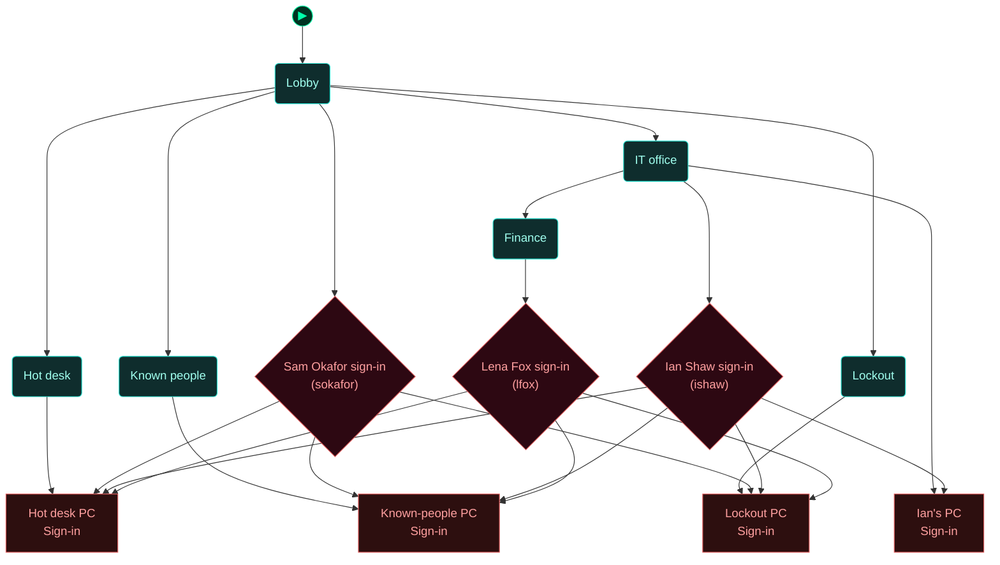
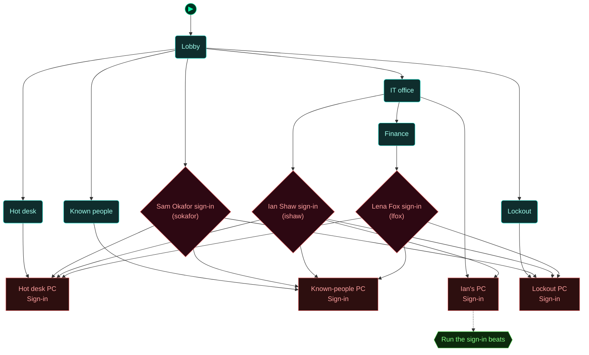
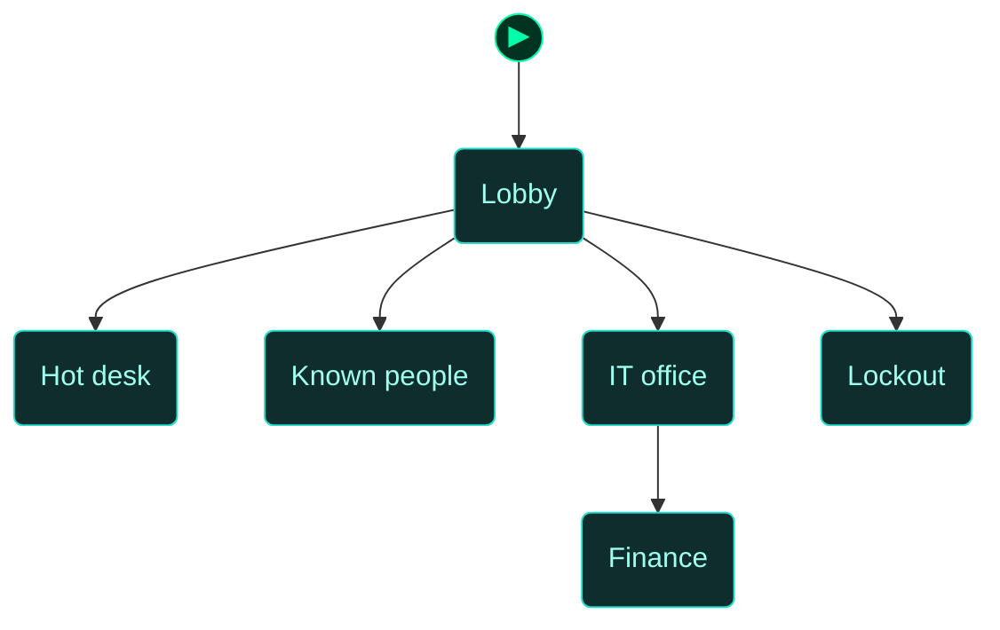

<!-- Auto-generated by scripts/generate_dungeon_graph.rb — do not edit by hand -->

# test_access_signin — Scenario Graph Reference

TEST: Access model sign-in

A test floor for sign-in PCs (ACCESS_MODEL_PLAN.md, step 8). Eight beats, each with a sign. S1: the hot desk (north) shows a tile for every account; sign in as Sam with the password on its sticky note. S2: the known-people PC (south) shows only people you have met; visit finance (east of the IT office) and look again. S3: Ian's PC (in the IT office, east) takes a typed username and admits IT staff only; his password is in his desk drawer. S4: Switch user at the hot desk to Ian; his files follow him. S5: copy one of Ian's files and move another. S6: open the archive with the handbook's password, then sign out. S7: the lockout PC (west) locks a username out after five wrong passwords. S8: reload; Ian's session at his PC survives.

## Scenario Statistics

| Metric | Value |
|---|---|
| Story aims | 1 |
| Total tasks | 8 (0 optional) |
| VM flag challenges | 0 |
| Physical locks | 4 |
| AND-gate convergences | 0 |
| Rooms | 6 |
| Puzzle graph nodes / edges | 13 / 22 |
| Story graph nodes / edges | 1 / 0 |

## Critical Path

0 hops through story aims — minimum mandatory sequence to reach mission completion:

****

## How to Read These Diagrams

| Shape | Colour | Meaning |
|---|---|---|
| Rounded rectangle | Teal | Room / physical area |
| Rectangle | Red | Lock, barrier, or interactive terminal |
| Diamond | Orange | Inventory item or credential |
| Diamond | Red/Pink | NPC or physical key |
| Diamond | Purple | VM flag (challenge completion token) |
| Rectangle | Blue | VM challenge |
| Ribbon | Amber | NPC conversation / action gate |
| Hexagon | Green | Story aim (objective) |
| Hexagon | Amber | Critical path node |
| Circle | Grey | AND gate (all inputs required) |
| Subroutine rect `[[…]]` | Green | Container (holds items) |
| Rounded rectangle | Amber | NPC in room (Rooms & Contents only) |

Edges: `-->` solid = hard dependency; `-.->` dashed = soft / narrative dependency or optional path.

The `▶` node marks the player's starting room.

## Puzzle Graph

Physical lock–key dependency chain. Shows which items, codes, and NPC interactions are required to open each lock, and which locks gate access to each room or object. Use this to trace solvability, spot circular dependencies, and check that every key is reachable before the lock that needs it.

## Story Aims

Narrative objective flow. Shows story aims and their unlock conditions. Critical path aims are highlighted in amber. Use this to check aim sequencing, identify gaps between objectives, and verify that the player always has a clear next goal.

## Story + Puzzle (Integrated)

Puzzle graph and story aims combined, with bridge edges connecting physical puzzle progress to story aim completion. Use this to verify that physical actions drive narrative progress and that no aim is left floating without a puzzle prerequisite.

## Rooms

Physical room layout with all connections. Locked rooms are shown in red. Use this to check room reachability, identify dead-end rooms with no content, and understand the spatial structure of the scenario.

## Rooms & Contents

Physical room layout with all objects, containers, NPCs, and held items. Use this to check clue distribution across rooms, verify that hints are placed before the locks they solve, and spot rooms that are under- or over-loaded with content.

```mermaid
flowchart TD

  classDef room      fill:#0f2d2d,stroke:#22ddcc,color:#a0ffee
  classDef lock      fill:#2d0f0f,stroke:#e66060,color:#ffa0a0
  classDef key       fill:#2d0812,stroke:#e66060,color:#ffa0a0
  classDef item      fill:#2d1200,stroke:#e89030,color:#ffcc80
  classDef gate      fill:#111,stroke:#666,color:#eee
  classDef vm        fill:#0c1f40,stroke:#4a90d9,color:#a0c8ff
  classDef flag      fill:#1a0c2d,stroke:#9060d0,color:#cc99ff
  classDef action    fill:#1a1200,stroke:#cc9922,color:#ffee88
  classDef aim       fill:#0d2a0d,stroke:#44cc44,color:#88ff88
  classDef aim_gate  fill:#111111,stroke:#44cc44,color:#44cc44
  classDef container fill:#1a2d1a,stroke:#60b060,color:#a0e0a0
  classDef npc       fill:#2d1f0d,stroke:#d0a050,color:#ffe0a0
  classDef critical  fill:#2a1500,stroke:#ffaa00,color:#ffdd88
  classDef start     fill:#003322,stroke:#00ffaa,color:#00ffaa

  node_start(("▶"))
  node_start --> lobby

  lobby("Lobby")
  hot_desk_room("Hot desk")
  known_room("Known people")
  it_room("IT office")
  finance_room("Finance")
  lockout_room("Lockout")
  rc_sign_lobby_1{"Sign: Start here"}
  rc_npc_sam_okafor_2("Sam Okafor")
  rc_hot_desk_3{"Hot desk PC"}
  rc_sign_s1_4{"Sign: S1 Account tiles"}
  rc_sign_s4_5{"Sign: S4 One profile, two PCs, and switching"}
  rc_sign_s5_6{"Sign: S5 Copy and Move"}
  rc_sign_s6_7{"Sign: S6 Locked folder and sign out"}
  rc_known_pc_8{"Known-people PC"}
  rc_sign_s2_9{"Sign: S2 Known people only"}
  rc_ian_pc_10{"Ian's PC"}
  rc_ian_drawer_11[["Ian's desk drawer"]]
  rc_ian_password_note_12{"Note: my sign-in"}
  rc_sign_s3_13{"Sign: S3 Typed username and the access list"}
  rc_sign_s8_14{"Sign: S8 Reload"}
  rc_npc_ian_shaw_15("Ian Shaw")
  rc_npc_lena_fox_16("Lena Fox")
  rc_lockout_pc_17{"Lockout PC"}
  rc_sign_s7_18{"Sign: S7 Lockout"}

  lobby --> hot_desk_room
  lobby --> it_room
  lobby --> known_room
  lobby --> lockout_room
  it_room --> finance_room
  lobby --> rc_sign_lobby_1
  lobby --> rc_npc_sam_okafor_2
  hot_desk_room --> rc_hot_desk_3
  hot_desk_room --> rc_sign_s1_4
  hot_desk_room --> rc_sign_s4_5
  hot_desk_room --> rc_sign_s5_6
  hot_desk_room --> rc_sign_s6_7
  known_room --> rc_known_pc_8
  known_room --> rc_sign_s2_9
  it_room --> rc_ian_pc_10
  it_room --> rc_ian_drawer_11
  rc_ian_drawer_11 --> rc_ian_password_note_12
  it_room --> rc_sign_s3_13
  it_room --> rc_sign_s8_14
  it_room --> rc_npc_ian_shaw_15
  finance_room --> rc_npc_lena_fox_16
  lockout_room --> rc_lockout_pc_17
  lockout_room --> rc_sign_s7_18

  class lobby,hot_desk_room,known_room,it_room,finance_room,lockout_room room
  class rc_sign_lobby_1,rc_hot_desk_3,rc_sign_s1_4,rc_sign_s4_5,rc_sign_s5_6,rc_sign_s6_7,rc_known_pc_8,rc_sign_s2_9,rc_ian_pc_10,rc_ian_password_note_12,rc_sign_s3_13,rc_sign_s8_14,rc_lockout_pc_17,rc_sign_s7_18 item
  class rc_npc_sam_okafor_2,rc_npc_ian_shaw_15,rc_npc_lena_fox_16 npc
  class rc_ian_drawer_11 container
  class node_start start
```

