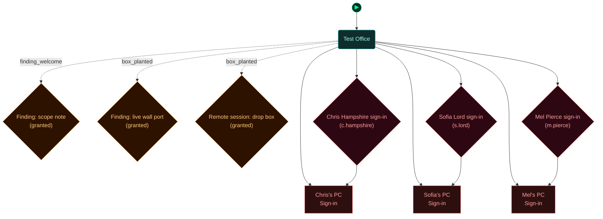
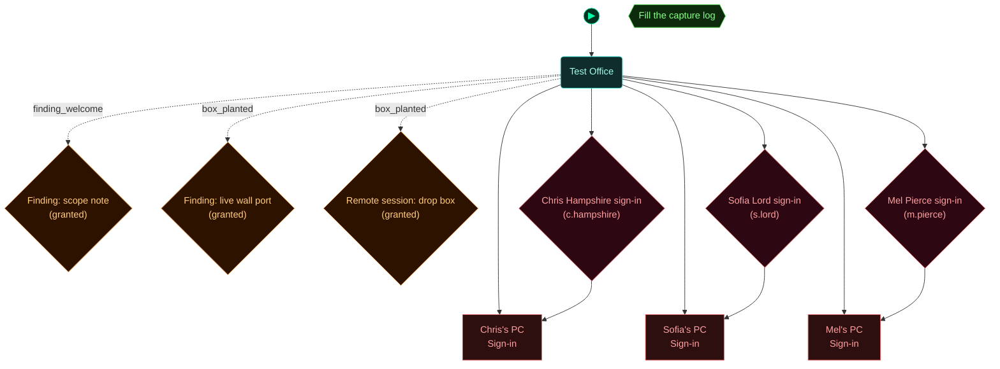

<!-- Auto-generated by scripts/generate_dungeon_graph.rb — do not edit by hand -->

# test_capture_log — Scenario Graph Reference

TEST: the capture log device and capture proofs (engine plan section 6).

You start with the capture log, a keylogger, a drop box and a QR card. Every capture, session and finding lands in the capture log, not in the tray. An account password is shown only once the server has seen the proof: the keylogger planted on Chris's desk, the QR card dropped where Sofia picks it up, or a session on Mel's PC. Ned's password opens nothing, so it is shown as soon as it is captured.

Signs on the walls say what each beat proves. Nothing to win.

## Scenario Statistics

| Metric | Value |
|---|---|
| Story aims | 1 |
| Total tasks | 5 (0 optional) |
| VM flag challenges | 0 |
| Physical locks | 3 |
| AND-gate convergences | 0 |
| Rooms | 1 |
| Puzzle graph nodes / edges | 10 / 12 |
| Story graph nodes / edges | 1 / 0 |

## Critical Path

0 hops through story aims — minimum mandatory sequence to reach mission completion:

****

## How to Read These Diagrams

| Shape | Colour | Meaning |
|---|---|---|
| Rounded rectangle | Teal | Room / physical area |
| Rectangle | Red | Lock, barrier, or interactive terminal |
| Diamond | Orange | Inventory item or credential |
| Diamond | Red/Pink | NPC or physical key |
| Diamond | Purple | VM flag (challenge completion token) |
| Rectangle | Blue | VM challenge |
| Ribbon | Amber | NPC conversation / action gate |
| Hexagon | Green | Story aim (objective) |
| Hexagon | Amber | Critical path node |
| Circle | Grey | AND gate (all inputs required) |
| Subroutine rect `[[…]]` | Green | Container (holds items) |
| Rounded rectangle | Amber | NPC in room (Rooms & Contents only) |

Edges: `-->` solid = hard dependency; `-.->` dashed = soft / narrative dependency or optional path.

The `▶` node marks the player's starting room.

## Puzzle Graph

Physical lock–key dependency chain. Shows which items, codes, and NPC interactions are required to open each lock, and which locks gate access to each room or object. Use this to trace solvability, spot circular dependencies, and check that every key is reachable before the lock that needs it.

## Story Aims

Narrative objective flow. Shows story aims and their unlock conditions. Critical path aims are highlighted in amber. Use this to check aim sequencing, identify gaps between objectives, and verify that the player always has a clear next goal.

## Story + Puzzle (Integrated)

Puzzle graph and story aims combined, with bridge edges connecting physical puzzle progress to story aim completion. Use this to verify that physical actions drive narrative progress and that no aim is left floating without a puzzle prerequisite.

## Rooms

Physical room layout with all connections. Locked rooms are shown in red. Use this to check room reachability, identify dead-end rooms with no content, and understand the spatial structure of the scenario.

```mermaid
flowchart TD

  classDef room      fill:#0f2d2d,stroke:#22ddcc,color:#a0ffee
  classDef lock      fill:#2d0f0f,stroke:#e66060,color:#ffa0a0
  classDef key       fill:#2d0812,stroke:#e66060,color:#ffa0a0
  classDef item      fill:#2d1200,stroke:#e89030,color:#ffcc80
  classDef gate      fill:#111,stroke:#666,color:#eee
  classDef vm        fill:#0c1f40,stroke:#4a90d9,color:#a0c8ff
  classDef flag      fill:#1a0c2d,stroke:#9060d0,color:#cc99ff
  classDef action    fill:#1a1200,stroke:#cc9922,color:#ffee88
  classDef aim       fill:#0d2a0d,stroke:#44cc44,color:#88ff88
  classDef aim_gate  fill:#111111,stroke:#44cc44,color:#44cc44
  classDef container fill:#1a2d1a,stroke:#60b060,color:#a0e0a0
  classDef npc       fill:#2d1f0d,stroke:#d0a050,color:#ffe0a0
  classDef critical  fill:#2a1500,stroke:#ffaa00,color:#ffdd88
  classDef start     fill:#003322,stroke:#00ffaa,color:#00ffaa

  node_start(("▶"))
  node_start --> office

  office("Test Office")


  class office room
  class node_start start
```

## Rooms & Contents

Physical room layout with all objects, containers, NPCs, and held items. Use this to check clue distribution across rooms, verify that hints are placed before the locks they solve, and spot rooms that are under- or over-loaded with content.

```mermaid
flowchart TD

  classDef room      fill:#0f2d2d,stroke:#22ddcc,color:#a0ffee
  classDef lock      fill:#2d0f0f,stroke:#e66060,color:#ffa0a0
  classDef key       fill:#2d0812,stroke:#e66060,color:#ffa0a0
  classDef item      fill:#2d1200,stroke:#e89030,color:#ffcc80
  classDef gate      fill:#111,stroke:#666,color:#eee
  classDef vm        fill:#0c1f40,stroke:#4a90d9,color:#a0c8ff
  classDef flag      fill:#1a0c2d,stroke:#9060d0,color:#cc99ff
  classDef action    fill:#1a1200,stroke:#cc9922,color:#ffee88
  classDef aim       fill:#0d2a0d,stroke:#44cc44,color:#88ff88
  classDef aim_gate  fill:#111111,stroke:#44cc44,color:#44cc44
  classDef container fill:#1a2d1a,stroke:#60b060,color:#a0e0a0
  classDef npc       fill:#2d1f0d,stroke:#d0a050,color:#ffe0a0
  classDef critical  fill:#2a1500,stroke:#ffaa00,color:#ffdd88
  classDef start     fill:#003322,stroke:#00ffaa,color:#00ffaa

  node_start(("▶"))
  node_start --> office

  office("Test Office")
  rc_sign_keylogger_1{"Sign: keylogger"}
  rc_sign_drop_2{"Sign: drop"}
  rc_sign_claim_3{"Sign: claim"}
  rc_sign_box_4{"Sign: wall port"}
  rc_sign_ned_5{"Sign: Ned"}
  rc_chris_desk_6{"Chris's desk"}
  rc_chris_pc_7{"Chris's PC"}
  rc_sofia_desk_8{"Sofia's desk"}
  rc_sofia_pc_9{"Sofia's PC"}
  rc_mel_pc_10[["Mel's PC"]]
  rc_mel_todo_11{"todo.txt"}
  rc_office_coffee_12{"Coffee station"}
  rc_wall_port_13{"Wall port"}
  rc_ned_note_14{"Ned's desk note"}
  rc_npc_chris_hampshire_15("Chris Hampshire")
  rc_npc_sofia_lord_16("Sofia Lord")
  rc_npc_mel_pierce_17("Mel Pierce")
  rc_npc_ned_okafor_18("Ned Okafor")
  rc_grant_finding_scope_19{"Finding: scope note<br/>(granted)"}
  rc_grant_finding_wall_port_20{"Finding: live wall port<br/>(granted)"}
  rc_grant_remote_session_box_21[["Remote session: drop box<br/>(granted)"]]
  rc_box_readme_22{"readme.txt"}
  rc_box_note_23{"Desk note"}

  office --> rc_sign_keylogger_1
  office --> rc_sign_drop_2
  office --> rc_sign_claim_3
  office --> rc_sign_box_4
  office --> rc_sign_ned_5
  office --> rc_chris_desk_6
  office --> rc_chris_pc_7
  office --> rc_sofia_desk_8
  office --> rc_sofia_pc_9
  office --> rc_mel_pc_10
  rc_mel_pc_10 --> rc_mel_todo_11
  office --> rc_office_coffee_12
  office --> rc_wall_port_13
  office --> rc_ned_note_14
  office --> rc_npc_chris_hampshire_15
  office --> rc_npc_sofia_lord_16
  office --> rc_npc_mel_pierce_17
  office --> rc_npc_ned_okafor_18
  office -.-> rc_grant_finding_scope_19
  office -.-> rc_grant_finding_wall_port_20
  office -.-> rc_grant_remote_session_box_21
  rc_grant_remote_session_box_21 --> rc_box_readme_22
  rc_grant_remote_session_box_21 --> rc_box_note_23

  class office room
  class rc_sign_keylogger_1,rc_sign_drop_2,rc_sign_claim_3,rc_sign_box_4,rc_sign_ned_5,rc_chris_desk_6,rc_chris_pc_7,rc_sofia_desk_8,rc_sofia_pc_9,rc_mel_todo_11,rc_office_coffee_12,rc_wall_port_13,rc_ned_note_14,rc_grant_finding_scope_19,rc_grant_finding_wall_port_20,rc_box_readme_22,rc_box_note_23 item
  class rc_mel_pc_10,rc_grant_remote_session_box_21 container
  class rc_npc_chris_hampshire_15,rc_npc_sofia_lord_16,rc_npc_mel_pierce_17,rc_npc_ned_okafor_18 npc
  class node_start start
```

