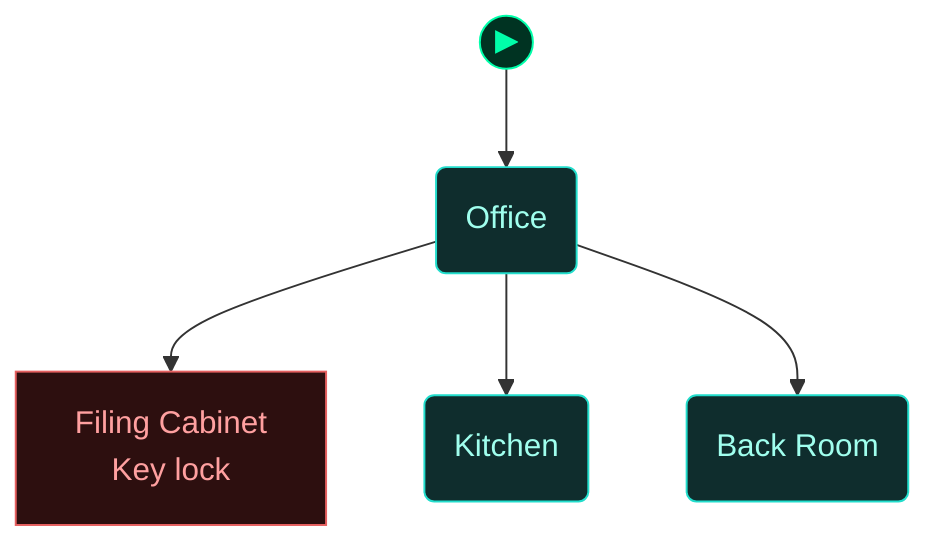
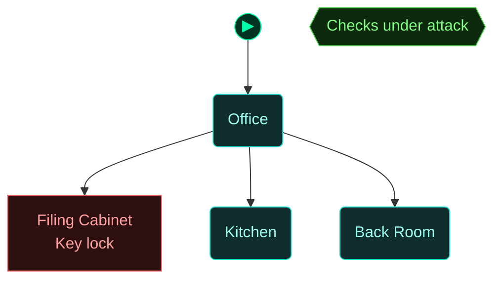
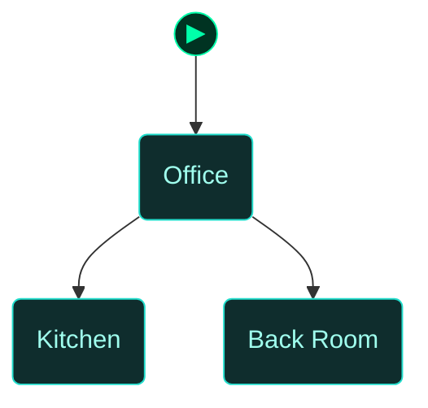

<!-- Auto-generated by scripts/generate_dungeon_graph.rb — do not edit by hand -->

# test_needs_attack — Scenario Graph Reference

TEST: Needs under attack (SIMS-1)

A probe, not a mission. Seven office staff run their needs while the player attacks and knocks them out to see what the needs system and the server do under combat. Ava carries abandoned mugs from the office to the kitchen tray; Ben walks to the kitchen cooler for water and keeps a notebook on him; Dee gets up for an office coffee and watches the floor; Eli never moves, sipping from his own mug, and prints a handover page about six seconds after you ask him for it; Fran and Gil take their breaks together at the kitchen kettle and cooler; Cal is hostile the moment you step into the back room. Read the Meeting Note to call Ben home and suspend his needs, the Meeting Over note to resume them, and the Break Time note to send Ben, Dee and Gil on a break at once. Pick Dee's filing cabinet while she can see you and she catches you. Knock someone out mid-errand and watch what drops; reload and check what survives.

## Scenario Statistics

| Metric | Value |
|---|---|
| Story aims | 1 |
| Total tasks | 6 (0 optional) |
| VM flag challenges | 0 |
| Physical locks | 1 |
| AND-gate convergences | 0 |
| Rooms | 3 |
| Puzzle graph nodes / edges | 4 / 3 |
| Story graph nodes / edges | 1 / 0 |

## Critical Path

0 hops through story aims — minimum mandatory sequence to reach mission completion:

****

## How to Read These Diagrams

| Shape | Colour | Meaning |
|---|---|---|
| Rounded rectangle | Teal | Room / physical area |
| Rectangle | Red | Lock, barrier, or interactive terminal |
| Diamond | Orange | Inventory item or credential |
| Diamond | Red/Pink | NPC or physical key |
| Diamond | Purple | VM flag (challenge completion token) |
| Rectangle | Blue | VM challenge |
| Ribbon | Amber | NPC conversation / action gate |
| Hexagon | Green | Story aim (objective) |
| Hexagon | Amber | Critical path node |
| Circle | Grey | AND gate (all inputs required) |
| Subroutine rect `[[…]]` | Green | Container (holds items) |
| Rounded rectangle | Amber | NPC in room (Rooms & Contents only) |

Edges: `-->` solid = hard dependency; `-.->` dashed = soft / narrative dependency or optional path.

The `▶` node marks the player's starting room.

## Puzzle Graph

Physical lock–key dependency chain. Shows which items, codes, and NPC interactions are required to open each lock, and which locks gate access to each room or object. Use this to trace solvability, spot circular dependencies, and check that every key is reachable before the lock that needs it.

## Story Aims

Narrative objective flow. Shows story aims and their unlock conditions. Critical path aims are highlighted in amber. Use this to check aim sequencing, identify gaps between objectives, and verify that the player always has a clear next goal.

## Story + Puzzle (Integrated)

Puzzle graph and story aims combined, with bridge edges connecting physical puzzle progress to story aim completion. Use this to verify that physical actions drive narrative progress and that no aim is left floating without a puzzle prerequisite.

## Rooms

Physical room layout with all connections. Locked rooms are shown in red. Use this to check room reachability, identify dead-end rooms with no content, and understand the spatial structure of the scenario.

## Rooms & Contents

Physical room layout with all objects, containers, NPCs, and held items. Use this to check clue distribution across rooms, verify that hints are placed before the locks they solve, and spot rooms that are under- or over-loaded with content.

```mermaid
flowchart TD

  classDef room      fill:#0f2d2d,stroke:#22ddcc,color:#a0ffee
  classDef lock      fill:#2d0f0f,stroke:#e66060,color:#ffa0a0
  classDef key       fill:#2d0812,stroke:#e66060,color:#ffa0a0
  classDef item      fill:#2d1200,stroke:#e89030,color:#ffcc80
  classDef gate      fill:#111,stroke:#666,color:#eee
  classDef vm        fill:#0c1f40,stroke:#4a90d9,color:#a0c8ff
  classDef flag      fill:#1a0c2d,stroke:#9060d0,color:#cc99ff
  classDef action    fill:#1a1200,stroke:#cc9922,color:#ffee88
  classDef aim       fill:#0d2a0d,stroke:#44cc44,color:#88ff88
  classDef aim_gate  fill:#111111,stroke:#44cc44,color:#44cc44
  classDef container fill:#1a2d1a,stroke:#60b060,color:#a0e0a0
  classDef npc       fill:#2d1f0d,stroke:#d0a050,color:#ffe0a0
  classDef critical  fill:#2a1500,stroke:#ffaa00,color:#ffdd88
  classDef start     fill:#003322,stroke:#00ffaa,color:#00ffaa

  node_start(("▶"))
  node_start --> office

  office("Office")
  kitchen("Kitchen")
  back_room("Back Room")
  rc_ava_pc_1{"Ava's PC"}
  rc_ben_pc_2{"Ben's PC"}
  rc_dee_pc_3{"Dee's PC"}
  rc_eli_mug_4{"Eli's Mug"}
  rc_office_coffee_5{"Office Coffee Station"}
  rc_office_copier_6{"Photocopier"}
  rc_eli_page_7{"Printout"}
  rc_dee_drawer_8{"Filing Cabinet"}
  rc_office_mugs_9{"Abandoned Mugs"}
  rc_office_lockpick_10{"Lock Pick Set"}
  rc_meeting_note_11{"Meeting Note"}
  rc_meeting_over_12{"Meeting Over"}
  rc_break_time_13{"Break Time"}
  rc_npc_ava_okafor_14("Ava Okafor")
  rc_ava_folder_15{"Ava's Folder"}
  rc_npc_ben_harwell_16("Ben Harwell")
  rc_ben_notebook_17{"Ben's Notebook"}
  rc_npc_dee_sullivan_18("Dee Sullivan")
  rc_npc_eli_thornton_19("Eli Thornton")
  rc_water_cooler_20{"Water Cooler"}
  rc_washing_up_tray_21{"Washing-up Tray"}
  rc_kitchen_kettle_22{"Kitchen Kettle"}
  rc_npc_fran_delacroix_23("Fran Delacroix")
  rc_npc_gil_ashworth_24("Gil Ashworth")
  rc_cal_mug_25{"Cal's Mug"}
  rc_npc_cal_mercer_26("Cal Mercer")

  office --> kitchen
  office --> back_room
  office --> rc_ava_pc_1
  office --> rc_ben_pc_2
  office --> rc_dee_pc_3
  office --> rc_eli_mug_4
  office --> rc_office_coffee_5
  office --> rc_office_copier_6
  office --> rc_eli_page_7
  office --> rc_dee_drawer_8
  office --> rc_office_mugs_9
  office --> rc_office_lockpick_10
  office --> rc_meeting_note_11
  office --> rc_meeting_over_12
  office --> rc_break_time_13
  office --> rc_npc_ava_okafor_14
  rc_npc_ava_okafor_14 --> rc_ava_folder_15
  office --> rc_npc_ben_harwell_16
  rc_npc_ben_harwell_16 --> rc_ben_notebook_17
  office --> rc_npc_dee_sullivan_18
  office --> rc_npc_eli_thornton_19
  kitchen --> rc_water_cooler_20
  kitchen --> rc_washing_up_tray_21
  kitchen --> rc_kitchen_kettle_22
  kitchen --> rc_npc_fran_delacroix_23
  kitchen --> rc_npc_gil_ashworth_24
  back_room --> rc_cal_mug_25
  back_room --> rc_npc_cal_mercer_26

  class office,kitchen,back_room room
  class rc_ava_pc_1,rc_ben_pc_2,rc_dee_pc_3,rc_eli_mug_4,rc_office_coffee_5,rc_office_copier_6,rc_eli_page_7,rc_dee_drawer_8,rc_office_mugs_9,rc_office_lockpick_10,rc_meeting_note_11,rc_meeting_over_12,rc_break_time_13,rc_ava_folder_15,rc_ben_notebook_17,rc_water_cooler_20,rc_washing_up_tray_21,rc_kitchen_kettle_22,rc_cal_mug_25 item
  class rc_npc_ava_okafor_14,rc_npc_ben_harwell_16,rc_npc_dee_sullivan_18,rc_npc_eli_thornton_19,rc_npc_fran_delacroix_23,rc_npc_gil_ashworth_24,rc_npc_cal_mercer_26 npc
  class node_start start
```

