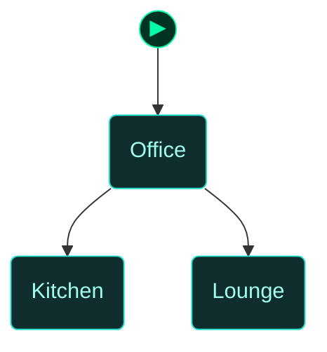
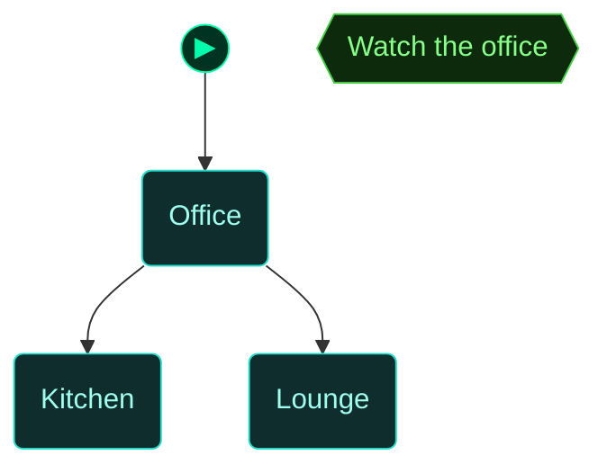

<!-- Auto-generated by scripts/generate_dungeon_graph.rb — do not edit by hand -->

# test_needs_sims — Scenario Graph Reference

TEST: Needs (Sims-style office day)

A demo of the NPC needs system. Nothing to solve. Five staff get thirsty, hungry, tired and bored, want coffee and want to work, and walk to whatever fixes it before going back to their own desks. Open the kitchen door (west) and the lounge door (east) once so they can get there. The lounge is Rosa's room: only she and Grace use it, and each PC is used only by its owner. Read the deadline memo in the office and Tom and Amara both want a coffee at once; whoever misses the office station walks to the kitchen, not to Rosa's kettle (with the kitchen still shut, they wait in line at the office station instead). Read the Activity Board before opening the kitchen and Amara and Tom want a coffee, Marek queues behind Tom, and whoever is pouring chats with the first in line, unless that is Marek. Drop the parcel or the dirty mugs from your inventory and watch someone deal with them. The whiteboard by the office's back wall shows the last thing anyone used. Icons over heads say what each person is doing, a thought bubble beside a head shows the need they will act on next, a carried parcel or mug shows in their hands, desk workers type, and you hear a drink or a snack when you are near enough.

## Scenario Statistics

| Metric | Value |
|---|---|
| Story aims | 1 |
| Total tasks | 19 (0 optional) |
| VM flag challenges | 0 |
| Physical locks | 0 |
| AND-gate convergences | 0 |
| Rooms | 3 |
| Puzzle graph nodes / edges | 3 / 2 |
| Story graph nodes / edges | 1 / 0 |

## Critical Path

0 hops through story aims — minimum mandatory sequence to reach mission completion:

****

## How to Read These Diagrams

| Shape | Colour | Meaning |
|---|---|---|
| Rounded rectangle | Teal | Room / physical area |
| Rectangle | Red | Lock, barrier, or interactive terminal |
| Diamond | Orange | Inventory item or credential |
| Diamond | Red/Pink | NPC or physical key |
| Diamond | Purple | VM flag (challenge completion token) |
| Rectangle | Blue | VM challenge |
| Ribbon | Amber | NPC conversation / action gate |
| Hexagon | Green | Story aim (objective) |
| Hexagon | Amber | Critical path node |
| Circle | Grey | AND gate (all inputs required) |
| Subroutine rect `[[…]]` | Green | Container (holds items) |
| Rounded rectangle | Amber | NPC in room (Rooms & Contents only) |

Edges: `-->` solid = hard dependency; `-.->` dashed = soft / narrative dependency or optional path.

The `▶` node marks the player's starting room.

## Puzzle Graph

Physical lock–key dependency chain. Shows which items, codes, and NPC interactions are required to open each lock, and which locks gate access to each room or object. Use this to trace solvability, spot circular dependencies, and check that every key is reachable before the lock that needs it.

## Story Aims

Narrative objective flow. Shows story aims and their unlock conditions. Critical path aims are highlighted in amber. Use this to check aim sequencing, identify gaps between objectives, and verify that the player always has a clear next goal.

## Story + Puzzle (Integrated)

Puzzle graph and story aims combined, with bridge edges connecting physical puzzle progress to story aim completion. Use this to verify that physical actions drive narrative progress and that no aim is left floating without a puzzle prerequisite.

## Rooms

Physical room layout with all connections. Locked rooms are shown in red. Use this to check room reachability, identify dead-end rooms with no content, and understand the spatial structure of the scenario.

## Rooms & Contents

Physical room layout with all objects, containers, NPCs, and held items. Use this to check clue distribution across rooms, verify that hints are placed before the locks they solve, and spot rooms that are under- or over-loaded with content.

```mermaid
flowchart TD

  classDef room      fill:#0f2d2d,stroke:#22ddcc,color:#a0ffee
  classDef lock      fill:#2d0f0f,stroke:#e66060,color:#ffa0a0
  classDef key       fill:#2d0812,stroke:#e66060,color:#ffa0a0
  classDef item      fill:#2d1200,stroke:#e89030,color:#ffcc80
  classDef gate      fill:#111,stroke:#666,color:#eee
  classDef vm        fill:#0c1f40,stroke:#4a90d9,color:#a0c8ff
  classDef flag      fill:#1a0c2d,stroke:#9060d0,color:#cc99ff
  classDef action    fill:#1a1200,stroke:#cc9922,color:#ffee88
  classDef aim       fill:#0d2a0d,stroke:#44cc44,color:#88ff88
  classDef aim_gate  fill:#111111,stroke:#44cc44,color:#44cc44
  classDef container fill:#1a2d1a,stroke:#60b060,color:#a0e0a0
  classDef npc       fill:#2d1f0d,stroke:#d0a050,color:#ffe0a0
  classDef critical  fill:#2a1500,stroke:#ffaa00,color:#ffdd88
  classDef start     fill:#003322,stroke:#00ffaa,color:#00ffaa

  node_start(("▶"))
  node_start --> office

  office("Office")
  kitchen("Kitchen")
  lounge("Lounge")
  rc_amara_pc_1{"Amara's PC"}
  rc_tom_pc_2{"Tom's PC"}
  rc_tom_badge_3{"Tom's ID badge"}
  rc_sanjay_pc_4{"Sanjay's PC"}
  rc_grace_laptop_5{"Grace's Laptop"}
  rc_office_coffee_6{"Office Coffee Station"}
  rc_office_mugs_7{"Abandoned Mugs"}
  rc_activity_board_8{"Activity Board"}
  rc_office_copier_9{"Photocopier"}
  rc_copier_out_a_10{"Printout"}
  rc_copier_out_b_11{"Printout"}
  rc_copier_out_c_12{"Printout"}
  rc_deadline_memo_13{"Deadline Memo"}
  rc_kitchen_rota_14{"Kitchen Rota"}
  rc_npc_amara_okoye_15("Amara Okoye")
  rc_npc_tom_fletcher_16("Tom Fletcher")
  rc_npc_grace_lindqvist_17("Grace Lindqvist")
  rc_npc_sanjay_mehta_18("Sanjay Mehta")
  rc_npc_marek_nowak_19("Marek Nowak")
  rc_fridge_20{"Fridge"}
  rc_microwave_21{"Microwave"}
  rc_kitchen_coffee_22{"Kitchen Coffee Station"}
  rc_water_cooler_23{"Water Cooler"}
  rc_washing_up_tray_24{"Washing-up Tray"}
  rc_rosa_laptop_25{"Rosa's Laptop"}
  rc_lounge_sofa_26{"Lounge Sofa"}
  rc_lounge_kettle_27{"Rosa's Kettle"}
  rc_npc_rosa_delgado_28("Rosa Delgado")

  office --> kitchen
  office --> lounge
  office --> rc_amara_pc_1
  office --> rc_tom_pc_2
  office --> rc_tom_badge_3
  office --> rc_sanjay_pc_4
  office --> rc_grace_laptop_5
  office --> rc_office_coffee_6
  office --> rc_office_mugs_7
  office --> rc_activity_board_8
  office --> rc_office_copier_9
  office --> rc_copier_out_a_10
  office --> rc_copier_out_b_11
  office --> rc_copier_out_c_12
  office --> rc_deadline_memo_13
  office --> rc_kitchen_rota_14
  office --> rc_npc_amara_okoye_15
  office --> rc_npc_tom_fletcher_16
  office --> rc_npc_grace_lindqvist_17
  office --> rc_npc_sanjay_mehta_18
  office --> rc_npc_marek_nowak_19
  kitchen --> rc_fridge_20
  kitchen --> rc_microwave_21
  kitchen --> rc_kitchen_coffee_22
  kitchen --> rc_water_cooler_23
  kitchen --> rc_washing_up_tray_24
  lounge --> rc_rosa_laptop_25
  lounge --> rc_lounge_sofa_26
  lounge --> rc_lounge_kettle_27
  lounge --> rc_npc_rosa_delgado_28

  class office,kitchen,lounge room
  class rc_amara_pc_1,rc_tom_pc_2,rc_tom_badge_3,rc_sanjay_pc_4,rc_grace_laptop_5,rc_office_coffee_6,rc_office_mugs_7,rc_activity_board_8,rc_office_copier_9,rc_copier_out_a_10,rc_copier_out_b_11,rc_copier_out_c_12,rc_deadline_memo_13,rc_kitchen_rota_14,rc_fridge_20,rc_microwave_21,rc_kitchen_coffee_22,rc_water_cooler_23,rc_washing_up_tray_24,rc_rosa_laptop_25,rc_lounge_sofa_26,rc_lounge_kettle_27 item
  class rc_npc_amara_okoye_15,rc_npc_tom_fletcher_16,rc_npc_grace_lindqvist_17,rc_npc_sanjay_mehta_18,rc_npc_marek_nowak_19,rc_npc_rosa_delgado_28 npc
  class node_start start
```

