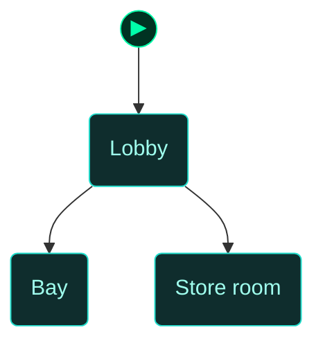
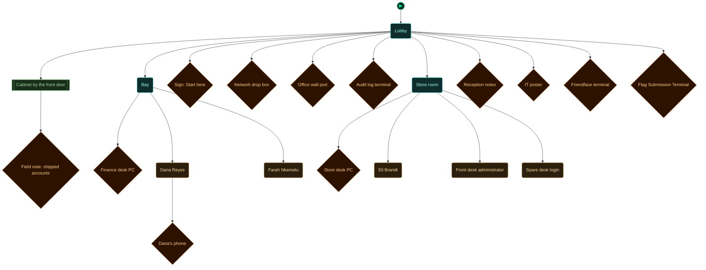

<!-- Auto-generated by scripts/generate_dungeon_graph.rb — do not edit by hand -->

# test_ops_crack — Scenario Graph Reference

TEST: Ops crack

A test floor for hash records and the offline cracker (S7, feature A21). A lobby with a drop box, a wall port, a cabinet, a notes pad, a public terminal and a flag station; a bay with two staff desks; a store room with a front desk panel and three more accounts. Collect stored records for the accounts, earn what you know about their owners, and crack them one by one. Nothing to solve.

## Scenario Statistics

| Metric | Value |
|---|---|
| Story aims | 1 |
| Total tasks | 1 (0 optional) |
| VM flag challenges | 0 |
| Physical locks | 4 |
| AND-gate convergences | 0 |
| Rooms | 4 |
| Puzzle graph nodes / edges | 45 / 56 |
| Story graph nodes / edges | 1 / 0 |

## Critical Path

0 hops through story aims — minimum mandatory sequence to reach mission completion:

****

## How to Read These Diagrams

| Shape | Colour | Meaning |
|---|---|---|
| Rounded rectangle | Teal | Room / physical area |
| Rectangle | Red | Lock, barrier, or interactive terminal |
| Diamond | Orange | Inventory item or credential |
| Diamond | Red/Pink | NPC or physical key |
| Diamond | Purple | VM flag (challenge completion token) |
| Rectangle | Blue | VM challenge |
| Ribbon | Amber | NPC conversation / action gate |
| Hexagon | Green | Story aim (objective) |
| Hexagon | Amber | Critical path node |
| Circle | Grey | AND gate (all inputs required) |
| Subroutine rect `[[…]]` | Green | Container (holds items) |
| Rounded rectangle | Amber | NPC in room (Rooms & Contents only) |

Edges: `-->` solid = hard dependency; `-.->` dashed = soft / narrative dependency or optional path.
  Network edges: `-.-` log: a log source (a note) and a reader that shows it; it gates nothing.
  Network edges: weak_ node: a weakness a check can find on a host or device, hung from it or from its network.
  Network edges: tech_ node: a technique card, drawn to each weakness it matches; a weakness may grant a session (to the host sign-in) or a credential.

The `▶` node marks the player's starting room.

## Puzzle Graph

Physical lock–key dependency chain. Shows which items, codes, and NPC interactions are required to open each lock, and which locks gate access to each room or object. Use this to trace solvability, spot circular dependencies, and check that every key is reachable before the lock that needs it.

```mermaid
flowchart TD

  classDef room      fill:#0f2d2d,stroke:#22ddcc,color:#a0ffee
  classDef lock      fill:#2d0f0f,stroke:#e66060,color:#ffa0a0
  classDef key       fill:#2d0812,stroke:#e66060,color:#ffa0a0
  classDef item      fill:#2d1200,stroke:#e89030,color:#ffcc80
  classDef gate      fill:#111,stroke:#666,color:#eee
  classDef vm        fill:#0c1f40,stroke:#4a90d9,color:#a0c8ff
  classDef flag      fill:#1a0c2d,stroke:#9060d0,color:#cc99ff
  classDef action    fill:#1a1200,stroke:#cc9922,color:#ffee88
  classDef aim       fill:#0d2a0d,stroke:#44cc44,color:#88ff88
  classDef aim_gate  fill:#111111,stroke:#44cc44,color:#44cc44
  classDef container fill:#1a2d1a,stroke:#60b060,color:#a0e0a0
  classDef npc       fill:#2d1f0d,stroke:#d0a050,color:#ffe0a0
  classDef note      fill:#161a2d,stroke:#7788bb,color:#c0c8ee
  classDef critical  fill:#2a1500,stroke:#ffaa00,color:#ffdd88
  classDef start     fill:#003322,stroke:#00ffaa,color:#00ffaa

  node_start(("▶"))
  node_start --> lobby

  lock_dana_pc["Finance desk PC<br/>Sign-in"]
  lock_eli_pc["Store desk PC<br/>Sign-in"]
  signin_dana{"Dana Reyes sign-in<br/>(dreyes)"}
  bay("Bay")
  signin_farah{"Farah Nkemelu sign-in<br/>(fnkemelu)"}
  signin_eli{"Eli Brandt sign-in<br/>(ebrandt)"}
  store("Store room")
  signin_deskadmin{"Front desk administrator sign-in<br/>(fdadmin)"}
  signin_sparedesk{"Spare desk login sign-in<br/>(spare)"}
  clue_desk_notes{"Reception notes"}
  lobby("Lobby")
  clue_social_intelfacts_dana_pet{"social/intelFacts/dana pet"}
  clue_rooms_bay_npcs_0_feed_posts_0{"rooms/bay/npcs[0]/feed/posts[0]"}
  clue_social_intelfacts_dana_town{"social/intelFacts/dana town"}
  clue_social_intelfacts_dana_year{"social/intelFacts/dana year"}
  clue_it_poster{"IT poster"}
  device_kit_dropbox{"Network drop box<br/>(rogue device)"}
  jack_office_port["Office wall port<br/>Network jack"]
  net_office_lan("Office network<br/>Network<br/>(sweep to list)")
  host_desk_panel[["Front desk panel<br/>(device)"]]
  resource_shared_drive[["Office-Shared<br/>(file share)"]]
  weak_desk_panel_admin_page_factory_login["Front desk panel<br/>Admin page :80<br/>default_creds / high"]
  log_crack_audit[("Office audit<br/>network_swept, host_scanned, service_checked, finding_confirmed, technique_used, share_folder_opened, admin_profile_read, signin_ok, signin_fail")]
  reader_audit_log_pc{"Audit log terminal<br/>(log reader)"}
  cred_dana_hash{"Dana Reyes hash<br/>(dreyes)"}
  cred_src_dana_file{"dana_record.dat"}
  cred_deskadmin_hash{"Front desk administrator hash<br/>(fdadmin)"}
  cred_eli_hash{"Eli Brandt hash<br/>(ebrandt)"}
  cred_src_eli_hash_file{"eli_record.dat"}
  cred_farah_hash{"Farah Nkemelu hash<br/>(fnkemelu)"}
  cred_src_farah_file{"farah_record.dat"}
  cred_sparedesk_hash{"Spare desk login hash<br/>(spare)"}
  cred_src_sparedesk_file{"sparedesk_record.dat"}
  crackpw_dana{"Dana Reyes password"}
  cred_src_desk_notes{"Reception notes"}
  crack_feed_dana_dana_post_1{"Dana Reyes feed post dana_post_1"}
  crack_flag_records_station{"Flag Submission Terminal flag"}
  crackpw_deskadmin{"Front desk administrator password"}
  crackpw_eli{"Eli Brandt password"}
  crackpw_farah{"Farah Nkemelu password"}
  crackpw_sparedesk{"Spare desk login password"}
  tech_factory_accounts{"Factory accounts"}
  cred_src_card_factory{"Field note: shipped accounts"}
  admin_at_dana_pc{"Finance desk PC<br/>Administrator session"}
  admin_at_eli_pc{"Store desk PC<br/>Administrator session"}

  bay --> lock_dana_pc
  store --> lock_eli_pc
  bay --> signin_dana
  signin_dana --> lock_dana_pc
  signin_dana --> lock_eli_pc
  bay --> signin_farah
  signin_farah --> lock_dana_pc
  signin_farah --> lock_eli_pc
  store --> signin_eli
  signin_eli --> lock_dana_pc
  signin_eli --> lock_eli_pc
  store --> signin_deskadmin
  signin_deskadmin --> lock_dana_pc
  signin_deskadmin --> lock_eli_pc
  store --> signin_sparedesk
  signin_sparedesk --> lock_dana_pc
  signin_sparedesk --> lock_eli_pc
  lobby --> clue_desk_notes
  clue_desk_notes -->|clue| signin_dana
  clue_social_intelfacts_dana_pet -->|clue| signin_dana
  clue_rooms_bay_npcs_0_feed_posts_0 -->|clue| signin_dana
  clue_social_intelfacts_dana_town -->|clue| signin_dana
  clue_social_intelfacts_dana_year -->|clue| signin_dana
  lobby --> clue_it_poster
  clue_it_poster -->|clue| signin_dana
  signin_dana -->|shared with dana| signin_farah
  lobby --> device_kit_dropbox
  lobby --> jack_office_port
  device_kit_dropbox --> jack_office_port
  jack_office_port --> net_office_lan
  net_office_lan -->|exposes| host_desk_panel
  net_office_lan -->|exposes| lock_dana_pc
  net_office_lan -->|exposes| lock_eli_pc
  net_office_lan -->|exposes| resource_shared_drive
  host_desk_panel --> weak_desk_panel_admin_page_factory_login
  lobby --> bay
  lobby --> store
  lobby --> reader_audit_log_pc
  log_crack_audit -.- reader_audit_log_pc
  cred_src_dana_file --> cred_dana_hash
  cred_src_eli_hash_file --> cred_eli_hash
  cred_src_farah_file --> cred_farah_hash
  cred_src_sparedesk_file --> cred_sparedesk_hash
  cred_dana_hash -->|crack (hard)| crackpw_dana
  cred_src_desk_notes -->|crack (hard)| crackpw_dana
  crack_feed_dana_dana_post_1 -->|crack (hard)| crackpw_dana
  crack_flag_records_station -->|crack (hard)| crackpw_dana
  cred_deskadmin_hash -->|crack (easy)| crackpw_deskadmin
  cred_eli_hash -->|crack| crackpw_eli
  cred_farah_hash -->|crack (medium)| crackpw_farah
  cred_sparedesk_hash -->|crack| crackpw_sparedesk
  cred_src_card_factory --> tech_factory_accounts
  tech_factory_accounts --> weak_desk_panel_admin_page_factory_login
  weak_desk_panel_admin_page_factory_login --> cred_deskadmin_hash
  signin_deskadmin -->|administrator| admin_at_dana_pc
  signin_deskadmin -->|administrator| admin_at_eli_pc

  class lock_dana_pc,lock_eli_pc,jack_office_port,weak_desk_panel_admin_page_factory_login lock
  class signin_dana,signin_farah,signin_eli,signin_deskadmin,signin_sparedesk,device_kit_dropbox,cred_dana_hash,cred_deskadmin_hash,cred_eli_hash,cred_farah_hash,cred_sparedesk_hash,crackpw_dana,crack_feed_dana_dana_post_1,crack_flag_records_station,crackpw_deskadmin,crackpw_eli,crackpw_farah,crackpw_sparedesk,tech_factory_accounts,admin_at_dana_pc,admin_at_eli_pc key
  class bay,store,lobby,net_office_lan room
  class clue_desk_notes,clue_social_intelfacts_dana_pet,clue_rooms_bay_npcs_0_feed_posts_0,clue_social_intelfacts_dana_town,clue_social_intelfacts_dana_year,clue_it_poster,reader_audit_log_pc,cred_src_dana_file,cred_src_eli_hash_file,cred_src_farah_file,cred_src_sparedesk_file,cred_src_desk_notes,cred_src_card_factory item
  class host_desk_panel,resource_shared_drive container
  class log_crack_audit note
  class node_start start
```

## Story Aims

Narrative objective flow. Shows story aims and their unlock conditions. Critical path aims are highlighted in amber. Use this to check aim sequencing, identify gaps between objectives, and verify that the player always has a clear next goal.


## Story + Puzzle (Integrated)

Puzzle graph and story aims combined, with bridge edges connecting physical puzzle progress to story aim completion. Use this to verify that physical actions drive narrative progress and that no aim is left floating without a puzzle prerequisite.

```mermaid
flowchart TD

  classDef room      fill:#0f2d2d,stroke:#22ddcc,color:#a0ffee
  classDef lock      fill:#2d0f0f,stroke:#e66060,color:#ffa0a0
  classDef key       fill:#2d0812,stroke:#e66060,color:#ffa0a0
  classDef item      fill:#2d1200,stroke:#e89030,color:#ffcc80
  classDef gate      fill:#111,stroke:#666,color:#eee
  classDef vm        fill:#0c1f40,stroke:#4a90d9,color:#a0c8ff
  classDef flag      fill:#1a0c2d,stroke:#9060d0,color:#cc99ff
  classDef action    fill:#1a1200,stroke:#cc9922,color:#ffee88
  classDef aim       fill:#0d2a0d,stroke:#44cc44,color:#88ff88
  classDef aim_gate  fill:#111111,stroke:#44cc44,color:#44cc44
  classDef container fill:#1a2d1a,stroke:#60b060,color:#a0e0a0
  classDef npc       fill:#2d1f0d,stroke:#d0a050,color:#ffe0a0
  classDef note      fill:#161a2d,stroke:#7788bb,color:#c0c8ee
  classDef critical  fill:#2a1500,stroke:#ffaa00,color:#ffdd88
  classDef start     fill:#003322,stroke:#00ffaa,color:#00ffaa

  node_start(("▶"))
  node_start --> lobby

  lock_dana_pc["Finance desk PC<br/>Sign-in"]
  lock_eli_pc["Store desk PC<br/>Sign-in"]
  signin_dana{"Dana Reyes sign-in<br/>(dreyes)"}
  bay("Bay")
  signin_farah{"Farah Nkemelu sign-in<br/>(fnkemelu)"}
  signin_eli{"Eli Brandt sign-in<br/>(ebrandt)"}
  store("Store room")
  signin_deskadmin{"Front desk administrator sign-in<br/>(fdadmin)"}
  signin_sparedesk{"Spare desk login sign-in<br/>(spare)"}
  clue_desk_notes{"Reception notes"}
  lobby("Lobby")
  clue_social_intelfacts_dana_pet{"social/intelFacts/dana pet"}
  clue_rooms_bay_npcs_0_feed_posts_0{"rooms/bay/npcs[0]/feed/posts[0]"}
  clue_social_intelfacts_dana_town{"social/intelFacts/dana town"}
  clue_social_intelfacts_dana_year{"social/intelFacts/dana year"}
  clue_it_poster{"IT poster"}
  device_kit_dropbox{"Network drop box<br/>(rogue device)"}
  jack_office_port["Office wall port<br/>Network jack"]
  net_office_lan("Office network<br/>Network<br/>(sweep to list)")
  host_desk_panel[["Front desk panel<br/>(device)"]]
  resource_shared_drive[["Office-Shared<br/>(file share)"]]
  weak_desk_panel_admin_page_factory_login["Front desk panel<br/>Admin page :80<br/>default_creds / high"]
  log_crack_audit[("Office audit<br/>network_swept, host_scanned, service_checked, finding_confirmed, technique_used, share_folder_opened, admin_profile_read, signin_ok, signin_fail")]
  reader_audit_log_pc{"Audit log terminal<br/>(log reader)"}
  cred_dana_hash{"Dana Reyes hash<br/>(dreyes)"}
  cred_src_dana_file{"dana_record.dat"}
  cred_deskadmin_hash{"Front desk administrator hash<br/>(fdadmin)"}
  cred_eli_hash{"Eli Brandt hash<br/>(ebrandt)"}
  cred_src_eli_hash_file{"eli_record.dat"}
  cred_farah_hash{"Farah Nkemelu hash<br/>(fnkemelu)"}
  cred_src_farah_file{"farah_record.dat"}
  cred_sparedesk_hash{"Spare desk login hash<br/>(spare)"}
  cred_src_sparedesk_file{"sparedesk_record.dat"}
  crackpw_dana{"Dana Reyes password"}
  cred_src_desk_notes{"Reception notes"}
  crack_feed_dana_dana_post_1{"Dana Reyes feed post dana_post_1"}
  crack_flag_records_station{"Flag Submission Terminal flag"}
  crackpw_deskadmin{"Front desk administrator password"}
  crackpw_eli{"Eli Brandt password"}
  crackpw_farah{"Farah Nkemelu password"}
  crackpw_sparedesk{"Spare desk login password"}
  tech_factory_accounts{"Factory accounts"}
  cred_src_card_factory{"Field note: shipped accounts"}
  admin_at_dana_pc{"Finance desk PC<br/>Administrator session"}
  admin_at_eli_pc{"Store desk PC<br/>Administrator session"}
  aim_crack_beats{{"Collect and crack the stored records"}}

  bay --> lock_dana_pc
  store --> lock_eli_pc
  bay --> signin_dana
  signin_dana --> lock_dana_pc
  signin_dana --> lock_eli_pc
  bay --> signin_farah
  signin_farah --> lock_dana_pc
  signin_farah --> lock_eli_pc
  store --> signin_eli
  signin_eli --> lock_dana_pc
  signin_eli --> lock_eli_pc
  store --> signin_deskadmin
  signin_deskadmin --> lock_dana_pc
  signin_deskadmin --> lock_eli_pc
  store --> signin_sparedesk
  signin_sparedesk --> lock_dana_pc
  signin_sparedesk --> lock_eli_pc
  lobby --> clue_desk_notes
  clue_desk_notes -->|clue| signin_dana
  clue_social_intelfacts_dana_pet -->|clue| signin_dana
  clue_rooms_bay_npcs_0_feed_posts_0 -->|clue| signin_dana
  clue_social_intelfacts_dana_town -->|clue| signin_dana
  clue_social_intelfacts_dana_year -->|clue| signin_dana
  lobby --> clue_it_poster
  clue_it_poster -->|clue| signin_dana
  signin_dana -->|shared with dana| signin_farah
  lobby --> device_kit_dropbox
  lobby --> jack_office_port
  device_kit_dropbox --> jack_office_port
  jack_office_port --> net_office_lan
  net_office_lan -->|exposes| host_desk_panel
  net_office_lan -->|exposes| lock_dana_pc
  net_office_lan -->|exposes| lock_eli_pc
  net_office_lan -->|exposes| resource_shared_drive
  host_desk_panel --> weak_desk_panel_admin_page_factory_login
  lobby --> bay
  lobby --> store
  lobby --> reader_audit_log_pc
  log_crack_audit -.- reader_audit_log_pc
  cred_src_dana_file --> cred_dana_hash
  cred_src_eli_hash_file --> cred_eli_hash
  cred_src_farah_file --> cred_farah_hash
  cred_src_sparedesk_file --> cred_sparedesk_hash
  cred_dana_hash -->|crack (hard)| crackpw_dana
  cred_src_desk_notes -->|crack (hard)| crackpw_dana
  crack_feed_dana_dana_post_1 -->|crack (hard)| crackpw_dana
  crack_flag_records_station -->|crack (hard)| crackpw_dana
  cred_deskadmin_hash -->|crack (easy)| crackpw_deskadmin
  cred_eli_hash -->|crack| crackpw_eli
  cred_farah_hash -->|crack (medium)| crackpw_farah
  cred_sparedesk_hash -->|crack| crackpw_sparedesk
  cred_src_card_factory --> tech_factory_accounts
  tech_factory_accounts --> weak_desk_panel_admin_page_factory_login
  weak_desk_panel_admin_page_factory_login --> cred_deskadmin_hash
  signin_deskadmin -->|administrator| admin_at_dana_pc
  signin_deskadmin -->|administrator| admin_at_eli_pc

  class lock_dana_pc,lock_eli_pc,jack_office_port,weak_desk_panel_admin_page_factory_login lock
  class signin_dana,signin_farah,signin_eli,signin_deskadmin,signin_sparedesk,device_kit_dropbox,cred_dana_hash,cred_deskadmin_hash,cred_eli_hash,cred_farah_hash,cred_sparedesk_hash,crackpw_dana,crack_feed_dana_dana_post_1,crack_flag_records_station,crackpw_deskadmin,crackpw_eli,crackpw_farah,crackpw_sparedesk,tech_factory_accounts,admin_at_dana_pc,admin_at_eli_pc key
  class bay,store,lobby,net_office_lan room
  class clue_desk_notes,clue_social_intelfacts_dana_pet,clue_rooms_bay_npcs_0_feed_posts_0,clue_social_intelfacts_dana_town,clue_social_intelfacts_dana_year,clue_it_poster,reader_audit_log_pc,cred_src_dana_file,cred_src_eli_hash_file,cred_src_farah_file,cred_src_sparedesk_file,cred_src_desk_notes,cred_src_card_factory item
  class host_desk_panel,resource_shared_drive container
  class log_crack_audit note
  class aim_crack_beats aim
  class node_start start
```

## Rooms

Physical room layout with all connections. Locked rooms are shown in red. Use this to check room reachability, identify dead-end rooms with no content, and understand the spatial structure of the scenario.



## Rooms & Contents

Physical room layout with all objects, containers, NPCs, and held items. Use this to check clue distribution across rooms, verify that hints are placed before the locks they solve, and spot rooms that are under- or over-loaded with content.


