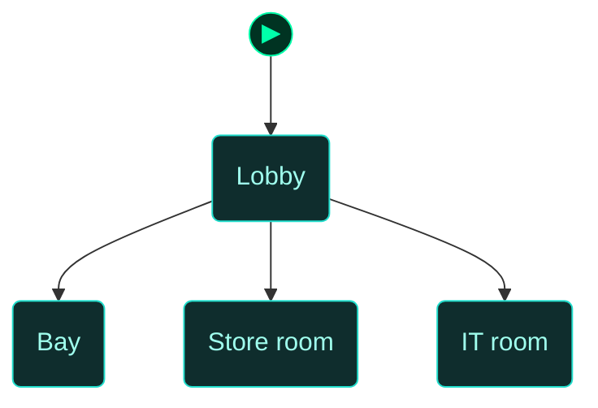

<!-- Auto-generated by scripts/generate_dungeon_graph.rb — do not edit by hand -->

# test_ops_privilege — Scenario Graph Reference

TEST: Ops privilege

A test floor for the privilege stage of the ops core (OPS_PRIVILEGE_ACCOUNTS_PLAN.md, S5a). A lobby with a drop box, a wall port and a cabinet; a bay with an owned desk PC, a USB socket and a stick port; a store room with a records server and two staff accounts. Sign in as an ordinary account, then as the administrator, and see what the administrator can do that the ordinary account cannot. Nothing to solve.

## Scenario Statistics

| Metric | Value |
|---|---|
| Story aims | 1 |
| Total tasks | 1 (0 optional) |
| VM flag challenges | 0 |
| Physical locks | 10 |
| AND-gate convergences | 0 |
| Rooms | 5 |
| Puzzle graph nodes / edges | 59 / 120 |
| Story graph nodes / edges | 1 / 0 |

## Critical Path

0 hops through story aims — minimum mandatory sequence to reach mission completion:

****

## How to Read These Diagrams

| Shape | Colour | Meaning |
|---|---|---|
| Rounded rectangle | Teal | Room / physical area |
| Rectangle | Red | Lock, barrier, or interactive terminal |
| Diamond | Orange | Inventory item or credential |
| Diamond | Red/Pink | NPC or physical key |
| Diamond | Purple | VM flag (challenge completion token) |
| Rectangle | Blue | VM challenge |
| Ribbon | Amber | NPC conversation / action gate |
| Hexagon | Green | Story aim (objective) |
| Hexagon | Amber | Critical path node |
| Circle | Grey | AND gate (all inputs required) |
| Subroutine rect `[[…]]` | Green | Container (holds items) |
| Rounded rectangle | Amber | NPC in room (Rooms & Contents only) |

Edges: `-->` solid = hard dependency; `-.->` dashed = soft / narrative dependency or optional path.
  Network edges: `-.-` log: a log source (a note) and a reader that shows it; it gates nothing.
  Network edges: `held` / `dropped` / `session at PC`: what an implant needs.
  Network edges: weak_ node: a weakness a check can find on a host or device, hung from it or from its network.
  Network edges: tech_ node: a technique card, drawn to each weakness it matches; a weakness may grant a session (to the host sign-in) or a credential.

The `▶` node marks the player's starting room.

## Puzzle Graph

Physical lock–key dependency chain. Shows which items, codes, and NPC interactions are required to open each lock, and which locks gate access to each room or object. Use this to trace solvability, spot circular dependencies, and check that every key is reachable before the lock that needs it.

```mermaid
flowchart TD

  classDef room      fill:#0f2d2d,stroke:#22ddcc,color:#a0ffee
  classDef lock      fill:#2d0f0f,stroke:#e66060,color:#ffa0a0
  classDef key       fill:#2d0812,stroke:#e66060,color:#ffa0a0
  classDef item      fill:#2d1200,stroke:#e89030,color:#ffcc80
  classDef gate      fill:#111,stroke:#666,color:#eee
  classDef vm        fill:#0c1f40,stroke:#4a90d9,color:#a0c8ff
  classDef flag      fill:#1a0c2d,stroke:#9060d0,color:#cc99ff
  classDef action    fill:#1a1200,stroke:#cc9922,color:#ffee88
  classDef aim       fill:#0d2a0d,stroke:#44cc44,color:#88ff88
  classDef aim_gate  fill:#111111,stroke:#44cc44,color:#44cc44
  classDef container fill:#1a2d1a,stroke:#60b060,color:#a0e0a0
  classDef npc       fill:#2d1f0d,stroke:#d0a050,color:#ffe0a0
  classDef note      fill:#161a2d,stroke:#7788bb,color:#c0c8ee
  classDef critical  fill:#2a1500,stroke:#ffaa00,color:#ffdd88
  classDef start     fill:#003322,stroke:#00ffaa,color:#00ffaa

  node_start(("▶"))
  node_start --> lobby

  lock_hot_desk["Hot desk PC<br/>Sign-in"]
  lock_sam_pc["Sam's desk PC<br/>Sign-in"]
  lock_bay_pc["Bay desk PC<br/>Sign-in"]
  lock_store_pc["Records PC<br/>Sign-in"]
  lock_desk_a["Desk PC A<br/>Sign-in"]
  lock_desk_b["Desk PC B<br/>Sign-in"]
  lock_lab_pc["Lab PC<br/>Sign-in"]
  signin_priya{"Priya Nair sign-in<br/>(pnair)"}
  lobby("Lobby")
  signin_sam{"Sam Okoro sign-in<br/>(sokoro)"}
  signin_olu{"Olu Marsh sign-in<br/>(omarsh)"}
  bay("Bay")
  signin_uma{"Uma Quayle sign-in<br/>(umaquay)"}
  store("Store room")
  signin_adel{"Adel Wick sign-in<br/>(adelwick)"}
  signin_deskadmin{"Desk administrator sign-in<br/>(deskadmin)"}
  it_room("IT room")
  signin_labadmin{"Lab administrator sign-in<br/>(labadmin)"}
  signin_ravi{"Ravi Menon sign-in<br/>(rmenon-adm)"}
  device_kit_dropbox{"Network drop box<br/>(rogue device)"}
  jack_office_port["Office wall port<br/>Network jack"]
  net_office_lan("Office network<br/>Network<br/>(sweep to list)")
  weak_store_pc_records_stale_build["Records PC<br/>records :8081<br/>unpatched / high"]
  implant_bay_pc["Implant: bay_pc<br/>(implant)"]
  device_kit_badusb{"Keystroke injector<br/>(implant device)"}
  workaround_sam_0>"Sam Okoro: uses the hot desk, at 40"]
  outage_sam_pc_off((" + "))
  log_priv_audit[("Privilege audit<br/>network_swept, host_scanned, service_checked, finding_confirmed, technique_refused, technique_used, admin_profile_read, usb_install_overridden, credentials_harvested, signin_refused")]
  reader_audit_log_pc{"Audit log terminal<br/>(log reader)"}
  cred_adel_assist{"Adel Wick assist invite<br/>(adelwick)"}
  cred_src_adel_assist_code{"Adel assist code.txt"}
  cred_adel_token{"Adel Wick token<br/>(adelwick)"}
  cred_baypc_olu{"Olu Marsh hash<br/>(omarsh)"}
  cred_baypc_uma{"Uma Quayle hash<br/>(umaquay)"}
  cred_desk_a_deskadmin{"Desk administrator hash<br/>(deskadmin)"}
  cred_desk_b_deskadmin{"Desk administrator hash<br/>(deskadmin)"}
  cred_hotdesk_priya{"Priya Nair hash<br/>(pnair)"}
  cred_hotdesk_sam{"Sam Okoro hash<br/>(sokoro)"}
  cred_lab_labadmin{"Lab administrator hash<br/>(labadmin)"}
  cred_uma_assist{"Uma Quayle assist invite<br/>(umaquay)"}
  cred_src_assist_code{"Uma assist code.txt"}
  crackpw_olu{"Olu Marsh password"}
  cred_src_bay_pinboard{"Bay pinboard"}
  crackpw_uma{"Uma Quayle password"}
  crackpw_deskadmin{"Desk administrator password"}
  cred_src_it_rota_poster{"IT rota poster"}
  crackpw_priya{"Priya Nair password"}
  cred_src_lobby_noticeboard{"Front desk noticeboard"}
  crackpw_sam{"Sam Okoro password"}
  crackpw_labadmin{"Lab administrator password"}
  tech_field_release_notes{"Release notes: records build"}
  cred_src_card_stale{"Field note: records updates"}
  admin_at_hot_desk{"Hot desk PC<br/>Administrator session"}
  admin_at_sam_pc{"Sam's desk PC<br/>Administrator session"}
  admin_at_bay_pc{"Bay desk PC<br/>Administrator session"}
  admin_at_store_pc{"Records PC<br/>Administrator session"}
  admin_at_desk_a{"Desk PC A<br/>Administrator session"}
  admin_at_desk_b{"Desk PC B<br/>Administrator session"}
  admin_at_lab_pc{"Lab PC<br/>Administrator session"}

  lobby --> lock_hot_desk
  lobby --> lock_sam_pc
  bay --> lock_bay_pc
  store --> lock_store_pc
  it_room --> lock_desk_a
  it_room --> lock_desk_b
  it_room --> lock_lab_pc
  lobby --> signin_priya
  signin_priya --> lock_hot_desk
  signin_priya --> lock_sam_pc
  signin_priya --> lock_bay_pc
  signin_priya --> lock_store_pc
  lobby --> signin_sam
  signin_sam --> lock_hot_desk
  signin_sam --> lock_sam_pc
  signin_sam --> lock_bay_pc
  signin_sam --> lock_store_pc
  bay --> signin_olu
  signin_olu --> lock_hot_desk
  signin_olu --> lock_sam_pc
  signin_olu --> lock_bay_pc
  signin_olu --> lock_store_pc
  store --> signin_uma
  signin_uma --> lock_hot_desk
  signin_uma --> lock_sam_pc
  signin_uma --> lock_bay_pc
  signin_uma --> lock_store_pc
  store --> signin_adel
  signin_adel --> lock_hot_desk
  signin_adel --> lock_sam_pc
  signin_adel --> lock_bay_pc
  signin_adel --> lock_store_pc
  signin_adel --> lock_desk_a
  signin_adel --> lock_desk_b
  signin_adel --> lock_lab_pc
  it_room --> signin_deskadmin
  signin_deskadmin --> lock_desk_a
  signin_deskadmin --> lock_desk_b
  signin_deskadmin --> lock_lab_pc
  it_room --> signin_labadmin
  signin_labadmin --> lock_desk_a
  signin_labadmin --> lock_desk_b
  signin_labadmin --> lock_lab_pc
  it_room --> signin_ravi
  signin_ravi --> lock_hot_desk
  signin_ravi --> lock_sam_pc
  signin_ravi --> lock_bay_pc
  signin_ravi --> lock_store_pc
  signin_ravi --> lock_desk_a
  signin_ravi --> lock_desk_b
  signin_ravi --> lock_lab_pc
  lobby --> device_kit_dropbox
  lobby --> jack_office_port
  device_kit_dropbox --> jack_office_port
  jack_office_port --> net_office_lan
  net_office_lan -->|exposes| lock_bay_pc
  net_office_lan -->|exposes| lock_store_pc
  net_office_lan -->|records| weak_store_pc_records_stale_build
  bay -->|at USB socket by the bay PC| implant_bay_pc
  bay --> device_kit_badusb
  device_kit_badusb -->|held| implant_bay_pc
  lock_bay_pc -->|session at PC| implant_bay_pc
  implant_bay_pc --> net_office_lan
  outage_sam_pc_off --> workaround_sam_0
  workaround_sam_0 -->|open session| lock_hot_desk
  lobby --> bay
  lobby --> store
  lobby --> it_room
  lobby --> reader_audit_log_pc
  log_priv_audit -.- reader_audit_log_pc
  cred_src_adel_assist_code --> cred_adel_assist
  cred_adel_assist --> lock_hot_desk
  cred_adel_token --> lock_bay_pc
  cred_src_assist_code --> cred_uma_assist
  cred_uma_assist --> lock_store_pc
  cred_baypc_olu -->|crack (easy)| crackpw_olu
  cred_src_bay_pinboard -->|crack (easy)| crackpw_olu
  cred_baypc_uma -->|crack (easy)| crackpw_uma
  cred_src_bay_pinboard -->|crack (easy)| crackpw_uma
  cred_desk_a_deskadmin -->|crack (easy)| crackpw_deskadmin
  cred_src_it_rota_poster -->|crack (easy)| crackpw_deskadmin
  cred_desk_b_deskadmin -->|crack (easy)| crackpw_deskadmin
  cred_hotdesk_priya -->|crack (easy)| crackpw_priya
  cred_src_lobby_noticeboard -->|crack (easy)| crackpw_priya
  cred_hotdesk_sam -->|crack (easy)| crackpw_sam
  cred_src_lobby_noticeboard -->|crack (easy)| crackpw_sam
  cred_lab_labadmin -->|crack| crackpw_labadmin
  cred_src_card_stale --> tech_field_release_notes
  tech_field_release_notes --> weak_store_pc_records_stale_build
  weak_store_pc_records_stale_build -->|grants session| lock_store_pc
  signin_adel -->|administrator| admin_at_hot_desk
  signin_ravi -->|administrator| admin_at_hot_desk
  signin_adel -->|administrator| admin_at_sam_pc
  signin_ravi -->|administrator| admin_at_sam_pc
  signin_adel -->|administrator| admin_at_bay_pc
  signin_ravi -->|administrator| admin_at_bay_pc
  signin_adel -->|administrator| admin_at_store_pc
  signin_ravi -->|administrator| admin_at_store_pc
  weak_store_pc_records_stale_build -->|administrator| admin_at_store_pc
  signin_adel -->|administrator| admin_at_desk_a
  signin_deskadmin -->|administrator| admin_at_desk_a
  signin_labadmin -->|administrator| admin_at_desk_a
  signin_ravi -->|administrator| admin_at_desk_a
  signin_adel -->|administrator| admin_at_desk_b
  signin_deskadmin -->|administrator| admin_at_desk_b
  signin_labadmin -->|administrator| admin_at_desk_b
  signin_ravi -->|administrator| admin_at_desk_b
  signin_adel -->|administrator| admin_at_lab_pc
  signin_deskadmin -->|administrator| admin_at_lab_pc
  signin_labadmin -->|administrator| admin_at_lab_pc
  signin_ravi -->|administrator| admin_at_lab_pc
  admin_at_hot_desk -->|collect| cred_hotdesk_priya
  admin_at_hot_desk -->|collect| cred_hotdesk_sam
  workaround_sam_0 -->|borrow| cred_hotdesk_sam
  admin_at_bay_pc -->|collect| cred_baypc_olu
  admin_at_bay_pc -->|collect| cred_baypc_uma
  admin_at_desk_a -->|collect| cred_desk_a_deskadmin
  admin_at_desk_b -->|collect| cred_desk_b_deskadmin
  admin_at_lab_pc -->|collect| cred_lab_labadmin
  lock_store_pc --> weak_store_pc_records_stale_build

  class lock_hot_desk,lock_sam_pc,lock_bay_pc,lock_store_pc,lock_desk_a,lock_desk_b,lock_lab_pc,jack_office_port,weak_store_pc_records_stale_build,implant_bay_pc lock
  class signin_priya,signin_sam,signin_olu,signin_uma,signin_adel,signin_deskadmin,signin_labadmin,signin_ravi,device_kit_dropbox,device_kit_badusb,cred_adel_assist,cred_adel_token,cred_baypc_olu,cred_baypc_uma,cred_desk_a_deskadmin,cred_desk_b_deskadmin,cred_hotdesk_priya,cred_hotdesk_sam,cred_lab_labadmin,cred_uma_assist,crackpw_olu,crackpw_uma,crackpw_deskadmin,crackpw_priya,crackpw_sam,crackpw_labadmin,tech_field_release_notes,admin_at_hot_desk,admin_at_sam_pc,admin_at_bay_pc,admin_at_store_pc,admin_at_desk_a,admin_at_desk_b,admin_at_lab_pc key
  class lobby,bay,store,it_room,net_office_lan room
  class workaround_sam_0 action
  class outage_sam_pc_off gate
  class log_priv_audit note
  class reader_audit_log_pc,cred_src_adel_assist_code,cred_src_assist_code,cred_src_bay_pinboard,cred_src_it_rota_poster,cred_src_lobby_noticeboard,cred_src_card_stale item
  class node_start start
```

## Story Aims

Narrative objective flow. Shows story aims and their unlock conditions. Critical path aims are highlighted in amber. Use this to check aim sequencing, identify gaps between objectives, and verify that the player always has a clear next goal.


## Story + Puzzle (Integrated)

Puzzle graph and story aims combined, with bridge edges connecting physical puzzle progress to story aim completion. Use this to verify that physical actions drive narrative progress and that no aim is left floating without a puzzle prerequisite.

```mermaid
flowchart TD

  classDef room      fill:#0f2d2d,stroke:#22ddcc,color:#a0ffee
  classDef lock      fill:#2d0f0f,stroke:#e66060,color:#ffa0a0
  classDef key       fill:#2d0812,stroke:#e66060,color:#ffa0a0
  classDef item      fill:#2d1200,stroke:#e89030,color:#ffcc80
  classDef gate      fill:#111,stroke:#666,color:#eee
  classDef vm        fill:#0c1f40,stroke:#4a90d9,color:#a0c8ff
  classDef flag      fill:#1a0c2d,stroke:#9060d0,color:#cc99ff
  classDef action    fill:#1a1200,stroke:#cc9922,color:#ffee88
  classDef aim       fill:#0d2a0d,stroke:#44cc44,color:#88ff88
  classDef aim_gate  fill:#111111,stroke:#44cc44,color:#44cc44
  classDef container fill:#1a2d1a,stroke:#60b060,color:#a0e0a0
  classDef npc       fill:#2d1f0d,stroke:#d0a050,color:#ffe0a0
  classDef note      fill:#161a2d,stroke:#7788bb,color:#c0c8ee
  classDef critical  fill:#2a1500,stroke:#ffaa00,color:#ffdd88
  classDef start     fill:#003322,stroke:#00ffaa,color:#00ffaa

  node_start(("▶"))
  node_start --> lobby

  lock_hot_desk["Hot desk PC<br/>Sign-in"]
  lock_sam_pc["Sam's desk PC<br/>Sign-in"]
  lock_bay_pc["Bay desk PC<br/>Sign-in"]
  lock_store_pc["Records PC<br/>Sign-in"]
  lock_desk_a["Desk PC A<br/>Sign-in"]
  lock_desk_b["Desk PC B<br/>Sign-in"]
  lock_lab_pc["Lab PC<br/>Sign-in"]
  signin_priya{"Priya Nair sign-in<br/>(pnair)"}
  lobby("Lobby")
  signin_sam{"Sam Okoro sign-in<br/>(sokoro)"}
  signin_olu{"Olu Marsh sign-in<br/>(omarsh)"}
  bay("Bay")
  signin_uma{"Uma Quayle sign-in<br/>(umaquay)"}
  store("Store room")
  signin_adel{"Adel Wick sign-in<br/>(adelwick)"}
  signin_deskadmin{"Desk administrator sign-in<br/>(deskadmin)"}
  it_room("IT room")
  signin_labadmin{"Lab administrator sign-in<br/>(labadmin)"}
  signin_ravi{"Ravi Menon sign-in<br/>(rmenon-adm)"}
  device_kit_dropbox{"Network drop box<br/>(rogue device)"}
  jack_office_port["Office wall port<br/>Network jack"]
  net_office_lan("Office network<br/>Network<br/>(sweep to list)")
  weak_store_pc_records_stale_build["Records PC<br/>records :8081<br/>unpatched / high"]
  implant_bay_pc["Implant: bay_pc<br/>(implant)"]
  device_kit_badusb{"Keystroke injector<br/>(implant device)"}
  workaround_sam_0>"Sam Okoro: uses the hot desk, at 40"]
  outage_sam_pc_off((" + "))
  log_priv_audit[("Privilege audit<br/>network_swept, host_scanned, service_checked, finding_confirmed, technique_refused, technique_used, admin_profile_read, usb_install_overridden, credentials_harvested, signin_refused")]
  reader_audit_log_pc{"Audit log terminal<br/>(log reader)"}
  cred_adel_assist{"Adel Wick assist invite<br/>(adelwick)"}
  cred_src_adel_assist_code{"Adel assist code.txt"}
  cred_adel_token{"Adel Wick token<br/>(adelwick)"}
  cred_baypc_olu{"Olu Marsh hash<br/>(omarsh)"}
  cred_baypc_uma{"Uma Quayle hash<br/>(umaquay)"}
  cred_desk_a_deskadmin{"Desk administrator hash<br/>(deskadmin)"}
  cred_desk_b_deskadmin{"Desk administrator hash<br/>(deskadmin)"}
  cred_hotdesk_priya{"Priya Nair hash<br/>(pnair)"}
  cred_hotdesk_sam{"Sam Okoro hash<br/>(sokoro)"}
  cred_lab_labadmin{"Lab administrator hash<br/>(labadmin)"}
  cred_uma_assist{"Uma Quayle assist invite<br/>(umaquay)"}
  cred_src_assist_code{"Uma assist code.txt"}
  crackpw_olu{"Olu Marsh password"}
  cred_src_bay_pinboard{"Bay pinboard"}
  crackpw_uma{"Uma Quayle password"}
  crackpw_deskadmin{"Desk administrator password"}
  cred_src_it_rota_poster{"IT rota poster"}
  crackpw_priya{"Priya Nair password"}
  cred_src_lobby_noticeboard{"Front desk noticeboard"}
  crackpw_sam{"Sam Okoro password"}
  crackpw_labadmin{"Lab administrator password"}
  tech_field_release_notes{"Release notes: records build"}
  cred_src_card_stale{"Field note: records updates"}
  admin_at_hot_desk{"Hot desk PC<br/>Administrator session"}
  admin_at_sam_pc{"Sam's desk PC<br/>Administrator session"}
  admin_at_bay_pc{"Bay desk PC<br/>Administrator session"}
  admin_at_store_pc{"Records PC<br/>Administrator session"}
  admin_at_desk_a{"Desk PC A<br/>Administrator session"}
  admin_at_desk_b{"Desk PC B<br/>Administrator session"}
  admin_at_lab_pc{"Lab PC<br/>Administrator session"}
  aim_privilege_beats{{"Compare the two accounts"}}

  lobby --> lock_hot_desk
  lobby --> lock_sam_pc
  bay --> lock_bay_pc
  store --> lock_store_pc
  it_room --> lock_desk_a
  it_room --> lock_desk_b
  it_room --> lock_lab_pc
  lobby --> signin_priya
  signin_priya --> lock_hot_desk
  signin_priya --> lock_sam_pc
  signin_priya --> lock_bay_pc
  signin_priya --> lock_store_pc
  lobby --> signin_sam
  signin_sam --> lock_hot_desk
  signin_sam --> lock_sam_pc
  signin_sam --> lock_bay_pc
  signin_sam --> lock_store_pc
  bay --> signin_olu
  signin_olu --> lock_hot_desk
  signin_olu --> lock_sam_pc
  signin_olu --> lock_bay_pc
  signin_olu --> lock_store_pc
  store --> signin_uma
  signin_uma --> lock_hot_desk
  signin_uma --> lock_sam_pc
  signin_uma --> lock_bay_pc
  signin_uma --> lock_store_pc
  store --> signin_adel
  signin_adel --> lock_hot_desk
  signin_adel --> lock_sam_pc
  signin_adel --> lock_bay_pc
  signin_adel --> lock_store_pc
  signin_adel --> lock_desk_a
  signin_adel --> lock_desk_b
  signin_adel --> lock_lab_pc
  it_room --> signin_deskadmin
  signin_deskadmin --> lock_desk_a
  signin_deskadmin --> lock_desk_b
  signin_deskadmin --> lock_lab_pc
  it_room --> signin_labadmin
  signin_labadmin --> lock_desk_a
  signin_labadmin --> lock_desk_b
  signin_labadmin --> lock_lab_pc
  it_room --> signin_ravi
  signin_ravi --> lock_hot_desk
  signin_ravi --> lock_sam_pc
  signin_ravi --> lock_bay_pc
  signin_ravi --> lock_store_pc
  signin_ravi --> lock_desk_a
  signin_ravi --> lock_desk_b
  signin_ravi --> lock_lab_pc
  lobby --> device_kit_dropbox
  lobby --> jack_office_port
  device_kit_dropbox --> jack_office_port
  jack_office_port --> net_office_lan
  net_office_lan -->|exposes| lock_bay_pc
  net_office_lan -->|exposes| lock_store_pc
  net_office_lan -->|records| weak_store_pc_records_stale_build
  bay -->|at USB socket by the bay PC| implant_bay_pc
  bay --> device_kit_badusb
  device_kit_badusb -->|held| implant_bay_pc
  lock_bay_pc -->|session at PC| implant_bay_pc
  implant_bay_pc --> net_office_lan
  outage_sam_pc_off --> workaround_sam_0
  workaround_sam_0 -->|open session| lock_hot_desk
  lobby --> bay
  lobby --> store
  lobby --> it_room
  lobby --> reader_audit_log_pc
  log_priv_audit -.- reader_audit_log_pc
  cred_src_adel_assist_code --> cred_adel_assist
  cred_adel_assist --> lock_hot_desk
  cred_adel_token --> lock_bay_pc
  cred_src_assist_code --> cred_uma_assist
  cred_uma_assist --> lock_store_pc
  cred_baypc_olu -->|crack (easy)| crackpw_olu
  cred_src_bay_pinboard -->|crack (easy)| crackpw_olu
  cred_baypc_uma -->|crack (easy)| crackpw_uma
  cred_src_bay_pinboard -->|crack (easy)| crackpw_uma
  cred_desk_a_deskadmin -->|crack (easy)| crackpw_deskadmin
  cred_src_it_rota_poster -->|crack (easy)| crackpw_deskadmin
  cred_desk_b_deskadmin -->|crack (easy)| crackpw_deskadmin
  cred_hotdesk_priya -->|crack (easy)| crackpw_priya
  cred_src_lobby_noticeboard -->|crack (easy)| crackpw_priya
  cred_hotdesk_sam -->|crack (easy)| crackpw_sam
  cred_src_lobby_noticeboard -->|crack (easy)| crackpw_sam
  cred_lab_labadmin -->|crack| crackpw_labadmin
  cred_src_card_stale --> tech_field_release_notes
  tech_field_release_notes --> weak_store_pc_records_stale_build
  weak_store_pc_records_stale_build -->|grants session| lock_store_pc
  signin_adel -->|administrator| admin_at_hot_desk
  signin_ravi -->|administrator| admin_at_hot_desk
  signin_adel -->|administrator| admin_at_sam_pc
  signin_ravi -->|administrator| admin_at_sam_pc
  signin_adel -->|administrator| admin_at_bay_pc
  signin_ravi -->|administrator| admin_at_bay_pc
  signin_adel -->|administrator| admin_at_store_pc
  signin_ravi -->|administrator| admin_at_store_pc
  weak_store_pc_records_stale_build -->|administrator| admin_at_store_pc
  signin_adel -->|administrator| admin_at_desk_a
  signin_deskadmin -->|administrator| admin_at_desk_a
  signin_labadmin -->|administrator| admin_at_desk_a
  signin_ravi -->|administrator| admin_at_desk_a
  signin_adel -->|administrator| admin_at_desk_b
  signin_deskadmin -->|administrator| admin_at_desk_b
  signin_labadmin -->|administrator| admin_at_desk_b
  signin_ravi -->|administrator| admin_at_desk_b
  signin_adel -->|administrator| admin_at_lab_pc
  signin_deskadmin -->|administrator| admin_at_lab_pc
  signin_labadmin -->|administrator| admin_at_lab_pc
  signin_ravi -->|administrator| admin_at_lab_pc
  admin_at_hot_desk -->|collect| cred_hotdesk_priya
  admin_at_hot_desk -->|collect| cred_hotdesk_sam
  workaround_sam_0 -->|borrow| cred_hotdesk_sam
  admin_at_bay_pc -->|collect| cred_baypc_olu
  admin_at_bay_pc -->|collect| cred_baypc_uma
  admin_at_desk_a -->|collect| cred_desk_a_deskadmin
  admin_at_desk_b -->|collect| cred_desk_b_deskadmin
  admin_at_lab_pc -->|collect| cred_lab_labadmin
  lock_store_pc --> weak_store_pc_records_stale_build

  class lock_hot_desk,lock_sam_pc,lock_bay_pc,lock_store_pc,lock_desk_a,lock_desk_b,lock_lab_pc,jack_office_port,weak_store_pc_records_stale_build,implant_bay_pc lock
  class signin_priya,signin_sam,signin_olu,signin_uma,signin_adel,signin_deskadmin,signin_labadmin,signin_ravi,device_kit_dropbox,device_kit_badusb,cred_adel_assist,cred_adel_token,cred_baypc_olu,cred_baypc_uma,cred_desk_a_deskadmin,cred_desk_b_deskadmin,cred_hotdesk_priya,cred_hotdesk_sam,cred_lab_labadmin,cred_uma_assist,crackpw_olu,crackpw_uma,crackpw_deskadmin,crackpw_priya,crackpw_sam,crackpw_labadmin,tech_field_release_notes,admin_at_hot_desk,admin_at_sam_pc,admin_at_bay_pc,admin_at_store_pc,admin_at_desk_a,admin_at_desk_b,admin_at_lab_pc key
  class lobby,bay,store,it_room,net_office_lan room
  class workaround_sam_0 action
  class outage_sam_pc_off gate
  class log_priv_audit note
  class reader_audit_log_pc,cred_src_adel_assist_code,cred_src_assist_code,cred_src_bay_pinboard,cred_src_it_rota_poster,cred_src_lobby_noticeboard,cred_src_card_stale item
  class aim_privilege_beats aim
  class node_start start
```

## Rooms

Physical room layout with all connections. Locked rooms are shown in red. Use this to check room reachability, identify dead-end rooms with no content, and understand the spatial structure of the scenario.



## Rooms & Contents

Physical room layout with all objects, containers, NPCs, and held items. Use this to check clue distribution across rooms, verify that hints are placed before the locks they solve, and spot rooms that are under- or over-loaded with content.

```mermaid
flowchart TD

  classDef room      fill:#0f2d2d,stroke:#22ddcc,color:#a0ffee
  classDef lock      fill:#2d0f0f,stroke:#e66060,color:#ffa0a0
  classDef key       fill:#2d0812,stroke:#e66060,color:#ffa0a0
  classDef item      fill:#2d1200,stroke:#e89030,color:#ffcc80
  classDef gate      fill:#111,stroke:#666,color:#eee
  classDef vm        fill:#0c1f40,stroke:#4a90d9,color:#a0c8ff
  classDef flag      fill:#1a0c2d,stroke:#9060d0,color:#cc99ff
  classDef action    fill:#1a1200,stroke:#cc9922,color:#ffee88
  classDef aim       fill:#0d2a0d,stroke:#44cc44,color:#88ff88
  classDef aim_gate  fill:#111111,stroke:#44cc44,color:#44cc44
  classDef container fill:#1a2d1a,stroke:#60b060,color:#a0e0a0
  classDef npc       fill:#2d1f0d,stroke:#d0a050,color:#ffe0a0
  classDef critical  fill:#2a1500,stroke:#ffaa00,color:#ffdd88
  classDef start     fill:#003322,stroke:#00ffaa,color:#00ffaa

  node_start(("▶"))
  node_start --> lobby

  lobby("Lobby")
  bay("Bay")
  store("Store room")
  it_room("IT room")
  rc_kit_dropbox_1{"Network drop box"}
  rc_office_port_2{"Office wall port"}
  rc_audit_log_pc_3{"Audit log terminal"}
  rc_lobby_cabinet_4[["Cabinet by the front door"]]
  rc_card_stale_5{"Field note: records updates"}
  rc_assist_code_6{"Uma assist code.txt"}
  rc_adel_assist_code_7{"Adel assist code.txt"}
  rc_sign_lobby_8{"Sign: Start here"}
  rc_hot_desk_9{"Hot desk PC"}
  rc_sam_pc_10{"Sam's desk PC"}
  rc_lobby_noticeboard_11{"Front desk noticeboard"}
  rc_sam_breaker_12{"Sam's PC power"}
  rc_npc_priya_nair_13("Priya Nair")
  rc_npc_sam_okoro_14("Sam Okoro")
  rc_bay_pc_15{"Bay desk PC"}
  rc_bay_dock_16{"USB socket by the bay PC"}
  rc_bay_port_17{"Stick port on the bay shelf"}
  rc_bay_breaker_18{"Wall switch: bay power"}
  rc_bay_breaker_on_19{"Wall switch: bay power back on"}
  rc_kit_badusb_20{"Keystroke injector"}
  rc_kit_stick_a_21{"Grey USB stick"}
  rc_kit_stick_b_22{"Blue USB stick"}
  rc_bay_usb_port_23{"Survey port on the bay desk"}
  rc_bay_pinboard_24{"Bay pinboard"}
  rc_npc_olu_marsh_25("Olu Marsh")
  rc_store_pc_26{"Records PC"}
  rc_note_uma_27{"Note: Uma's login"}
  rc_note_adel_28{"Note: Adel's login"}
  rc_npc_uma_quayle_29("Uma Quayle")
  rc_npc_adel_wick_30("Adel Wick")
  rc_desk_a_31{"Desk PC A"}
  rc_desk_b_32{"Desk PC B"}
  rc_lab_pc_33{"Lab PC"}
  rc_it_rota_poster_34{"IT rota poster"}
  rc_ravi_note_35{"Note: Ravi's login"}
  rc_npc_desk_administrator_36("Desk administrator")
  rc_npc_lab_administrator_37("Lab administrator")
  rc_npc_ravi_menon_38("Ravi Menon")

  lobby --> bay
  lobby --> store
  lobby --> it_room
  lobby --> rc_kit_dropbox_1
  lobby --> rc_office_port_2
  lobby --> rc_audit_log_pc_3
  lobby --> rc_lobby_cabinet_4
  rc_lobby_cabinet_4 --> rc_card_stale_5
  rc_lobby_cabinet_4 --> rc_assist_code_6
  rc_lobby_cabinet_4 --> rc_adel_assist_code_7
  lobby --> rc_sign_lobby_8
  lobby --> rc_hot_desk_9
  lobby --> rc_sam_pc_10
  lobby --> rc_lobby_noticeboard_11
  lobby --> rc_sam_breaker_12
  lobby --> rc_npc_priya_nair_13
  lobby --> rc_npc_sam_okoro_14
  bay --> rc_bay_pc_15
  bay --> rc_bay_dock_16
  bay --> rc_bay_port_17
  bay --> rc_bay_breaker_18
  bay --> rc_bay_breaker_on_19
  bay --> rc_kit_badusb_20
  bay --> rc_kit_stick_a_21
  bay --> rc_kit_stick_b_22
  bay --> rc_bay_usb_port_23
  bay --> rc_bay_pinboard_24
  bay --> rc_npc_olu_marsh_25
  store --> rc_store_pc_26
  store --> rc_note_uma_27
  store --> rc_note_adel_28
  store --> rc_npc_uma_quayle_29
  store --> rc_npc_adel_wick_30
  it_room --> rc_desk_a_31
  it_room --> rc_desk_b_32
  it_room --> rc_lab_pc_33
  it_room --> rc_it_rota_poster_34
  it_room --> rc_ravi_note_35
  it_room --> rc_npc_desk_administrator_36
  it_room --> rc_npc_lab_administrator_37
  it_room --> rc_npc_ravi_menon_38

  class lobby,bay,store,it_room room
  class rc_kit_dropbox_1,rc_office_port_2,rc_audit_log_pc_3,rc_card_stale_5,rc_assist_code_6,rc_adel_assist_code_7,rc_sign_lobby_8,rc_hot_desk_9,rc_sam_pc_10,rc_lobby_noticeboard_11,rc_sam_breaker_12,rc_bay_pc_15,rc_bay_dock_16,rc_bay_port_17,rc_bay_breaker_18,rc_bay_breaker_on_19,rc_kit_badusb_20,rc_kit_stick_a_21,rc_kit_stick_b_22,rc_bay_usb_port_23,rc_bay_pinboard_24,rc_store_pc_26,rc_note_uma_27,rc_note_adel_28,rc_desk_a_31,rc_desk_b_32,rc_lab_pc_33,rc_it_rota_poster_34,rc_ravi_note_35 item
  class rc_lobby_cabinet_4 container
  class rc_npc_priya_nair_13,rc_npc_sam_okoro_14,rc_npc_olu_marsh_25,rc_npc_uma_quayle_29,rc_npc_adel_wick_30,rc_npc_desk_administrator_36,rc_npc_lab_administrator_37,rc_npc_ravi_menon_38 npc
  class node_start start
```


